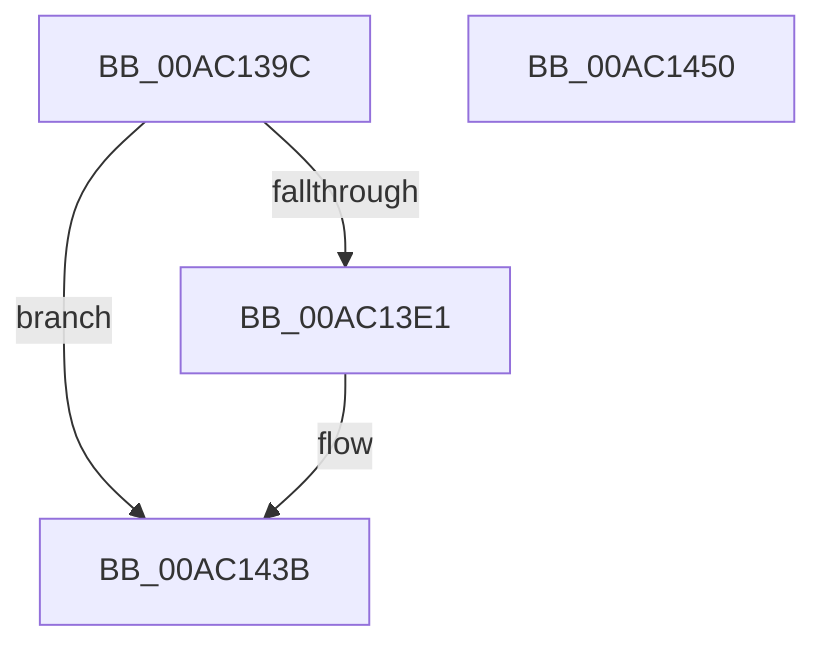

# PopDiagTracePolicyInitiatePowerActionApiCall

- RVA: `0x00AC139C`–`0x00AC1451` (길이 `181` bytes)
- VA: `0x0000000140AC139C`
- 실행 섹션: `PAGE`
- PDB 이름 있음: `예`; PDB Function 태그: `아니요`
- unwind 정보 RVA: `0x000B05B8`
- 디코드: `43`개 명령, `181/181` bytes 표시
- 미해석 바이트: `0` (있으면 어셈블리에 `.byte`로 보존)

> 이 문서는 커널 이미지의 기계어와 PDB 기호를 분석해 생성했습니다. 4번과 5번은 함수 원형과 자료형을 바이너리 사용 방식에서 추정한 C 해석이며 원본 소스 복구 결과는 아닙니다.

## 1. Dependencies

- 직접 호출 지점: **3**; 고유 호출 대상: **3**
- 직접 호출자로 확인된 함수: **1**
- RIP 상대 이미지 참조: **4**

### Outgoing calls
- `0x00AC13BF` → [PsGetCurrentThreadProcess](../../text/47/PsGetCurrentThreadProcess_function_0047C7E0.md) (function, `0x0047C7E0`)
- `0x00AC1436` → [EtwWrite](../../text/41/EtwWrite_function_0041C720.md) (function, `0x0041C720`)
- `0x00AC1442` → [_security_check_cookie](../../text/6A/_security_check_cookie_function_006AC640.md) (function, `0x006AC640`)

### Direct callers
- [NtInitiatePowerAction](../75/NtInitiatePowerAction_function_0075FCB0.md) at `0x0075FDED`

### Static image references
- `0x00AC13B1` → RVA `0x00E0A740` (`.data`; read)
- `0x00AC13D4` → RVA `0x00E67858` (`.data`; read)
- `0x00AC13FC` → RVA `0x0001E928` (`.rdata`; read)
- `0x00AC141E` → RVA `0x00F0B408` (`.data`; read)

## 2. Other-region calls and transfers

- 다른 실행 섹션으로 향하는 call: **3**
  - `0x00AC13BF` → [PsGetCurrentThreadProcess](../../text/47/PsGetCurrentThreadProcess_function_0047C7E0.md) (`PAGE` → `.text`)
  - `0x00AC1436` → [EtwWrite](../../text/41/EtwWrite_function_0041C720.md) (`PAGE` → `.text`)
  - `0x00AC1442` → [_security_check_cookie](../../text/6A/_security_check_cookie_function_006AC640.md) (`PAGE` → `.text`)
- 별도 외부 분기/꼬리 이동을 확인하지 못했습니다.

## 3. Assembly (complete function range)

```asm
00AC139C  89 54 24 10                     mov dword ptr [rsp + 0x10], edx
00AC13A0  89 4C 24 08                     mov dword ptr [rsp + 8], ecx
00AC13A4  55                              push rbp
00AC13A5  48 8D 6C 24 A9                  lea rbp, [rsp - 0x57]
00AC13AA  48 81 EC 90 00 00 00            sub rsp, 0x90
00AC13B1  48 8B 05 88 93 34 00            mov rax, qword ptr [rip + 0x349388]
00AC13B8  48 33 C4                        xor rax, rsp
00AC13BB  48 89 45 47                     mov qword ptr [rbp + 0x47], rax
00AC13BF  E8 1C B4 9B FF                  call 0x14047c7e0
00AC13C4  45 33 C0                        xor r8d, r8d
00AC13C7  48 8B 90 50 03 00 00            mov rdx, qword ptr [rax + 0x350]
00AC13CE  0F B7 02                        movzx eax, word ptr [rdx]
00AC13D1  66 D1 E8                        shr ax, 1
00AC13D4  44 38 05 7D 64 3A 00            cmp byte ptr [rip + 0x3a647d], r8b
00AC13DB  66 89 45 F7                     mov word ptr [rbp - 9], ax
00AC13DF  74 5A                           je 0x140ac143b
00AC13E1  48 C7 45 0F 02 00 00 00         mov qword ptr [rbp + 0xf], 2
00AC13E9  45 8D 48 04                     lea r9d, [r8 + 4]
00AC13ED  48 8D 45 F7                     lea rax, [rbp - 9]
00AC13F1  48 89 45 07                     mov qword ptr [rbp + 7], rax
00AC13F5  48 8B 42 08                     mov rax, qword ptr [rdx + 8]
00AC13F9  0F B7 0A                        movzx ecx, word ptr [rdx]
00AC13FC  48 8D 15 25 D5 55 FF            lea rdx, [rip - 0xaa2adb]
00AC1403  48 89 45 17                     mov qword ptr [rbp + 0x17], rax
00AC1407  48 8D 45 67                     lea rax, [rbp + 0x67]
00AC140B  48 89 45 27                     mov qword ptr [rbp + 0x27], rax
00AC140F  48 8D 45 6F                     lea rax, [rbp + 0x6f]
00AC1413  48 89 45 37                     mov qword ptr [rbp + 0x37], rax
00AC1417  48 8D 45 07                     lea rax, [rbp + 7]
00AC141B  89 4D 1F                        mov dword ptr [rbp + 0x1f], ecx
00AC141E  48 8B 0D E3 9F 44 00            mov rcx, qword ptr [rip + 0x449fe3]
00AC1425  48 89 44 24 20                  mov qword ptr [rsp + 0x20], rax
00AC142A  44 89 45 23                     mov dword ptr [rbp + 0x23], r8d
00AC142E  4C 89 4D 2F                     mov qword ptr [rbp + 0x2f], r9
00AC1432  4C 89 4D 3F                     mov qword ptr [rbp + 0x3f], r9
00AC1436  E8 E5 B2 95 FF                  call 0x14041c720
00AC143B  48 8B 4D 47                     mov rcx, qword ptr [rbp + 0x47]
00AC143F  48 33 CC                        xor rcx, rsp
00AC1442  E8 F9 B1 BE FF                  call 0x1406ac640
00AC1447  48 81 C4 90 00 00 00            add rsp, 0x90
00AC144E  5D                              pop rbp
00AC144F  C3                              ret
00AC1450  CC                              int3
```

## 4. C-style interpretation (structured pseudocode)

```c
__int64 __fastcall PopDiagTracePolicyInitiatePowerActionApiCall(int a1, int a2, int a3)
{
    __int64 result;
    __int64 v_rsp;
    unsigned __int64 v_stack_m18;
    unsigned __int64 v_stack_m20;
    unsigned __int64 v_stack_m28;
    unsigned __int64 v_stack_m30;
    unsigned __int64 v_stack_m38;
    unsigned int v_stack_m3C;
    unsigned int v_stack_m40;
    unsigned __int64 v_stack_m48;
    unsigned __int64 v_stack_m50;
    unsigned __int64 v_stack_m58;
    unsigned __int64 v_stack_m5F;
    unsigned __int16 v_stack_m68;
    unsigned __int64 v_stack_m78;
    unsigned int v_stack_p10;
    unsigned int v_stack_p8;

    v_stack_p10 = a2;
    v_stack_p8 = a1;
    v_rsp = (v_rsp) - (144);
    result = (*(unsigned __int64 *)(v_rip + 3445640)) ^ (v_rsp);
    v_stack_m18 = result;
    result = PsGetCurrentThreadProcess(a1, a2, a3, a4);
    a3 = 0;
    result = (unsigned __int16)((*(unsigned __int16 *)(*(unsigned __int64 *)(result + 848))) >> (1));
    v_stack_m68 = (unsigned __int16)(result);
    if ((*(unsigned __int8 *)(v_rip + 3826813)) != 0) {
        v_stack_m50 = 2;
        a4 = a3 + 4;
        result = v_stack_m68;
        v_stack_m58 = result;
        result = *(unsigned __int64 *)(*(unsigned __int64 *)(result + 848) + 8);
        a1 = *(unsigned __int16 *)(*(unsigned __int64 *)(result + 848));
        a2 = v_rip - 11152091;
        v_stack_m48 = result;
        result = v_stack_p8;
        v_stack_m38 = result;
        result = v_stack_p10;
        v_stack_m28 = result;
        result = v_stack_m58;
        v_stack_m40 = a1;
        a1 = *(unsigned __int64 *)(v_rip + 4497379);
        v_stack_m78 = result;
        v_stack_m3C = 0;
        v_stack_m30 = a4;
        v_stack_m20 = a4;
        result = EtwWrite(a1, a2, a3, a4);
    }
    a1 = (v_stack_m18) ^ (v_rsp);
    result = _security_check_cookie(a1, a2, a3, a4);
    v_rsp = (v_rsp) + (144);
    return result;
}
```

## 5. (Beta) C Style

```c
int64_t PopDiagTracePolicyInitiatePowerActionApiCall(int32_t Arg1, int32_t Arg2, int32_t Arg3)
{
    int64_t result;
    int64_t local_rsp;
    uint64_t v_stack_m18;
    uint64_t v_stack_m20;
    uint64_t v_stack_m28;
    uint64_t v_stack_m30;
    uint64_t v_stack_m38;
    uint32_t v_stack_m3C;
    uint32_t v_stack_m40;
    uint64_t v_stack_m48;
    uint64_t v_stack_m50;
    uint64_t v_stack_m58;
    uint64_t v_stack_m5F;
    uint16_t v_stack_m68;
    uint64_t v_stack_m78;
    uint32_t v_stack_p10;
    uint32_t v_stack_p8;

    v_stack_p10 = Arg2;
    v_stack_p8 = Arg1;
    local_rsp = (local_rsp) - (144);
    result = (*(uint64_t *)(v_rip + 0x349388)) ^ (local_rsp);
    v_stack_m18 = result;
    result = PsGetCurrentThreadProcess(Arg1, Arg2, Arg3, a4);
    Arg3 = 0;
    result = (uint16_t)((*(uint16_t *)(*(uint64_t *)(result + 0x350))) >> (1));
    v_stack_m68 = (uint16_t)(result);
    if ((*(uint8_t *)(v_rip + 0x3A647D)) != 0) {
        v_stack_m50 = 2;
        a4 = Arg3 + 4;
        result = v_stack_m68;
        v_stack_m58 = result;
        result = *(uint64_t *)(*(uint64_t *)(result + 0x350) + 0x8);
        Arg1 = *(uint16_t *)(*(uint64_t *)(result + 0x350));
        Arg2 = v_rip - 11152091;
        v_stack_m48 = result;
        result = v_stack_p8;
        v_stack_m38 = result;
        result = v_stack_p10;
        v_stack_m28 = result;
        result = v_stack_m58;
        v_stack_m40 = Arg1;
        Arg1 = *(uint64_t *)(v_rip + 0x449FE3);
        v_stack_m78 = result;
        v_stack_m3C = 0;
        v_stack_m30 = a4;
        v_stack_m20 = a4;
        result = EtwWrite(Arg1, Arg2, Arg3, a4);
    }
    Arg1 = (v_stack_m18) ^ (local_rsp);
    result = _security_check_cookie(Arg1, Arg2, Arg3, a4);
    local_rsp = (local_rsp) + (144);
    return result;
}
```

## 6. Execution-region graph

[열기: 2D/3D 그래프와 함수 탐색 컨트롤 패널](../../../control-panel.html?section=page&rva=0x00AC139C&view=graph)

- 2D 그래프는 위에서 아래로 흐르고, 3D 그래프는 빈 공간을 드래그해 회전합니다. Shift+드래그는 이동, 휠은 확대·축소, 함수 노드 선택은 대상 보고서 이동입니다.

### Static fallback


