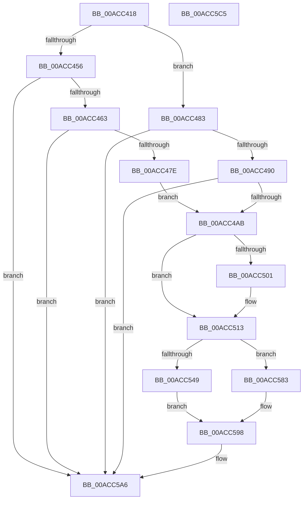

# PopDiagTraceSetThreadExecutionState

- RVA: `0x00ACC418`–`0x00ACC5C6` (길이 `430` bytes)
- VA: `0x0000000140ACC418`
- 실행 섹션: `PAGE`
- PDB 이름 있음: `예`; PDB Function 태그: `아니요`
- unwind 정보 RVA: `0x000BE550`
- 디코드: `102`개 명령, `430/430` bytes 표시
- 미해석 바이트: `0` (있으면 어셈블리에 `.byte`로 보존)

> 이 문서는 커널 이미지의 기계어와 PDB 기호를 분석해 생성했습니다. 4번과 5번은 함수 원형과 자료형을 바이너리 사용 방식에서 추정한 C 해석이며 원본 소스 복구 결과는 아닙니다.

## 1. Dependencies

- 직접 호출 지점: **6**; 고유 호출 대상: **4**
- 직접 호출자로 확인된 함수: **1**
- RIP 상대 이미지 참조: **5**

### Outgoing calls
- `0x00ACC44D` → [Feature_ExpandSTEIgnoreReasons__private_IsEnabledDeviceUsageNoInline](../../text/4F/Feature_ExpandSTEIgnoreReasons__private_IsEnabledDeviceUsageNoInline_function_004F7AE8.md) (function, `0x004F7AE8`)
- `0x00ACC471` → [EtwEventEnabled](../../text/39/EtwEventEnabled_function_00392450.md) (function, `0x00392450`)
- `0x00ACC49E` → [EtwEventEnabled](../../text/39/EtwEventEnabled_function_00392450.md) (function, `0x00392450`)
- `0x00ACC536` → [Feature_ExpandSTEIgnoreReasons__private_IsEnabledDeviceUsageNoInline](../../text/4F/Feature_ExpandSTEIgnoreReasons__private_IsEnabledDeviceUsageNoInline_function_004F7AE8.md) (function, `0x004F7AE8`)
- `0x00ACC5A1` → [EtwWrite](../../text/41/EtwWrite_function_0041C720.md) (function, `0x0041C720`)
- `0x00ACC5AD` → [_security_check_cookie](../../text/6A/_security_check_cookie_function_006AC640.md) (function, `0x006AC640`)

### Direct callers
- [NtSetThreadExecutionState](NtSetThreadExecutionState_function_00AC0A40.md) at `0x00AC0C0B`

### Static image references
- `0x00ACC434` → RVA `0x00E0A740` (`.data`; read)
- `0x00ACC456` → RVA `0x00E67858` (`.data`; read)
- `0x00ACC463` → RVA `0x00F0B408` (`.data`; read)
- `0x00ACC46A` → RVA `0x0001EC88` (`.rdata`; read)
- `0x00ACC497` → RVA `0x0001EC98` (`.rdata`; read)

## 2. Other-region calls and transfers

- 다른 실행 섹션으로 향하는 call: **6**
  - `0x00ACC44D` → [Feature_ExpandSTEIgnoreReasons__private_IsEnabledDeviceUsageNoInline](../../text/4F/Feature_ExpandSTEIgnoreReasons__private_IsEnabledDeviceUsageNoInline_function_004F7AE8.md) (`PAGE` → `.text`)
  - `0x00ACC471` → [EtwEventEnabled](../../text/39/EtwEventEnabled_function_00392450.md) (`PAGE` → `.text`)
  - `0x00ACC49E` → [EtwEventEnabled](../../text/39/EtwEventEnabled_function_00392450.md) (`PAGE` → `.text`)
  - `0x00ACC536` → [Feature_ExpandSTEIgnoreReasons__private_IsEnabledDeviceUsageNoInline](../../text/4F/Feature_ExpandSTEIgnoreReasons__private_IsEnabledDeviceUsageNoInline_function_004F7AE8.md) (`PAGE` → `.text`)
  - `0x00ACC5A1` → [EtwWrite](../../text/41/EtwWrite_function_0041C720.md) (`PAGE` → `.text`)
  - `0x00ACC5AD` → [_security_check_cookie](../../text/6A/_security_check_cookie_function_006AC640.md) (`PAGE` → `.text`)
- 별도 외부 분기/꼬리 이동을 확인하지 못했습니다.

## 3. Assembly (complete function range)

```asm
00ACC418  48 8B C4                        mov rax, rsp
00ACC41B  48 89 58 08                     mov qword ptr [rax + 8], rbx
00ACC41F  44 89 40 18                     mov dword ptr [rax + 0x18], r8d
00ACC423  89 50 10                        mov dword ptr [rax + 0x10], edx
00ACC426  55                              push rbp
00ACC427  56                              push rsi
00ACC428  57                              push rdi
00ACC429  48 8D 68 A1                     lea rbp, [rax - 0x5f]
00ACC42D  48 81 EC C0 00 00 00            sub rsp, 0xc0
00ACC434  48 8B 05 05 E3 33 00            mov rax, qword ptr [rip + 0x33e305]
00ACC43B  48 33 C4                        xor rax, rsp
00ACC43E  48 89 45 37                     mov qword ptr [rbp + 0x37], rax
00ACC442  33 F6                           xor esi, esi
00ACC444  41 8B D9                        mov ebx, r9d
00ACC447  89 75 BB                        mov dword ptr [rbp - 0x45], esi
00ACC44A  48 8B F9                        mov rdi, rcx
00ACC44D  E8 96 B6 A2 FF                  call 0x1404f7ae8
00ACC452  85 C0                           test eax, eax
00ACC454  74 2D                           je 0x140acc483
00ACC456  40 38 35 FB B3 39 00            cmp byte ptr [rip + 0x39b3fb], sil
00ACC45D  0F 84 43 01 00 00               je 0x140acc5a6
00ACC463  48 8B 0D 9E EF 43 00            mov rcx, qword ptr [rip + 0x43ef9e]
00ACC46A  48 8D 15 17 28 55 FF            lea rdx, [rip - 0xaad7e9]
00ACC471  E8 DA 5F 8C FF                  call 0x140392450
00ACC476  84 C0                           test al, al
00ACC478  0F 84 28 01 00 00               je 0x140acc5a6
00ACC47E  89 5D BB                        mov dword ptr [rbp - 0x45], ebx
00ACC481  EB 28                           jmp 0x140acc4ab
00ACC483  40 38 35 CE B3 39 00            cmp byte ptr [rip + 0x39b3ce], sil
00ACC48A  0F 84 16 01 00 00               je 0x140acc5a6
00ACC490  48 8B 0D 71 EF 43 00            mov rcx, qword ptr [rip + 0x43ef71]
00ACC497  48 8D 15 FA 27 55 FF            lea rdx, [rip - 0xaad806]
00ACC49E  E8 AD 5F 8C FF                  call 0x140392450
00ACC4A3  84 C0                           test al, al
00ACC4A5  0F 84 FB 00 00 00               je 0x140acc5a6
00ACC4AB  8B 87 08 05 00 00               mov eax, dword ptr [rdi + 0x508]
00ACC4B1  48 8D 5D E7                     lea rbx, [rbp - 0x19]
00ACC4B5  89 45 BF                        mov dword ptr [rbp - 0x41], eax
00ACC4B8  8B 87 10 05 00 00               mov eax, dword ptr [rdi + 0x510]
00ACC4BE  89 45 C3                        mov dword ptr [rbp - 0x3d], eax
00ACC4C1  48 8B 87 20 02 00 00            mov rax, qword ptr [rdi + 0x220]
00ACC4C8  48 8B 88 50 03 00 00            mov rcx, qword ptr [rax + 0x350]
00ACC4CF  0F B7 01                        movzx eax, word ptr [rcx]
00ACC4D2  66 D1 E8                        shr ax, 1
00ACC4D5  66 89 45 B7                     mov word ptr [rbp - 0x49], ax
00ACC4D9  48 8D 45 6F                     lea rax, [rbp + 0x6f]
00ACC4DD  48 89 45 C7                     mov qword ptr [rbp - 0x39], rax
00ACC4E1  48 8D 45 B7                     lea rax, [rbp - 0x49]
00ACC4E5  48 89 45 D7                     mov qword ptr [rbp - 0x29], rax
00ACC4E9  48 C7 45 CF 04 00 00 00         mov qword ptr [rbp - 0x31], 4
00ACC4F1  48 C7 45 DF 02 00 00 00         mov qword ptr [rbp - 0x21], 2
00ACC4F9  0F B7 11                        movzx edx, word ptr [rcx]
00ACC4FC  66 85 D2                        test dx, dx
00ACC4FF  74 12                           je 0x140acc513
00ACC501  48 8B 41 08                     mov rax, qword ptr [rcx + 8]
00ACC505  48 8D 5D F7                     lea rbx, [rbp - 9]
00ACC509  48 89 45 E7                     mov qword ptr [rbp - 0x19], rax
00ACC50D  89 55 EF                        mov dword ptr [rbp - 0x11], edx
00ACC510  89 75 F3                        mov dword ptr [rbp - 0xd], esi
00ACC513  48 C7 43 08 04 00 00 00         mov qword ptr [rbx + 8], 4
00ACC51B  48 8D 45 BF                     lea rax, [rbp - 0x41]
00ACC51F  48 89 03                        mov qword ptr [rbx], rax
00ACC522  48 8D 45 C3                     lea rax, [rbp - 0x3d]
00ACC526  48 89 43 10                     mov qword ptr [rbx + 0x10], rax
00ACC52A  48 C7 43 18 04 00 00 00         mov qword ptr [rbx + 0x18], 4
00ACC532  48 83 C3 20                     add rbx, 0x20
00ACC536  E8 AD B5 A2 FF                  call 0x1404f7ae8
00ACC53B  48 8B 0D C6 EE 43 00            mov rcx, qword ptr [rip + 0x43eec6]
00ACC542  45 33 C0                        xor r8d, r8d
00ACC545  85 C0                           test eax, eax
00ACC547  74 3A                           je 0x140acc583
00ACC549  48 C7 43 08 04 00 00 00         mov qword ptr [rbx + 8], 4
00ACC551  48 8D 45 77                     lea rax, [rbp + 0x77]
00ACC555  48 89 03                        mov qword ptr [rbx], rax
00ACC558  48 8D 15 29 27 55 FF            lea rdx, [rip - 0xaad8d7]
00ACC55F  48 83 C3 10                     add rbx, 0x10
00ACC563  48 8D 45 BB                     lea rax, [rbp - 0x45]
00ACC567  48 C7 43 08 04 00 00 00         mov qword ptr [rbx + 8], 4
00ACC56F  48 89 03                        mov qword ptr [rbx], rax
00ACC572  48 8D 45 C7                     lea rax, [rbp - 0x39]
00ACC576  48 2B D8                        sub rbx, rax
00ACC579  4C 8D 4B 10                     lea r9, [rbx + 0x10]
00ACC57D  49 C1 F9 04                     sar r9, 4
00ACC581  EB 15                           jmp 0x140acc598
00ACC583  48 8D 45 C7                     lea rax, [rbp - 0x39]
00ACC587  48 2B D8                        sub rbx, rax
00ACC58A  48 8D 15 07 27 55 FF            lea rdx, [rip - 0xaad8f9]
00ACC591  48 C1 FB 04                     sar rbx, 4
00ACC595  44 8B CB                        mov r9d, ebx
00ACC598  48 8D 45 C7                     lea rax, [rbp - 0x39]
00ACC59C  48 89 44 24 20                  mov qword ptr [rsp + 0x20], rax
00ACC5A1  E8 7A 01 95 FF                  call 0x14041c720
00ACC5A6  48 8B 4D 37                     mov rcx, qword ptr [rbp + 0x37]
00ACC5AA  48 33 CC                        xor rcx, rsp
00ACC5AD  E8 8E 00 BE FF                  call 0x1406ac640
00ACC5B2  48 8B 9C 24 E0 00 00 00         mov rbx, qword ptr [rsp + 0xe0]
00ACC5BA  48 81 C4 C0 00 00 00            add rsp, 0xc0
00ACC5C1  5F                              pop rdi
00ACC5C2  5E                              pop rsi
00ACC5C3  5D                              pop rbp
00ACC5C4  C3                              ret
00ACC5C5  CC                              int3
```

## 4. C-style interpretation (structured pseudocode)

```c
__int64 __fastcall PopDiagTraceSetThreadExecutionState(__int64 a1, int a2, int a3, int a4)
{
    __int64 result;
    __int64 v_rbx;
    __int64 v_rsi;
    __int64 v_rsp;
    unsigned __int64 v_stack_mB8;
    unsigned __int64 v_stack_p8;

    *(unsigned __int64 *)(v_rsp + 8) = v_rbx;
    *(unsigned int *)(v_rsp + 24) = a3;
    *(unsigned int *)(v_rsp + 16) = a2;
    v_rsp = (v_rsp) - (192);
    result = (*(unsigned __int64 *)(v_rip + 3400453)) ^ (v_rsp);
    *(unsigned __int64 *)(v_rsp - 95 + 55) = result;
    v_rsi = 0;
    *(unsigned int *)(v_rsp - 95 - 69) = 0;
    result = Feature_ExpandSTEIgnoreReasons__private_IsEnabledDeviceUsageNoInline(a1, a2, a3, a4);
    if ((unsigned int)(result) == 0) goto loc_00ACC483;
    if ((*(unsigned __int8 *)(v_rip + 3781627)) == 0) goto loc_00ACC5A6;
    result = EtwEventEnabled(*(unsigned __int64 *)(v_rip + 4452254), v_rip - 11196393, a3, a4);
    if ((unsigned __int8)(result) == 0) goto loc_00ACC5A6;
    *(unsigned int *)(v_rsp - 95 - 69) = (unsigned int)((unsigned int)(a4));
    goto loc_00ACC4AB;
loc_00ACC483:
    if ((*(unsigned __int8 *)(v_rip + 3781582)) == 0) goto loc_00ACC5A6;
    result = EtwEventEnabled(*(unsigned __int64 *)(v_rip + 4452209), v_rip - 11196422, a3, a4);
    if ((unsigned __int8)(result) == 0) goto loc_00ACC5A6;
loc_00ACC4AB:
    *(unsigned int *)(v_rsp - 95 - 65) = (unsigned int)((unsigned int)(*(unsigned int *)(a1 + 1288)));
    *(unsigned int *)(v_rsp - 95 - 61) = (unsigned int)((unsigned int)(*(unsigned int *)(a1 + 1296)));
    result = (unsigned __int16)((*(unsigned __int16 *)(*(unsigned __int64 *)(*(unsigned __int64 *)(a1 + 544) + 848))) >> (1));
    *(unsigned __int16 *)(v_rsp - 95 - 73) = (unsigned __int16)(result);
    *(unsigned __int64 *)(v_rsp - 95 - 57) = v_rsp - 95 + 111;
    *(unsigned __int64 *)(v_rsp - 95 - 41) = v_rsp - 95 - 73;
    *(unsigned __int64 *)(v_rsp - 95 - 49) = 4;
    *(unsigned __int64 *)(v_rsp - 95 - 33) = 2;
    result = v_rsp - 95 - 73;
    v_rbx = v_rsp - 95 - 25;
    if ((unsigned __int16)(*(unsigned __int16 *)(*(unsigned __int64 *)(*(unsigned __int64 *)(a1 + 544) + 848))) != 0) {
        result = *(unsigned __int64 *)(*(unsigned __int64 *)(*(unsigned __int64 *)(a1 + 544) + 848) + 8);
        v_rbx = v_rsp - 95 - 9;
        *(unsigned __int64 *)(v_rsp - 95 - 25) = result;
        *(unsigned int *)(v_rsp - 95 - 17) = (unsigned int)(*(unsigned __int16 *)(*(unsigned __int64 *)(*(unsigned __int64 *)(a1 + 544) + 848)));
        *(unsigned int *)(v_rsp - 95 - 13) = 0;
    }
    *(unsigned __int64 *)(v_rbx + 8) = 4;
    *(unsigned __int64 *)(v_rbx) = v_rsp - 95 - 65;
    *(unsigned __int64 *)(v_rbx + 16) = v_rsp - 95 - 61;
    *(unsigned __int64 *)(v_rbx + 24) = 4;
    v_rbx = (v_rbx) + (32);
    result = Feature_ExpandSTEIgnoreReasons__private_IsEnabledDeviceUsageNoInline(*(unsigned __int64 *)(*(unsigned __int64 *)(a1 + 544) + 848), *(unsigned __int16 *)(*(unsigned __int64 *)(*(unsigned __int64 *)(a1 + 544) + 848)), a3, a4);
    a3 = 0;
    if ((unsigned int)(result) == 0) goto loc_00ACC583;
    *(unsigned __int64 *)(v_rbx + 8) = 4;
    *(unsigned __int64 *)(v_rbx) = v_rsp - 95 + 119;
    v_rbx = (v_rbx) + (16);
    *(unsigned __int64 *)(v_rbx + 8) = 4;
    *(unsigned __int64 *)(v_rbx) = v_rsp - 95 - 69;
    v_rbx = (v_rbx) - (v_rsp - 95 - 57);
    a4 = (v_rbx + 16) >> (4);
    goto loc_00ACC598;
loc_00ACC583:
    v_rbx = (v_rbx) - (v_rsp - 95 - 57);
    v_rbx = (v_rbx) >> (4);
loc_00ACC598:
    v_stack_mB8 = v_rsp - 95 - 57;
    result = EtwWrite(*(unsigned __int64 *)(v_rip + 4452038), v_rip - 11196665, a3, (unsigned int)((unsigned int)(v_rbx)));
loc_00ACC5A6:
    a1 = (*(unsigned __int64 *)(v_rsp - 95 + 55)) ^ (v_rsp);
    result = _security_check_cookie(a1, v_rip - 11196665, a3, (unsigned int)((unsigned int)(v_rbx)));
    v_rsp = (v_rsp) + (192);
    return result;
}
```

## 5. (Beta) C Style

```c
int64_t PopDiagTraceSetThreadExecutionState(void *Arg1, int32_t Arg2, int32_t Arg3, int32_t Arg4)
{
    uint8_t *arg1 = (uint8_t *)Arg1;

    int64_t result;
    int64_t local_rbx;
    int64_t local_rsi;
    int64_t local_rsp;
    uint64_t v_stack_mB8;
    uint64_t v_stack_p8;

    *(uint64_t *)(local_rsp + 0x8) = local_rbx;
    *(uint32_t *)(local_rsp + 0x18) = Arg3;
    *(uint32_t *)(local_rsp + 0x10) = Arg2;
    local_rsp = (local_rsp) - (192);
    result = (*(uint64_t *)(v_rip + 0x33E305)) ^ (local_rsp);
    *(uint64_t *)(local_rsp - 0x5F + 0x37) = result;
    local_rsi = 0;
    *(uint32_t *)(local_rsp - 0x5F - 0x45) = 0;
    result = Feature_ExpandSTEIgnoreReasons__private_IsEnabledDeviceUsageNoInline(Arg1, Arg2, Arg3, Arg4);
    if ((uint32_t)(result) == 0) goto loc_00ACC483;
    if ((*(uint8_t *)(v_rip + 0x39B3FB)) == 0) goto loc_00ACC5A6;
    result = EtwEventEnabled(*(uint64_t *)(v_rip + 0x43EF9E), v_rip - 11196393, Arg3, Arg4);
    if ((uint8_t)(result) == 0) goto loc_00ACC5A6;
    *(uint32_t *)(local_rsp - 0x5F - 0x45) = (uint32_t)((uint32_t)(Arg4));
    goto loc_00ACC4AB;
loc_00ACC483:
    if ((*(uint8_t *)(v_rip + 0x39B3CE)) == 0) goto loc_00ACC5A6;
    result = EtwEventEnabled(*(uint64_t *)(v_rip + 0x43EF71), v_rip - 11196422, Arg3, Arg4);
    if ((uint8_t)(result) == 0) goto loc_00ACC5A6;
loc_00ACC4AB:
    *(uint32_t *)(local_rsp - 0x5F - 0x41) = (uint32_t)((uint32_t)(*(uint32_t *)(arg1 + 0x508)));
    *(uint32_t *)(local_rsp - 0x5F - 0x3D) = (uint32_t)((uint32_t)(*(uint32_t *)(arg1 + 0x510)));
    result = (uint16_t)((*(uint16_t *)(*(uint64_t *)(*(uint64_t *)(arg1 + 0x220) + 0x350))) >> (1));
    *(uint16_t *)(local_rsp - 0x5F - 0x49) = (uint16_t)(result);
    *(uint64_t *)(local_rsp - 0x5F - 0x39) = local_rsp - 95 + 111;
    *(uint64_t *)(local_rsp - 0x5F - 0x29) = local_rsp - 95 - 73;
    *(uint64_t *)(local_rsp - 0x5F - 0x31) = 4;
    *(uint64_t *)(local_rsp - 0x5F - 0x21) = 2;
    result = local_rsp - 95 - 73;
    local_rbx = local_rsp - 95 - 25;
    if ((uint16_t)(*(uint16_t *)(*(uint64_t *)(*(uint64_t *)(arg1 + 0x220) + 0x350))) != 0) {
        result = *(uint64_t *)(*(uint64_t *)(*(uint64_t *)(arg1 + 0x220) + 0x350) + 0x8);
        local_rbx = local_rsp - 95 - 9;
        *(uint64_t *)(local_rsp - 0x5F - 0x19) = result;
        *(uint32_t *)(local_rsp - 0x5F - 0x11) = (uint32_t)(*(uint16_t *)(*(uint64_t *)(*(uint64_t *)(arg1 + 0x220) + 0x350)));
        *(uint32_t *)(local_rsp - 0x5F - 0xD) = 0;
    }
    *(uint64_t *)(local_rbx + 0x8) = 4;
    *(uint64_t *)(local_rbx) = local_rsp - 95 - 65;
    *(uint64_t *)(local_rbx + 0x10) = local_rsp - 95 - 61;
    *(uint64_t *)(local_rbx + 0x18) = 4;
    local_rbx = (local_rbx) + (32);
    result = Feature_ExpandSTEIgnoreReasons__private_IsEnabledDeviceUsageNoInline(*(uint64_t *)(*(uint64_t *)(arg1 + 0x220) + 0x350), *(uint16_t *)(*(uint64_t *)(*(uint64_t *)(arg1 + 0x220) + 0x350)), Arg3, Arg4);
    Arg3 = 0;
    if ((uint32_t)(result) == 0) goto loc_00ACC583;
    *(uint64_t *)(local_rbx + 0x8) = 4;
    *(uint64_t *)(local_rbx) = local_rsp - 95 + 119;
    local_rbx = (local_rbx) + (16);
    *(uint64_t *)(local_rbx + 0x8) = 4;
    *(uint64_t *)(local_rbx) = local_rsp - 95 - 69;
    local_rbx = (local_rbx) - (local_rsp - 95 - 57);
    Arg4 = (local_rbx + 16) >> (4);
    goto loc_00ACC598;
loc_00ACC583:
    local_rbx = (local_rbx) - (local_rsp - 95 - 57);
    local_rbx = (local_rbx) >> (4);
loc_00ACC598:
    v_stack_mB8 = local_rsp - 95 - 57;
    result = EtwWrite(*(uint64_t *)(v_rip + 0x43EEC6), v_rip - 11196665, Arg3, (uint32_t)((uint32_t)(local_rbx)));
loc_00ACC5A6:
    Arg1 = (*(uint64_t *)(local_rsp - 0x5F + 0x37)) ^ (local_rsp);
    result = _security_check_cookie(Arg1, v_rip - 11196665, Arg3, (uint32_t)((uint32_t)(local_rbx)));
    local_rsp = (local_rsp) + (192);
    return result;
}
```

### 관측된 메모리 오프셋

구조체 형식이 확인되지 않은 접근은 인자 기준의 오프셋으로만 기록했습니다.

| 기준 인자 | 오프셋 표현 | 폭 (bit) | 접근 |
|---|---:|---:|---|
| `Arg1` | `+ 0x220` | `64` | `R` |
| `Arg1` | `+ 0x508` | `32` | `R` |
| `Arg1` | `+ 0x510` | `32` | `R` |

## 6. Execution-region graph

[열기: 2D/3D 그래프와 함수 탐색 컨트롤 패널](../../../control-panel.html?section=page&rva=0x00ACC418&view=graph)

- 2D 그래프는 위에서 아래로 흐르고, 3D 그래프는 빈 공간을 드래그해 회전합니다. Shift+드래그는 이동, 휠은 확대·축소, 함수 노드 선택은 대상 보고서 이동입니다.

### Static fallback


