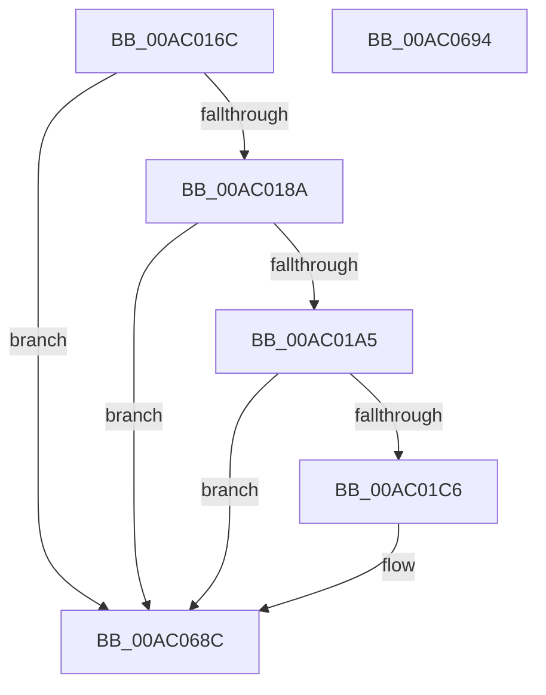

# PopDiagTraceSleepStudyStop

- RVA: `0x00AC016C`–`0x00AC0695` (길이 `1,321` bytes)
- VA: `0x0000000140AC016C`
- 실행 섹션: `PAGE`
- PDB 이름 있음: `예`; PDB Function 태그: `아니요`
- unwind 정보 RVA: `0x000BD874`
- 디코드: `210`개 명령, `1,321/1,321` bytes 표시
- 미해석 바이트: `0` (있으면 어셈블리에 `.byte`로 보존)

> 이 문서는 커널 이미지의 기계어와 PDB 기호를 분석해 생성했습니다. 4번과 5번은 함수 원형과 자료형을 바이너리 사용 방식에서 추정한 C 해석이며 원본 소스 복구 결과는 아닙니다.

## 1. Dependencies

- 직접 호출 지점: **4**; 고유 호출 대상: **4**
- 직접 호출자로 확인된 함수: **1**
- RIP 상대 이미지 참조: **43**

### Outgoing calls
- `0x00AC0198` → [EtwEventEnabled](../../text/39/EtwEventEnabled_function_00392450.md) (function, `0x00392450`)
- `0x00AC01B5` → [ExAllocatePool2](../../poolcode/B8/ExAllocatePool2_function_00B820F0.md) (function, `0x00B820F0`)
- `0x00AC067A` → [EtwWrite](../../text/41/EtwWrite_function_0041C720.md) (function, `0x0041C720`)
- `0x00AC0687` → [ExFreePoolWithTag](../../poolcode/B8/ExFreePoolWithTag_function_00B82870.md) (function, `0x00B82870`)

### Direct callers
- [PopSleepstudyScenarioStopWorker](PopSleepstudyScenarioStopWorker_function_00AC0100.md) at `0x00AC0134`

### Static image references
- `0x00AC017D` → RVA `0x00E67859` (`.data`; read)
- `0x00AC018A` → RVA `0x00F0B6B8` (`.data`; read)
- `0x00AC0191` → RVA `0x00029858` (`.rdata`; read)
- `0x00AC01C6` → RVA `0x00F0B589` (`.data`; read)
- `0x00AC01D0` → RVA `0x00F0B588` (`.data`; read)
- `0x00AC0214` → RVA `0x00F0B5E1` (`.data`; read)
- `0x00AC021E` → RVA `0x00F0B5E0` (`.data`; read)
- `0x00AC0228` → RVA `0x00F0B5B8` (`.data`; read)
- `0x00AC0232` → RVA `0x00F0B538` (`.data`; read)
- `0x00AC023B` → RVA `0x00F0B500` (`.data`; read)
- `0x00AC0248` → RVA `0x00F0B528` (`.data`; read)
- `0x00AC026B` → RVA `0x00F0B590` (`.data`; read)
- `0x00AC027E` → RVA `0x00F0B598` (`.data`; read)
- `0x00AC0291` → RVA `0x00F0B5A0` (`.data`; read)
- `0x00AC02A4` → RVA `0x00F0B520` (`.data`; read)
- `0x00AC02B7` → RVA `0x00F0B51C` (`.data`; read)
- `0x00AC02CA` → RVA `0x00F0B560` (`.data`; read)
- `0x00AC02F6` → RVA `0x00F0B518` (`.data`; read)
- `0x00AC030B` → RVA `0x00F0B558` (`.data`; read)
- `0x00AC0324` → RVA `0x00F0B584` (`.data`; read)
- `0x00AC037F` → RVA `0x00F0B568` (`.data`; read)
- `0x00AC0398` → RVA `0x00F0B5B0` (`.data`; read)
- `0x00AC03B1` → RVA `0x00F0B5B4` (`.data`; read)
- `0x00AC03CA` → RVA `0x00F0B5BC` (`.data`; read)
- `0x00AC03E3` → RVA `0x00F0B5C8` (`.data`; read)
- `0x00AC03FC` → RVA `0x00F0B5CC` (`.data`; read)
- `0x00AC0415` → RVA `0x00F0B508` (`.data`; read)
- `0x00AC042E` → RVA `0x00F0B510` (`.data`; read)
- `0x00AC0447` → RVA `0x00F0B5DC` (`.data`; read)
- `0x00AC0476` → RVA `0x00F0B5E4` (`.data`; read)
- `0x00AC048F` → RVA `0x00F0B5E8` (`.data`; read)
- `0x00AC04EA` → RVA `0x00F0B5C0` (`.data`; read)
- `0x00AC0503` → RVA `0x00F0B5C4` (`.data`; read)
- `0x00AC0574` → RVA `0x00F0B578` (`.data`; read)
- `0x00AC058D` → RVA `0x00F0B570` (`.data`; read)
- `0x00AC05A6` → RVA `0x00F0B65C` (`.data`; read)
- `0x00AC05BF` → RVA `0x00F0B684` (`.data`; read)
- `0x00AC05D8` → RVA `0x00F0B688` (`.data`; read)
- `0x00AC0603` → RVA `0x00F0B690` (`.data`; read)
- `0x00AC0620` → RVA `0x00F0B698` (`.data`; read)
- `0x00AC062E` → RVA `0x00E67870` (`.data`; read)
- `0x00AC0640` → RVA `0x00F0B6A0` (`.data`; read)
- `0x00AC0655` → RVA `0x00F0B6A8` (`.data`; read)

## 2. Other-region calls and transfers

- 다른 실행 섹션으로 향하는 call: **4**
  - `0x00AC0198` → [EtwEventEnabled](../../text/39/EtwEventEnabled_function_00392450.md) (`PAGE` → `.text`)
  - `0x00AC01B5` → [ExAllocatePool2](../../poolcode/B8/ExAllocatePool2_function_00B820F0.md) (`PAGE` → `POOLCODE`)
  - `0x00AC067A` → [EtwWrite](../../text/41/EtwWrite_function_0041C720.md) (`PAGE` → `.text`)
  - `0x00AC0687` → [ExFreePoolWithTag](../../poolcode/B8/ExFreePoolWithTag_function_00B82870.md) (`PAGE` → `POOLCODE`)
- 별도 외부 분기/꼬리 이동을 확인하지 못했습니다.

## 3. Assembly (complete function range)

```asm
00AC016C  48 89 4C 24 08                  mov qword ptr [rsp + 8], rcx
00AC0171  55                              push rbp
00AC0172  53                              push rbx
00AC0173  57                              push rdi
00AC0174  48 8B EC                        mov rbp, rsp
00AC0177  48 83 EC 60                     sub rsp, 0x60
00AC017B  33 FF                           xor edi, edi
00AC017D  40 38 3D D5 76 3A 00            cmp byte ptr [rip + 0x3a76d5], dil
00AC0184  0F 84 02 05 00 00               je 0x140ac068c
00AC018A  48 8B 0D 27 B5 44 00            mov rcx, qword ptr [rip + 0x44b527]
00AC0191  48 8D 15 C0 96 56 FF            lea rdx, [rip - 0xa96940]
00AC0198  E8 B3 22 8D FF                  call 0x140392450
00AC019D  84 C0                           test al, al
00AC019F  0F 84 E7 04 00 00               je 0x140ac068c
00AC01A5  BA E0 02 00 00                  mov edx, 0x2e0
00AC01AA  B9 00 01 00 00                  mov ecx, 0x100
00AC01AF  41 B8 54 56 45 50               mov r8d, 0x50455654
00AC01B5  E8 36 1F 0C 00                  call 0x140b820f0
00AC01BA  48 8B D8                        mov rbx, rax
00AC01BD  48 85 C0                        test rax, rax
00AC01C0  0F 84 C6 04 00 00               je 0x140ac068c
00AC01C6  0F B6 0D BC B3 44 00            movzx ecx, byte ptr [rip + 0x44b3bc]
00AC01CD  8D 57 01                        lea edx, [rdi + 1]
00AC01D0  0F B6 05 B1 B3 44 00            movzx eax, byte ptr [rip + 0x44b3b1]
00AC01D7  23 C2                           and eax, edx
00AC01D9  40 88 7D 28                     mov byte ptr [rbp + 0x28], dil
00AC01DD  89 45 30                        mov dword ptr [rbp + 0x30], eax
00AC01E0  8B C1                           mov eax, ecx
00AC01E2  23 C2                           and eax, edx
00AC01E4  89 45 D0                        mov dword ptr [rbp - 0x30], eax
00AC01E7  8B C1                           mov eax, ecx
00AC01E9  D1 E8                           shr eax, 1
00AC01EB  23 C2                           and eax, edx
00AC01ED  89 45 38                        mov dword ptr [rbp + 0x38], eax
00AC01F0  8B C1                           mov eax, ecx
00AC01F2  C1 E8 04                        shr eax, 4
00AC01F5  23 C2                           and eax, edx
00AC01F7  89 45 F0                        mov dword ptr [rbp - 0x10], eax
00AC01FA  8B C1                           mov eax, ecx
00AC01FC  C1 E8 03                        shr eax, 3
00AC01FF  23 C2                           and eax, edx
00AC0201  89 45 EC                        mov dword ptr [rbp - 0x14], eax
00AC0204  8B C1                           mov eax, ecx
00AC0206  C1 E8 05                        shr eax, 5
00AC0209  83 E0 03                        and eax, 3
00AC020C  C1 E9 02                        shr ecx, 2
00AC020F  89 45 E8                        mov dword ptr [rbp - 0x18], eax
00AC0212  23 CA                           and ecx, edx
00AC0214  0F B6 05 C6 B3 44 00            movzx eax, byte ptr [rip + 0x44b3c6]
00AC021B  89 45 E0                        mov dword ptr [rbp - 0x20], eax
00AC021E  0F B6 05 BB B3 44 00            movzx eax, byte ptr [rip + 0x44b3bb]
00AC0225  89 45 D8                        mov dword ptr [rbp - 0x28], eax
00AC0228  0F B6 05 89 B3 44 00            movzx eax, byte ptr [rip + 0x44b389]
00AC022F  89 45 DC                        mov dword ptr [rbp - 0x24], eax
00AC0232  8B 05 00 B3 44 00               mov eax, dword ptr [rip + 0x44b300]
00AC0238  89 45 E4                        mov dword ptr [rbp - 0x1c], eax
00AC023B  48 8D 05 BE B2 44 00            lea rax, [rip + 0x44b2be]
00AC0242  89 4D D4                        mov dword ptr [rbp - 0x2c], ecx
00AC0245  48 89 03                        mov qword ptr [rbx], rax
00AC0248  48 8D 05 D9 B2 44 00            lea rax, [rip + 0x44b2d9]
00AC024F  48 C7 43 08 04 00 00 00         mov qword ptr [rbx + 8], 4
00AC0257  48 89 43 10                     mov qword ptr [rbx + 0x10], rax
00AC025B  48 8D 45 30                     lea rax, [rbp + 0x30]
00AC025F  48 C7 43 18 08 00 00 00         mov qword ptr [rbx + 0x18], 8
00AC0267  48 89 43 20                     mov qword ptr [rbx + 0x20], rax
00AC026B  48 8D 05 1E B3 44 00            lea rax, [rip + 0x44b31e]
00AC0272  48 C7 43 28 04 00 00 00         mov qword ptr [rbx + 0x28], 4
00AC027A  48 89 43 30                     mov qword ptr [rbx + 0x30], rax
00AC027E  48 8D 05 13 B3 44 00            lea rax, [rip + 0x44b313]
00AC0285  48 C7 43 38 08 00 00 00         mov qword ptr [rbx + 0x38], 8
00AC028D  48 89 43 40                     mov qword ptr [rbx + 0x40], rax
00AC0291  48 8D 05 08 B3 44 00            lea rax, [rip + 0x44b308]
00AC0298  48 C7 43 48 08 00 00 00         mov qword ptr [rbx + 0x48], 8
00AC02A0  48 89 43 50                     mov qword ptr [rbx + 0x50], rax
00AC02A4  48 8D 05 75 B2 44 00            lea rax, [rip + 0x44b275]
00AC02AB  48 C7 43 58 08 00 00 00         mov qword ptr [rbx + 0x58], 8
00AC02B3  48 89 43 60                     mov qword ptr [rbx + 0x60], rax
00AC02B7  48 8D 05 5E B2 44 00            lea rax, [rip + 0x44b25e]
00AC02BE  48 C7 43 68 08 00 00 00         mov qword ptr [rbx + 0x68], 8
00AC02C6  48 89 43 70                     mov qword ptr [rbx + 0x70], rax
00AC02CA  48 8D 05 8F B2 44 00            lea rax, [rip + 0x44b28f]
00AC02D1  48 C7 43 78 04 00 00 00         mov qword ptr [rbx + 0x78], 4
00AC02D9  48 89 83 80 00 00 00            mov qword ptr [rbx + 0x80], rax
00AC02E0  48 8D 45 28                     lea rax, [rbp + 0x28]
00AC02E4  48 C7 83 88 00 00 00 08 00 00 00  mov qword ptr [rbx + 0x88], 8
00AC02EF  48 89 83 90 00 00 00            mov qword ptr [rbx + 0x90], rax
00AC02F6  48 8D 05 1B B2 44 00            lea rax, [rip + 0x44b21b]
00AC02FD  48 89 93 98 00 00 00            mov qword ptr [rbx + 0x98], rdx
00AC0304  48 89 83 A0 00 00 00            mov qword ptr [rbx + 0xa0], rax
00AC030B  48 8D 05 46 B2 44 00            lea rax, [rip + 0x44b246]
00AC0312  48 C7 83 A8 00 00 00 04 00 00 00  mov qword ptr [rbx + 0xa8], 4
00AC031D  48 89 83 B0 00 00 00            mov qword ptr [rbx + 0xb0], rax
00AC0324  48 8D 05 59 B2 44 00            lea rax, [rip + 0x44b259]
00AC032B  48 C7 83 B8 00 00 00 08 00 00 00  mov qword ptr [rbx + 0xb8], 8
00AC0336  48 89 83 C0 00 00 00            mov qword ptr [rbx + 0xc0], rax
00AC033D  48 8D 45 38                     lea rax, [rbp + 0x38]
00AC0341  48 C7 83 C8 00 00 00 04 00 00 00  mov qword ptr [rbx + 0xc8], 4
00AC034C  48 89 83 D0 00 00 00            mov qword ptr [rbx + 0xd0], rax
00AC0353  48 8D 45 D0                     lea rax, [rbp - 0x30]
00AC0357  48 C7 83 D8 00 00 00 04 00 00 00  mov qword ptr [rbx + 0xd8], 4
00AC0362  48 89 83 E0 00 00 00            mov qword ptr [rbx + 0xe0], rax
00AC0369  48 C7 83 E8 00 00 00 04 00 00 00  mov qword ptr [rbx + 0xe8], 4
00AC0374  48 C7 83 F8 00 00 00 08 00 00 00  mov qword ptr [rbx + 0xf8], 8
00AC037F  48 8D 05 E2 B1 44 00            lea rax, [rip + 0x44b1e2]
00AC0386  48 89 83 F0 00 00 00            mov qword ptr [rbx + 0xf0], rax
00AC038D  48 8D 45 D4                     lea rax, [rbp - 0x2c]
00AC0391  48 89 83 00 01 00 00            mov qword ptr [rbx + 0x100], rax
00AC0398  48 8D 05 11 B2 44 00            lea rax, [rip + 0x44b211]
00AC039F  48 C7 83 08 01 00 00 04 00 00 00  mov qword ptr [rbx + 0x108], 4
00AC03AA  48 89 83 10 01 00 00            mov qword ptr [rbx + 0x110], rax
00AC03B1  48 8D 05 FC B1 44 00            lea rax, [rip + 0x44b1fc]
00AC03B8  48 C7 83 18 01 00 00 04 00 00 00  mov qword ptr [rbx + 0x118], 4
00AC03C3  48 89 83 20 01 00 00            mov qword ptr [rbx + 0x120], rax
00AC03CA  48 8D 05 EB B1 44 00            lea rax, [rip + 0x44b1eb]
00AC03D1  48 C7 83 28 01 00 00 04 00 00 00  mov qword ptr [rbx + 0x128], 4
00AC03DC  48 89 83 30 01 00 00            mov qword ptr [rbx + 0x130], rax
00AC03E3  48 8D 05 DE B1 44 00            lea rax, [rip + 0x44b1de]
00AC03EA  48 C7 83 38 01 00 00 04 00 00 00  mov qword ptr [rbx + 0x138], 4
00AC03F5  48 89 83 40 01 00 00            mov qword ptr [rbx + 0x140], rax
00AC03FC  48 8D 05 C9 B1 44 00            lea rax, [rip + 0x44b1c9]
00AC0403  48 C7 83 48 01 00 00 04 00 00 00  mov qword ptr [rbx + 0x148], 4
00AC040E  48 89 83 50 01 00 00            mov qword ptr [rbx + 0x150], rax
00AC0415  48 8D 05 EC B0 44 00            lea rax, [rip + 0x44b0ec]
00AC041C  48 C7 83 58 01 00 00 04 00 00 00  mov qword ptr [rbx + 0x158], 4
00AC0427  48 89 83 60 01 00 00            mov qword ptr [rbx + 0x160], rax
00AC042E  48 8D 05 DB B0 44 00            lea rax, [rip + 0x44b0db]
00AC0435  48 C7 83 68 01 00 00 04 00 00 00  mov qword ptr [rbx + 0x168], 4
00AC0440  48 89 83 70 01 00 00            mov qword ptr [rbx + 0x170], rax
00AC0447  48 8D 05 8E B1 44 00            lea rax, [rip + 0x44b18e]
00AC044E  48 C7 83 78 01 00 00 08 00 00 00  mov qword ptr [rbx + 0x178], 8
00AC0459  48 89 83 80 01 00 00            mov qword ptr [rbx + 0x180], rax
00AC0460  48 8D 45 D8                     lea rax, [rbp - 0x28]
00AC0464  48 C7 83 88 01 00 00 04 00 00 00  mov qword ptr [rbx + 0x188], 4
00AC046F  48 89 83 90 01 00 00            mov qword ptr [rbx + 0x190], rax
00AC0476  48 8D 05 67 B1 44 00            lea rax, [rip + 0x44b167]
00AC047D  48 C7 83 98 01 00 00 04 00 00 00  mov qword ptr [rbx + 0x198], 4
00AC0488  48 89 83 A0 01 00 00            mov qword ptr [rbx + 0x1a0], rax
00AC048F  48 8D 05 52 B1 44 00            lea rax, [rip + 0x44b152]
00AC0496  48 C7 83 A8 01 00 00 04 00 00 00  mov qword ptr [rbx + 0x1a8], 4
00AC04A1  48 89 83 B0 01 00 00            mov qword ptr [rbx + 0x1b0], rax
00AC04A8  48 8D 45 DC                     lea rax, [rbp - 0x24]
00AC04AC  48 C7 83 B8 01 00 00 04 00 00 00  mov qword ptr [rbx + 0x1b8], 4
00AC04B7  48 89 83 C0 01 00 00            mov qword ptr [rbx + 0x1c0], rax
00AC04BE  48 8D 45 E0                     lea rax, [rbp - 0x20]
00AC04C2  48 C7 83 C8 01 00 00 04 00 00 00  mov qword ptr [rbx + 0x1c8], 4
00AC04CD  48 89 83 D0 01 00 00            mov qword ptr [rbx + 0x1d0], rax
00AC04D4  48 8D 45 20                     lea rax, [rbp + 0x20]
00AC04D8  48 C7 83 D8 01 00 00 04 00 00 00  mov qword ptr [rbx + 0x1d8], 4
00AC04E3  48 89 83 E0 01 00 00            mov qword ptr [rbx + 0x1e0], rax
00AC04EA  48 8D 05 CF B0 44 00            lea rax, [rip + 0x44b0cf]
00AC04F1  48 C7 83 E8 01 00 00 08 00 00 00  mov qword ptr [rbx + 0x1e8], 8
00AC04FC  48 89 83 F0 01 00 00            mov qword ptr [rbx + 0x1f0], rax
00AC0503  48 8D 05 BA B0 44 00            lea rax, [rip + 0x44b0ba]
00AC050A  48 C7 83 F8 01 00 00 04 00 00 00  mov qword ptr [rbx + 0x1f8], 4
00AC0515  48 89 83 00 02 00 00            mov qword ptr [rbx + 0x200], rax
00AC051C  48 8D 45 E4                     lea rax, [rbp - 0x1c]
00AC0520  48 C7 83 08 02 00 00 04 00 00 00  mov qword ptr [rbx + 0x208], 4
00AC052B  48 89 83 10 02 00 00            mov qword ptr [rbx + 0x210], rax
00AC0532  48 8D 45 E8                     lea rax, [rbp - 0x18]
00AC0536  48 C7 83 18 02 00 00 04 00 00 00  mov qword ptr [rbx + 0x218], 4
00AC0541  48 89 83 20 02 00 00            mov qword ptr [rbx + 0x220], rax
00AC0548  48 8D 45 EC                     lea rax, [rbp - 0x14]
00AC054C  48 C7 83 28 02 00 00 04 00 00 00  mov qword ptr [rbx + 0x228], 4
00AC0557  48 89 83 30 02 00 00            mov qword ptr [rbx + 0x230], rax
00AC055E  48 8D 45 F0                     lea rax, [rbp - 0x10]
00AC0562  48 C7 83 38 02 00 00 04 00 00 00  mov qword ptr [rbx + 0x238], 4
00AC056D  48 89 83 40 02 00 00            mov qword ptr [rbx + 0x240], rax
00AC0574  48 8D 05 FD AF 44 00            lea rax, [rip + 0x44affd]
00AC057B  48 C7 83 48 02 00 00 04 00 00 00  mov qword ptr [rbx + 0x248], 4
00AC0586  48 89 83 50 02 00 00            mov qword ptr [rbx + 0x250], rax
00AC058D  48 8D 05 DC AF 44 00            lea rax, [rip + 0x44afdc]
00AC0594  48 C7 83 58 02 00 00 04 00 00 00  mov qword ptr [rbx + 0x258], 4
00AC059F  48 89 83 60 02 00 00            mov qword ptr [rbx + 0x260], rax
00AC05A6  48 8D 05 AF B0 44 00            lea rax, [rip + 0x44b0af]
00AC05AD  48 C7 83 68 02 00 00 08 00 00 00  mov qword ptr [rbx + 0x268], 8
00AC05B8  48 89 83 70 02 00 00            mov qword ptr [rbx + 0x270], rax
00AC05BF  48 8D 05 BE B0 44 00            lea rax, [rip + 0x44b0be]
00AC05C6  48 C7 83 78 02 00 00 04 00 00 00  mov qword ptr [rbx + 0x278], 4
00AC05D1  48 89 83 80 02 00 00            mov qword ptr [rbx + 0x280], rax
00AC05D8  48 8D 05 A9 B0 44 00            lea rax, [rip + 0x44b0a9]
00AC05DF  48 89 93 88 02 00 00            mov qword ptr [rbx + 0x288], rdx
00AC05E6  48 89 83 90 02 00 00            mov qword ptr [rbx + 0x290], rax
00AC05ED  48 C7 83 98 02 00 00 08 00 00 00  mov qword ptr [rbx + 0x298], 8
00AC05F8  48 C7 83 A8 02 00 00 08 00 00 00  mov qword ptr [rbx + 0x2a8], 8
00AC0603  48 8D 05 86 B0 44 00            lea rax, [rip + 0x44b086]
00AC060A  48 89 83 A0 02 00 00            mov qword ptr [rbx + 0x2a0], rax
00AC0611  44 8D 4F 2E                     lea r9d, [rdi + 0x2e]
00AC0615  48 C7 83 B8 02 00 00 08 00 00 00  mov qword ptr [rbx + 0x2b8], 8
00AC0620  48 8D 05 71 B0 44 00            lea rax, [rip + 0x44b071]
00AC0627  48 89 83 B0 02 00 00            mov qword ptr [rbx + 0x2b0], rax
00AC062E  4C 8D 05 3B 72 3A 00            lea r8, [rip + 0x3a723b]
00AC0635  48 C7 83 C8 02 00 00 08 00 00 00  mov qword ptr [rbx + 0x2c8], 8
00AC0640  48 8D 05 59 B0 44 00            lea rax, [rip + 0x44b059]
00AC0647  48 89 83 C0 02 00 00            mov qword ptr [rbx + 0x2c0], rax
00AC064E  48 8D 15 03 92 56 FF            lea rdx, [rip - 0xa96dfd]
00AC0655  48 8D 05 4C B0 44 00            lea rax, [rip + 0x44b04c]
00AC065C  48 C7 83 D8 02 00 00 08 00 00 00  mov qword ptr [rbx + 0x2d8], 8
00AC0667  48 89 83 D0 02 00 00            mov qword ptr [rbx + 0x2d0], rax
00AC066E  48 8B 0D 43 B0 44 00            mov rcx, qword ptr [rip + 0x44b043]
00AC0675  48 89 5C 24 20                  mov qword ptr [rsp + 0x20], rbx
00AC067A  E8 A1 C0 95 FF                  call 0x14041c720
00AC067F  BA 54 56 45 50                  mov edx, 0x50455654
00AC0684  48 8B CB                        mov rcx, rbx
00AC0687  E8 E4 21 0C 00                  call 0x140b82870
00AC068C  48 83 C4 60                     add rsp, 0x60
00AC0690  5F                              pop rdi
00AC0691  5B                              pop rbx
00AC0692  5D                              pop rbp
00AC0693  C3                              ret
00AC0694  CC                              int3
```

## 4. C-style interpretation (structured pseudocode)

```c
__int64 __fastcall PopDiagTraceSleepStudyStop(__int64 a1)
{
    __int64 result;
    __int64 v_rdi;
    __int64 v_rsp;
    unsigned int v_stack_m28;
    unsigned int v_stack_m2C;
    unsigned int v_stack_m30;
    unsigned int v_stack_m34;
    unsigned int v_stack_m38;
    unsigned int v_stack_m3C;
    unsigned int v_stack_m40;
    unsigned int v_stack_m44;
    unsigned int v_stack_m48;
    unsigned __int64 v_stack_m58;
    unsigned __int8 v_stack_p10;
    unsigned int v_stack_p18;
    unsigned int v_stack_p20;
    unsigned __int64 v_stack_p8;

    v_stack_p8 = a1;
    v_rsp = (v_rsp) - (96);
    v_rdi = 0;
    if ((*(unsigned __int8 *)(v_rip + 3831509)) == 0) goto loc_00AC068C;
    result = EtwEventEnabled(*(unsigned __int64 *)(v_rip + 4502823), v_rip - 11102528, a3, a4);
    if ((unsigned __int8)(result) == 0) goto loc_00AC068C;
    result = ExAllocatePool2(256, 736, (unsigned int)(0x50455654ULL), a4);
    if (result != 0) {
        a1 = *(unsigned __int8 *)(v_rip + 4502460);
        a2 = v_rdi + 1;
        result = *(unsigned __int8 *)(v_rip + 4502449);
        result = (unsigned int)((result) & ((unsigned int)(a2)));
        v_stack_p10 = 0;
        v_stack_p18 = (unsigned int)(result);
        result = (unsigned int)(a1);
        result = (unsigned int)((result) & ((unsigned int)(a2)));
        v_stack_m48 = (unsigned int)(result);
        result = (unsigned int)(a1);
        result = (unsigned int)((result) >> (1));
        result = (unsigned int)((result) & ((unsigned int)(a2)));
        v_stack_p20 = (unsigned int)(result);
        result = (unsigned int)(a1);
        result = (unsigned int)((result) >> (4));
        result = (unsigned int)((result) & ((unsigned int)(a2)));
        v_stack_m28 = (unsigned int)(result);
        result = (unsigned int)(a1);
        result = (unsigned int)((result) >> (3));
        result = (unsigned int)((result) & ((unsigned int)(a2)));
        v_stack_m2C = (unsigned int)(result);
        result = (unsigned int)(a1);
        result = (unsigned int)((result) >> (5));
        result = (unsigned int)((result) & (3));
        a1 = (unsigned int)((a1) >> (2));
        v_stack_m30 = (unsigned int)(result);
        a1 = (unsigned int)((a1) & ((unsigned int)(a2)));
        result = *(unsigned __int8 *)(v_rip + 4502470);
        v_stack_m38 = (unsigned int)(result);
        result = *(unsigned __int8 *)(v_rip + 4502459);
        v_stack_m40 = (unsigned int)(result);
        result = *(unsigned __int8 *)(v_rip + 4502409);
        v_stack_m3C = (unsigned int)(result);
        result = *(unsigned int *)(v_rip + 4502272);
        v_stack_m34 = (unsigned int)(result);
        result = v_rip + 4502206;
        v_stack_m44 = (unsigned int)(a1);
        *(unsigned __int64 *)(result) = result;
        result = v_rip + 4502233;
        *(unsigned __int64 *)(result + 8) = 4;
        *(unsigned __int64 *)(result + 16) = result;
        result = v_stack_p18;
        *(unsigned __int64 *)(result + 24) = 8;
        *(unsigned __int64 *)(result + 32) = result;
        result = v_rip + 4502302;
        *(unsigned __int64 *)(result + 40) = 4;
        *(unsigned __int64 *)(result + 48) = result;
        result = v_rip + 4502291;
        *(unsigned __int64 *)(result + 56) = 8;
        *(unsigned __int64 *)(result + 64) = result;
        result = v_rip + 4502280;
        *(unsigned __int64 *)(result + 72) = 8;
        *(unsigned __int64 *)(result + 80) = result;
        result = v_rip + 4502133;
        *(unsigned __int64 *)(result + 88) = 8;
        *(unsigned __int64 *)(result + 96) = result;
        result = v_rip + 4502110;
        *(unsigned __int64 *)(result + 104) = 8;
        *(unsigned __int64 *)(result + 112) = result;
        result = v_rip + 4502159;
        *(unsigned __int64 *)(result + 120) = 4;
        *(unsigned __int64 *)(result + 128) = result;
        result = v_stack_p10;
        *(unsigned __int64 *)(result + 136) = 8;
        *(unsigned __int64 *)(result + 144) = result;
        result = v_rip + 4502043;
        *(unsigned __int64 *)(result + 152) = a2;
        *(unsigned __int64 *)(result + 160) = result;
        result = v_rip + 4502086;
        *(unsigned __int64 *)(result + 168) = 4;
        *(unsigned __int64 *)(result + 176) = result;
        result = v_rip + 4502105;
        *(unsigned __int64 *)(result + 184) = 8;
        *(unsigned __int64 *)(result + 192) = result;
        result = v_stack_p20;
        *(unsigned __int64 *)(result + 200) = 4;
        *(unsigned __int64 *)(result + 208) = result;
        result = v_stack_m48;
        *(unsigned __int64 *)(result + 216) = 4;
        *(unsigned __int64 *)(result + 224) = result;
        *(unsigned __int64 *)(result + 232) = 4;
        *(unsigned __int64 *)(result + 248) = 8;
        result = v_rip + 4501986;
        *(unsigned __int64 *)(result + 240) = result;
        result = v_stack_m44;
        *(unsigned __int64 *)(result + 256) = result;
        result = v_rip + 4502033;
        *(unsigned __int64 *)(result + 264) = 4;
        *(unsigned __int64 *)(result + 272) = result;
        result = v_rip + 4502012;
        *(unsigned __int64 *)(result + 280) = 4;
        *(unsigned __int64 *)(result + 288) = result;
        result = v_rip + 4501995;
        *(unsigned __int64 *)(result + 296) = 4;
        *(unsigned __int64 *)(result + 304) = result;
        result = v_rip + 4501982;
        *(unsigned __int64 *)(result + 312) = 4;
        *(unsigned __int64 *)(result + 320) = result;
        result = v_rip + 4501961;
        *(unsigned __int64 *)(result + 328) = 4;
        *(unsigned __int64 *)(result + 336) = result;
        result = v_rip + 4501740;
        *(unsigned __int64 *)(result + 344) = 4;
        *(unsigned __int64 *)(result + 352) = result;
        result = v_rip + 4501723;
        *(unsigned __int64 *)(result + 360) = 4;
        *(unsigned __int64 *)(result + 368) = result;
        result = v_rip + 4501902;
        *(unsigned __int64 *)(result + 376) = 8;
        *(unsigned __int64 *)(result + 384) = result;
        result = v_stack_m40;
        *(unsigned __int64 *)(result + 392) = 4;
        *(unsigned __int64 *)(result + 400) = result;
        result = v_rip + 4501863;
        *(unsigned __int64 *)(result + 408) = 4;
        *(unsigned __int64 *)(result + 416) = result;
        result = v_rip + 4501842;
        *(unsigned __int64 *)(result + 424) = 4;
        *(unsigned __int64 *)(result + 432) = result;
        result = v_stack_m3C;
        *(unsigned __int64 *)(result + 440) = 4;
        *(unsigned __int64 *)(result + 448) = result;
        result = v_stack_m38;
        *(unsigned __int64 *)(result + 456) = 4;
        *(unsigned __int64 *)(result + 464) = result;
        result = v_stack_p8;
        *(unsigned __int64 *)(result + 472) = 4;
        *(unsigned __int64 *)(result + 480) = result;
        result = v_rip + 4501711;
        *(unsigned __int64 *)(result + 488) = 8;
        *(unsigned __int64 *)(result + 496) = result;
        result = v_rip + 4501690;
        *(unsigned __int64 *)(result + 504) = 4;
        *(unsigned __int64 *)(result + 512) = result;
        result = v_stack_m34;
        *(unsigned __int64 *)(result + 520) = 4;
        *(unsigned __int64 *)(result + 528) = result;
        result = v_stack_m30;
        *(unsigned __int64 *)(result + 536) = 4;
        *(unsigned __int64 *)(result + 544) = result;
        result = v_stack_m2C;
        *(unsigned __int64 *)(result + 552) = 4;
        *(unsigned __int64 *)(result + 560) = result;
        result = v_stack_m28;
        *(unsigned __int64 *)(result + 568) = 4;
        *(unsigned __int64 *)(result + 576) = result;
        result = v_rip + 4501501;
        *(unsigned __int64 *)(result + 584) = 4;
        *(unsigned __int64 *)(result + 592) = result;
        result = v_rip + 4501468;
        *(unsigned __int64 *)(result + 600) = 4;
        *(unsigned __int64 *)(result + 608) = result;
        result = v_rip + 4501679;
        *(unsigned __int64 *)(result + 616) = 8;
        *(unsigned __int64 *)(result + 624) = result;
        result = v_rip + 4501694;
        *(unsigned __int64 *)(result + 632) = 4;
        *(unsigned __int64 *)(result + 640) = result;
        result = v_rip + 4501673;
        *(unsigned __int64 *)(result + 648) = a2;
        *(unsigned __int64 *)(result + 656) = result;
        *(unsigned __int64 *)(result + 664) = 8;
        *(unsigned __int64 *)(result + 680) = 8;
        result = v_rip + 4501638;
        *(unsigned __int64 *)(result + 672) = result;
        a4 = v_rdi + 46;
        *(unsigned __int64 *)(result + 696) = 8;
        result = v_rip + 4501617;
        *(unsigned __int64 *)(result + 688) = result;
        a3 = v_rip + 3830331;
        *(unsigned __int64 *)(result + 712) = 8;
        result = v_rip + 4501593;
        *(unsigned __int64 *)(result + 704) = result;
        a2 = v_rip - 11103741;
        result = v_rip + 4501580;
        *(unsigned __int64 *)(result + 728) = 8;
        *(unsigned __int64 *)(result + 720) = result;
        a1 = *(unsigned __int64 *)(v_rip + 4501571);
        v_stack_m58 = result;
        result = EtwWrite(a1, a2, a3, a4);
        a2 = 0x50455654ULL;
        a1 = result;
        result = ExFreePoolWithTag(a1, a2, a3, a4);
    }
    v_rsp = (v_rsp) + (96);
    return result;
}
```

## 5. (Beta) C Style

```c
int64_t PopDiagTraceSleepStudyStop(int64_t Arg1)
{
    int64_t result;
    int64_t local_rdi;
    int64_t local_rsp;
    uint32_t v_stack_m28;
    uint32_t v_stack_m2C;
    uint32_t v_stack_m30;
    uint32_t v_stack_m34;
    uint32_t v_stack_m38;
    uint32_t v_stack_m3C;
    uint32_t v_stack_m40;
    uint32_t v_stack_m44;
    uint32_t v_stack_m48;
    uint64_t v_stack_m58;
    uint8_t v_stack_p10;
    uint32_t v_stack_p18;
    uint32_t v_stack_p20;
    uint64_t v_stack_p8;

    v_stack_p8 = Arg1;
    local_rsp = (local_rsp) - (96);
    local_rdi = 0;
    if ((*(uint8_t *)(v_rip + 0x3A76D5)) == 0) goto loc_00AC068C;
    result = EtwEventEnabled(*(uint64_t *)(v_rip + 0x44B527), v_rip - 11102528, a3, a4);
    if ((uint8_t)(result) == 0) goto loc_00AC068C;
    result = ExAllocatePool2(256, 736, (uint32_t)(0x50455654ULL), a4);
    if (result != 0) {
        Arg1 = *(uint8_t *)(v_rip + 0x44B3BC);
        a2 = local_rdi + 1;
        result = *(uint8_t *)(v_rip + 0x44B3B1);
        result = (uint32_t)((result) & ((uint32_t)(a2)));
        v_stack_p10 = 0;
        v_stack_p18 = (uint32_t)(result);
        result = (uint32_t)(Arg1);
        result = (uint32_t)((result) & ((uint32_t)(a2)));
        v_stack_m48 = (uint32_t)(result);
        result = (uint32_t)(Arg1);
        result = (uint32_t)((result) >> (1));
        result = (uint32_t)((result) & ((uint32_t)(a2)));
        v_stack_p20 = (uint32_t)(result);
        result = (uint32_t)(Arg1);
        result = (uint32_t)((result) >> (4));
        result = (uint32_t)((result) & ((uint32_t)(a2)));
        v_stack_m28 = (uint32_t)(result);
        result = (uint32_t)(Arg1);
        result = (uint32_t)((result) >> (3));
        result = (uint32_t)((result) & ((uint32_t)(a2)));
        v_stack_m2C = (uint32_t)(result);
        result = (uint32_t)(Arg1);
        result = (uint32_t)((result) >> (5));
        result = (uint32_t)((result) & (3));
        Arg1 = (uint32_t)((Arg1) >> (2));
        v_stack_m30 = (uint32_t)(result);
        Arg1 = (uint32_t)((Arg1) & ((uint32_t)(a2)));
        result = *(uint8_t *)(v_rip + 0x44B3C6);
        v_stack_m38 = (uint32_t)(result);
        result = *(uint8_t *)(v_rip + 0x44B3BB);
        v_stack_m40 = (uint32_t)(result);
        result = *(uint8_t *)(v_rip + 0x44B389);
        v_stack_m3C = (uint32_t)(result);
        result = *(uint32_t *)(v_rip + 0x44B300);
        v_stack_m34 = (uint32_t)(result);
        result = v_rip + 4502206;
        v_stack_m44 = (uint32_t)(Arg1);
        *(uint64_t *)(result) = result;
        result = v_rip + 4502233;
        *(uint64_t *)(result + 0x8) = 4;
        *(uint64_t *)(result + 0x10) = result;
        result = v_stack_p18;
        *(uint64_t *)(result + 0x18) = 8;
        *(uint64_t *)(result + 0x20) = result;
        result = v_rip + 4502302;
        *(uint64_t *)(result + 0x28) = 4;
        *(uint64_t *)(result + 0x30) = result;
        result = v_rip + 4502291;
        *(uint64_t *)(result + 0x38) = 8;
        *(uint64_t *)(result + 0x40) = result;
        result = v_rip + 4502280;
        *(uint64_t *)(result + 0x48) = 8;
        *(uint64_t *)(result + 0x50) = result;
        result = v_rip + 4502133;
        *(uint64_t *)(result + 0x58) = 8;
        *(uint64_t *)(result + 0x60) = result;
        result = v_rip + 4502110;
        *(uint64_t *)(result + 0x68) = 8;
        *(uint64_t *)(result + 0x70) = result;
        result = v_rip + 4502159;
        *(uint64_t *)(result + 0x78) = 4;
        *(uint64_t *)(result + 0x80) = result;
        result = v_stack_p10;
        *(uint64_t *)(result + 0x88) = 8;
        *(uint64_t *)(result + 0x90) = result;
        result = v_rip + 4502043;
        *(uint64_t *)(result + 0x98) = a2;
        *(uint64_t *)(result + 0xA0) = result;
        result = v_rip + 4502086;
        *(uint64_t *)(result + 0xA8) = 4;
        *(uint64_t *)(result + 0xB0) = result;
        result = v_rip + 4502105;
        *(uint64_t *)(result + 0xB8) = 8;
        *(uint64_t *)(result + 0xC0) = result;
        result = v_stack_p20;
        *(uint64_t *)(result + 0xC8) = 4;
        *(uint64_t *)(result + 0xD0) = result;
        result = v_stack_m48;
        *(uint64_t *)(result + 0xD8) = 4;
        *(uint64_t *)(result + 0xE0) = result;
        *(uint64_t *)(result + 0xE8) = 4;
        *(uint64_t *)(result + 0xF8) = 8;
        result = v_rip + 4501986;
        *(uint64_t *)(result + 0xF0) = result;
        result = v_stack_m44;
        *(uint64_t *)(result + 0x100) = result;
        result = v_rip + 4502033;
        *(uint64_t *)(result + 0x108) = 4;
        *(uint64_t *)(result + 0x110) = result;
        result = v_rip + 4502012;
        *(uint64_t *)(result + 0x118) = 4;
        *(uint64_t *)(result + 0x120) = result;
        result = v_rip + 4501995;
        *(uint64_t *)(result + 0x128) = 4;
        *(uint64_t *)(result + 0x130) = result;
        result = v_rip + 4501982;
        *(uint64_t *)(result + 0x138) = 4;
        *(uint64_t *)(result + 0x140) = result;
        result = v_rip + 4501961;
        *(uint64_t *)(result + 0x148) = 4;
        *(uint64_t *)(result + 0x150) = result;
        result = v_rip + 4501740;
        *(uint64_t *)(result + 0x158) = 4;
        *(uint64_t *)(result + 0x160) = result;
        result = v_rip + 4501723;
        *(uint64_t *)(result + 0x168) = 4;
        *(uint64_t *)(result + 0x170) = result;
        result = v_rip + 4501902;
        *(uint64_t *)(result + 0x178) = 8;
        *(uint64_t *)(result + 0x180) = result;
        result = v_stack_m40;
        *(uint64_t *)(result + 0x188) = 4;
        *(uint64_t *)(result + 0x190) = result;
        result = v_rip + 4501863;
        *(uint64_t *)(result + 0x198) = 4;
        *(uint64_t *)(result + 0x1A0) = result;
        result = v_rip + 4501842;
        *(uint64_t *)(result + 0x1A8) = 4;
        *(uint64_t *)(result + 0x1B0) = result;
        result = v_stack_m3C;
        *(uint64_t *)(result + 0x1B8) = 4;
        *(uint64_t *)(result + 0x1C0) = result;
        result = v_stack_m38;
        *(uint64_t *)(result + 0x1C8) = 4;
        *(uint64_t *)(result + 0x1D0) = result;
        result = v_stack_p8;
        *(uint64_t *)(result + 0x1D8) = 4;
        *(uint64_t *)(result + 0x1E0) = result;
        result = v_rip + 4501711;
        *(uint64_t *)(result + 0x1E8) = 8;
        *(uint64_t *)(result + 0x1F0) = result;
        result = v_rip + 4501690;
        *(uint64_t *)(result + 0x1F8) = 4;
        *(uint64_t *)(result + 0x200) = result;
        result = v_stack_m34;
        *(uint64_t *)(result + 0x208) = 4;
        *(uint64_t *)(result + 0x210) = result;
        result = v_stack_m30;
        *(uint64_t *)(result + 0x218) = 4;
        *(uint64_t *)(result + 0x220) = result;
        result = v_stack_m2C;
        *(uint64_t *)(result + 0x228) = 4;
        *(uint64_t *)(result + 0x230) = result;
        result = v_stack_m28;
        *(uint64_t *)(result + 0x238) = 4;
        *(uint64_t *)(result + 0x240) = result;
        result = v_rip + 4501501;
        *(uint64_t *)(result + 0x248) = 4;
        *(uint64_t *)(result + 0x250) = result;
        result = v_rip + 4501468;
        *(uint64_t *)(result + 0x258) = 4;
        *(uint64_t *)(result + 0x260) = result;
        result = v_rip + 4501679;
        *(uint64_t *)(result + 0x268) = 8;
        *(uint64_t *)(result + 0x270) = result;
        result = v_rip + 4501694;
        *(uint64_t *)(result + 0x278) = 4;
        *(uint64_t *)(result + 0x280) = result;
        result = v_rip + 4501673;
        *(uint64_t *)(result + 0x288) = a2;
        *(uint64_t *)(result + 0x290) = result;
        *(uint64_t *)(result + 0x298) = 8;
        *(uint64_t *)(result + 0x2A8) = 8;
        result = v_rip + 4501638;
        *(uint64_t *)(result + 0x2A0) = result;
        a4 = local_rdi + 46;
        *(uint64_t *)(result + 0x2B8) = 8;
        result = v_rip + 4501617;
        *(uint64_t *)(result + 0x2B0) = result;
        a3 = v_rip + 3830331;
        *(uint64_t *)(result + 0x2C8) = 8;
        result = v_rip + 4501593;
        *(uint64_t *)(result + 0x2C0) = result;
        a2 = v_rip - 11103741;
        result = v_rip + 4501580;
        *(uint64_t *)(result + 0x2D8) = 8;
        *(uint64_t *)(result + 0x2D0) = result;
        Arg1 = *(uint64_t *)(v_rip + 0x44B043);
        v_stack_m58 = result;
        result = EtwWrite(Arg1, a2, a3, a4);
        a2 = 0x50455654ULL;
        Arg1 = result;
        result = ExFreePoolWithTag(Arg1, a2, a3, a4);
    }
    local_rsp = (local_rsp) + (96);
    return result;
}
```

## 6. Execution-region graph

[열기: 2D/3D 그래프와 함수 탐색 컨트롤 패널](../../../control-panel.html?section=page&rva=0x00AC016C&view=graph)

- 2D 그래프는 위에서 아래로 흐르고, 3D 그래프는 빈 공간을 드래그해 회전합니다. Shift+드래그는 이동, 휠은 확대·축소, 함수 노드 선택은 대상 보고서 이동입니다.

### Static fallback


