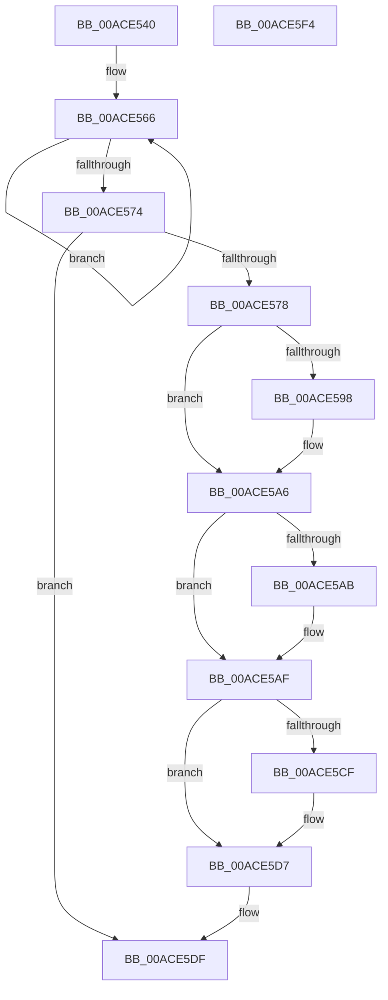

# PopDirectedDripsDiagNotifySessionStart

- RVA: `0x00ACE540`–`0x00ACE5F5` (길이 `181` bytes)
- VA: `0x0000000140ACE540`
- 실행 섹션: `PAGE`
- PDB 이름 있음: `예`; PDB Function 태그: `아니요`
- unwind 정보 RVA: `0x0005C954`
- 디코드: `47`개 명령, `181/181` bytes 표시
- 미해석 바이트: `0` (있으면 어셈블리에 `.byte`로 보존)

> 이 문서는 커널 이미지의 기계어와 PDB 기호를 분석해 생성했습니다. 4번과 5번은 함수 원형과 자료형을 바이너리 사용 방식에서 추정한 C 해석이며 원본 소스 복구 결과는 아닙니다.

## 1. Dependencies

- 직접 호출 지점: **4**; 고유 호출 대상: **4**
- 직접 호출자로 확인된 함수: **1**
- RIP 상대 이미지 참조: **5**

### Outgoing calls
- `0x00ACE587` → [KeAbPreAcquire](../../text/21/KeAbPreAcquire_function_00210230.md) (function, `0x00210230`)
- `0x00ACE5A1` → [ExfAcquirePushLockExclusiveEx](../../text/20/ExfAcquirePushLockExclusiveEx_function_0020FC90.md) (function, `0x0020FC90`)
- `0x00ACE5D2` → [ExfTryToWakePushLock](../../text/26/ExfTryToWakePushLock_function_00265DD0.md) (function, `0x00265DD0`)
- `0x00ACE5DA` → [KeAbPostRelease](../../text/2E/KeAbPostRelease_function_002E1600.md) (function, `0x002E1600`)

### Direct callers
- [sub_00B4309E](../B4/Unknown_function_00B4309E.md) at `0x00B430EA`

### Static image references
- `0x00ACE559` → RVA `0x00F0EAC0` (`.data`; read)
- `0x00ACE578` → RVA `0x00F07650` (`.data`; read)
- `0x00ACE5AF` → RVA `0x00F07440` (`.data`; write)
- `0x00ACE5BA` → RVA `0x00F07448` (`.data`; write)
- `0x00ACE5C0` → RVA `0x00F07650` (`.data`; read/write)

## 2. Other-region calls and transfers

- 다른 실행 섹션으로 향하는 call: **4**
  - `0x00ACE587` → [KeAbPreAcquire](../../text/21/KeAbPreAcquire_function_00210230.md) (`PAGE` → `.text`)
  - `0x00ACE5A1` → [ExfAcquirePushLockExclusiveEx](../../text/20/ExfAcquirePushLockExclusiveEx_function_0020FC90.md) (`PAGE` → `.text`)
  - `0x00ACE5D2` → [ExfTryToWakePushLock](../../text/26/ExfTryToWakePushLock_function_00265DD0.md) (`PAGE` → `.text`)
  - `0x00ACE5DA` → [KeAbPostRelease](../../text/2E/KeAbPostRelease_function_002E1600.md) (`PAGE` → `.text`)
- 별도 외부 분기/꼬리 이동을 확인하지 못했습니다.

## 3. Assembly (complete function range)

```asm
00ACE540  48 89 5C 24 08                  mov qword ptr [rsp + 8], rbx
00ACE545  48 89 6C 24 10                  mov qword ptr [rsp + 0x10], rbp
00ACE54A  48 89 74 24 18                  mov qword ptr [rsp + 0x18], rsi
00ACE54F  57                              push rdi
00ACE550  48 83 EC 20                     sub rsp, 0x20
00ACE554  8B FA                           mov edi, edx
00ACE556  48 8B F1                        mov rsi, rcx
00ACE559  0F 0D 0D 60 05 44 00            prefetchw byte ptr [rip + 0x440560]
00ACE560  8B 05 5A 05 44 00               mov eax, dword ptr [rip + 0x44055a]
00ACE566  44 8B C0                        mov r8d, eax
00ACE569  F0 44 0F B1 05 4E 05 44 00      lock cmpxchg dword ptr [rip + 0x44054e], r8d
00ACE572  75 F2                           jne 0x140ace566
00ACE574  A8 01                           test al, 1
00ACE576  74 67                           je 0x140ace5df
00ACE578  48 8D 2D D1 90 43 00            lea rbp, [rip + 0x4390d1]
00ACE57F  45 33 C0                        xor r8d, r8d
00ACE582  48 8B CD                        mov rcx, rbp
00ACE585  33 D2                           xor edx, edx
00ACE587  E8 A4 1C 74 FF                  call 0x140210230
00ACE58C  F0 48 0F BA 6D 00 00            lock bts qword ptr [rbp], 0
00ACE593  48 8B D8                        mov rbx, rax
00ACE596  73 0E                           jae 0x140ace5a6
00ACE598  4C 8B C5                        mov r8, rbp
00ACE59B  48 8B D0                        mov rdx, rax
00ACE59E  48 8B CD                        mov rcx, rbp
00ACE5A1  E8 EA 16 74 FF                  call 0x14020fc90
00ACE5A6  48 85 DB                        test rbx, rbx
00ACE5A9  74 04                           je 0x140ace5af
00ACE5AB  C6 43 0A 01                     mov byte ptr [rbx + 0xa], 1
00ACE5AF  48 89 35 8A 8E 43 00            mov qword ptr [rip + 0x438e8a], rsi
00ACE5B6  48 83 C8 FF                     or rax, 0xffffffffffffffff
00ACE5BA  89 3D 88 8E 43 00               mov dword ptr [rip + 0x438e88], edi
00ACE5C0  F0 48 0F C1 05 87 90 43 00      lock xadd qword ptr [rip + 0x439087], rax
00ACE5C9  24 06                           and al, 6
00ACE5CB  3C 02                           cmp al, 2
00ACE5CD  75 08                           jne 0x140ace5d7
00ACE5CF  48 8B CD                        mov rcx, rbp
00ACE5D2  E8 F9 77 79 FF                  call 0x140265dd0
00ACE5D7  48 8B CD                        mov rcx, rbp
00ACE5DA  E8 21 30 81 FF                  call 0x1402e1600
00ACE5DF  48 8B 5C 24 30                  mov rbx, qword ptr [rsp + 0x30]
00ACE5E4  48 8B 6C 24 38                  mov rbp, qword ptr [rsp + 0x38]
00ACE5E9  48 8B 74 24 40                  mov rsi, qword ptr [rsp + 0x40]
00ACE5EE  48 83 C4 20                     add rsp, 0x20
00ACE5F2  5F                              pop rdi
00ACE5F3  C3                              ret
00ACE5F4  CC                              int3
```

## 4. C-style interpretation (structured pseudocode)

```c
__int64 __fastcall PopDirectedDripsDiagNotifySessionStart(__int64 a1, int a2)
{
    __int64 result;
    __int64 v_rsp;
    unsigned __int64 v_stack_p10;
    unsigned __int64 v_stack_p18;
    unsigned __int64 v_stack_p8;

    v_stack_p8 = v_rbx;
    v_stack_p10 = v_rbp;
    v_stack_p18 = v_rsi;
    v_rsp = (v_rsp) - (32);
loc_00ACE566:
    if (condition_is_not_equal) goto loc_00ACE566;
    if ((((unsigned __int8)((unsigned int)(*(unsigned int *)(v_rip + 4457818)))) & (1)) == 0) goto loc_00ACE5DF;
    a3 = 0;
    a2 = 0;
    result = KeAbPreAcquire(v_rip + 4427985, a2, a3, a4);
    if (!(condition_is_above_or_equal)) {
        a3 = v_rip + 4427985;
        a2 = result;
        a1 = v_rip + 4427985;
        result = ExfAcquirePushLockExclusiveEx(a1, a2, a3, a4);
    }
    if (result != 0) {
        *(unsigned __int8 *)(result + 10) = 1;
    }
    *(unsigned __int64 *)(v_rip + 4427402) = a1;
    result = (result) | (-1);
    *(unsigned int *)(v_rip + 4427400) = (unsigned int)((unsigned int)(a2));
    result = (unsigned __int8)((result) & (6));
    if (((unsigned __int8)(result)) == 2) {
        a1 = v_rip + 4427985;
        result = ExfTryToWakePushLock(a1, a2, a3, a4);
    }
    result = KeAbPostRelease(v_rip + 4427985, a2, a3, a4);
loc_00ACE5DF:
    v_rsp = (v_rsp) + (32);
    return result;
}
```

## 5. (Beta) C Style

```c
int64_t PopDirectedDripsDiagNotifySessionStart(int64_t Arg1, int32_t Arg2)
{
    int64_t result;
    int64_t local_rsp;
    uint64_t v_stack_p10;
    uint64_t v_stack_p18;
    uint64_t v_stack_p8;

    v_stack_p8 = local_rbx;
    v_stack_p10 = local_rbp;
    v_stack_p18 = local_rsi;
    local_rsp = (local_rsp) - (32);
loc_00ACE566:
    if (condition_is_not_equal) goto loc_00ACE566;
    if ((((uint8_t)((uint32_t)(*(uint32_t *)(v_rip + 0x44055A)))) & (1)) == 0) goto loc_00ACE5DF;
    a3 = 0;
    Arg2 = 0;
    result = KeAbPreAcquire(v_rip + 4427985, Arg2, a3, a4);
    if (!(condition_is_above_or_equal)) {
        a3 = v_rip + 4427985;
        Arg2 = result;
        Arg1 = v_rip + 4427985;
        result = ExfAcquirePushLockExclusiveEx(Arg1, Arg2, a3, a4);
    }
    if (result != 0) {
        *(uint8_t *)(result + 0xA) = 1;
    }
    *(uint64_t *)(v_rip + 0x438E8A) = Arg1;
    result = (result) | (-1);
    *(uint32_t *)(v_rip + 0x438E88) = (uint32_t)((uint32_t)(Arg2));
    result = (uint8_t)((result) & (6));
    if (((uint8_t)(result)) == 2) {
        Arg1 = v_rip + 4427985;
        result = ExfTryToWakePushLock(Arg1, Arg2, a3, a4);
    }
    result = KeAbPostRelease(v_rip + 4427985, Arg2, a3, a4);
loc_00ACE5DF:
    local_rsp = (local_rsp) + (32);
    return result;
}
```

## 6. Execution-region graph

[열기: 2D/3D 그래프와 함수 탐색 컨트롤 패널](../../../control-panel.html?section=page&rva=0x00ACE540&view=graph)

- 2D 그래프는 위에서 아래로 흐르고, 3D 그래프는 빈 공간을 드래그해 회전합니다. Shift+드래그는 이동, 휠은 확대·축소, 함수 노드 선택은 대상 보고서 이동입니다.

### Static fallback


