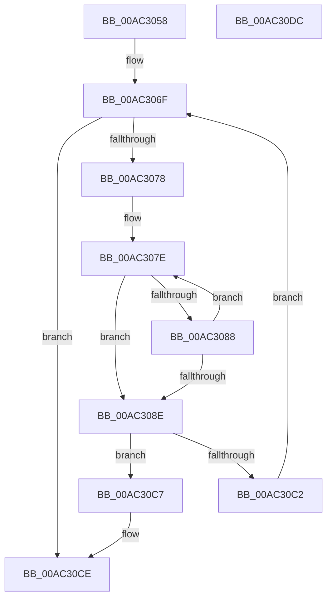

# PopDirectedDripsDiagSanitizeHardwareId

- RVA: `0x00AC3058`–`0x00AC30DD` (길이 `133` bytes)
- VA: `0x0000000140AC3058`
- 실행 섹션: `PAGE`
- PDB 이름 있음: `예`; PDB Function 태그: `아니요`
- unwind 정보 RVA: `0x0006E5F8`
- 디코드: `41`개 명령, `133/133` bytes 표시
- 미해석 바이트: `0` (있으면 어셈블리에 `.byte`로 보존)

> 이 문서는 커널 이미지의 기계어와 PDB 기호를 분석해 생성했습니다. 4번과 5번은 함수 원형과 자료형을 바이너리 사용 방식에서 추정한 C 해석이며 원본 소스 복구 결과는 아닙니다.

## 1. Dependencies

- 직접 호출 지점: **1**; 고유 호출 대상: **1**
- 직접 호출자로 확인된 함수: **1**
- RIP 상대 이미지 참조: **1**

### Outgoing calls
- `0x00AC30B9` → [RtlPrefixUnicodeString](../8F/RtlPrefixUnicodeString_function_008F4F70.md) (function, `0x008F4F70`)

### Direct callers
- [PopDirectedDripsDiagRundownDevices](../A8/PopDirectedDripsDiagRundownDevices_function_00A80E08.md) at `0x00A80FE9`

### Static image references
- `0x00AC30AD` → RVA `0x00B4B5C0` (`PopBthEnumEnumeratorPrefix`; read)

## 2. Other-region calls and transfers

- 다른 실행 섹션으로 향하는 call: **0**
- 별도 외부 분기/꼬리 이동을 확인하지 못했습니다.

## 3. Assembly (complete function range)

```asm
00AC3058  48 89 5C 24 08                  mov qword ptr [rsp + 8], rbx
00AC305D  57                              push rdi
00AC305E  48 83 EC 30                     sub rsp, 0x30
00AC3062  0F 57 C0                        xorps xmm0, xmm0
00AC3065  48 8B F9                        mov rdi, rcx
00AC3068  0F 11 44 24 20                  movups xmmword ptr [rsp + 0x20], xmm0
00AC306D  33 D2                           xor edx, edx
00AC306F  0F B7 0F                        movzx ecx, word ptr [rdi]
00AC3072  D1 E9                           shr ecx, 1
00AC3074  3B D1                           cmp edx, ecx
00AC3076  73 56                           jae 0x140ac30ce
00AC3078  4C 8B 47 08                     mov r8, qword ptr [rdi + 8]
00AC307C  8B DA                           mov ebx, edx
00AC307E  8B C3                           mov eax, ebx
00AC3080  66 41 83 3C 40 2C               cmp word ptr [r8 + rax*2], 0x2c
00AC3086  74 06                           je 0x140ac308e
00AC3088  FF C3                           inc ebx
00AC308A  3B D9                           cmp ebx, ecx
00AC308C  72 F0                           jb 0x140ac307e
00AC308E  49 8D 0C 50                     lea rcx, [r8 + rdx*2]
00AC3092  0F B7 C3                        movzx eax, bx
00AC3095  66 2B C2                        sub ax, dx
00AC3098  48 89 4C 24 28                  mov qword ptr [rsp + 0x28], rcx
00AC309D  66 03 C0                        add ax, ax
00AC30A0  48 8D 54 24 20                  lea rdx, [rsp + 0x20]
00AC30A5  41 B0 01                        mov r8b, 1
00AC30A8  66 89 44 24 20                  mov word ptr [rsp + 0x20], ax
00AC30AD  48 8D 0D 0C 85 08 00            lea rcx, [rip + 0x8850c]
00AC30B4  66 89 44 24 22                  mov word ptr [rsp + 0x22], ax
00AC30B9  E8 B2 1E E3 FF                  call 0x1408f4f70
00AC30BE  84 C0                           test al, al
00AC30C0  75 05                           jne 0x140ac30c7
00AC30C2  8D 53 01                        lea edx, [rbx + 1]
00AC30C5  EB A8                           jmp 0x140ac306f
00AC30C7  48 8D 3D F2 84 08 00            lea rdi, [rip + 0x884f2]
00AC30CE  48 8B 5C 24 40                  mov rbx, qword ptr [rsp + 0x40]
00AC30D3  48 8B C7                        mov rax, rdi
00AC30D6  48 83 C4 30                     add rsp, 0x30
00AC30DA  5F                              pop rdi
00AC30DB  C3                              ret
00AC30DC  CC                              int3
```

## 4. C-style interpretation (structured pseudocode)

```c
__int64 __fastcall PopDirectedDripsDiagSanitizeHardwareId(__int64 a1, int a2)
{
    __int64 result;
    __int64 v_rbx;
    __int64 v_rsp;
    unsigned __int64 v_stack_m10;
    unsigned __int16 v_stack_m16;
    unsigned __int64 v_stack_m18;
    unsigned __int64 v_stack_p8;

    v_stack_p8 = v_rbx;
    v_rsp = (v_rsp) - (48);
    v_stack_m18 = v_xmm0;
    a2 = 0;
loc_00AC306F:
    a1 = (unsigned int)((*(unsigned __int16 *)(a1)) >> (1));
    if (0 >= ((unsigned int)(a1))) goto loc_00AC30CE;
loc_00AC307E:
    if ((*(unsigned __int16 *)(*(unsigned __int64 *)(a1 + 8) + 0 * 2)) == 44) goto loc_00AC308E;
    v_rbx = (unsigned int)((0) + 1);
    if (((unsigned int)(v_rbx)) < ((unsigned int)(a1))) goto loc_00AC307E;
loc_00AC308E:
    result = (unsigned __int16)(((unsigned __int16)(v_rbx)) - (0));
    v_stack_m10 = *(unsigned __int64 *)(a1 + 8) + a2 * 2;
    result = (unsigned __int16)((result) + ((unsigned __int16)(result)));
    v_stack_m18 = (unsigned __int16)(result);
    v_stack_m16 = (unsigned __int16)(result);
    result = RtlPrefixUnicodeString(v_rip + 558348, v_stack_m18, 1, a4);
    if ((unsigned __int8)(result) != 0) goto loc_00AC30C7;
    goto loc_00AC306F;
loc_00AC30C7:
loc_00AC30CE:
    v_rsp = (v_rsp) + (48);
    return v_rip + 558322;
}
```

## 5. (Beta) C Style

```c
int64_t PopDirectedDripsDiagSanitizeHardwareId(void *Arg1, int32_t Arg2)
{
    uint8_t *arg1 = (uint8_t *)Arg1;

    int64_t result;
    int64_t local_rbx;
    int64_t local_rsp;
    uint64_t v_stack_m10;
    uint16_t v_stack_m16;
    uint64_t v_stack_m18;
    uint64_t v_stack_p8;

    v_stack_p8 = local_rbx;
    local_rsp = (local_rsp) - (48);
    v_stack_m18 = v_xmm0;
    Arg2 = 0;
loc_00AC306F:
    Arg1 = (uint32_t)((*(uint16_t *)(arg1)) >> (1));
    if (0 >= ((uint32_t)(Arg1))) goto loc_00AC30CE;
loc_00AC307E:
    if ((*(uint16_t *)(*(uint64_t *)(arg1 + 0x8) + 0x0 * 2)) == 44) goto loc_00AC308E;
    local_rbx = (uint32_t)((0) + 1);
    if (((uint32_t)(local_rbx)) < ((uint32_t)(Arg1))) goto loc_00AC307E;
loc_00AC308E:
    result = (uint16_t)(((uint16_t)(local_rbx)) - (0));
    v_stack_m10 = *(uint64_t *)(arg1 + 0x8) + Arg2 * 2;
    result = (uint16_t)((result) + ((uint16_t)(result)));
    v_stack_m18 = (uint16_t)(result);
    v_stack_m16 = (uint16_t)(result);
    result = RtlPrefixUnicodeString(v_rip + 558348, v_stack_m18, 1, a4);
    if ((uint8_t)(result) != 0) goto loc_00AC30C7;
    goto loc_00AC306F;
loc_00AC30C7:
loc_00AC30CE:
    local_rsp = (local_rsp) + (48);
    return v_rip + 558322;
}
```

### 관측된 메모리 오프셋

구조체 형식이 확인되지 않은 접근은 인자 기준의 오프셋으로만 기록했습니다.

| 기준 인자 | 오프셋 표현 | 폭 (bit) | 접근 |
|---|---:|---:|---|
| `Arg1` | `+ 0x0` | `16` | `R` |
| `Arg1` | `+ 0x8` | `64` | `R` |

## 6. Execution-region graph

[열기: 2D/3D 그래프와 함수 탐색 컨트롤 패널](../../../control-panel.html?section=page&rva=0x00AC3058&view=graph)

- 2D 그래프는 위에서 아래로 흐르고, 3D 그래프는 빈 공간을 드래그해 회전합니다. Shift+드래그는 이동, 휠은 확대·축소, 함수 노드 선택은 대상 보고서 이동입니다.

### Static fallback


