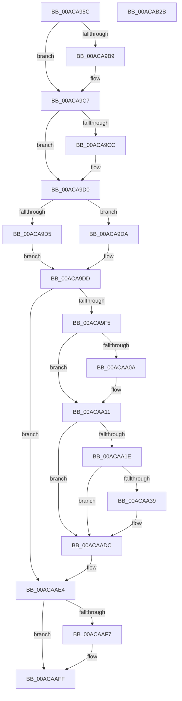

# PopDirectedDripsDiagTraceBroadcastVisit

- RVA: `0x00ACA95C`–`0x00ACAB2C` (길이 `464` bytes)
- VA: `0x0000000140ACA95C`
- 실행 섹션: `PAGE`
- PDB 이름 있음: `예`; PDB Function 태그: `아니요`
- unwind 정보 RVA: `0x000BE3BC`
- 디코드: `114`개 명령, `464/464` bytes 표시
- 미해석 바이트: `0` (있으면 어셈블리에 `.byte`로 보존)

> 이 문서는 커널 이미지의 기계어와 PDB 기호를 분석해 생성했습니다. 4번과 5번은 함수 원형과 자료형을 바이너리 사용 방식에서 추정한 C 해석이며 원본 소스 복구 결과는 아닙니다.

## 1. Dependencies

- 직접 호출 지점: **8**; 고유 호출 대상: **8**
- 직접 호출자로 확인된 함수: **1**
- RIP 상대 이미지 참조: **6**

### Outgoing calls
- `0x00ACA9A9` → [KeAbPreAcquire](../../text/21/KeAbPreAcquire_function_00210230.md) (function, `0x00210230`)
- `0x00ACA9C2` → [ExfAcquirePushLockExclusiveEx](../../text/20/ExfAcquirePushLockExclusiveEx_function_0020FC90.md) (function, `0x0020FC90`)
- `0x00ACA9E4` → [PopDirectedDripsDiagGetOrCreateDeviceDiagnostic](../70/PopDirectedDripsDiagGetOrCreateDeviceDiagnostic_function_00705170.md) (function, `0x00705170`)
- `0x00ACAA2C` → [EtwEventEnabled](../../text/39/EtwEventEnabled_function_00392450.md) (function, `0x00392450`)
- `0x00ACAAD7` → [EtwWrite](../../text/41/EtwWrite_function_0041C720.md) (function, `0x0041C720`)
- `0x00ACAAFA` → [ExfTryToWakePushLock](../../text/26/ExfTryToWakePushLock_function_00265DD0.md) (function, `0x00265DD0`)
- `0x00ACAB02` → [KeAbPostRelease](../../text/2E/KeAbPostRelease_function_002E1600.md) (function, `0x002E1600`)
- `0x00ACAB0E` → [_security_check_cookie](../../text/6A/_security_check_cookie_function_006AC640.md) (function, `0x006AC640`)

### Direct callers
- [PopDirectedDripsVisitDevice](../70/PopDirectedDripsVisitDevice_function_00703068.md) at `0x007030A9`

### Static image references
- `0x00ACA976` → RVA `0x00E0A740` (`.data`; read)
- `0x00ACA988` → RVA `0x00F07650` (`.data`; read)
- `0x00ACAA11` → RVA `0x00E67858` (`.data`; read)
- `0x00ACAA1E` → RVA `0x00F0B408` (`.data`; read)
- `0x00ACAA25` → RVA `0x00022F10` (`.rdata`; read)
- `0x00ACAAE8` → RVA `0x00F07650` (`.data`; read/write)

## 2. Other-region calls and transfers

- 다른 실행 섹션으로 향하는 call: **7**
  - `0x00ACA9A9` → [KeAbPreAcquire](../../text/21/KeAbPreAcquire_function_00210230.md) (`PAGE` → `.text`)
  - `0x00ACA9C2` → [ExfAcquirePushLockExclusiveEx](../../text/20/ExfAcquirePushLockExclusiveEx_function_0020FC90.md) (`PAGE` → `.text`)
  - `0x00ACAA2C` → [EtwEventEnabled](../../text/39/EtwEventEnabled_function_00392450.md) (`PAGE` → `.text`)
  - `0x00ACAAD7` → [EtwWrite](../../text/41/EtwWrite_function_0041C720.md) (`PAGE` → `.text`)
  - `0x00ACAAFA` → [ExfTryToWakePushLock](../../text/26/ExfTryToWakePushLock_function_00265DD0.md) (`PAGE` → `.text`)
  - `0x00ACAB02` → [KeAbPostRelease](../../text/2E/KeAbPostRelease_function_002E1600.md) (`PAGE` → `.text`)
  - `0x00ACAB0E` → [_security_check_cookie](../../text/6A/_security_check_cookie_function_006AC640.md) (`PAGE` → `.text`)
- 별도 외부 분기/꼬리 이동을 확인하지 못했습니다.

## 3. Assembly (complete function range)

```asm
00ACA95C  48 89 5C 24 10                  mov qword ptr [rsp + 0x10], rbx
00ACA961  48 89 74 24 18                  mov qword ptr [rsp + 0x18], rsi
00ACA966  55                              push rbp
00ACA967  57                              push rdi
00ACA968  41 57                           push r15
00ACA96A  48 8D 6C 24 B9                  lea rbp, [rsp - 0x47]
00ACA96F  48 81 EC C0 00 00 00            sub rsp, 0xc0
00ACA976  48 8B 05 C3 FD 33 00            mov rax, qword ptr [rip + 0x33fdc3]
00ACA97D  48 33 C4                        xor rax, rsp
00ACA980  48 89 45 37                     mov qword ptr [rbp + 0x37], rax
00ACA984  83 65 BF 00                     and dword ptr [rbp - 0x41], 0
00ACA988  4C 8D 3D C1 CC 43 00            lea r15, [rip + 0x43ccc1]
00ACA98F  83 65 BB 00                     and dword ptr [rbp - 0x45], 0
00ACA993  41 8B F0                        mov esi, r8d
00ACA996  83 65 C3 00                     and dword ptr [rbp - 0x3d], 0
00ACA99A  48 8B FA                        mov rdi, rdx
00ACA99D  48 89 4D C7                     mov qword ptr [rbp - 0x39], rcx
00ACA9A1  45 33 C0                        xor r8d, r8d
00ACA9A4  49 8B CF                        mov rcx, r15
00ACA9A7  33 D2                           xor edx, edx
00ACA9A9  E8 82 58 74 FF                  call 0x140210230
00ACA9AE  F0 49 0F BA 2F 00               lock bts qword ptr [r15], 0
00ACA9B4  48 8B D8                        mov rbx, rax
00ACA9B7  73 0E                           jae 0x140aca9c7
00ACA9B9  4D 8B C7                        mov r8, r15
00ACA9BC  48 8B D0                        mov rdx, rax
00ACA9BF  49 8B CF                        mov rcx, r15
00ACA9C2  E8 C9 52 74 FF                  call 0x14020fc90
00ACA9C7  48 85 DB                        test rbx, rbx
00ACA9CA  74 04                           je 0x140aca9d0
00ACA9CC  C6 43 0A 01                     mov byte ptr [rbx + 0xa], 1
00ACA9D0  48 85 FF                        test rdi, rdi
00ACA9D3  74 05                           je 0x140aca9da
00ACA9D5  8B 47 20                        mov eax, dword ptr [rdi + 0x20]
00ACA9D8  EB 03                           jmp 0x140aca9dd
00ACA9DA  83 C8 FF                        or eax, 0xffffffff
00ACA9DD  48 8B 4D C7                     mov rcx, qword ptr [rbp - 0x39]
00ACA9E1  89 45 B7                        mov dword ptr [rbp - 0x49], eax
00ACA9E4  E8 87 A7 C3 FF                  call 0x140705170
00ACA9E9  48 8B D8                        mov rbx, rax
00ACA9EC  48 85 C0                        test rax, rax
00ACA9EF  0F 84 EF 00 00 00               je 0x140acaae4
00ACA9F5  F7 80 98 00 00 00 00 00 02 00   test dword ptr [rax + 0x98], 0x20000
00ACA9FF  8B 4D B7                        mov ecx, dword ptr [rbp - 0x49]
00ACAA02  89 88 94 00 00 00               mov dword ptr [rax + 0x94], ecx
00ACAA08  74 07                           je 0x140acaa11
00ACAA0A  C7 45 BB 01 00 00 00            mov dword ptr [rbp - 0x45], 1
00ACAA11  80 3D 40 CE 39 00 00            cmp byte ptr [rip + 0x39ce40], 0
00ACAA18  0F 84 BE 00 00 00               je 0x140acaadc
00ACAA1E  48 8B 0D E3 09 44 00            mov rcx, qword ptr [rip + 0x4409e3]
00ACAA25  48 8D 15 E4 84 55 FF            lea rdx, [rip - 0xaa7b1c]
00ACAA2C  E8 1F 7A 8C FF                  call 0x140392450
00ACAA31  84 C0                           test al, al
00ACAA33  0F 84 A3 00 00 00               je 0x140acaadc
00ACAA39  4C 8B 45 C7                     mov r8, qword ptr [rbp - 0x39]
00ACAA3D  48 8D 15 CC 84 55 FF            lea rdx, [rip - 0xaa7b34]
00ACAA44  41 B9 04 00 00 00               mov r9d, 4
00ACAA4A  41 0F B7 40 28                  movzx eax, word ptr [r8 + 0x28]
00ACAA4F  83 65 E3 00                     and dword ptr [rbp - 0x1d], 0
00ACAA53  83 65 F3 00                     and dword ptr [rbp - 0xd], 0
00ACAA57  83 65 03 00                     and dword ptr [rbp + 3], 0
00ACAA5B  83 65 13 00                     and dword ptr [rbp + 0x13], 0
00ACAA5F  D1 E8                           shr eax, 1
00ACAA61  89 45 BF                        mov dword ptr [rbp - 0x41], eax
00ACAA64  48 8D 45 B7                     lea rax, [rbp - 0x49]
00ACAA68  48 89 45 D7                     mov qword ptr [rbp - 0x29], rax
00ACAA6C  48 8D 45 BB                     lea rax, [rbp - 0x45]
00ACAA70  48 89 45 E7                     mov qword ptr [rbp - 0x19], rax
00ACAA74  48 8D 45 C7                     lea rax, [rbp - 0x39]
00ACAA78  48 89 45 F7                     mov qword ptr [rbp - 9], rax
00ACAA7C  48 8D 45 BF                     lea rax, [rbp - 0x41]
00ACAA80  48 89 45 07                     mov qword ptr [rbp + 7], rax
00ACAA84  44 89 4D DF                     mov dword ptr [rbp - 0x21], r9d
00ACAA88  44 89 4D EF                     mov dword ptr [rbp - 0x11], r9d
00ACAA8C  44 89 4D 0F                     mov dword ptr [rbp + 0xf], r9d
00ACAA90  C7 45 FF 08 00 00 00            mov dword ptr [rbp - 1], 8
00ACAA97  49 8B 40 30                     mov rax, qword ptr [r8 + 0x30]
00ACAA9B  41 0F B7 48 28                  movzx ecx, word ptr [r8 + 0x28]
00ACAAA0  45 33 C0                        xor r8d, r8d
00ACAAA3  83 65 23 00                     and dword ptr [rbp + 0x23], 0
00ACAAA7  83 65 33 00                     and dword ptr [rbp + 0x33], 0
00ACAAAB  48 89 45 17                     mov qword ptr [rbp + 0x17], rax
00ACAAAF  48 8D 45 C3                     lea rax, [rbp - 0x3d]
00ACAAB3  48 89 45 27                     mov qword ptr [rbp + 0x27], rax
00ACAAB7  48 8D 45 D7                     lea rax, [rbp - 0x29]
00ACAABB  89 4D 1F                        mov dword ptr [rbp + 0x1f], ecx
00ACAABE  48 8B 0D 43 09 44 00            mov rcx, qword ptr [rip + 0x440943]
00ACAAC5  44 89 4D 2F                     mov dword ptr [rbp + 0x2f], r9d
00ACAAC9  41 B9 06 00 00 00               mov r9d, 6
00ACAACF  48 89 44 24 20                  mov qword ptr [rsp + 0x20], rax
00ACAAD4  89 75 C3                        mov dword ptr [rbp - 0x3d], esi
00ACAAD7  E8 44 1C 95 FF                  call 0x14041c720
00ACAADC  0F BA AB 98 00 00 00 12         bts dword ptr [rbx + 0x98], 0x12
00ACAAE4  48 83 C8 FF                     or rax, 0xffffffffffffffff
00ACAAE8  F0 48 0F C1 05 5F CB 43 00      lock xadd qword ptr [rip + 0x43cb5f], rax
00ACAAF1  24 06                           and al, 6
00ACAAF3  3C 02                           cmp al, 2
00ACAAF5  75 08                           jne 0x140acaaff
00ACAAF7  49 8B CF                        mov rcx, r15
00ACAAFA  E8 D1 B2 79 FF                  call 0x140265dd0
00ACAAFF  49 8B CF                        mov rcx, r15
00ACAB02  E8 F9 6A 81 FF                  call 0x1402e1600
00ACAB07  48 8B 4D 37                     mov rcx, qword ptr [rbp + 0x37]
00ACAB0B  48 33 CC                        xor rcx, rsp
00ACAB0E  E8 2D 1B BE FF                  call 0x1406ac640
00ACAB13  4C 8D 9C 24 C0 00 00 00         lea r11, [rsp + 0xc0]
00ACAB1B  49 8B 5B 28                     mov rbx, qword ptr [r11 + 0x28]
00ACAB1F  49 8B 73 30                     mov rsi, qword ptr [r11 + 0x30]
00ACAB23  49 8B E3                        mov rsp, r11
00ACAB26  41 5F                           pop r15
00ACAB28  5F                              pop rdi
00ACAB29  5D                              pop rbp
00ACAB2A  C3                              ret
00ACAB2B  CC                              int3
```

## 4. C-style interpretation (structured pseudocode)

```c
__int64 __fastcall PopDirectedDripsDiagTraceBroadcastVisit(__int64 a1, __int64 a2, int a3)
{
    __int64 result;
    __int64 v_rsp;
    unsigned __int64 v_stack_m18;
    unsigned __int64 v_stack_m28;
    unsigned int v_stack_m2C;
    unsigned int v_stack_m30;
    unsigned __int64 v_stack_m38;
    unsigned int v_stack_m3C;
    unsigned int v_stack_m40;
    unsigned __int64 v_stack_m48;
    unsigned int v_stack_m4C;
    unsigned int v_stack_m50;
    unsigned __int64 v_stack_m58;
    unsigned int v_stack_m5C;
    unsigned __int64 v_stack_m5F;
    unsigned int v_stack_m60;
    unsigned __int64 v_stack_m68;
    unsigned int v_stack_m6C;
    unsigned int v_stack_m70;
    unsigned __int64 v_stack_m78;
    unsigned int v_stack_m7C;
    unsigned int v_stack_m80;
    unsigned __int64 v_stack_m88;
    unsigned __int64 v_stack_m98;
    unsigned int v_stack_m9C;
    unsigned int v_stack_mA0;
    unsigned int v_stack_mA4;
    unsigned int v_stack_mA8;
    unsigned __int64 v_stack_mB8;
    unsigned __int64 v_stack_p10;
    unsigned __int64 v_stack_p18;

    v_stack_p10 = v_rbx;
    v_stack_p18 = v_rsi;
    v_rsp = (v_rsp) - (192);
    result = (*(unsigned __int64 *)(v_rip + 3407299)) ^ (v_rsp);
    v_stack_m28 = result;
    v_stack_m98 = a1;
    a3 = 0;
    a2 = 0;
    result = KeAbPreAcquire(v_rip + 4443329, a2, a3, a4);
    if (!(condition_is_above_or_equal)) {
        a3 = v_rip + 4443329;
        a2 = result;
        a1 = v_rip + 4443329;
        result = ExfAcquirePushLockExclusiveEx(a1, a2, a3, a4);
    }
    if (result != 0) {
        *(unsigned __int8 *)(result + 10) = 1;
    }
    if (a2 == 0) goto loc_00ACA9DA;
    goto loc_00ACA9DD;
loc_00ACA9DA:
    result = (unsigned int)(((unsigned int)(*(unsigned int *)(a2 + 32))) | (0xFFFFFFFFULL));
loc_00ACA9DD:
    v_stack_mA8 = (unsigned int)(result);
    result = PopDirectedDripsDiagGetOrCreateDeviceDiagnostic(v_stack_m98, a2, a3, a4);
    if (result == 0) goto loc_00ACAAE4;
    *(unsigned int *)(result + 148) = (unsigned int)((unsigned int)(v_stack_mA8));
    if (((*(unsigned int *)(result + 152)) & (0x20000ULL)) != 0) {
        v_stack_mA4 = 1;
    }
    if ((*(unsigned __int8 *)(v_rip + 3788352)) == 0) goto loc_00ACAADC;
    result = EtwEventEnabled(*(unsigned __int64 *)(v_rip + 4458979), v_rip - 11172636, a3, a4);
    if ((unsigned __int8)(result) != 0) {
        a3 = v_stack_m98;
        a2 = v_rip - 11172660;
        a4 = 4;
        result = *(unsigned __int16 *)(a3 + 40);
        result = (unsigned int)((result) >> (1));
        v_stack_mA0 = (unsigned int)(result);
        result = v_stack_mA8;
        v_stack_m88 = result;
        result = v_stack_mA4;
        v_stack_m78 = result;
        result = v_stack_m98;
        v_stack_m68 = result;
        result = v_stack_mA0;
        v_stack_m58 = result;
        v_stack_m80 = (unsigned int)(a4);
        v_stack_m70 = (unsigned int)(a4);
        v_stack_m50 = (unsigned int)(a4);
        v_stack_m60 = 8;
        result = *(unsigned __int64 *)(a3 + 48);
        a1 = *(unsigned __int16 *)(a3 + 40);
        a3 = 0;
        v_stack_m48 = result;
        result = v_stack_m9C;
        v_stack_m38 = result;
        result = v_stack_m88;
        v_stack_m40 = (unsigned int)(a1);
        a1 = *(unsigned __int64 *)(v_rip + 4458819);
        v_stack_m30 = (unsigned int)(a4);
        a4 = 6;
        v_stack_mB8 = result;
        v_stack_m9C = (unsigned int)((unsigned int)(a3));
        result = EtwWrite(a1, a2, a3, a4);
    }
loc_00ACAAE4:
    result = (result) | (-1);
    result = (unsigned __int8)((result) & (6));
    if (((unsigned __int8)(result)) == 2) {
        a1 = v_rip + 4443329;
        result = ExfTryToWakePushLock(a1, a2, a3, a4);
    }
    result = KeAbPostRelease(v_rip + 4443329, a2, a3, a4);
    a1 = (v_stack_m28) ^ (v_rsp);
    result = _security_check_cookie(a1, a2, a3, a4);
    return result;
}
```

## 5. (Beta) C Style

```c
int64_t PopDirectedDripsDiagTraceBroadcastVisit(int64_t Arg1, int64_t Arg2, int32_t Arg3)
{
    int64_t result;
    int64_t local_rsp;
    uint64_t v_stack_m18;
    uint64_t v_stack_m28;
    uint32_t v_stack_m2C;
    uint32_t v_stack_m30;
    uint64_t v_stack_m38;
    uint32_t v_stack_m3C;
    uint32_t v_stack_m40;
    uint64_t v_stack_m48;
    uint32_t v_stack_m4C;
    uint32_t v_stack_m50;
    uint64_t v_stack_m58;
    uint32_t v_stack_m5C;
    uint64_t v_stack_m5F;
    uint32_t v_stack_m60;
    uint64_t v_stack_m68;
    uint32_t v_stack_m6C;
    uint32_t v_stack_m70;
    uint64_t v_stack_m78;
    uint32_t v_stack_m7C;
    uint32_t v_stack_m80;
    uint64_t v_stack_m88;
    uint64_t v_stack_m98;
    uint32_t v_stack_m9C;
    uint32_t v_stack_mA0;
    uint32_t v_stack_mA4;
    uint32_t v_stack_mA8;
    uint64_t v_stack_mB8;
    uint64_t v_stack_p10;
    uint64_t v_stack_p18;

    v_stack_p10 = local_rbx;
    v_stack_p18 = local_rsi;
    local_rsp = (local_rsp) - (192);
    result = (*(uint64_t *)(v_rip + 0x33FDC3)) ^ (local_rsp);
    v_stack_m28 = result;
    v_stack_m98 = Arg1;
    Arg3 = 0;
    Arg2 = 0;
    result = KeAbPreAcquire(v_rip + 4443329, Arg2, Arg3, a4);
    if (!(condition_is_above_or_equal)) {
        Arg3 = v_rip + 4443329;
        Arg2 = result;
        Arg1 = v_rip + 4443329;
        result = ExfAcquirePushLockExclusiveEx(Arg1, Arg2, Arg3, a4);
    }
    if (result != 0) {
        *(uint8_t *)(result + 0xA) = 1;
    }
    if (Arg2 == 0) goto loc_00ACA9DA;
    goto loc_00ACA9DD;
loc_00ACA9DA:
    result = (uint32_t)(((uint32_t)(*(uint32_t *)(Arg2 + 0x20))) | (0xFFFFFFFFULL));
loc_00ACA9DD:
    v_stack_mA8 = (uint32_t)(result);
    result = PopDirectedDripsDiagGetOrCreateDeviceDiagnostic(v_stack_m98, Arg2, Arg3, a4);
    if (result == 0) goto loc_00ACAAE4;
    *(uint32_t *)(result + 0x94) = (uint32_t)((uint32_t)(v_stack_mA8));
    if (((*(uint32_t *)(result + 0x98)) & (0x20000ULL)) != 0) {
        v_stack_mA4 = 1;
    }
    if ((*(uint8_t *)(v_rip + 0x39CE40)) == 0) goto loc_00ACAADC;
    result = EtwEventEnabled(*(uint64_t *)(v_rip + 0x4409E3), v_rip - 11172636, Arg3, a4);
    if ((uint8_t)(result) != 0) {
        Arg3 = v_stack_m98;
        Arg2 = v_rip - 11172660;
        a4 = 4;
        result = *(uint16_t *)(Arg3 + 0x28);
        result = (uint32_t)((result) >> (1));
        v_stack_mA0 = (uint32_t)(result);
        result = v_stack_mA8;
        v_stack_m88 = result;
        result = v_stack_mA4;
        v_stack_m78 = result;
        result = v_stack_m98;
        v_stack_m68 = result;
        result = v_stack_mA0;
        v_stack_m58 = result;
        v_stack_m80 = (uint32_t)(a4);
        v_stack_m70 = (uint32_t)(a4);
        v_stack_m50 = (uint32_t)(a4);
        v_stack_m60 = 8;
        result = *(uint64_t *)(Arg3 + 0x30);
        Arg1 = *(uint16_t *)(Arg3 + 0x28);
        Arg3 = 0;
        v_stack_m48 = result;
        result = v_stack_m9C;
        v_stack_m38 = result;
        result = v_stack_m88;
        v_stack_m40 = (uint32_t)(Arg1);
        Arg1 = *(uint64_t *)(v_rip + 0x440943);
        v_stack_m30 = (uint32_t)(a4);
        a4 = 6;
        v_stack_mB8 = result;
        v_stack_m9C = (uint32_t)((uint32_t)(Arg3));
        result = EtwWrite(Arg1, Arg2, Arg3, a4);
    }
loc_00ACAAE4:
    result = (result) | (-1);
    result = (uint8_t)((result) & (6));
    if (((uint8_t)(result)) == 2) {
        Arg1 = v_rip + 4443329;
        result = ExfTryToWakePushLock(Arg1, Arg2, Arg3, a4);
    }
    result = KeAbPostRelease(v_rip + 4443329, Arg2, Arg3, a4);
    Arg1 = (v_stack_m28) ^ (local_rsp);
    result = _security_check_cookie(Arg1, Arg2, Arg3, a4);
    return result;
}
```

## 6. Execution-region graph

[열기: 2D/3D 그래프와 함수 탐색 컨트롤 패널](../../../control-panel.html?section=page&rva=0x00ACA95C&view=graph)

- 2D 그래프는 위에서 아래로 흐르고, 3D 그래프는 빈 공간을 드래그해 회전합니다. Shift+드래그는 이동, 휠은 확대·축소, 함수 노드 선택은 대상 보고서 이동입니다.

### Static fallback


