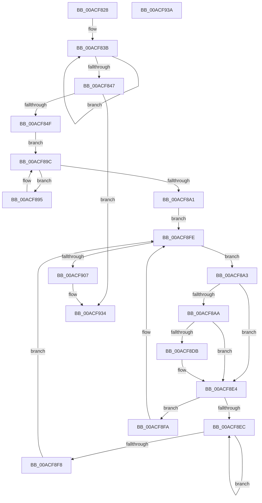

# PopDirectedDripsUmMarkTestDevices

- RVA: `0x00ACF828`–`0x00ACF93B` (길이 `275` bytes)
- VA: `0x0000000140ACF828`
- 실행 섹션: `PAGE`
- PDB 이름 있음: `예`; PDB Function 태그: `아니요`
- unwind 정보 RVA: `0x00064C80`
- 디코드: `71`개 명령, `275/275` bytes 표시
- 미해석 바이트: `0` (있으면 어셈블리에 `.byte`로 보존)

> 이 문서는 커널 이미지의 기계어와 PDB 기호를 분석해 생성했습니다. 4번과 5번은 함수 원형과 자료형을 바이너리 사용 방식에서 추정한 C 해석이며 원본 소스 복구 결과는 아닙니다.

## 1. Dependencies

- 직접 호출 지점: **8**; 고유 호출 대상: **6**
- 직접 호출자로 확인된 함수: **1**
- RIP 상대 이미지 참조: **6**

### Outgoing calls
- `0x00ACF856` → [PopAcquireRwLockShared](../../text/2D/PopAcquireRwLockShared_function_002D9A40.md) (function, `0x002D9A40`)
- `0x00ACF87C` → [PopDirectedDripsNotify](../A8/PopDirectedDripsNotify_function_00A80850.md) (function, `0x00A80850`)
- `0x00ACF883` → [IoLockUnlockPnpDeviceTree](../AB/IoLockUnlockPnpDeviceTree_function_00AB953C.md) (function, `0x00AB953C`)
- `0x00ACF8D1` → [RtlLookupElementGenericTableAvl](../../text/3F/RtlLookupElementGenericTableAvl_function_003FEFB0.md) (function, `0x003FEFB0`)
- `0x00ACF8DF` → [PopDirectedDripsMarkCandidateDevice](../70/PopDirectedDripsMarkCandidateDevice_function_00705BB4.md) (function, `0x00705BB4`)
- `0x00ACF909` → [IoLockUnlockPnpDeviceTree](../AB/IoLockUnlockPnpDeviceTree_function_00AB953C.md) (function, `0x00AB953C`)
- `0x00ACF923` → [PopDirectedDripsNotify](../A8/PopDirectedDripsNotify_function_00A80850.md) (function, `0x00A80850`)
- `0x00ACF92F` → [PopReleaseRwLock](../../text/2D/PopReleaseRwLock_function_002DFBBC.md) (function, `0x002DFBBC`)

### Direct callers
- [PopDirectedDripsIdleResiliencyCallback](../A3/PopDirectedDripsIdleResiliencyCallback_function_00A31884.md) at `0x00A3196A`

### Static image references
- `0x00ACF82E` → RVA `0x00F07288` (`.data`; read)
- `0x00ACF84F` → RVA `0x00F07290` (`.data`; read)
- `0x00ACF85B` → RVA `0x00F0B6B0` (`.data`; read)
- `0x00ACF86C` → RVA `0x00F07210` (`.data`; read)
- `0x00ACF888` → RVA `0x00F8C438` (`.data`; read)
- `0x00ACF8B5` → RVA `0x00F07220` (`.data`; read)

## 2. Other-region calls and transfers

- 다른 실행 섹션으로 향하는 call: **3**
  - `0x00ACF856` → [PopAcquireRwLockShared](../../text/2D/PopAcquireRwLockShared_function_002D9A40.md) (`PAGE` → `.text`)
  - `0x00ACF8D1` → [RtlLookupElementGenericTableAvl](../../text/3F/RtlLookupElementGenericTableAvl_function_003FEFB0.md) (`PAGE` → `.text`)
  - `0x00ACF92F` → [PopReleaseRwLock](../../text/2D/PopReleaseRwLock_function_002DFBBC.md) (`PAGE` → `.text`)
- 별도 외부 분기/꼬리 이동을 확인하지 못했습니다.

## 3. Assembly (complete function range)

```asm
00ACF828  40 53                           push rbx
00ACF82A  48 83 EC 30                     sub rsp, 0x30
00ACF82E  0F 0D 0D 53 7A 43 00            prefetchw byte ptr [rip + 0x437a53]
00ACF835  8B 05 4D 7A 43 00               mov eax, dword ptr [rip + 0x437a4d]
00ACF83B  8B C8                           mov ecx, eax
00ACF83D  F0 0F B1 0D 43 7A 43 00         lock cmpxchg dword ptr [rip + 0x437a43], ecx
00ACF845  75 F4                           jne 0x140acf83b
00ACF847  85 C0                           test eax, eax
00ACF849  0F 84 E5 00 00 00               je 0x140acf934
00ACF84F  48 8D 0D 3A 7A 43 00            lea rcx, [rip + 0x437a3a]
00ACF856  E8 E5 A1 80 FF                  call 0x1402d9a40
00ACF85B  48 8B 05 4E BE 43 00            mov rax, qword ptr [rip + 0x43be4e]
00ACF862  48 8D 54 24 40                  lea rdx, [rsp + 0x40]
00ACF867  48 89 44 24 40                  mov qword ptr [rsp + 0x40], rax
00ACF86C  8A 05 9E 79 43 00               mov al, byte ptr [rip + 0x43799e]
00ACF872  F6 D8                           neg al
00ACF874  1B C9                           sbb ecx, ecx
00ACF876  83 E1 02                        and ecx, 2
00ACF879  83 C1 02                        add ecx, 2
00ACF87C  E8 CF 0F FB FF                  call 0x140a80850
00ACF881  B1 01                           mov cl, 1
00ACF883  E8 B4 9C FE FF                  call 0x140ab953c
00ACF888  48 8B 1D A9 CB 4B 00            mov rbx, qword ptr [rip + 0x4bcba9]
00ACF88F  48 8B 43 08                     mov rax, qword ptr [rbx + 8]
00ACF893  EB 07                           jmp 0x140acf89c
00ACF895  48 8B D8                        mov rbx, rax
00ACF898  48 8B 40 08                     mov rax, qword ptr [rax + 8]
00ACF89C  48 85 C0                        test rax, rax
00ACF89F  75 F4                           jne 0x140acf895
00ACF8A1  EB 5B                           jmp 0x140acf8fe
00ACF8A3  48 83 7B 50 00                  cmp qword ptr [rbx + 0x50], 0
00ACF8A8  74 3A                           je 0x140acf8e4
00ACF8AA  0F B7 43 28                     movzx eax, word ptr [rbx + 0x28]
00ACF8AE  48 8D 54 24 20                  lea rdx, [rsp + 0x20]
00ACF8B3  D1 E8                           shr eax, 1
00ACF8B5  48 8D 0D 64 79 43 00            lea rcx, [rip + 0x437964]
00ACF8BC  89 44 24 24                     mov dword ptr [rsp + 0x24], eax
00ACF8C0  48 8B 43 30                     mov rax, qword ptr [rbx + 0x30]
00ACF8C4  48 89 44 24 28                  mov qword ptr [rsp + 0x28], rax
00ACF8C9  C7 44 24 20 01 00 00 00         mov dword ptr [rsp + 0x20], 1
00ACF8D1  E8 DA F6 92 FF                  call 0x1403fefb0
00ACF8D6  48 85 C0                        test rax, rax
00ACF8D9  74 09                           je 0x140acf8e4
00ACF8DB  48 8B 4B 50                     mov rcx, qword ptr [rbx + 0x50]
00ACF8DF  E8 D0 62 C3 FF                  call 0x140705bb4
00ACF8E4  48 8B 03                        mov rax, qword ptr [rbx]
00ACF8E7  48 85 C0                        test rax, rax
00ACF8EA  74 0E                           je 0x140acf8fa
00ACF8EC  48 8B D8                        mov rbx, rax
00ACF8EF  48 8B 40 08                     mov rax, qword ptr [rax + 8]
00ACF8F3  48 85 C0                        test rax, rax
00ACF8F6  75 F4                           jne 0x140acf8ec
00ACF8F8  EB 04                           jmp 0x140acf8fe
00ACF8FA  48 8B 5B 10                     mov rbx, qword ptr [rbx + 0x10]
00ACF8FE  48 3B 1D 33 CB 4B 00            cmp rbx, qword ptr [rip + 0x4bcb33]
00ACF905  75 9C                           jne 0x140acf8a3
00ACF907  33 C9                           xor ecx, ecx
00ACF909  E8 2E 9C FE FF                  call 0x140ab953c
00ACF90E  8A 05 FC 78 43 00               mov al, byte ptr [rip + 0x4378fc]
00ACF914  48 8D 54 24 40                  lea rdx, [rsp + 0x40]
00ACF919  F6 D8                           neg al
00ACF91B  1B C9                           sbb ecx, ecx
00ACF91D  83 E1 02                        and ecx, 2
00ACF920  83 C1 03                        add ecx, 3
00ACF923  E8 28 0F FB FF                  call 0x140a80850
00ACF928  48 8D 0D 61 79 43 00            lea rcx, [rip + 0x437961]
00ACF92F  E8 88 02 81 FF                  call 0x1402dfbbc
00ACF934  48 83 C4 30                     add rsp, 0x30
00ACF938  5B                              pop rbx
00ACF939  C3                              ret
00ACF93A  CC                              int3
```

## 4. C-style interpretation (structured pseudocode)

```c
__int64 __fastcall PopDirectedDripsUmMarkTestDevices(void)
{
    __int64 result;
    __int64 v_rsp;
    unsigned __int64 v_stack_m10;
    unsigned int v_stack_m14;
    unsigned __int64 v_stack_m18;
    unsigned __int64 v_stack_p8;

    v_rsp = (v_rsp) - (48);
loc_00ACF83B:
    if (condition_is_not_equal) goto loc_00ACF83B;
    if ((unsigned int)((unsigned int)(*(unsigned int *)(v_rip + 4422221))) == 0) goto loc_00ACF934;
    result = PopAcquireRwLockShared(v_rip + 4422202, a2, a3, a4);
    v_stack_p8 = *(unsigned __int64 *)(v_rip + 4439630);
    result = (unsigned __int8)(-(*(unsigned __int8 *)(v_rip + 4422046)));
    a1 = (unsigned int)((v_rip + 4422202) & (2));
    a1 = (unsigned int)((a1) + (2));
    result = PopDirectedDripsNotify(a1, v_stack_p8, a3, a4);
    result = IoLockUnlockPnpDeviceTree(1, v_stack_p8, a3, a4);
    goto loc_00ACF89C;
loc_00ACF895:
loc_00ACF89C:
    if (*(unsigned __int64 *)(*(unsigned __int64 *)(*(unsigned __int64 *)(v_rip + 4967337) + 8) + 8) != 0) goto loc_00ACF895;
    goto loc_00ACF8FE;
loc_00ACF8A3:
    if ((*(unsigned __int64 *)(*(unsigned __int64 *)(*(unsigned __int64 *)(v_rip + 4967337) + 8) + 80)) == 0) goto loc_00ACF8E4;
    result = (unsigned int)((*(unsigned __int16 *)(*(unsigned __int64 *)(*(unsigned __int64 *)(v_rip + 4967337) + 8) + 40)) >> (1));
    v_stack_m14 = (unsigned int)(result);
    v_stack_m10 = *(unsigned __int64 *)(*(unsigned __int64 *)(*(unsigned __int64 *)(v_rip + 4967337) + 8) + 48);
    v_stack_m18 = 1;
    result = RtlLookupElementGenericTableAvl(v_rip + 4421988, v_stack_m18, a3, a4);
    if (result != 0) {
        a1 = *(unsigned __int64 *)(*(unsigned __int64 *)(*(unsigned __int64 *)(v_rip + 4967337) + 8) + 80);
        result = PopDirectedDripsMarkCandidateDevice(a1, v_stack_m18, a3, a4);
    }
    if (*(unsigned __int64 *)(*(unsigned __int64 *)(*(unsigned __int64 *)(v_rip + 4967337) + 8)) == 0) goto loc_00ACF8FA;
loc_00ACF8EC:
    if (*(unsigned __int64 *)(*(unsigned __int64 *)(*(unsigned __int64 *)(*(unsigned __int64 *)(v_rip + 4967337) + 8)) + 8) != 0) goto loc_00ACF8EC;
    goto loc_00ACF8FE;
loc_00ACF8FA:
loc_00ACF8FE:
    if ((*(unsigned __int64 *)(*(unsigned __int64 *)(*(unsigned __int64 *)(*(unsigned __int64 *)(v_rip + 4967337) + 8)) + 16)) != (*(unsigned __int64 *)(v_rip + 4967219))) goto loc_00ACF8A3;
    a1 = 0;
    result = IoLockUnlockPnpDeviceTree(a1, v_stack_m18, a3, a4);
    result = (unsigned __int8)(-(*(unsigned __int8 *)(v_rip + 4421884)));
    a1 = (unsigned int)((a1) & (2));
    a1 = (unsigned int)((a1) + (3));
    result = PopDirectedDripsNotify(a1, v_stack_p8, a3, a4);
    result = PopReleaseRwLock(v_rip + 4421985, v_stack_p8, a3, a4);
loc_00ACF934:
    v_rsp = (v_rsp) + (48);
    return result;
}
```

## 5. (Beta) C Style

```c
void PopDirectedDripsUmMarkTestDevices(void)
{
    int64_t result;
    int64_t local_rsp;
    uint64_t v_stack_m10;
    uint32_t v_stack_m14;
    uint64_t v_stack_m18;
    uint64_t v_stack_p8;

    local_rsp = (local_rsp) - (48);
loc_00ACF83B:
    if (condition_is_not_equal) goto loc_00ACF83B;
    if ((uint32_t)((uint32_t)(*(uint32_t *)(v_rip + 0x437A4D))) == 0) goto loc_00ACF934;
    result = PopAcquireRwLockShared(v_rip + 4422202, a2, a3, a4);
    v_stack_p8 = *(uint64_t *)(v_rip + 0x43BE4E);
    result = (uint8_t)(-(*(uint8_t *)(v_rip + 0x43799E)));
    a1 = (uint32_t)((v_rip + 4422202) & (2));
    a1 = (uint32_t)((a1) + (2));
    result = PopDirectedDripsNotify(a1, v_stack_p8, a3, a4);
    result = IoLockUnlockPnpDeviceTree(1, v_stack_p8, a3, a4);
    goto loc_00ACF89C;
loc_00ACF895:
loc_00ACF89C:
    if (*(uint64_t *)(*(uint64_t *)(*(uint64_t *)(v_rip + 0x4BCBA9) + 0x8) + 0x8) != 0) goto loc_00ACF895;
    goto loc_00ACF8FE;
loc_00ACF8A3:
    if ((*(uint64_t *)(*(uint64_t *)(*(uint64_t *)(v_rip + 0x4BCBA9) + 0x8) + 0x50)) == 0) goto loc_00ACF8E4;
    result = (uint32_t)((*(uint16_t *)(*(uint64_t *)(*(uint64_t *)(v_rip + 0x4BCBA9) + 0x8) + 0x28)) >> (1));
    v_stack_m14 = (uint32_t)(result);
    v_stack_m10 = *(uint64_t *)(*(uint64_t *)(*(uint64_t *)(v_rip + 0x4BCBA9) + 0x8) + 0x30);
    v_stack_m18 = 1;
    result = RtlLookupElementGenericTableAvl(v_rip + 4421988, v_stack_m18, a3, a4);
    if (result != 0) {
        a1 = *(uint64_t *)(*(uint64_t *)(*(uint64_t *)(v_rip + 0x4BCBA9) + 0x8) + 0x50);
        result = PopDirectedDripsMarkCandidateDevice(a1, v_stack_m18, a3, a4);
    }
    if (*(uint64_t *)(*(uint64_t *)(*(uint64_t *)(v_rip + 0x4BCBA9) + 0x8)) == 0) goto loc_00ACF8FA;
loc_00ACF8EC:
    if (*(uint64_t *)(*(uint64_t *)(*(uint64_t *)(*(uint64_t *)(v_rip + 0x4BCBA9) + 0x8)) + 0x8) != 0) goto loc_00ACF8EC;
    goto loc_00ACF8FE;
loc_00ACF8FA:
loc_00ACF8FE:
    if ((*(uint64_t *)(*(uint64_t *)(*(uint64_t *)(*(uint64_t *)(v_rip + 0x4BCBA9) + 0x8)) + 0x10)) != (*(uint64_t *)(v_rip + 0x4BCB33))) goto loc_00ACF8A3;
    a1 = 0;
    result = IoLockUnlockPnpDeviceTree(a1, v_stack_m18, a3, a4);
    result = (uint8_t)(-(*(uint8_t *)(v_rip + 0x4378FC)));
    a1 = (uint32_t)((a1) & (2));
    a1 = (uint32_t)((a1) + (3));
    result = PopDirectedDripsNotify(a1, v_stack_p8, a3, a4);
    result = PopReleaseRwLock(v_rip + 4421985, v_stack_p8, a3, a4);
loc_00ACF934:
    local_rsp = (local_rsp) + (48);
    return result;
}
```

## 6. Execution-region graph

[열기: 2D/3D 그래프와 함수 탐색 컨트롤 패널](../../../control-panel.html?section=page&rva=0x00ACF828&view=graph)

- 2D 그래프는 위에서 아래로 흐르고, 3D 그래프는 빈 공간을 드래그해 회전합니다. Shift+드래그는 이동, 휠은 확대·축소, 함수 노드 선택은 대상 보고서 이동입니다.

### Static fallback


