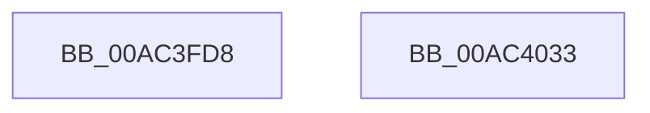

# PopDispatchSuperfetchNotification

- RVA: `0x00AC3FD8`–`0x00AC4034` (길이 `92` bytes)
- VA: `0x0000000140AC3FD8`
- 실행 섹션: `PAGE`
- PDB 이름 있음: `예`; PDB Function 태그: `아니요`
- unwind 정보 RVA: `0x0005CAAC`
- 디코드: `24`개 명령, `92/92` bytes 표시
- 미해석 바이트: `0` (있으면 어셈블리에 `.byte`로 보존)

> 이 문서는 커널 이미지의 기계어와 PDB 기호를 분석해 생성했습니다. 4번과 5번은 함수 원형과 자료형을 바이너리 사용 방식에서 추정한 C 해석이며 원본 소스 복구 결과는 아닙니다.

## 1. Dependencies

- 직접 호출 지점: **5**; 고유 호출 대상: **3**
- 직접 호출자로 확인된 함수: **1**
- RIP 상대 이미지 참조: **2**

### Outgoing calls
- `0x00AC3FEE` → [PopDiagTraceEventNoPayload](../../text/49/PopDiagTraceEventNoPayload_function_004982F8.md) (function, `0x004982F8`)
- `0x00AC3FF8` → [PopCheckpointSystemSleep](../../pagelk/B7/PopCheckpointSystemSleep_function_00B77C90.md) (function, `0x00B77C90`)
- `0x00AC400D` → [PfPowerActionNotify](../../pagelk/B7/PfPowerActionNotify_function_00B7AC98.md) (function, `0x00B7AC98`)
- `0x00AC4019` → [PopDiagTraceEventNoPayload](../../text/49/PopDiagTraceEventNoPayload_function_004982F8.md) (function, `0x004982F8`)
- `0x00AC4023` → [PopCheckpointSystemSleep](../../pagelk/B7/PopCheckpointSystemSleep_function_00B77C90.md) (function, `0x00B77C90`)

### Direct callers
- [PopIssueActionRequest](../A9/PopIssueActionRequest_function_00A9CE54.md) at `0x00A9D180`

### Static image references
- `0x00AC3FE7` → RVA `0x0001E988` (`.rdata`; read)
- `0x00AC4012` → RVA `0x0001E978` (`.rdata`; read)

## 2. Other-region calls and transfers

- 다른 실행 섹션으로 향하는 call: **5**
  - `0x00AC3FEE` → [PopDiagTraceEventNoPayload](../../text/49/PopDiagTraceEventNoPayload_function_004982F8.md) (`PAGE` → `.text`)
  - `0x00AC3FF8` → [PopCheckpointSystemSleep](../../pagelk/B7/PopCheckpointSystemSleep_function_00B77C90.md) (`PAGE` → `PAGELK`)
  - `0x00AC400D` → [PfPowerActionNotify](../../pagelk/B7/PfPowerActionNotify_function_00B7AC98.md) (`PAGE` → `PAGELK`)
  - `0x00AC4019` → [PopDiagTraceEventNoPayload](../../text/49/PopDiagTraceEventNoPayload_function_004982F8.md) (`PAGE` → `.text`)
  - `0x00AC4023` → [PopCheckpointSystemSleep](../../pagelk/B7/PopCheckpointSystemSleep_function_00B77C90.md) (`PAGE` → `PAGELK`)
- 별도 외부 분기/꼬리 이동을 확인하지 못했습니다.

## 3. Assembly (complete function range)

```asm
00AC3FD8  48 89 5C 24 08                  mov qword ptr [rsp + 8], rbx
00AC3FDD  57                              push rdi
00AC3FDE  48 83 EC 20                     sub rsp, 0x20
00AC3FE2  8B F9                           mov edi, ecx
00AC3FE4  48 63 DA                        movsxd rbx, edx
00AC3FE7  48 8D 0D 9A A9 55 FF            lea rcx, [rip - 0xaa5666]
00AC3FEE  E8 05 43 9D FF                  call 0x1404982f8
00AC3FF3  B9 06 00 00 00                  mov ecx, 6
00AC3FF8  E8 93 3C 0B 00                  call 0x140b77c90
00AC3FFD  C1 FF 1F                        sar edi, 0x1f
00AC4000  4C 8B C3                        mov r8, rbx
00AC4003  83 E7 02                        and edi, 2
00AC4006  B9 01 00 00 00                  mov ecx, 1
00AC400B  8B D7                           mov edx, edi
00AC400D  E8 86 6C 0B 00                  call 0x140b7ac98
00AC4012  48 8D 0D 5F A9 55 FF            lea rcx, [rip - 0xaa56a1]
00AC4019  E8 DA 42 9D FF                  call 0x1404982f8
00AC401E  B9 07 00 00 00                  mov ecx, 7
00AC4023  E8 68 3C 0B 00                  call 0x140b77c90
00AC4028  48 8B 5C 24 30                  mov rbx, qword ptr [rsp + 0x30]
00AC402D  48 83 C4 20                     add rsp, 0x20
00AC4031  5F                              pop rdi
00AC4032  C3                              ret
00AC4033  CC                              int3
```

## 4. C-style interpretation (structured pseudocode)

```c
__int64 __fastcall PopDispatchSuperfetchNotification(int a1, int a2)
{
    __int64 result;
    __int64 v_rdi;
    __int64 v_rsp;
    unsigned __int64 v_stack_p8;

    v_stack_p8 = v_rbx;
    v_rsp = (v_rsp) - (32);
    result = PopDiagTraceEventNoPayload(v_rip - 11163238, a2, a3, a4);
    result = PopCheckpointSystemSleep(6, a2, a3, a4);
    v_rdi = (unsigned int)(((unsigned int)(a1)) >> (31));
    v_rdi = (unsigned int)((v_rdi) & (2));
    result = PfPowerActionNotify(1, (unsigned int)((unsigned int)(v_rdi)), (int)(a2), a4);
    result = PopDiagTraceEventNoPayload(v_rip - 11163297, (unsigned int)((unsigned int)(v_rdi)), (int)(a2), a4);
    result = PopCheckpointSystemSleep(7, (unsigned int)((unsigned int)(v_rdi)), (int)(a2), a4);
    v_rsp = (v_rsp) + (32);
    return result;
}
```

## 5. (Beta) C Style

```c
int64_t PopDispatchSuperfetchNotification(int32_t Arg1, int32_t Arg2)
{
    int64_t result;
    int64_t local_rdi;
    int64_t local_rsp;
    uint64_t v_stack_p8;

    v_stack_p8 = local_rbx;
    local_rsp = (local_rsp) - (32);
    result = PopDiagTraceEventNoPayload(v_rip - 11163238, Arg2, a3, a4);
    result = PopCheckpointSystemSleep(6, Arg2, a3, a4);
    local_rdi = (uint32_t)(((uint32_t)(Arg1)) >> (31));
    local_rdi = (uint32_t)((local_rdi) & (2));
    result = PfPowerActionNotify(1, (uint32_t)((uint32_t)(local_rdi)), (int32_t)(Arg2), a4);
    result = PopDiagTraceEventNoPayload(v_rip - 11163297, (uint32_t)((uint32_t)(local_rdi)), (int32_t)(Arg2), a4);
    result = PopCheckpointSystemSleep(7, (uint32_t)((uint32_t)(local_rdi)), (int32_t)(Arg2), a4);
    local_rsp = (local_rsp) + (32);
    return result;
}
```

## 6. Execution-region graph

[열기: 2D/3D 그래프와 함수 탐색 컨트롤 패널](../../../control-panel.html?section=page&rva=0x00AC3FD8&view=graph)

- 2D 그래프는 위에서 아래로 흐르고, 3D 그래프는 빈 공간을 드래그해 회전합니다. Shift+드래그는 이동, 휠은 확대·축소, 함수 노드 선택은 대상 보고서 이동입니다.

### Static fallback


