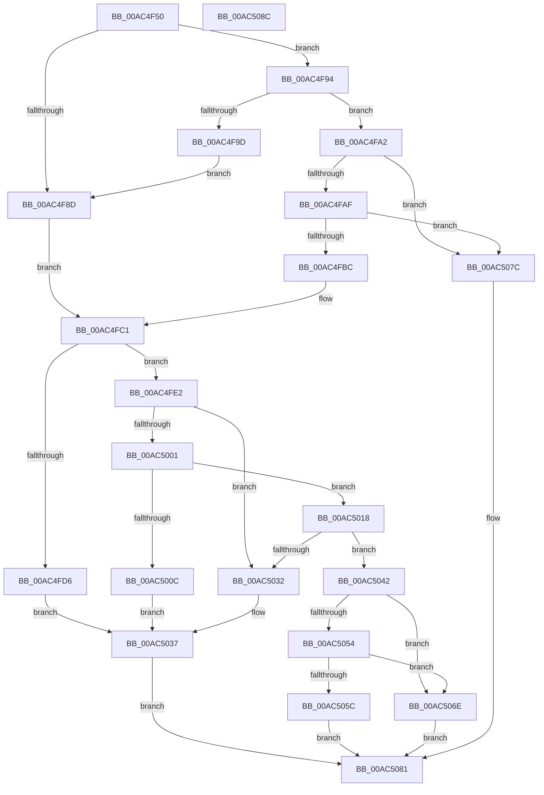

# PopEnableSystemSleepCheckpoint

- RVA: `0x00AC4F50`–`0x00AC508D` (길이 `317` bytes)
- VA: `0x0000000140AC4F50`
- 실행 섹션: `PAGE`
- PDB 이름 있음: `예`; PDB Function 태그: `아니요`
- unwind 정보 RVA: `0x000BDEAC`
- 디코드: `85`개 명령, `317/317` bytes 표시
- 미해석 바이트: `0` (있으면 어셈블리에 `.byte`로 보존)

> 이 문서는 커널 이미지의 기계어와 PDB 기호를 분석해 생성했습니다. 4번과 5번은 함수 원형과 자료형을 바이너리 사용 방식에서 추정한 C 해석이며 원본 소스 복구 결과는 아닙니다.

## 1. Dependencies

- 직접 호출 지점: **6**; 고유 호출 대상: **5**
- 직접 호출자로 확인된 함수: **1**
- RIP 상대 이미지 참조: **7**

### Outgoing calls
- `0x00AC4F94` → [PopIsDetailedSleepReliabilityDiagEnabled](PopIsDetailedSleepReliabilityDiagEnabled_function_00ACEEA4.md) (function, `0x00ACEEA4`)
- `0x00AC4FF6` → [NtQueryEnvironmentVariableInfoEx](../7C/NtQueryEnvironmentVariableInfoEx_function_007CDF00.md) (function, `0x007CDF00`)
- `0x00AC501D` → [KeQueryInterruptTimePrecise](../../text/20/KeQueryInterruptTimePrecise_function_00209530.md) (function, `0x00209530`)
- `0x00AC5027` → [PopCheckpointSystemSleepUnsafe](../../pagelk/B7/PopCheckpointSystemSleepUnsafe_function_00B71950.md) (function, `0x00B71950`)
- `0x00AC503B` → [PopTraceSleepCheckpointInitFailure](../76/PopTraceSleepCheckpointInitFailure_function_00763D7C.md) (function, `0x00763D7C`)
- `0x00AC5047` → [KeQueryInterruptTimePrecise](../../text/20/KeQueryInterruptTimePrecise_function_00209530.md) (function, `0x00209530`)

### Direct callers
- [PopIssueActionRequest](../A9/PopIssueActionRequest_function_00A9CE54.md) at `0x00A9D088`

### Static image references
- `0x00AC4F74` → RVA `0x00F0C9D4` (`.data`; write)
- `0x00AC4F7E` → RVA `0x00F0C2E8` (`.data`; read/write)
- `0x00AC4F84` → RVA `0x00F0C9D0` (`.data`; read)
- `0x00AC4FA2` → RVA `0x00F0CED4` (`.data`; read)
- `0x00AC4FAF` → RVA `0x00E675C8` (`.data`; read)
- `0x00AC4FC1` → RVA `0x00F0C2E8` (`.data`; read)
- `0x00AC4FCD` → RVA `0x00EFF050` (`.data`; read)

## 2. Other-region calls and transfers

- 다른 실행 섹션으로 향하는 call: **3**
  - `0x00AC501D` → [KeQueryInterruptTimePrecise](../../text/20/KeQueryInterruptTimePrecise_function_00209530.md) (`PAGE` → `.text`)
  - `0x00AC5027` → [PopCheckpointSystemSleepUnsafe](../../pagelk/B7/PopCheckpointSystemSleepUnsafe_function_00B71950.md) (`PAGE` → `PAGELK`)
  - `0x00AC5047` → [KeQueryInterruptTimePrecise](../../text/20/KeQueryInterruptTimePrecise_function_00209530.md) (`PAGE` → `.text`)
- 별도 외부 분기/꼬리 이동을 확인하지 못했습니다.

## 3. Assembly (complete function range)

```asm
00AC4F50  48 8B C4                        mov rax, rsp
00AC4F53  53                              push rbx
00AC4F54  55                              push rbp
00AC4F55  56                              push rsi
00AC4F56  57                              push rdi
00AC4F57  48 83 EC 28                     sub rsp, 0x28
00AC4F5B  48 83 60 18 00                  and qword ptr [rax + 0x18], 0
00AC4F60  40 32 F6                        xor sil, sil
00AC4F63  48 83 60 20 00                  and qword ptr [rax + 0x20], 0
00AC4F68  48 83 60 08 00                  and qword ptr [rax + 8], 0
00AC4F6D  48 83 60 10 00                  and qword ptr [rax + 0x10], 0
00AC4F72  33 C0                           xor eax, eax
00AC4F74  C7 05 56 7A 44 00 00 00 00 00   mov dword ptr [rip + 0x447a56], 0
00AC4F7E  87 05 64 73 44 00               xchg dword ptr [rip + 0x447364], eax
00AC4F84  83 3D 45 7A 44 00 00            cmp dword ptr [rip + 0x447a45], 0
00AC4F8B  74 07                           je 0x140ac4f94
00AC4F8D  B8 04 00 00 00                  mov eax, 4
00AC4F92  EB 2D                           jmp 0x140ac4fc1
00AC4F94  E8 0B 9F 00 00                  call 0x140aceea4
00AC4F99  84 C0                           test al, al
00AC4F9B  74 05                           je 0x140ac4fa2
00AC4F9D  40 B6 01                        mov sil, 1
00AC4FA0  EB EB                           jmp 0x140ac4f8d
00AC4FA2  40 38 35 2B 7F 44 00            cmp byte ptr [rip + 0x447f2b], sil
00AC4FA9  0F 84 CD 00 00 00               je 0x140ac507c
00AC4FAF  F6 05 12 26 3A 00 F0            test byte ptr [rip + 0x3a2612], 0xf0
00AC4FB6  0F 84 C0 00 00 00               je 0x140ac507c
00AC4FBC  B8 01 00 00 00                  mov eax, 1
00AC4FC1  48 8D 1D 20 73 44 00            lea rbx, [rip + 0x447320]
00AC4FC8  48 8B CB                        mov rcx, rbx
00AC4FCB  87 01                           xchg dword ptr [rcx], eax
00AC4FCD  83 3D 7C A0 43 00 02            cmp dword ptr [rip + 0x43a07c], 2
00AC4FD4  74 0C                           je 0x140ac4fe2
00AC4FD6  BF 02 00 00 C0                  mov edi, 0xc0000002
00AC4FDB  B8 08 00 00 00                  mov eax, 8
00AC4FE0  EB 55                           jmp 0x140ac5037
00AC4FE2  4C 8D 4C 24 60                  lea r9, [rsp + 0x60]
00AC4FE7  B9 01 00 00 00                  mov ecx, 1
00AC4FEC  4C 8D 44 24 50                  lea r8, [rsp + 0x50]
00AC4FF1  48 8D 54 24 68                  lea rdx, [rsp + 0x68]
00AC4FF6  E8 05 8F D0 FF                  call 0x1407cdf00
00AC4FFB  8B F8                           mov edi, eax
00AC4FFD  85 C0                           test eax, eax
00AC4FFF  78 31                           js 0x140ac5032
00AC5001  48 81 7C 24 50 00 04 00 00      cmp qword ptr [rsp + 0x50], 0x400
00AC500A  77 0C                           ja 0x140ac5018
00AC500C  BF 54 04 00 C0                  mov edi, 0xc0000454
00AC5011  B8 09 00 00 00                  mov eax, 9
00AC5016  EB 1F                           jmp 0x140ac5037
00AC5018  48 8D 4C 24 58                  lea rcx, [rsp + 0x58]
00AC501D  E8 0E 45 74 FF                  call 0x140209530
00AC5022  33 C9                           xor ecx, ecx
00AC5024  48 8B E8                        mov rbp, rax
00AC5027  E8 24 C9 0A 00                  call 0x140b71950
00AC502C  8B F8                           mov edi, eax
00AC502E  85 C0                           test eax, eax
00AC5030  79 10                           jns 0x140ac5042
00AC5032  B8 0F 00 00 00                  mov eax, 0xf
00AC5037  87 03                           xchg dword ptr [rbx], eax
00AC5039  8B CF                           mov ecx, edi
00AC503B  E8 3C ED C9 FF                  call 0x140763d7c
00AC5040  EB 3F                           jmp 0x140ac5081
00AC5042  48 8D 4C 24 58                  lea rcx, [rsp + 0x58]
00AC5047  E8 E4 44 74 FF                  call 0x140209530
00AC504C  48 2B C5                        sub rax, rbp
00AC504F  40 84 F6                        test sil, sil
00AC5052  74 1A                           je 0x140ac506e
00AC5054  48 3D A0 86 01 00               cmp rax, 0x186a0
00AC505A  76 12                           jbe 0x140ac506e
00AC505C  B8 0A 00 00 00                  mov eax, 0xa
00AC5061  BF 02 01 00 00                  mov edi, 0x102
00AC5066  87 05 7C 72 44 00               xchg dword ptr [rip + 0x44727c], eax
00AC506C  EB 13                           jmp 0x140ac5081
00AC506E  C7 05 5C 79 44 00 01 00 00 00   mov dword ptr [rip + 0x44795c], 1
00AC5078  33 FF                           xor edi, edi
00AC507A  EB 05                           jmp 0x140ac5081
00AC507C  BF 29 02 00 C0                  mov edi, 0xc0000229
00AC5081  8B C7                           mov eax, edi
00AC5083  48 83 C4 28                     add rsp, 0x28
00AC5087  5F                              pop rdi
00AC5088  5E                              pop rsi
00AC5089  5D                              pop rbp
00AC508A  5B                              pop rbx
00AC508B  C3                              ret
00AC508C  CC                              int3
```

## 4. C-style interpretation (structured pseudocode)

```c
__int64 __fastcall PopEnableSystemSleepCheckpoint(void)
{
    __int64 result;
    __int64 v_rdi;
    __int64 v_rsi;
    __int64 v_rsp;
    unsigned __int64 v_stack_p10;
    unsigned __int64 v_stack_p18;
    unsigned __int64 v_stack_p20;
    unsigned __int64 v_stack_p8;

    v_rsp = (v_rsp) - (40);
    v_rsi = 0;
    result = 0;
    *(unsigned int *)(v_rip + 4487766) = 0;
    if ((*(unsigned int *)(v_rip + 4487749)) == 0) goto loc_00AC4F94;
loc_00AC4F8D:
    goto loc_00AC4FC1;
loc_00AC4F94:
    result = PopIsDetailedSleepReliabilityDiagEnabled(a1, a2, a3, a4);
    if ((unsigned __int8)(result) == 0) goto loc_00AC4FA2;
    goto loc_00AC4F8D;
loc_00AC4FA2:
    if ((*(unsigned __int8 *)(v_rip + 4489003)) == 1) goto loc_00AC507C;
    if (((*(unsigned __int8 *)(v_rip + 3810834)) & (240)) == 0) goto loc_00AC507C;
loc_00AC4FC1:
    if ((*(unsigned int *)(v_rip + 4431996)) == 2) goto loc_00AC4FE2;
    goto loc_00AC5037;
loc_00AC4FE2:
    result = NtQueryEnvironmentVariableInfoEx(1, v_stack_p20, v_stack_p8, v_stack_p18);
    if (sign_flag) goto loc_00AC5032;
    if (v_stack_p8 > 0x400ULL) goto loc_00AC5018;
    goto loc_00AC5037;
loc_00AC5018:
    result = KeQueryInterruptTimePrecise(v_stack_p10, v_stack_p20, v_stack_p8, v_stack_p18);
    a1 = 0;
    result = PopCheckpointSystemSleepUnsafe(a1, v_stack_p20, v_stack_p8, v_stack_p18);
    if (!sign_flag) goto loc_00AC5042;
loc_00AC5032:
loc_00AC5037:
    result = PopTraceSleepCheckpointInitFailure((unsigned int)((unsigned int)((unsigned int)((unsigned int)(result)))), v_stack_p20, v_stack_p8, v_stack_p18);
    goto loc_00AC5081;
loc_00AC5042:
    result = KeQueryInterruptTimePrecise(v_stack_p10, v_stack_p20, v_stack_p8, v_stack_p18);
    result = (result) - (result);
    if (1 == 0) goto loc_00AC506E;
    if (result <= 0x186A0ULL) goto loc_00AC506E;
    goto loc_00AC5081;
loc_00AC506E:
    *(unsigned int *)(v_rip + 4487516) = 1;
    v_rdi = 0;
    goto loc_00AC5081;
loc_00AC507C:
loc_00AC5081:
    v_rsp = (v_rsp) + (40);
    return (unsigned int)((unsigned int)((unsigned int)(0xC0000229ULL)));
}
```

## 5. (Beta) C Style

```c
void PopEnableSystemSleepCheckpoint(void)
{
    int64_t result;
    int64_t local_rdi;
    int64_t local_rsi;
    int64_t local_rsp;
    uint64_t v_stack_p10;
    uint64_t v_stack_p18;
    uint64_t v_stack_p20;
    uint64_t v_stack_p8;

    local_rsp = (local_rsp) - (40);
    local_rsi = 0;
    result = 0;
    *(uint32_t *)(v_rip + 0x447A56) = 0;
    if ((*(uint32_t *)(v_rip + 0x447A45)) == 0) goto loc_00AC4F94;
loc_00AC4F8D:
    goto loc_00AC4FC1;
loc_00AC4F94:
    result = PopIsDetailedSleepReliabilityDiagEnabled(a1, a2, a3, a4);
    if ((uint8_t)(result) == 0) goto loc_00AC4FA2;
    goto loc_00AC4F8D;
loc_00AC4FA2:
    if ((*(uint8_t *)(v_rip + 0x447F2B)) == 1) goto loc_00AC507C;
    if (((*(uint8_t *)(v_rip + 0x3A2612)) & (240)) == 0) goto loc_00AC507C;
loc_00AC4FC1:
    if ((*(uint32_t *)(v_rip + 0x43A07C)) == 2) goto loc_00AC4FE2;
    goto loc_00AC5037;
loc_00AC4FE2:
    result = NtQueryEnvironmentVariableInfoEx(1, v_stack_p20, v_stack_p8, v_stack_p18);
    if (sign_flag) goto loc_00AC5032;
    if (v_stack_p8 > 0x400ULL) goto loc_00AC5018;
    goto loc_00AC5037;
loc_00AC5018:
    result = KeQueryInterruptTimePrecise(v_stack_p10, v_stack_p20, v_stack_p8, v_stack_p18);
    a1 = 0;
    result = PopCheckpointSystemSleepUnsafe(a1, v_stack_p20, v_stack_p8, v_stack_p18);
    if (!sign_flag) goto loc_00AC5042;
loc_00AC5032:
loc_00AC5037:
    result = PopTraceSleepCheckpointInitFailure((uint32_t)((uint32_t)((uint32_t)((uint32_t)(result)))), v_stack_p20, v_stack_p8, v_stack_p18);
    goto loc_00AC5081;
loc_00AC5042:
    result = KeQueryInterruptTimePrecise(v_stack_p10, v_stack_p20, v_stack_p8, v_stack_p18);
    result = (result) - (result);
    if (1 == 0) goto loc_00AC506E;
    if (result <= 0x186A0ULL) goto loc_00AC506E;
    goto loc_00AC5081;
loc_00AC506E:
    *(uint32_t *)(v_rip + 0x44795C) = 1;
    local_rdi = 0;
    goto loc_00AC5081;
loc_00AC507C:
loc_00AC5081:
    local_rsp = (local_rsp) + (40);
    return (uint32_t)((uint32_t)((uint32_t)(0xC0000229ULL)));
}
```

## 6. Execution-region graph

[열기: 2D/3D 그래프와 함수 탐색 컨트롤 패널](../../../control-panel.html?section=page&rva=0x00AC4F50&view=graph)

- 2D 그래프는 위에서 아래로 흐르고, 3D 그래프는 빈 공간을 드래그해 회전합니다. Shift+드래그는 이동, 휠은 확대·축소, 함수 노드 선택은 대상 보고서 이동입니다.

### Static fallback


