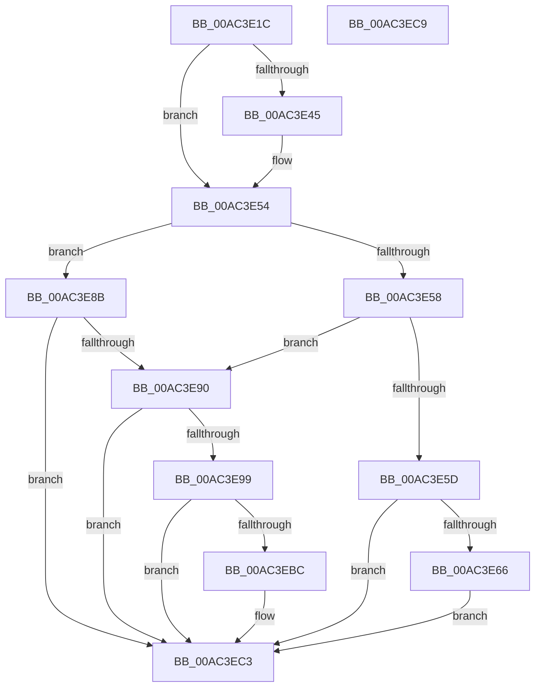

# PopEnforceDeepSleep

- RVA: `0x00AC3E1C`–`0x00AC3ECA` (길이 `174` bytes)
- VA: `0x0000000140AC3E1C`
- 실행 섹션: `PAGE`
- PDB 이름 있음: `예`; PDB Function 태그: `아니요`
- unwind 정보 RVA: `0x000AC81C`
- 디코드: `45`개 명령, `174/174` bytes 표시
- 미해석 바이트: `0` (있으면 어셈블리에 `.byte`로 보존)

> 이 문서는 커널 이미지의 기계어와 PDB 기호를 분석해 생성했습니다. 4번과 5번은 함수 원형과 자료형을 바이너리 사용 방식에서 추정한 C 해석이며 원본 소스 복구 결과는 아닙니다.

## 1. Dependencies

- 직접 호출 지점: **7**; 고유 호출 대상: **4**
- 직접 호출자로 확인된 함수: **1**
- RIP 상대 이미지 참조: **6**

### Outgoing calls
- `0x00AC3E37` → [PopDeepSleepEnabled](../../text/49/PopDeepSleepEnabled_function_0049E5E0.md) (function, `0x0049E5E0`)
- `0x00AC3E6F` → [KeSetMaxDynamicTickDuration](../../text/5B/KeSetMaxDynamicTickDuration_function_005B1C64.md) (function, `0x005B1C64`)
- `0x00AC3E7D` → [PopDeepSleepClearDisengageReason](../../text/39/PopDeepSleepClearDisengageReason_function_0039010C.md) (function, `0x0039010C`)
- `0x00AC3E84` → [PopDeepSleepClearDisengageReason](../../text/39/PopDeepSleepClearDisengageReason_function_0039010C.md) (function, `0x0039010C`)
- `0x00AC3EA0` → [KeSetMaxDynamicTickDuration](../../text/5B/KeSetMaxDynamicTickDuration_function_005B1C64.md) (function, `0x005B1C64`)
- `0x00AC3EAE` → [PopDeepSleepSetDisengageReason](../../text/38/PopDeepSleepSetDisengageReason_function_0038FEC4.md) (function, `0x0038FEC4`)
- `0x00AC3EBE` → [PopDeepSleepSetDisengageReason](../../text/38/PopDeepSleepSetDisengageReason_function_0038FEC4.md) (function, `0x0038FEC4`)

### Direct callers
- [PopEnforceResiliencyScenarios](PopEnforceResiliencyScenarios_function_00AC3D90.md) at `0x00AC3D9C`

### Static image references
- `0x00AC3E22` → RVA `0x00FC5128` (`ALMOSTRO`; read)
- `0x00AC3E2E` → RVA `0x00F092E8` (`.data`; read)
- `0x00AC3E45` → RVA `0x00F0C720` (`.data`; read)
- `0x00AC3E5D` → RVA `0x00FC6AF0` (`ALMOSTRO`; read)
- `0x00AC3E76` → RVA `0x00FC6AF0` (`ALMOSTRO`; write)
- `0x00AC3EB3` → RVA `0x00F0CED4` (`.data`; read)

## 2. Other-region calls and transfers

- 다른 실행 섹션으로 향하는 call: **7**
  - `0x00AC3E37` → [PopDeepSleepEnabled](../../text/49/PopDeepSleepEnabled_function_0049E5E0.md) (`PAGE` → `.text`)
  - `0x00AC3E6F` → [KeSetMaxDynamicTickDuration](../../text/5B/KeSetMaxDynamicTickDuration_function_005B1C64.md) (`PAGE` → `.text`)
  - `0x00AC3E7D` → [PopDeepSleepClearDisengageReason](../../text/39/PopDeepSleepClearDisengageReason_function_0039010C.md) (`PAGE` → `.text`)
  - `0x00AC3E84` → [PopDeepSleepClearDisengageReason](../../text/39/PopDeepSleepClearDisengageReason_function_0039010C.md) (`PAGE` → `.text`)
  - `0x00AC3EA0` → [KeSetMaxDynamicTickDuration](../../text/5B/KeSetMaxDynamicTickDuration_function_005B1C64.md) (`PAGE` → `.text`)
  - `0x00AC3EAE` → [PopDeepSleepSetDisengageReason](../../text/38/PopDeepSleepSetDisengageReason_function_0038FEC4.md) (`PAGE` → `.text`)
  - `0x00AC3EBE` → [PopDeepSleepSetDisengageReason](../../text/38/PopDeepSleepSetDisengageReason_function_0038FEC4.md) (`PAGE` → `.text`)
- 별도 외부 분기/꼬리 이동을 확인하지 못했습니다.

## 3. Assembly (complete function range)

```asm
00AC3E1C  40 57                           push rdi
00AC3E1E  48 83 EC 20                     sub rsp, 0x20
00AC3E22  48 8B 15 FF 12 50 00            mov rdx, qword ptr [rip + 0x5012ff]
00AC3E29  45 32 C0                        xor r8b, r8b
00AC3E2C  33 C0                           xor eax, eax
00AC3E2E  F0 48 0F B1 15 B1 54 44 00      lock cmpxchg qword ptr [rip + 0x4454b1], rdx
00AC3E37  E8 A4 A7 9D FF                  call 0x14049e5e0
00AC3E3C  BF 01 00 00 00                  mov edi, 1
00AC3E41  84 C0                           test al, al
00AC3E43  74 0F                           je 0x140ac3e54
00AC3E45  80 3D D4 88 44 00 00            cmp byte ptr [rip + 0x4488d4], 0
00AC3E4C  45 0F B6 C0                     movzx r8d, r8b
00AC3E50  44 0F 45 C7                     cmovne r8d, edi
00AC3E54  85 C9                           test ecx, ecx
00AC3E56  74 33                           je 0x140ac3e8b
00AC3E58  45 84 C0                        test r8b, r8b
00AC3E5B  75 33                           jne 0x140ac3e90
00AC3E5D  44 38 05 8C 2C 50 00            cmp byte ptr [rip + 0x502c8c], r8b
00AC3E64  75 5D                           jne 0x140ac3ec3
00AC3E66  8B C1                           mov eax, ecx
00AC3E68  48 69 C8 80 96 98 00            imul rcx, rax, 0x989680
00AC3E6F  E8 F0 DD AE FF                  call 0x1405b1c64
00AC3E74  33 C9                           xor ecx, ecx
00AC3E76  40 88 3D 73 2C 50 00            mov byte ptr [rip + 0x502c73], dil
00AC3E7D  E8 8A C2 8C FF                  call 0x14039010c
00AC3E82  8B CF                           mov ecx, edi
00AC3E84  E8 83 C2 8C FF                  call 0x14039010c
00AC3E89  EB 38                           jmp 0x140ac3ec3
00AC3E8B  45 84 C0                        test r8b, r8b
00AC3E8E  74 33                           je 0x140ac3ec3
00AC3E90  80 3D 59 2C 50 00 00            cmp byte ptr [rip + 0x502c59], 0
00AC3E97  74 2A                           je 0x140ac3ec3
00AC3E99  48 8B 0D 48 54 44 00            mov rcx, qword ptr [rip + 0x445448]
00AC3EA0  E8 BF DD AE FF                  call 0x1405b1c64
00AC3EA5  33 C9                           xor ecx, ecx
00AC3EA7  C6 05 42 2C 50 00 00            mov byte ptr [rip + 0x502c42], 0
00AC3EAE  E8 11 C0 8C FF                  call 0x14038fec4
00AC3EB3  80 3D 1A 90 44 00 00            cmp byte ptr [rip + 0x44901a], 0
00AC3EBA  75 07                           jne 0x140ac3ec3
00AC3EBC  8B CF                           mov ecx, edi
00AC3EBE  E8 01 C0 8C FF                  call 0x14038fec4
00AC3EC3  48 83 C4 20                     add rsp, 0x20
00AC3EC7  5F                              pop rdi
00AC3EC8  C3                              ret
00AC3EC9  CC                              int3
```

## 4. C-style interpretation (structured pseudocode)

```c
__int64 __fastcall PopEnforceDeepSleep(int a1, __int64 a2, unsigned __int8 a3)
{
    __int64 result;
    __int64 v_rsp;

    v_rsp = (v_rsp) - (32);
    a3 = 0;
    result = 0;
    result = PopDeepSleepEnabled(a1, *(unsigned __int64 *)(v_rip + 5247743), a3, a4);
    if ((unsigned __int8)(result) != 0) {
        a3 = 0;
        if ((*(unsigned __int8 *)(v_rip + 4491476)) != 0) { a3 = 1; }
    }
    if (a1 == 0) goto loc_00AC3E8B;
    if (a3 != 0) goto loc_00AC3E90;
    if ((*(unsigned __int8 *)(v_rip + 5254284)) != a3) goto loc_00AC3EC3;
    a1 = (a1) * ((unsigned int)(a1));
    result = KeSetMaxDynamicTickDuration(a1, *(unsigned __int64 *)(v_rip + 5247743), a3, a4);
    a1 = 0;
    *(unsigned __int8 *)(v_rip + 5254259) = 1;
    result = PopDeepSleepClearDisengageReason(a1, *(unsigned __int64 *)(v_rip + 5247743), a3, a4);
    result = PopDeepSleepClearDisengageReason(1, *(unsigned __int64 *)(v_rip + 5247743), a3, a4);
    goto loc_00AC3EC3;
loc_00AC3E8B:
    if (a3 == 0) goto loc_00AC3EC3;
loc_00AC3E90:
    if ((*(unsigned __int8 *)(v_rip + 5254233)) == 0) goto loc_00AC3EC3;
    result = KeSetMaxDynamicTickDuration(*(unsigned __int64 *)(v_rip + 4478024), *(unsigned __int64 *)(v_rip + 5247743), a3, a4);
    a1 = 0;
    *(unsigned __int8 *)(v_rip + 5254210) = 0;
    result = PopDeepSleepSetDisengageReason(a1, *(unsigned __int64 *)(v_rip + 5247743), a3, a4);
    if ((*(unsigned __int8 *)(v_rip + 4493338)) == 0) {
        a1 = 1;
        result = PopDeepSleepSetDisengageReason(a1, *(unsigned __int64 *)(v_rip + 5247743), a3, a4);
    }
    v_rsp = (v_rsp) + (32);
    return result;
}
```

## 5. (Beta) C Style

```c
int64_t PopEnforceDeepSleep(int32_t Arg1, int64_t Arg2, uint8_t Arg3)
{
    int64_t result;
    int64_t local_rsp;

    local_rsp = (local_rsp) - (32);
    Arg3 = 0;
    result = 0;
    result = PopDeepSleepEnabled(Arg1, *(uint64_t *)(v_rip + 0x5012FF), Arg3, a4);
    if ((uint8_t)(result) != 0) {
        Arg3 = 0;
        if ((*(uint8_t *)(v_rip + 0x4488D4)) != 0) { Arg3 = 1; }
    }
    if (Arg1 == 0) goto loc_00AC3E8B;
    if (Arg3 != 0) goto loc_00AC3E90;
    if ((*(uint8_t *)(v_rip + 0x502C8C)) != Arg3) goto loc_00AC3EC3;
    Arg1 = (Arg1) * ((uint32_t)(Arg1));
    result = KeSetMaxDynamicTickDuration(Arg1, *(uint64_t *)(v_rip + 0x5012FF), Arg3, a4);
    Arg1 = 0;
    *(uint8_t *)(v_rip + 0x502C73) = 1;
    result = PopDeepSleepClearDisengageReason(Arg1, *(uint64_t *)(v_rip + 0x5012FF), Arg3, a4);
    result = PopDeepSleepClearDisengageReason(1, *(uint64_t *)(v_rip + 0x5012FF), Arg3, a4);
    goto loc_00AC3EC3;
loc_00AC3E8B:
    if (Arg3 == 0) goto loc_00AC3EC3;
loc_00AC3E90:
    if ((*(uint8_t *)(v_rip + 0x502C59)) == 0) goto loc_00AC3EC3;
    result = KeSetMaxDynamicTickDuration(*(uint64_t *)(v_rip + 0x445448), *(uint64_t *)(v_rip + 0x5012FF), Arg3, a4);
    Arg1 = 0;
    *(uint8_t *)(v_rip + 0x502C42) = 0;
    result = PopDeepSleepSetDisengageReason(Arg1, *(uint64_t *)(v_rip + 0x5012FF), Arg3, a4);
    if ((*(uint8_t *)(v_rip + 0x44901A)) == 0) {
        Arg1 = 1;
        result = PopDeepSleepSetDisengageReason(Arg1, *(uint64_t *)(v_rip + 0x5012FF), Arg3, a4);
    }
    local_rsp = (local_rsp) + (32);
    return result;
}
```

## 6. Execution-region graph

[열기: 2D/3D 그래프와 함수 탐색 컨트롤 패널](../../../control-panel.html?section=page&rva=0x00AC3E1C&view=graph)

- 2D 그래프는 위에서 아래로 흐르고, 3D 그래프는 빈 공간을 드래그해 회전합니다. Shift+드래그는 이동, 휠은 확대·축소, 함수 노드 선택은 대상 보고서 이동입니다.

### Static fallback


