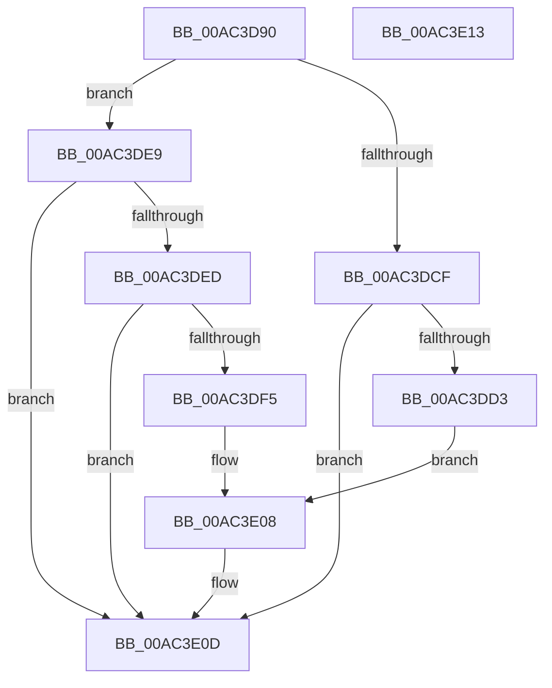

# PopEnforceResiliencyScenarios

- RVA: `0x00AC3D90`–`0x00AC3E14` (길이 `132` bytes)
- VA: `0x0000000140AC3D90`
- 실행 섹션: `PAGE`
- PDB 이름 있음: `예`; PDB Function 태그: `아니요`
- unwind 정보 RVA: `0x0005CF00`
- 디코드: `34`개 명령, `132/132` bytes 표시
- 미해석 바이트: `0` (있으면 어셈블리에 `.byte`로 보존)

> 이 문서는 커널 이미지의 기계어와 PDB 기호를 분석해 생성했습니다. 4번과 5번은 함수 원형과 자료형을 바이너리 사용 방식에서 추정한 C 해석이며 원본 소스 복구 결과는 아닙니다.

## 1. Dependencies

- 직접 호출 지점: **5**; 고유 호출 대상: **5**
- 직접 호출자로 확인된 함수: **2**
- RIP 상대 이미지 참조: **6**

### Outgoing calls
- `0x00AC3D9C` → [PopEnforceDeepSleep](PopEnforceDeepSleep_function_00AC3E1C.md) (function, `0x00AC3E1C`)
- `0x00AC3DA8` → [PpmAcquireLock](../../text/2D/PpmAcquireLock_function_002D9AA4.md) (function, `0x002D9AA4`)
- `0x00AC3DAD` → [PoFxSendSystemLatencyUpdate](../../text/46/PoFxSendSystemLatencyUpdate_function_0046A008.md) (function, `0x0046A008`)
- `0x00AC3DB9` → [PpmReleaseLock](../../text/2D/PpmReleaseLock_function_002DA428.md) (function, `0x002DA428`)
- `0x00AC3E08` → [PopEnsureCoalescingWorkerWillRun](../../text/4C/PopEnsureCoalescingWorkerWillRun_function_004C266C.md) (function, `0x004C266C`)

### Direct callers
- [NtPowerInformation](../95/NtPowerInformation_function_00955D80.md) at `0x00957483`
- [PopTransitionSystemPowerStateEx](../../pagelk/B7/PopTransitionSystemPowerStateEx_function_00B7E8C0.md) at `0x00B7EAE6`

### Static image references
- `0x00AC3DA1` → RVA `0x00F0E760` (`.data`; read)
- `0x00AC3DC2` → RVA `0x00FC6CCC` (`ALMOSTRO`; read)
- `0x00AC3DD3` → RVA `0x00F0E068` (`.data`; read/write)
- `0x00AC3DDA` → RVA `0x00FC6ADF` (`ALMOSTRO`; write)
- `0x00AC3DE1` → RVA `0x00FC6E3C` (`ALMOSTRO`; write)
- `0x00AC3DED` → RVA `0x00FC6ADF` (`ALMOSTRO`; read)

## 2. Other-region calls and transfers

- 다른 실행 섹션으로 향하는 call: **4**
  - `0x00AC3DA8` → [PpmAcquireLock](../../text/2D/PpmAcquireLock_function_002D9AA4.md) (`PAGE` → `.text`)
  - `0x00AC3DAD` → [PoFxSendSystemLatencyUpdate](../../text/46/PoFxSendSystemLatencyUpdate_function_0046A008.md) (`PAGE` → `.text`)
  - `0x00AC3DB9` → [PpmReleaseLock](../../text/2D/PpmReleaseLock_function_002DA428.md) (`PAGE` → `.text`)
  - `0x00AC3E08` → [PopEnsureCoalescingWorkerWillRun](../../text/4C/PopEnsureCoalescingWorkerWillRun_function_004C266C.md) (`PAGE` → `.text`)
- 별도 외부 분기/꼬리 이동을 확인하지 못했습니다.

## 3. Assembly (complete function range)

```asm
00AC3D90  40 53                           push rbx
00AC3D92  48 83 EC 20                     sub rsp, 0x20
00AC3D96  48 8B D9                        mov rbx, rcx
00AC3D99  8B 49 04                        mov ecx, dword ptr [rcx + 4]
00AC3D9C  E8 7B 00 00 00                  call 0x140ac3e1c
00AC3DA1  48 8D 0D B8 A9 44 00            lea rcx, [rip + 0x44a9b8]
00AC3DA8  E8 F7 5C 81 FF                  call 0x1402d9aa4
00AC3DAD  E8 56 62 9A FF                  call 0x14046a008
00AC3DB2  48 8D 0D A7 A9 44 00            lea rcx, [rip + 0x44a9a7]
00AC3DB9  E8 6A 66 81 FF                  call 0x1402da428
00AC3DBE  8B 0B                           mov ecx, dword ptr [rbx]
00AC3DC0  33 D2                           xor edx, edx
00AC3DC2  39 15 04 2F 50 00               cmp dword ptr [rip + 0x502f04], edx
00AC3DC8  0F 95 C0                        setne al
00AC3DCB  85 C9                           test ecx, ecx
00AC3DCD  74 1A                           je 0x140ac3de9
00AC3DCF  84 C0                           test al, al
00AC3DD1  75 3A                           jne 0x140ac3e0d
00AC3DD3  80 0D 8E A2 44 00 02            or byte ptr [rip + 0x44a28e], 2
00AC3DDA  C6 05 FE 2C 50 00 01            mov byte ptr [rip + 0x502cfe], 1
00AC3DE1  89 0D 55 30 50 00               mov dword ptr [rip + 0x503055], ecx
00AC3DE7  EB 1F                           jmp 0x140ac3e08
00AC3DE9  84 C0                           test al, al
00AC3DEB  74 20                           je 0x140ac3e0d
00AC3DED  38 15 EC 2C 50 00               cmp byte ptr [rip + 0x502cec], dl
00AC3DF3  74 18                           je 0x140ac3e0d
00AC3DF5  80 25 6C A2 44 00 FD            and byte ptr [rip + 0x44a26c], 0xfd
00AC3DFC  89 15 3A 30 50 00               mov dword ptr [rip + 0x50303a], edx
00AC3E02  88 15 D7 2C 50 00               mov byte ptr [rip + 0x502cd7], dl
00AC3E08  E8 5F E8 9F FF                  call 0x1404c266c
00AC3E0D  48 83 C4 20                     add rsp, 0x20
00AC3E11  5B                              pop rbx
00AC3E12  C3                              ret
00AC3E13  CC                              int3
```

## 4. C-style interpretation (structured pseudocode)

```c
__int64 __fastcall PopEnforceResiliencyScenarios(__int64 a1, int a2)
{
    __int64 result;
    __int64 v_rsp;

    v_rsp = (v_rsp) - (32);
    result = PopEnforceDeepSleep((unsigned int)(*(unsigned int *)(a1 + 4)), a2, a3, a4);
    result = PpmAcquireLock(v_rip + 4499896, a2, a3, a4);
    result = PoFxSendSystemLatencyUpdate(v_rip + 4499896, a2, a3, a4);
    result = PpmReleaseLock(v_rip + 4499879, a2, a3, a4);
    a2 = 0;
    result = ((*(unsigned int *)(v_rip + 5254916)) != 0) ? 1 : 0;
    if ((unsigned int)((unsigned int)(*(unsigned int *)(a1))) == 0) goto loc_00AC3DE9;
    if ((unsigned __int8)(result) != 0) goto loc_00AC3E0D;
    *(unsigned __int8 *)(v_rip + 5254398) = 1;
    *(unsigned int *)(v_rip + 5255253) = (unsigned int)((unsigned int)(*(unsigned int *)(a1)));
    goto loc_00AC3E08;
loc_00AC3DE9:
    if ((unsigned __int8)(result) == 0) goto loc_00AC3E0D;
    if ((*(unsigned __int8 *)(v_rip + 5254380)) == 0) goto loc_00AC3E0D;
    *(unsigned int *)(v_rip + 5255226) = 0;
    *(unsigned __int8 *)(v_rip + 5254359) = 0;
loc_00AC3E08:
    result = PopEnsureCoalescingWorkerWillRun((unsigned int)(*(unsigned int *)(a1)), a2, a3, a4);
loc_00AC3E0D:
    v_rsp = (v_rsp) + (32);
    return result;
}
```

## 5. (Beta) C Style

```c
int64_t PopEnforceResiliencyScenarios(void *Arg1, int32_t Arg2)
{
    uint8_t *arg1 = (uint8_t *)Arg1;

    int64_t result;
    int64_t local_rsp;

    local_rsp = (local_rsp) - (32);
    result = PopEnforceDeepSleep((uint32_t)(*(uint32_t *)(arg1 + 0x4)), Arg2, a3, a4);
    result = PpmAcquireLock(v_rip + 4499896, Arg2, a3, a4);
    result = PoFxSendSystemLatencyUpdate(v_rip + 4499896, Arg2, a3, a4);
    result = PpmReleaseLock(v_rip + 4499879, Arg2, a3, a4);
    Arg2 = 0;
    result = ((*(uint32_t *)(v_rip + 0x502F04)) != 0) ? 1 : 0;
    if ((uint32_t)((uint32_t)(*(uint32_t *)(arg1))) == 0) goto loc_00AC3DE9;
    if ((uint8_t)(result) != 0) goto loc_00AC3E0D;
    *(uint8_t *)(v_rip + 0x502CFE) = 1;
    *(uint32_t *)(v_rip + 0x503055) = (uint32_t)((uint32_t)(*(uint32_t *)(arg1)));
    goto loc_00AC3E08;
loc_00AC3DE9:
    if ((uint8_t)(result) == 0) goto loc_00AC3E0D;
    if ((*(uint8_t *)(v_rip + 0x502CEC)) == 0) goto loc_00AC3E0D;
    *(uint32_t *)(v_rip + 0x50303A) = 0;
    *(uint8_t *)(v_rip + 0x502CD7) = 0;
loc_00AC3E08:
    result = PopEnsureCoalescingWorkerWillRun((uint32_t)(*(uint32_t *)(arg1)), Arg2, a3, a4);
loc_00AC3E0D:
    local_rsp = (local_rsp) + (32);
    return result;
}
```

### 관측된 메모리 오프셋

구조체 형식이 확인되지 않은 접근은 인자 기준의 오프셋으로만 기록했습니다.

| 기준 인자 | 오프셋 표현 | 폭 (bit) | 접근 |
|---|---:|---:|---|
| `Arg1` | `+ 0x0` | `32` | `R` |
| `Arg1` | `+ 0x4` | `32` | `R` |

## 6. Execution-region graph

[열기: 2D/3D 그래프와 함수 탐색 컨트롤 패널](../../../control-panel.html?section=page&rva=0x00AC3D90&view=graph)

- 2D 그래프는 위에서 아래로 흐르고, 3D 그래프는 빈 공간을 드래그해 회전합니다. Shift+드래그는 이동, 휠은 확대·축소, 함수 노드 선택은 대상 보고서 이동입니다.

### Static fallback


