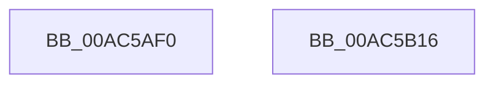

# PopEsExitSleep

- RVA: `0x00AC5AF0`–`0x00AC5B17` (길이 `39` bytes)
- VA: `0x0000000140AC5AF0`
- 실행 섹션: `PAGE`
- PDB 이름 있음: `예`; PDB Function 태그: `아니요`
- unwind 정보 RVA: `0x0005C788`
- 디코드: `9`개 명령, `39/39` bytes 표시
- 미해석 바이트: `0` (있으면 어셈블리에 `.byte`로 보존)

> 이 문서는 커널 이미지의 기계어와 PDB 기호를 분석해 생성했습니다. 4번과 5번은 함수 원형과 자료형을 바이너리 사용 방식에서 추정한 C 해석이며 원본 소스 복구 결과는 아닙니다.

## 1. Dependencies

- 직접 호출 지점: **3**; 고유 호출 대상: **3**
- 직접 호출자로 확인된 함수: **1**
- RIP 상대 이미지 참조: **1**

### Outgoing calls
- `0x00AC5AFB` → [PopAcquireRwLockExclusive](../../text/43/PopAcquireRwLockExclusive_function_00430B44.md) (function, `0x00430B44`)
- `0x00AC5B00` → [PopEsStartTelemetry](PopEsStartTelemetry_function_00AC5B20.md) (function, `0x00AC5B20`)
- `0x00AC5B0C` → [PopReleaseRwLock](../../text/2D/PopReleaseRwLock_function_002DFBBC.md) (function, `0x002DFBBC`)

### Direct callers
- [PopTransitionSystemPowerStateEx](../../pagelk/B7/PopTransitionSystemPowerStateEx_function_00B7E8C0.md) at `0x00B7F8AF`

### Static image references
- `0x00AC5AF4` → RVA `0x00F08440` (`.data`; read)

## 2. Other-region calls and transfers

- 다른 실행 섹션으로 향하는 call: **2**
  - `0x00AC5AFB` → [PopAcquireRwLockExclusive](../../text/43/PopAcquireRwLockExclusive_function_00430B44.md) (`PAGE` → `.text`)
  - `0x00AC5B0C` → [PopReleaseRwLock](../../text/2D/PopReleaseRwLock_function_002DFBBC.md) (`PAGE` → `.text`)
- 별도 외부 분기/꼬리 이동을 확인하지 못했습니다.

## 3. Assembly (complete function range)

```asm
00AC5AF0  48 83 EC 28                     sub rsp, 0x28
00AC5AF4  48 8D 0D 45 29 44 00            lea rcx, [rip + 0x442945]
00AC5AFB  E8 44 B0 96 FF                  call 0x140430b44
00AC5B00  E8 1B 00 00 00                  call 0x140ac5b20
00AC5B05  48 8D 0D 34 29 44 00            lea rcx, [rip + 0x442934]
00AC5B0C  E8 AB A0 81 FF                  call 0x1402dfbbc
00AC5B11  48 83 C4 28                     add rsp, 0x28
00AC5B15  C3                              ret
00AC5B16  CC                              int3
```

## 4. C-style interpretation (structured pseudocode)

```c
__int64 __fastcall PopEsExitSleep(void)
{
    __int64 result;
    __int64 v_rsp;

    v_rsp = (v_rsp) - (40);
    result = PopAcquireRwLockExclusive(v_rip + 4467013, a2, a3, a4);
    result = PopEsStartTelemetry(v_rip + 4467013, a2, a3, a4);
    result = PopReleaseRwLock(v_rip + 4466996, a2, a3, a4);
    v_rsp = (v_rsp) + (40);
    return result;
}
```

## 5. (Beta) C Style

```c
void PopEsExitSleep(void)
{
    int64_t result;
    int64_t local_rsp;

    local_rsp = (local_rsp) - (40);
    result = PopAcquireRwLockExclusive(v_rip + 4467013, a2, a3, a4);
    result = PopEsStartTelemetry(v_rip + 4467013, a2, a3, a4);
    result = PopReleaseRwLock(v_rip + 4466996, a2, a3, a4);
    local_rsp = (local_rsp) + (40);
    return result;
}
```

## 6. Execution-region graph

[열기: 2D/3D 그래프와 함수 탐색 컨트롤 패널](../../../control-panel.html?section=page&rva=0x00AC5AF0&view=graph)

- 2D 그래프는 위에서 아래로 흐르고, 3D 그래프는 빈 공간을 드래그해 회전합니다. Shift+드래그는 이동, 휠은 확대·축소, 함수 노드 선택은 대상 보고서 이동입니다.

### Static fallback


