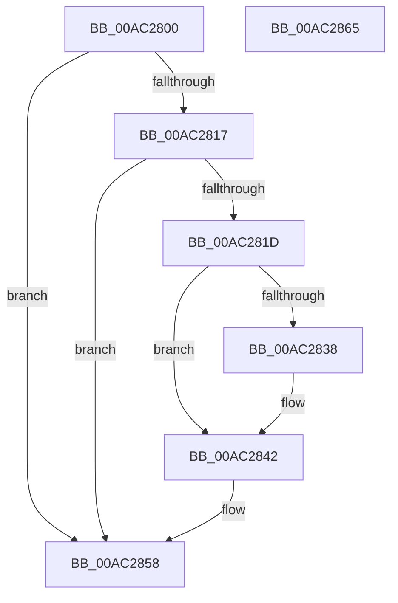

# PopEsPowerSettingBatteryThresholdCallback

- RVA: `0x00AC2800`–`0x00AC2866` (길이 `102` bytes)
- VA: `0x0000000140AC2800`
- 실행 섹션: `PAGE`
- PDB 이름 있음: `예`; PDB Function 태그: `아니요`
- unwind 정보 RVA: `0x0005CAAC`
- 디코드: `27`개 명령, `102/102` bytes 표시
- 미해석 바이트: `0` (있으면 어셈블리에 `.byte`로 보존)

> 이 문서는 커널 이미지의 기계어와 PDB 기호를 분석해 생성했습니다. 4번과 5번은 함수 원형과 자료형을 바이너리 사용 방식에서 추정한 C 해석이며 원본 소스 복구 결과는 아닙니다.

## 1. Dependencies

- 직접 호출 지점: **3**; 고유 호출 대상: **3**
- 직접 호출자로 확인된 함수: **0**
- RIP 상대 이미지 참조: **2**

### Outgoing calls
- `0x00AC2826` → [PopAcquireRwLockExclusive](../../text/43/PopAcquireRwLockExclusive_function_00430B44.md) (function, `0x00430B44`)
- `0x00AC2849` → [PopReleaseRwLock](../../text/2D/PopReleaseRwLock_function_002DFBBC.md) (function, `0x002DFBBC`)
- `0x00AC2853` → [PopEsWorkItemSchedule](../A4/PopEsWorkItemSchedule_function_00A4A5DC.md) (function, `0x00A4A5DC`)

### Direct callers
- 이 함수 시작 RVA로 연결되는 직접 call은 확인되지 않았습니다. 간접 호출은 완전히 역산할 수 없습니다.

### Static image references
- `0x00AC281D` → RVA `0x00F08440` (`.data`; read)
- `0x00AC282D` → RVA `0x00F0CE50` (`.data`; write)

## 2. Other-region calls and transfers

- 다른 실행 섹션으로 향하는 call: **2**
  - `0x00AC2826` → [PopAcquireRwLockExclusive](../../text/43/PopAcquireRwLockExclusive_function_00430B44.md) (`PAGE` → `.text`)
  - `0x00AC2849` → [PopReleaseRwLock](../../text/2D/PopReleaseRwLock_function_002DFBBC.md) (`PAGE` → `.text`)
- 별도 외부 분기/꼬리 이동을 확인하지 못했습니다.

## 3. Assembly (complete function range)

```asm
00AC2800  48 89 5C 24 08                  mov qword ptr [rsp + 8], rbx
00AC2805  57                              push rdi
00AC2806  48 83 EC 20                     sub rsp, 0x20
00AC280A  48 8B FA                        mov rdi, rdx
00AC280D  BB 0D 00 00 C0                  mov ebx, 0xc000000d
00AC2812  48 85 D2                        test rdx, rdx
00AC2815  74 41                           je 0x140ac2858
00AC2817  41 83 F8 04                     cmp r8d, 4
00AC281B  75 3B                           jne 0x140ac2858
00AC281D  48 8D 0D 1C 5C 44 00            lea rcx, [rip + 0x445c1c]
00AC2824  33 DB                           xor ebx, ebx
00AC2826  E8 19 E3 96 FF                  call 0x140430b44
00AC282B  8B 17                           mov edx, dword ptr [rdi]
00AC282D  89 15 1D A6 44 00               mov dword ptr [rip + 0x44a61d], edx
00AC2833  83 FA 64                        cmp edx, 0x64
00AC2836  76 0A                           jbe 0x140ac2842
00AC2838  C7 05 0E A6 44 00 64 00 00 00   mov dword ptr [rip + 0x44a60e], 0x64
00AC2842  48 8D 0D F7 5B 44 00            lea rcx, [rip + 0x445bf7]
00AC2849  E8 6E D3 81 FF                  call 0x1402dfbbc
00AC284E  B9 02 00 00 00                  mov ecx, 2
00AC2853  E8 84 7D F8 FF                  call 0x140a4a5dc
00AC2858  8B C3                           mov eax, ebx
00AC285A  48 8B 5C 24 30                  mov rbx, qword ptr [rsp + 0x30]
00AC285F  48 83 C4 20                     add rsp, 0x20
00AC2863  5F                              pop rdi
00AC2864  C3                              ret
00AC2865  CC                              int3
```

## 4. C-style interpretation (structured pseudocode)

```c
__int64 __fastcall PopEsPowerSettingBatteryThresholdCallback(__int64 a1, __int64 a2, int a3)
{
    __int64 result;
    __int64 v_rbx;
    __int64 v_rsp;
    unsigned __int64 v_stack_p8;

    v_stack_p8 = v_rbx;
    v_rsp = (v_rsp) - (32);
    if (a2 == 0) goto loc_00AC2858;
    if (a3 != 4) goto loc_00AC2858;
    v_rbx = 0;
    result = PopAcquireRwLockExclusive(v_rip + 4480028, a2, a3, a4);
    *(unsigned int *)(v_rip + 4498973) = (unsigned int)((unsigned int)(*(unsigned int *)(a2)));
    if (((unsigned int)((unsigned int)(*(unsigned int *)(a2)))) >= = 100) {
        *(unsigned int *)(v_rip + 4498958) = 100;
    }
    result = PopReleaseRwLock(v_rip + 4479991, (unsigned int)(*(unsigned int *)(a2)), a3, a4);
    result = PopEsWorkItemSchedule(2, (unsigned int)(*(unsigned int *)(a2)), a3, a4);
loc_00AC2858:
    v_rsp = (v_rsp) + (32);
    return 0;
}
```

## 5. (Beta) C Style

```c
int64_t PopEsPowerSettingBatteryThresholdCallback(int64_t Arg1, void *Arg2, int32_t Arg3)
{
    uint8_t *arg2 = (uint8_t *)Arg2;

    int64_t result;
    int64_t local_rbx;
    int64_t local_rsp;
    uint64_t v_stack_p8;

    v_stack_p8 = local_rbx;
    local_rsp = (local_rsp) - (32);
    if (Arg2 == NULL) goto loc_00AC2858;
    if (Arg3 != 4) goto loc_00AC2858;
    local_rbx = 0;
    result = PopAcquireRwLockExclusive(v_rip + 4480028, Arg2, Arg3, a4);
    *(uint32_t *)(v_rip + 0x44A61D) = (uint32_t)((uint32_t)(*(uint32_t *)(arg2)));
    if (((uint32_t)((uint32_t)(*(uint32_t *)(arg2)))) >= = 100) {
        *(uint32_t *)(v_rip + 0x44A60E) = 100;
    }
    result = PopReleaseRwLock(v_rip + 4479991, (uint32_t)(*(uint32_t *)(arg2)), Arg3, a4);
    result = PopEsWorkItemSchedule(2, (uint32_t)(*(uint32_t *)(arg2)), Arg3, a4);
loc_00AC2858:
    local_rsp = (local_rsp) + (32);
    return 0;
}
```

### 관측된 메모리 오프셋

구조체 형식이 확인되지 않은 접근은 인자 기준의 오프셋으로만 기록했습니다.

| 기준 인자 | 오프셋 표현 | 폭 (bit) | 접근 |
|---|---:|---:|---|
| `Arg2` | `+ 0x0` | `32` | `R` |

## 6. Execution-region graph

[열기: 2D/3D 그래프와 함수 탐색 컨트롤 패널](../../../control-panel.html?section=page&rva=0x00AC2800&view=graph)

- 2D 그래프는 위에서 아래로 흐르고, 3D 그래프는 빈 공간을 드래그해 회전합니다. Shift+드래그는 이동, 휠은 확대·축소, 함수 노드 선택은 대상 보고서 이동입니다.

### Static fallback


