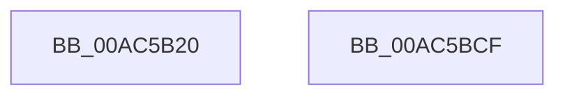

# PopEsStartTelemetry

- RVA: `0x00AC5B20`–`0x00AC5BD0` (길이 `176` bytes)
- VA: `0x0000000140AC5B20`
- 실행 섹션: `PAGE`
- PDB 이름 있음: `예`; PDB Function 태그: `아니요`
- unwind 정보 RVA: `0x00071A74`
- 디코드: `38`개 명령, `176/176` bytes 표시
- 미해석 바이트: `0` (있으면 어셈블리에 `.byte`로 보존)

> 이 문서는 커널 이미지의 기계어와 PDB 기호를 분석해 생성했습니다. 4번과 5번은 함수 원형과 자료형을 바이너리 사용 방식에서 추정한 C 해석이며 원본 소스 복구 결과는 아닙니다.

## 1. Dependencies

- 직접 호출 지점: **2**; 고유 호출 대상: **2**
- 직접 호출자로 확인된 함수: **2**
- RIP 상대 이미지 참조: **9**

### Outgoing calls
- `0x00AC5B54` → [PopAcquireRwLockShared](../../text/2D/PopAcquireRwLockShared_function_002D9A40.md) (function, `0x002D9A40`)
- `0x00AC5B6C` → [PopReleaseRwLock](../../text/2D/PopReleaseRwLock_function_002DFBBC.md) (function, `0x002DFBBC`)

### Direct callers
- [PopEsExitSleep](PopEsExitSleep_function_00AC5AF0.md) at `0x00AC5B00`
- [PopEsWorker](PopEsWorker_function_00AC6EE0.md) at `0x00AC6FB5`

### Static image references
- `0x00AC5B4A` → RVA `0x00F0C238` (`.data`; read)
- `0x00AC5B59` → RVA `0x00F0C248` (`.data`; read)
- `0x00AC5B79` → RVA `0x00E67A10` (`.data`; write)
- `0x00AC5BA4` → RVA `0x00E67A1C` (`.data`; write)
- `0x00AC5BAA` → RVA `0x00F0CE50` (`.data`; read)
- `0x00AC5BB0` → RVA `0x00E67A20` (`.data`; write)
- `0x00AC5BB6` → RVA `0x00F0CE55` (`.data`; read)
- `0x00AC5BBC` → RVA `0x00E67A00` (`.data`; write)
- `0x00AC5BC2` → RVA `0x00E67A18` (`.data`; write)

## 2. Other-region calls and transfers

- 다른 실행 섹션으로 향하는 call: **2**
  - `0x00AC5B54` → [PopAcquireRwLockShared](../../text/2D/PopAcquireRwLockShared_function_002D9A40.md) (`PAGE` → `.text`)
  - `0x00AC5B6C` → [PopReleaseRwLock](../../text/2D/PopReleaseRwLock_function_002DFBBC.md) (`PAGE` → `.text`)
- 별도 외부 분기/꼬리 이동을 확인하지 못했습니다.

## 3. Assembly (complete function range)

```asm
00AC5B20  40 53                           push rbx
00AC5B22  48 83 EC 50                     sub rsp, 0x50
00AC5B26  48 B8 04 00 00 00 80 F7 FF FF   movabs rax, 0xfffff78000000004
00AC5B30  8B 08                           mov ecx, dword ptr [rax]
00AC5B32  48 B8 20 03 00 00 80 F7 FF FF   movabs rax, 0xfffff78000000320
00AC5B3C  48 C1 E1 20                     shl rcx, 0x20
00AC5B40  48 8B 00                        mov rax, qword ptr [rax]
00AC5B43  48 C1 E0 08                     shl rax, 8
00AC5B47  48 F7 E1                        mul rcx
00AC5B4A  48 8D 0D E7 66 44 00            lea rcx, [rip + 0x4466e7]
00AC5B51  48 8B DA                        mov rbx, rdx
00AC5B54  E8 E7 3E 81 FF                  call 0x1402d9a40
00AC5B59  0F 10 05 E8 66 44 00            movups xmm0, xmmword ptr [rip + 0x4466e8]
00AC5B60  48 8D 0D D1 66 44 00            lea rcx, [rip + 0x4466d1]
00AC5B67  0F 11 44 24 20                  movups xmmword ptr [rsp + 0x20], xmm0
00AC5B6C  E8 4B A0 81 FF                  call 0x1402dfbbc
00AC5B71  0F 10 54 24 20                  movups xmm2, xmmword ptr [rsp + 0x20]
00AC5B76  45 33 C0                        xor r8d, r8d
00AC5B79  48 89 1D 90 1E 3A 00            mov qword ptr [rip + 0x3a1e90], rbx
00AC5B80  66 0F 6F CA                     movdqa xmm1, xmm2
00AC5B84  66 0F 6F C2                     movdqa xmm0, xmm2
00AC5B88  66 0F 73 D9 01                  psrldq xmm1, 1
00AC5B8D  66 0F 7E C8                     movd eax, xmm1
00AC5B91  66 0F 73 D8 0C                  psrldq xmm0, 0xc
00AC5B96  66 0F 7E C1                     movd ecx, xmm0
00AC5B9A  84 C0                           test al, al
00AC5B9C  66 0F 7E D0                     movd eax, xmm2
00AC5BA0  44 0F 45 C1                     cmovne r8d, ecx
00AC5BA4  88 05 72 1E 3A 00               mov byte ptr [rip + 0x3a1e72], al
00AC5BAA  8B 05 A0 72 44 00               mov eax, dword ptr [rip + 0x4472a0]
00AC5BB0  89 05 6A 1E 3A 00               mov dword ptr [rip + 0x3a1e6a], eax
00AC5BB6  8A 05 99 72 44 00               mov al, byte ptr [rip + 0x447299]
00AC5BBC  88 05 3E 1E 3A 00               mov byte ptr [rip + 0x3a1e3e], al
00AC5BC2  44 89 05 4F 1E 3A 00            mov dword ptr [rip + 0x3a1e4f], r8d
00AC5BC9  48 83 C4 50                     add rsp, 0x50
00AC5BCD  5B                              pop rbx
00AC5BCE  C3                              ret
00AC5BCF  CC                              int3
```

## 4. C-style interpretation (structured pseudocode)

```c
__int64 __fastcall PopEsStartTelemetry(__int64 a1, __int64 a2, int a3)
{
    __int64 result;
    __int64 v_rsp;
    unsigned __int64 v_stack_m38;

    v_rsp = (v_rsp) - (80);
    a1 = ((unsigned int)(*(unsigned int *)(result))) << (32);
    result = (*(unsigned __int64 *)(result)) << (8);
    result = PopAcquireRwLockShared(v_rip + 4482791, a2, a3, a4);
    v_stack_m38 = v_xmm0;
    result = PopReleaseRwLock(v_rip + 4482769, a2, a3, a4);
    a3 = 0;
    *(unsigned __int64 *)(v_rip + 3808912) = a2;
    if ((unsigned __int8)(result) != 0) { a3 = (unsigned int)(v_rip + 4482769); }
    *(unsigned __int8 *)(v_rip + 3808882) = (unsigned __int8)(result);
    *(unsigned int *)(v_rip + 3808874) = (unsigned int)((unsigned int)(*(unsigned int *)(v_rip + 4485792)));
    *(unsigned __int8 *)(v_rip + 3808830) = (unsigned __int8)(*(unsigned __int8 *)(v_rip + 4485785));
    *(unsigned int *)(v_rip + 3808847) = a3;
    v_rsp = (v_rsp) + (80);
    return *(unsigned __int8 *)(v_rip + 4485785);
}
```

## 5. (Beta) C Style

```c
int64_t PopEsStartTelemetry(int64_t Arg1, int64_t Arg2, int32_t Arg3)
{
    int64_t result;
    int64_t local_rsp;
    uint64_t v_stack_m38;

    local_rsp = (local_rsp) - (80);
    Arg1 = ((uint32_t)(*(uint32_t *)(result))) << (32);
    result = (*(uint64_t *)(result)) << (8);
    result = PopAcquireRwLockShared(v_rip + 4482791, Arg2, Arg3, a4);
    v_stack_m38 = v_xmm0;
    result = PopReleaseRwLock(v_rip + 4482769, Arg2, Arg3, a4);
    Arg3 = 0;
    *(uint64_t *)(v_rip + 0x3A1E90) = Arg2;
    if ((uint8_t)(result) != 0) { Arg3 = (uint32_t)(v_rip + 4482769); }
    *(uint8_t *)(v_rip + 0x3A1E72) = (uint8_t)(result);
    *(uint32_t *)(v_rip + 0x3A1E6A) = (uint32_t)((uint32_t)(*(uint32_t *)(v_rip + 0x4472A0)));
    *(uint8_t *)(v_rip + 0x3A1E3E) = (uint8_t)(*(uint8_t *)(v_rip + 0x447299));
    *(uint32_t *)(v_rip + 0x3A1E4F) = Arg3;
    local_rsp = (local_rsp) + (80);
    return *(uint8_t *)(v_rip + 0x447299);
}
```

## 6. Execution-region graph

[열기: 2D/3D 그래프와 함수 탐색 컨트롤 패널](../../../control-panel.html?section=page&rva=0x00AC5B20&view=graph)

- 2D 그래프는 위에서 아래로 흐르고, 3D 그래프는 빈 공간을 드래그해 회전합니다. Shift+드래그는 이동, 휠은 확대·축소, 함수 노드 선택은 대상 보고서 이동입니다.

### Static fallback


