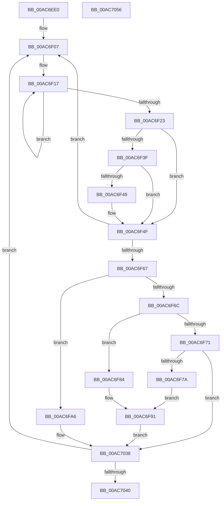

# PopEsWorker

- RVA: `0x00AC6EE0`–`0x00AC7057` (길이 `375` bytes)
- VA: `0x0000000140AC6EE0`
- 실행 섹션: `PAGE`
- PDB 이름 있음: `예`; PDB Function 태그: `아니요`
- unwind 정보 RVA: `0x000BDFD8`
- 디코드: `92`개 명령, `375/375` bytes 표시
- 미해석 바이트: `0` (있으면 어셈블리에 `.byte`로 보존)

> 이 문서는 커널 이미지의 기계어와 PDB 기호를 분석해 생성했습니다. 4번과 5번은 함수 원형과 자료형을 바이너리 사용 방식에서 추정한 C 해석이며 원본 소스 복구 결과는 아닙니다.

## 1. Dependencies

- 직접 호출 지점: **12**; 고유 호출 대상: **7**
- 직접 호출자로 확인된 함수: **0**
- RIP 상대 이미지 참조: **10**

### Outgoing calls
- `0x00AC6F7D` → [PopAcquireRwLockExclusive](../../text/43/PopAcquireRwLockExclusive_function_00430B44.md) (function, `0x00430B44`)
- `0x00AC6F87` → [PopAcquireRwLockExclusive](../../text/43/PopAcquireRwLockExclusive_function_00430B44.md) (function, `0x00430B44`)
- `0x00AC6F8C` → [PopEsUpdateSetting](../76/PopEsUpdateSetting_function_00769A48.md) (function, `0x00769A48`)
- `0x00AC6F94` → [PopEsUpdateState](../../text/5D/PopEsUpdateState_function_005DA018.md) (function, `0x005DA018`)
- `0x00AC6F9C` → [PopReleaseRwLock](../../text/2D/PopReleaseRwLock_function_002DFBBC.md) (function, `0x002DFBBC`)
- `0x00AC6FA8` → [PopEsPublishStateV2](../76/PopEsPublishStateV2_function_00769908.md) (function, `0x00769908`)
- `0x00AC6FB0` → [PopAcquireRwLockExclusive](../../text/43/PopAcquireRwLockExclusive_function_00430B44.md) (function, `0x00430B44`)
- `0x00AC6FB5` → [PopEsStartTelemetry](PopEsStartTelemetry_function_00AC5B20.md) (function, `0x00AC5B20`)
- `0x00AC6FBD` → [PopReleaseRwLock](../../text/2D/PopReleaseRwLock_function_002DFBBC.md) (function, `0x002DFBBC`)
- `0x00AC6FE9` → [ExSubscribeWnfStateChange](../9D/ExSubscribeWnfStateChange_function_009D4BC0.md) (function, `0x009D4BC0`)
- `0x00AC700E` → [ExSubscribeWnfStateChange](../9D/ExSubscribeWnfStateChange_function_009D4BC0.md) (function, `0x009D4BC0`)
- `0x00AC7033` → [ExSubscribeWnfStateChange](../9D/ExSubscribeWnfStateChange_function_009D4BC0.md) (function, `0x009D4BC0`)

### Direct callers
- 이 함수 시작 RVA로 연결되는 직접 call은 확인되지 않았습니다. 간접 호출은 완전히 역산할 수 없습니다.

### Static image references
- `0x00AC6EF9` → RVA `0x00F08440` (`.data`; read)
- `0x00AC6F00` → RVA `0x00769AF0` (`PopEsWnfSubscriptionGpAndMdmCallback`; read)
- `0x00AC6F0A` → RVA `0x00E679D8` (`.data`; read)
- `0x00AC6FC8` → RVA `0x00A4A3C0` (`PopEsWnfSubscriptionOverrideCallback`; read)
- `0x00AC6FD7` → RVA `0x000209D8` (`.rdata`; read)
- `0x00AC6FDE` → RVA `0x00F08430` (`.data`; read)
- `0x00AC6FF4` → RVA `0x00029168` (`.rdata`; read)
- `0x00AC7003` → RVA `0x00F08418` (`.data`; read)
- `0x00AC7019` → RVA `0x000208E0` (`.rdata`; read)
- `0x00AC7028` → RVA `0x00F08420` (`.data`; read)

## 2. Other-region calls and transfers

- 다른 실행 섹션으로 향하는 call: **6**
  - `0x00AC6F7D` → [PopAcquireRwLockExclusive](../../text/43/PopAcquireRwLockExclusive_function_00430B44.md) (`PAGE` → `.text`)
  - `0x00AC6F87` → [PopAcquireRwLockExclusive](../../text/43/PopAcquireRwLockExclusive_function_00430B44.md) (`PAGE` → `.text`)
  - `0x00AC6F94` → [PopEsUpdateState](../../text/5D/PopEsUpdateState_function_005DA018.md) (`PAGE` → `.text`)
  - `0x00AC6F9C` → [PopReleaseRwLock](../../text/2D/PopReleaseRwLock_function_002DFBBC.md) (`PAGE` → `.text`)
  - `0x00AC6FB0` → [PopAcquireRwLockExclusive](../../text/43/PopAcquireRwLockExclusive_function_00430B44.md) (`PAGE` → `.text`)
  - `0x00AC6FBD` → [PopReleaseRwLock](../../text/2D/PopReleaseRwLock_function_002DFBBC.md) (`PAGE` → `.text`)
- 별도 외부 분기/꼬리 이동을 확인하지 못했습니다.

## 3. Assembly (complete function range)

```asm
00AC6EE0  48 8B C4                        mov rax, rsp
00AC6EE3  48 89 58 08                     mov qword ptr [rax + 8], rbx
00AC6EE7  48 89 68 18                     mov qword ptr [rax + 0x18], rbp
00AC6EEB  48 89 78 20                     mov qword ptr [rax + 0x20], rdi
00AC6EEF  41 57                           push r15
00AC6EF1  48 83 EC 30                     sub rsp, 0x30
00AC6EF5  83 60 10 00                     and dword ptr [rax + 0x10], 0
00AC6EF9  48 8D 2D 40 15 44 00            lea rbp, [rip + 0x441540]
00AC6F00  4C 8D 3D E9 2B CA FF            lea r15, [rip - 0x35d417]
00AC6F07  40 32 FF                        xor dil, dil
00AC6F0A  0F 0D 0D C7 0A 3A 00            prefetchw byte ptr [rip + 0x3a0ac7]
00AC6F11  8B 05 C1 0A 3A 00               mov eax, dword ptr [rip + 0x3a0ac1]
00AC6F17  8B C8                           mov ecx, eax
00AC6F19  F0 0F B1 0D B7 0A 3A 00         lock cmpxchg dword ptr [rip + 0x3a0ab7], ecx
00AC6F21  75 F4                           jne 0x140ac6f17
00AC6F23  0F BC C8                        bsf ecx, eax
00AC6F26  BA 01 00 00 00                  mov edx, 1
00AC6F2B  44 8B C0                        mov r8d, eax
00AC6F2E  D3 E2                           shl edx, cl
00AC6F30  89 4C 24 48                     mov dword ptr [rsp + 0x48], ecx
00AC6F34  8B CA                           mov ecx, edx
00AC6F36  F7 D1                           not ecx
00AC6F38  23 C8                           and ecx, eax
00AC6F3A  F6 C1 08                        test cl, 8
00AC6F3D  74 10                           je 0x140ac6f4f
00AC6F3F  8D 42 FE                        lea eax, [rdx - 2]
00AC6F42  A9 FD FF FF FF                  test eax, 0xfffffffd
00AC6F47  75 06                           jne 0x140ac6f4f
00AC6F49  40 B7 01                        mov dil, 1
00AC6F4C  83 E1 F7                        and ecx, 0xfffffff7
00AC6F4F  8B D9                           mov ebx, ecx
00AC6F51  41 8B C0                        mov eax, r8d
00AC6F54  83 E3 FB                        and ebx, 0xfffffffb
00AC6F57  83 FA 02                        cmp edx, 2
00AC6F5A  0F 45 D9                        cmovne ebx, ecx
00AC6F5D  F0 0F B1 1D 73 0A 3A 00         lock cmpxchg dword ptr [rip + 0x3a0a73], ebx
00AC6F65  75 A0                           jne 0x140ac6f07
00AC6F67  83 EA 01                        sub edx, 1
00AC6F6A  74 3A                           je 0x140ac6fa6
00AC6F6C  83 EA 01                        sub edx, 1
00AC6F6F  74 13                           je 0x140ac6f84
00AC6F71  83 FA 02                        cmp edx, 2
00AC6F74  0F 85 BE 00 00 00               jne 0x140ac7038
00AC6F7A  48 8B CD                        mov rcx, rbp
00AC6F7D  E8 C2 9B 96 FF                  call 0x140430b44
00AC6F82  EB 0D                           jmp 0x140ac6f91
00AC6F84  48 8B CD                        mov rcx, rbp
00AC6F87  E8 B8 9B 96 FF                  call 0x140430b44
00AC6F8C  E8 B7 2A CA FF                  call 0x140769a48
00AC6F91  40 8A CF                        mov cl, dil
00AC6F94  E8 7F 30 B1 FF                  call 0x1405da018
00AC6F99  48 8B CD                        mov rcx, rbp
00AC6F9C  E8 1B 8C 81 FF                  call 0x1402dfbbc
00AC6FA1  E9 92 00 00 00                  jmp 0x140ac7038
00AC6FA6  B1 01                           mov cl, 1
00AC6FA8  E8 5B 29 CA FF                  call 0x140769908
00AC6FAD  48 8B CD                        mov rcx, rbp
00AC6FB0  E8 8F 9B 96 FF                  call 0x140430b44
00AC6FB5  E8 66 EB FF FF                  call 0x140ac5b20
00AC6FBA  48 8B CD                        mov rcx, rbp
00AC6FBD  E8 FA 8B 81 FF                  call 0x1402dfbbc
00AC6FC2  48 83 64 24 28 00               and qword ptr [rsp + 0x28], 0
00AC6FC8  48 8D 05 F1 33 F8 FF            lea rax, [rip - 0x7cc0f]
00AC6FCF  45 33 C9                        xor r9d, r9d
00AC6FD2  48 89 44 24 20                  mov qword ptr [rsp + 0x20], rax
00AC6FD7  48 8D 15 FA 99 55 FF            lea rdx, [rip - 0xaa6606]
00AC6FDE  48 8D 0D 4B 14 44 00            lea rcx, [rip + 0x44144b]
00AC6FE5  45 8D 41 01                     lea r8d, [r9 + 1]
00AC6FE9  E8 D2 DB F0 FF                  call 0x1409d4bc0
00AC6FEE  48 83 64 24 28 00               and qword ptr [rsp + 0x28], 0
00AC6FF4  48 8D 15 6D 21 56 FF            lea rdx, [rip - 0xa9de93]
00AC6FFB  45 33 C9                        xor r9d, r9d
00AC6FFE  4C 89 7C 24 20                  mov qword ptr [rsp + 0x20], r15
00AC7003  48 8D 0D 0E 14 44 00            lea rcx, [rip + 0x44140e]
00AC700A  45 8D 41 01                     lea r8d, [r9 + 1]
00AC700E  E8 AD DB F0 FF                  call 0x1409d4bc0
00AC7013  48 83 64 24 28 00               and qword ptr [rsp + 0x28], 0
00AC7019  48 8D 15 C0 98 55 FF            lea rdx, [rip - 0xaa6740]
00AC7020  45 33 C9                        xor r9d, r9d
00AC7023  4C 89 7C 24 20                  mov qword ptr [rsp + 0x20], r15
00AC7028  48 8D 0D F1 13 44 00            lea rcx, [rip + 0x4413f1]
00AC702F  45 8D 41 01                     lea r8d, [r9 + 1]
00AC7033  E8 88 DB F0 FF                  call 0x1409d4bc0
00AC7038  85 DB                           test ebx, ebx
00AC703A  0F 85 C7 FE FF FF               jne 0x140ac6f07
00AC7040  48 8B 5C 24 40                  mov rbx, qword ptr [rsp + 0x40]
00AC7045  48 8B 6C 24 50                  mov rbp, qword ptr [rsp + 0x50]
00AC704A  48 8B 7C 24 58                  mov rdi, qword ptr [rsp + 0x58]
00AC704F  48 83 C4 30                     add rsp, 0x30
00AC7053  41 5F                           pop r15
00AC7055  C3                              ret
00AC7056  CC                              int3
```

## 4. C-style interpretation (structured pseudocode)

```c
__int64 __fastcall PopEsWorker(__int64 a1, __int64 a2, __int64 a3, int a4)
{
    __int64 result;
    __int64 v_rbx;
    __int64 v_rdi;
    __int64 v_rsp;
    unsigned __int64 v_stack_m10;
    unsigned __int64 v_stack_m18;
    unsigned int v_stack_p10;
    unsigned __int64 v_stack_p18;
    unsigned __int64 v_stack_p20;
    unsigned __int64 v_stack_p8;

    *(unsigned __int64 *)(v_rsp + 8) = v_rbx;
    *(unsigned __int64 *)(v_rsp + 24) = v_rbp;
    *(unsigned __int64 *)(v_rsp + 32) = v_rdi;
    v_rsp = (v_rsp) - (48);
loc_00AC6F07:
    v_rdi = 0;
loc_00AC6F17:
    if (condition_is_not_equal) goto loc_00AC6F17;
    a2 = (unsigned int)((1) << ((unsigned __int8)((unsigned int)((unsigned int)((unsigned int)(*(unsigned int *)(v_rip + 3803841)))))));
    v_stack_p10 = (unsigned int)((unsigned int)((unsigned int)((unsigned int)(*(unsigned int *)(v_rip + 3803841)))));
    a1 = (unsigned int)(~((unsigned int)((unsigned int)(a2))));
    a1 = (unsigned int)((a1) & ((unsigned int)((unsigned int)(*(unsigned int *)(v_rip + 3803841)))));
    if ((((unsigned __int8)(a1)) & (8)) == 0) goto loc_00AC6F4F;
    if ((((unsigned int)(a2 - 2)) & (0xFFFFFFFDULL)) == 0) {
        v_rdi = 1;
        a1 = (unsigned int)((a1) & (0xFFFFFFF7ULL));
    }
    v_rbx = (unsigned int)(((unsigned int)((unsigned int)(a1))) & (0xFFFFFFFBULL));
    if (((unsigned int)(a2)) != 2) { v_rbx = (unsigned int)(a1); }
    if (((unsigned int)(a2)) != 2) goto loc_00AC6F07;
    a2 = (unsigned int)((a2) - (1));
    if (condition_is_equal) goto loc_00AC6FA6;
    a2 = (unsigned int)((a2) - (1));
    if (condition_is_equal) goto loc_00AC6F84;
    if (((unsigned int)(a2)) != 2) goto loc_00AC7038;
    result = PopAcquireRwLockExclusive(v_rip + 4461888, a2, (unsigned int)((unsigned int)((unsigned int)(*(unsigned int *)(v_rip + 3803841)))), a4);
    goto loc_00AC6F91;
loc_00AC6F84:
    result = PopAcquireRwLockExclusive(v_rip + 4461888, a2, (unsigned int)((unsigned int)((unsigned int)(*(unsigned int *)(v_rip + 3803841)))), a4);
    result = PopEsUpdateSetting(v_rip + 4461888, a2, (unsigned int)((unsigned int)((unsigned int)(*(unsigned int *)(v_rip + 3803841)))), a4);
loc_00AC6F91:
    result = PopEsUpdateState((unsigned __int8)(v_rdi), a2, (unsigned int)((unsigned int)((unsigned int)(*(unsigned int *)(v_rip + 3803841)))), a4);
    result = PopReleaseRwLock(v_rip + 4461888, a2, (unsigned int)((unsigned int)((unsigned int)(*(unsigned int *)(v_rip + 3803841)))), a4);
    goto loc_00AC7038;
loc_00AC6FA6:
    result = PopEsPublishStateV2(1, a2, (unsigned int)((unsigned int)((unsigned int)(*(unsigned int *)(v_rip + 3803841)))), a4);
    result = PopAcquireRwLockExclusive(v_rip + 4461888, a2, (unsigned int)((unsigned int)((unsigned int)(*(unsigned int *)(v_rip + 3803841)))), a4);
    result = PopEsStartTelemetry(v_rip + 4461888, a2, (unsigned int)((unsigned int)((unsigned int)(*(unsigned int *)(v_rip + 3803841)))), a4);
    result = PopReleaseRwLock(v_rip + 4461888, a2, (unsigned int)((unsigned int)((unsigned int)(*(unsigned int *)(v_rip + 3803841)))), a4);
    a4 = 0;
    v_stack_m18 = v_rip - 510991;
    result = ExSubscribeWnfStateChange(v_rip + 4461643, v_rip - 11167238, a4 + 1, a4);
    a4 = 0;
    v_stack_m18 = v_rip - 3527703;
    result = ExSubscribeWnfStateChange(v_rip + 4461582, v_rip - 11132563, a4 + 1, a4);
    a4 = 0;
    v_stack_m18 = v_rip - 3527703;
    result = ExSubscribeWnfStateChange(v_rip + 4461553, v_rip - 11167552, a4 + 1, a4);
loc_00AC7038:
    if ((unsigned int)(v_rbx) != 0) goto loc_00AC6F07;
    v_rsp = (v_rsp) + (48);
    return result;
}
```

## 5. (Beta) C Style

```c
int64_t PopEsWorker(int64_t Arg1, int64_t Arg2, int64_t Arg3, int32_t Arg4)
{
    int64_t result;
    int64_t local_rbx;
    int64_t local_rdi;
    int64_t local_rsp;
    uint64_t v_stack_m10;
    uint64_t v_stack_m18;
    uint32_t v_stack_p10;
    uint64_t v_stack_p18;
    uint64_t v_stack_p20;
    uint64_t v_stack_p8;

    *(uint64_t *)(local_rsp + 0x8) = local_rbx;
    *(uint64_t *)(local_rsp + 0x18) = local_rbp;
    *(uint64_t *)(local_rsp + 0x20) = local_rdi;
    local_rsp = (local_rsp) - (48);
loc_00AC6F07:
    local_rdi = 0;
loc_00AC6F17:
    if (condition_is_not_equal) goto loc_00AC6F17;
    Arg2 = (uint32_t)((1) << ((uint8_t)((uint32_t)((uint32_t)((uint32_t)(*(uint32_t *)(v_rip + 0x3A0AC1)))))));
    v_stack_p10 = (uint32_t)((uint32_t)((uint32_t)((uint32_t)(*(uint32_t *)(v_rip + 0x3A0AC1)))));
    Arg1 = (uint32_t)(~((uint32_t)((uint32_t)(Arg2))));
    Arg1 = (uint32_t)((Arg1) & ((uint32_t)((uint32_t)(*(uint32_t *)(v_rip + 0x3A0AC1)))));
    if ((((uint8_t)(Arg1)) & (8)) == 0) goto loc_00AC6F4F;
    if ((((uint32_t)(Arg2 - 2)) & (0xFFFFFFFDULL)) == 0) {
        local_rdi = 1;
        Arg1 = (uint32_t)((Arg1) & (0xFFFFFFF7ULL));
    }
    local_rbx = (uint32_t)(((uint32_t)((uint32_t)(Arg1))) & (0xFFFFFFFBULL));
    if (((uint32_t)(Arg2)) != 2) { local_rbx = (uint32_t)(Arg1); }
    if (((uint32_t)(Arg2)) != 2) goto loc_00AC6F07;
    Arg2 = (uint32_t)((Arg2) - (1));
    if (condition_is_equal) goto loc_00AC6FA6;
    Arg2 = (uint32_t)((Arg2) - (1));
    if (condition_is_equal) goto loc_00AC6F84;
    if (((uint32_t)(Arg2)) != 2) goto loc_00AC7038;
    result = PopAcquireRwLockExclusive(v_rip + 4461888, Arg2, (uint32_t)((uint32_t)((uint32_t)(*(uint32_t *)(v_rip + 0x3A0AC1)))), Arg4);
    goto loc_00AC6F91;
loc_00AC6F84:
    result = PopAcquireRwLockExclusive(v_rip + 4461888, Arg2, (uint32_t)((uint32_t)((uint32_t)(*(uint32_t *)(v_rip + 0x3A0AC1)))), Arg4);
    result = PopEsUpdateSetting(v_rip + 4461888, Arg2, (uint32_t)((uint32_t)((uint32_t)(*(uint32_t *)(v_rip + 0x3A0AC1)))), Arg4);
loc_00AC6F91:
    result = PopEsUpdateState((uint8_t)(local_rdi), Arg2, (uint32_t)((uint32_t)((uint32_t)(*(uint32_t *)(v_rip + 0x3A0AC1)))), Arg4);
    result = PopReleaseRwLock(v_rip + 4461888, Arg2, (uint32_t)((uint32_t)((uint32_t)(*(uint32_t *)(v_rip + 0x3A0AC1)))), Arg4);
    goto loc_00AC7038;
loc_00AC6FA6:
    result = PopEsPublishStateV2(1, Arg2, (uint32_t)((uint32_t)((uint32_t)(*(uint32_t *)(v_rip + 0x3A0AC1)))), Arg4);
    result = PopAcquireRwLockExclusive(v_rip + 4461888, Arg2, (uint32_t)((uint32_t)((uint32_t)(*(uint32_t *)(v_rip + 0x3A0AC1)))), Arg4);
    result = PopEsStartTelemetry(v_rip + 4461888, Arg2, (uint32_t)((uint32_t)((uint32_t)(*(uint32_t *)(v_rip + 0x3A0AC1)))), Arg4);
    result = PopReleaseRwLock(v_rip + 4461888, Arg2, (uint32_t)((uint32_t)((uint32_t)(*(uint32_t *)(v_rip + 0x3A0AC1)))), Arg4);
    Arg4 = 0;
    v_stack_m18 = v_rip - 510991;
    result = ExSubscribeWnfStateChange(v_rip + 4461643, v_rip - 11167238, Arg4 + 1, Arg4);
    Arg4 = 0;
    v_stack_m18 = v_rip - 3527703;
    result = ExSubscribeWnfStateChange(v_rip + 4461582, v_rip - 11132563, Arg4 + 1, Arg4);
    Arg4 = 0;
    v_stack_m18 = v_rip - 3527703;
    result = ExSubscribeWnfStateChange(v_rip + 4461553, v_rip - 11167552, Arg4 + 1, Arg4);
loc_00AC7038:
    if ((uint32_t)(local_rbx) != 0) goto loc_00AC6F07;
    local_rsp = (local_rsp) + (48);
    return result;
}
```

## 6. Execution-region graph

[열기: 2D/3D 그래프와 함수 탐색 컨트롤 패널](../../../control-panel.html?section=page&rva=0x00AC6EE0&view=graph)

- 2D 그래프는 위에서 아래로 흐르고, 3D 그래프는 빈 공간을 드래그해 회전합니다. Shift+드래그는 이동, 휠은 확대·축소, 함수 노드 선택은 대상 보고서 이동입니다.

### Static fallback


