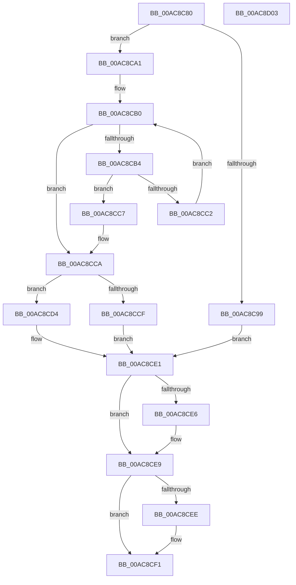

# PopFanFindBucketIndex

- RVA: `0x00AC8C80`–`0x00AC8D04` (길이 `132` bytes)
- VA: `0x0000000140AC8C80`
- 실행 섹션: `PAGE`
- PDB 이름 있음: `예`; PDB Function 태그: `아니요`
- unwind 정보 RVA: `0x00069588`
- 디코드: `41`개 명령, `132/132` bytes 표시
- 미해석 바이트: `0` (있으면 어셈블리에 `.byte`로 보존)

> 이 문서는 커널 이미지의 기계어와 PDB 기호를 분석해 생성했습니다. 4번과 5번은 함수 원형과 자료형을 바이너리 사용 방식에서 추정한 C 해석이며 원본 소스 복구 결과는 아닙니다.

## 1. Dependencies

- 직접 호출 지점: **0**; 고유 호출 대상: **0**
- 직접 호출자로 확인된 함수: **2**
- RIP 상대 이미지 참조: **0**

### Outgoing calls
- 직접 디코드된 call 명령이 없습니다.

### Direct callers
- [PopFanUpdateSpeed](../AA/PopFanUpdateSpeed_function_00AABF40.md) at `0x00AAC0E2`
- [PopFanUpdateStatistics](../AA/PopFanUpdateStatistics_function_00AAC23C.md) at `0x00AAC295`

### Static image references
- 디코드된 RIP-relative 메모리 참조가 없습니다.

## 2. Other-region calls and transfers

- 다른 실행 섹션으로 향하는 call: **0**
- 별도 외부 분기/꼬리 이동을 확인하지 못했습니다.

## 3. Assembly (complete function range)

```asm
00AC8C80  48 89 5C 24 08                  mov qword ptr [rsp + 8], rbx
00AC8C85  48 89 74 24 10                  mov qword ptr [rsp + 0x10], rsi
00AC8C8A  48 89 7C 24 18                  mov qword ptr [rsp + 0x18], rdi
00AC8C8F  41 83 CB FF                     or r11d, 0xffffffff
00AC8C93  8B FA                           mov edi, edx
00AC8C95  85 D2                           test edx, edx
00AC8C97  75 08                           jne 0x140ac8ca1
00AC8C99  33 C0                           xor eax, eax
00AC8C9B  44 8D 5A 01                     lea r11d, [rdx + 1]
00AC8C9F  EB 40                           jmp 0x140ac8ce1
00AC8CA1  8B B1 80 00 00 00               mov esi, dword ptr [rcx + 0x80]
00AC8CA7  41 BA 01 00 00 00               mov r10d, 1
00AC8CAD  41 8B D2                        mov edx, r10d
00AC8CB0  3B D6                           cmp edx, esi
00AC8CB2  77 16                           ja 0x140ac8cca
00AC8CB4  8D 42 FF                        lea eax, [rdx - 1]
00AC8CB7  8B 84 81 84 00 00 00            mov eax, dword ptr [rcx + rax*4 + 0x84]
00AC8CBE  3B F8                           cmp edi, eax
00AC8CC0  76 05                           jbe 0x140ac8cc7
00AC8CC2  41 03 D2                        add edx, r10d
00AC8CC5  EB E9                           jmp 0x140ac8cb0
00AC8CC7  44 8B D8                        mov r11d, eax
00AC8CCA  41 3B D2                        cmp edx, r10d
00AC8CCD  75 05                           jne 0x140ac8cd4
00AC8CCF  41 8B C2                        mov eax, r10d
00AC8CD2  EB 0D                           jmp 0x140ac8ce1
00AC8CD4  8D 42 FE                        lea eax, [rdx - 2]
00AC8CD7  8B 84 81 84 00 00 00            mov eax, dword ptr [rcx + rax*4 + 0x84]
00AC8CDE  41 03 C2                        add eax, r10d
00AC8CE1  4D 85 C0                        test r8, r8
00AC8CE4  74 03                           je 0x140ac8ce9
00AC8CE6  41 89 00                        mov dword ptr [r8], eax
00AC8CE9  4D 85 C9                        test r9, r9
00AC8CEC  74 03                           je 0x140ac8cf1
00AC8CEE  45 89 19                        mov dword ptr [r9], r11d
00AC8CF1  48 8B 5C 24 08                  mov rbx, qword ptr [rsp + 8]
00AC8CF6  8B C2                           mov eax, edx
00AC8CF8  48 8B 74 24 10                  mov rsi, qword ptr [rsp + 0x10]
00AC8CFD  48 8B 7C 24 18                  mov rdi, qword ptr [rsp + 0x18]
00AC8D02  C3                              ret
00AC8D03  CC                              int3
```

## 4. C-style interpretation (structured pseudocode)

```c
__int64 __fastcall PopFanFindBucketIndex(__int64 a1, __int64 a2, __int64 a3, __int64 a4)
{
    __int64 result;
    __int64 v_r11;
    unsigned __int64 v_stack_p10;
    unsigned __int64 v_stack_p18;
    unsigned __int64 v_stack_p8;

    v_stack_p8 = v_rbx;
    v_stack_p10 = v_rsi;
    v_stack_p18 = v_rdi;
    v_r11 = (unsigned int)((v_r11) | (0xFFFFFFFFULL));
    if ((unsigned int)(a2) != 0) goto loc_00AC8CA1;
    result = 0;
    goto loc_00AC8CE1;
loc_00AC8CA1:
loc_00AC8CB0:
    if (1 > ((unsigned int)((unsigned int)(*(unsigned int *)(a1 + 128))))) goto loc_00AC8CCA;
    if (((unsigned int)((unsigned int)((unsigned int)(a2)))) <= ((unsigned int)((unsigned int)(*(unsigned int *)(a1 + 1 - 1 * 4 + 132))))) goto loc_00AC8CC7;
    a2 = (unsigned int)((1) + (1));
    goto loc_00AC8CB0;
loc_00AC8CC7:
loc_00AC8CCA:
    if (((unsigned int)(a2)) != 1) goto loc_00AC8CD4;
    goto loc_00AC8CE1;
loc_00AC8CD4:
    result = (unsigned int)(((unsigned int)(*(unsigned int *)(a1 + a2 - 2 * 4 + 132))) + (1));
loc_00AC8CE1:
    if (a3 != 0) {
        *(unsigned int *)(a3) = (unsigned int)(result);
    }
    if (a4 != 0) {
        *(unsigned int *)(a4) = (unsigned int)((unsigned int)((unsigned int)((unsigned int)(*(unsigned int *)(a1 + 1 - 1 * 4 + 132)))));
    }
    return (unsigned int)((unsigned int)(a2));
}
```

## 5. (Beta) C Style

```c
int64_t PopFanFindBucketIndex(void *Arg1, int64_t Arg2, int64_t Arg3, int64_t Arg4)
{
    uint8_t *arg1 = (uint8_t *)Arg1;

    int64_t result;
    int64_t local_r11;
    uint64_t v_stack_p10;
    uint64_t v_stack_p18;
    uint64_t v_stack_p8;

    v_stack_p8 = local_rbx;
    v_stack_p10 = local_rsi;
    v_stack_p18 = local_rdi;
    local_r11 = (uint32_t)((local_r11) | (0xFFFFFFFFULL));
    if ((uint32_t)(Arg2) != 0) goto loc_00AC8CA1;
    result = 0;
    goto loc_00AC8CE1;
loc_00AC8CA1:
loc_00AC8CB0:
    if (1 > ((uint32_t)((uint32_t)(*(uint32_t *)(arg1 + 0x80))))) goto loc_00AC8CCA;
    if (((uint32_t)((uint32_t)((uint32_t)(Arg2)))) <= ((uint32_t)((uint32_t)(*(uint32_t *)(arg1 + 0x1 - 0x1 * 4 + 0x84))))) goto loc_00AC8CC7;
    Arg2 = (uint32_t)((1) + (1));
    goto loc_00AC8CB0;
loc_00AC8CC7:
loc_00AC8CCA:
    if (((uint32_t)(Arg2)) != 1) goto loc_00AC8CD4;
    goto loc_00AC8CE1;
loc_00AC8CD4:
    result = (uint32_t)(((uint32_t)(*(uint32_t *)(arg1 + Arg2 - 0x2 * 4 + 0x84))) + (1));
loc_00AC8CE1:
    if (Arg3 != 0) {
        *(uint32_t *)(Arg3) = (uint32_t)(result);
    }
    if (Arg4 != 0) {
        *(uint32_t *)(Arg4) = (uint32_t)((uint32_t)((uint32_t)((uint32_t)(*(uint32_t *)(arg1 + 0x1 - 0x1 * 4 + 0x84)))));
    }
    return (uint32_t)((uint32_t)(Arg2));
}
```

### 관측된 메모리 오프셋

구조체 형식이 확인되지 않은 접근은 인자 기준의 오프셋으로만 기록했습니다.

| 기준 인자 | 오프셋 표현 | 폭 (bit) | 접근 |
|---|---:|---:|---|
| `Arg1` | `+ 0x80` | `32` | `R` |
| `Arg1` | `+ 0x84 + rax*4` | `32` | `R` |

## 6. Execution-region graph

[열기: 2D/3D 그래프와 함수 탐색 컨트롤 패널](../../../control-panel.html?section=page&rva=0x00AC8C80&view=graph)

- 2D 그래프는 위에서 아래로 흐르고, 3D 그래프는 빈 공간을 드래그해 회전합니다. Shift+드래그는 이동, 휠은 확대·축소, 함수 노드 선택은 대상 보고서 이동입니다.

### Static fallback


