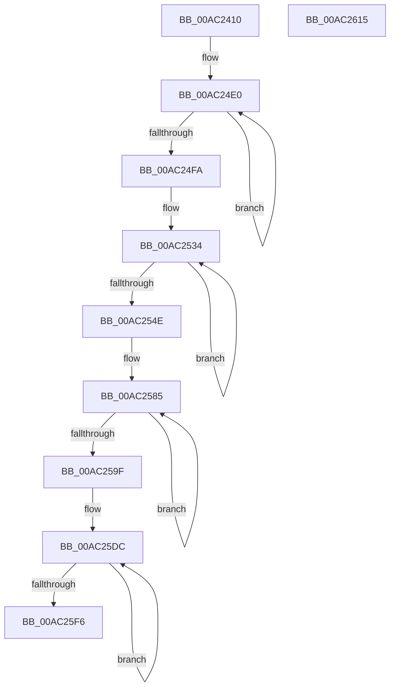

# PopIdleWakeSourceAccountingBucketsToDiagnosticBuckets

- RVA: `0x00AC2410`–`0x00AC2616` (길이 `518` bytes)
- VA: `0x0000000140AC2410`
- 실행 섹션: `PAGE`
- PDB 이름 있음: `예`; PDB Function 태그: `아니요`
- unwind 정보 RVA: `0x0005FEF8`
- 디코드: `120`개 명령, `518/518` bytes 표시
- 미해석 바이트: `0` (있으면 어셈블리에 `.byte`로 보존)

> 이 문서는 커널 이미지의 기계어와 PDB 기호를 분석해 생성했습니다. 4번과 5번은 함수 원형과 자료형을 바이너리 사용 방식에서 추정한 C 해석이며 원본 소스 복구 결과는 아닙니다.

## 1. Dependencies

- 직접 호출 지점: **11**; 고유 호출 대상: **1**
- 직접 호출자로 확인된 함수: **1**
- RIP 상대 이미지 참조: **0**

### Outgoing calls
- `0x00AC2444` → [PpmConvertTimeTo](../../text/43/PpmConvertTimeTo_function_0043B3CC.md) (function, `0x0043B3CC`)
- `0x00AC2454` → [PpmConvertTimeTo](../../text/43/PpmConvertTimeTo_function_0043B3CC.md) (function, `0x0043B3CC`)
- `0x00AC2464` → [PpmConvertTimeTo](../../text/43/PpmConvertTimeTo_function_0043B3CC.md) (function, `0x0043B3CC`)
- `0x00AC24AA` → [PpmConvertTimeTo](../../text/43/PpmConvertTimeTo_function_0043B3CC.md) (function, `0x0043B3CC`)
- `0x00AC24E8` → [PpmConvertTimeTo](../../text/43/PpmConvertTimeTo_function_0043B3CC.md) (function, `0x0043B3CC`)
- `0x00AC2504` → [PpmConvertTimeTo](../../text/43/PpmConvertTimeTo_function_0043B3CC.md) (function, `0x0043B3CC`)
- `0x00AC253C` → [PpmConvertTimeTo](../../text/43/PpmConvertTimeTo_function_0043B3CC.md) (function, `0x0043B3CC`)
- `0x00AC2558` → [PpmConvertTimeTo](../../text/43/PpmConvertTimeTo_function_0043B3CC.md) (function, `0x0043B3CC`)
- `0x00AC258D` → [PpmConvertTimeTo](../../text/43/PpmConvertTimeTo_function_0043B3CC.md) (function, `0x0043B3CC`)
- `0x00AC25A9` → [PpmConvertTimeTo](../../text/43/PpmConvertTimeTo_function_0043B3CC.md) (function, `0x0043B3CC`)
- `0x00AC25E4` → [PpmConvertTimeTo](../../text/43/PpmConvertTimeTo_function_0043B3CC.md) (function, `0x0043B3CC`)

### Direct callers
- [sub_00B4A99E](../B4/Unknown_function_00B4A99E.md) at `0x00B4A9CA`
- [sub_00B4A99E](../B4/Unknown_function_00B4A99E.md) at `0x00B4A9DD`

### Static image references
- 디코드된 RIP-relative 메모리 참조가 없습니다.

## 2. Other-region calls and transfers

- 다른 실행 섹션으로 향하는 call: **11**
  - `0x00AC2444` → [PpmConvertTimeTo](../../text/43/PpmConvertTimeTo_function_0043B3CC.md) (`PAGE` → `.text`)
  - `0x00AC2454` → [PpmConvertTimeTo](../../text/43/PpmConvertTimeTo_function_0043B3CC.md) (`PAGE` → `.text`)
  - `0x00AC2464` → [PpmConvertTimeTo](../../text/43/PpmConvertTimeTo_function_0043B3CC.md) (`PAGE` → `.text`)
  - `0x00AC24AA` → [PpmConvertTimeTo](../../text/43/PpmConvertTimeTo_function_0043B3CC.md) (`PAGE` → `.text`)
  - `0x00AC24E8` → [PpmConvertTimeTo](../../text/43/PpmConvertTimeTo_function_0043B3CC.md) (`PAGE` → `.text`)
  - `0x00AC2504` → [PpmConvertTimeTo](../../text/43/PpmConvertTimeTo_function_0043B3CC.md) (`PAGE` → `.text`)
  - `0x00AC253C` → [PpmConvertTimeTo](../../text/43/PpmConvertTimeTo_function_0043B3CC.md) (`PAGE` → `.text`)
  - `0x00AC2558` → [PpmConvertTimeTo](../../text/43/PpmConvertTimeTo_function_0043B3CC.md) (`PAGE` → `.text`)
  - `0x00AC258D` → [PpmConvertTimeTo](../../text/43/PpmConvertTimeTo_function_0043B3CC.md) (`PAGE` → `.text`)
  - `0x00AC25A9` → [PpmConvertTimeTo](../../text/43/PpmConvertTimeTo_function_0043B3CC.md) (`PAGE` → `.text`)
  - `0x00AC25E4` → [PpmConvertTimeTo](../../text/43/PpmConvertTimeTo_function_0043B3CC.md) (`PAGE` → `.text`)
- 별도 외부 분기/꼬리 이동을 확인하지 못했습니다.

## 3. Assembly (complete function range)

```asm
00AC2410  48 8B C4                        mov rax, rsp
00AC2413  48 89 58 08                     mov qword ptr [rax + 8], rbx
00AC2417  48 89 68 10                     mov qword ptr [rax + 0x10], rbp
00AC241B  48 89 70 18                     mov qword ptr [rax + 0x18], rsi
00AC241F  48 89 78 20                     mov qword ptr [rax + 0x20], rdi
00AC2423  41 54                           push r12
00AC2425  41 56                           push r14
00AC2427  41 57                           push r15
00AC2429  48 83 EC 20                     sub rsp, 0x20
00AC242D  8B 01                           mov eax, dword ptr [rcx]
00AC242F  48 8B DA                        mov rbx, rdx
00AC2432  89 02                           mov dword ptr [rdx], eax
00AC2434  48 8B F9                        mov rdi, rcx
00AC2437  48 8B 49 08                     mov rcx, qword ptr [rcx + 8]
00AC243B  41 BC 40 42 0F 00               mov r12d, 0xf4240
00AC2441  41 8B D4                        mov edx, r12d
00AC2444  E8 83 8F 97 FF                  call 0x14043b3cc
00AC2449  48 89 43 08                     mov qword ptr [rbx + 8], rax
00AC244D  41 8B D4                        mov edx, r12d
00AC2450  48 8B 4F 10                     mov rcx, qword ptr [rdi + 0x10]
00AC2454  E8 73 8F 97 FF                  call 0x14043b3cc
00AC2459  48 89 43 10                     mov qword ptr [rbx + 0x10], rax
00AC245D  41 8B D4                        mov edx, r12d
00AC2460  48 8B 4F 18                     mov rcx, qword ptr [rdi + 0x18]
00AC2464  E8 63 8F 97 FF                  call 0x14043b3cc
00AC2469  48 89 43 18                     mov qword ptr [rbx + 0x18], rax
00AC246D  41 8B D4                        mov edx, r12d
00AC2470  0F 10 47 20                     movups xmm0, xmmword ptr [rdi + 0x20]
00AC2474  0F 11 43 20                     movups xmmword ptr [rbx + 0x20], xmm0
00AC2478  0F 10 4F 30                     movups xmm1, xmmword ptr [rdi + 0x30]
00AC247C  0F 11 4B 30                     movups xmmword ptr [rbx + 0x30], xmm1
00AC2480  8B 47 40                        mov eax, dword ptr [rdi + 0x40]
00AC2483  89 43 40                        mov dword ptr [rbx + 0x40], eax
00AC2486  0F 10 47 44                     movups xmm0, xmmword ptr [rdi + 0x44]
00AC248A  0F 11 43 44                     movups xmmword ptr [rbx + 0x44], xmm0
00AC248E  0F 10 4F 54                     movups xmm1, xmmword ptr [rdi + 0x54]
00AC2492  0F 11 4B 54                     movups xmmword ptr [rbx + 0x54], xmm1
00AC2496  F2 0F 10 47 64                  movsd xmm0, qword ptr [rdi + 0x64]
00AC249B  F2 0F 11 43 64                  movsd qword ptr [rbx + 0x64], xmm0
00AC24A0  8B 47 6C                        mov eax, dword ptr [rdi + 0x6c]
00AC24A3  89 43 6C                        mov dword ptr [rbx + 0x6c], eax
00AC24A6  48 8B 4F 78                     mov rcx, qword ptr [rdi + 0x78]
00AC24AA  E8 1D 8F 97 FF                  call 0x14043b3cc
00AC24AF  48 89 43 70                     mov qword ptr [rbx + 0x70], rax
00AC24B3  48 8D B3 90 00 00 00            lea rsi, [rbx + 0x90]
00AC24BA  0F 10 87 80 00 00 00            movups xmm0, xmmword ptr [rdi + 0x80]
00AC24C1  48 8B EF                        mov rbp, rdi
00AC24C4  41 BE 05 00 00 00               mov r14d, 5
00AC24CA  48 2B EB                        sub rbp, rbx
00AC24CD  45 8B FE                        mov r15d, r14d
00AC24D0  0F 11 43 78                     movups xmmword ptr [rbx + 0x78], xmm0
00AC24D4  8B 87 90 00 00 00               mov eax, dword ptr [rdi + 0x90]
00AC24DA  89 83 88 00 00 00               mov dword ptr [rbx + 0x88], eax
00AC24E0  48 8B 4C 2E 08                  mov rcx, qword ptr [rsi + rbp + 8]
00AC24E5  49 8B D4                        mov rdx, r12
00AC24E8  E8 DF 8E 97 FF                  call 0x14043b3cc
00AC24ED  48 89 06                        mov qword ptr [rsi], rax
00AC24F0  48 8D 76 08                     lea rsi, [rsi + 8]
00AC24F4  49 83 EF 01                     sub r15, 1
00AC24F8  75 E6                           jne 0x140ac24e0
00AC24FA  48 8B 8F C0 00 00 00            mov rcx, qword ptr [rdi + 0xc0]
00AC2501  49 8B D4                        mov rdx, r12
00AC2504  E8 C3 8E 97 FF                  call 0x14043b3cc
00AC2509  48 89 83 B8 00 00 00            mov qword ptr [rbx + 0xb8], rax
00AC2510  48 8D B3 D8 00 00 00            lea rsi, [rbx + 0xd8]
00AC2517  0F 10 87 C8 00 00 00            movups xmm0, xmmword ptr [rdi + 0xc8]
00AC251E  4D 8B FE                        mov r15, r14
00AC2521  0F 11 83 C0 00 00 00            movups xmmword ptr [rbx + 0xc0], xmm0
00AC2528  8B 87 D8 00 00 00               mov eax, dword ptr [rdi + 0xd8]
00AC252E  89 83 D0 00 00 00               mov dword ptr [rbx + 0xd0], eax
00AC2534  48 8B 4C 2E 08                  mov rcx, qword ptr [rsi + rbp + 8]
00AC2539  49 8B D4                        mov rdx, r12
00AC253C  E8 8B 8E 97 FF                  call 0x14043b3cc
00AC2541  48 89 06                        mov qword ptr [rsi], rax
00AC2544  48 8D 76 08                     lea rsi, [rsi + 8]
00AC2548  49 83 EF 01                     sub r15, 1
00AC254C  75 E6                           jne 0x140ac2534
00AC254E  48 8B 8F 08 01 00 00            mov rcx, qword ptr [rdi + 0x108]
00AC2555  49 8B D4                        mov rdx, r12
00AC2558  E8 6F 8E 97 FF                  call 0x14043b3cc
00AC255D  48 89 83 00 01 00 00            mov qword ptr [rbx + 0x100], rax
00AC2564  48 8D B3 20 01 00 00            lea rsi, [rbx + 0x120]
00AC256B  0F 10 87 10 01 00 00            movups xmm0, xmmword ptr [rdi + 0x110]
00AC2572  0F 11 83 08 01 00 00            movups xmmword ptr [rbx + 0x108], xmm0
00AC2579  8B 87 20 01 00 00               mov eax, dword ptr [rdi + 0x120]
00AC257F  89 83 18 01 00 00               mov dword ptr [rbx + 0x118], eax
00AC2585  48 8B 4C 2E 08                  mov rcx, qword ptr [rsi + rbp + 8]
00AC258A  49 8B D4                        mov rdx, r12
00AC258D  E8 3A 8E 97 FF                  call 0x14043b3cc
00AC2592  48 89 06                        mov qword ptr [rsi], rax
00AC2595  48 8D 76 08                     lea rsi, [rsi + 8]
00AC2599  49 83 EE 01                     sub r14, 1
00AC259D  75 E6                           jne 0x140ac2585
00AC259F  48 8B 8F 50 01 00 00            mov rcx, qword ptr [rdi + 0x150]
00AC25A6  49 8B D4                        mov rdx, r12
00AC25A9  E8 1E 8E 97 FF                  call 0x14043b3cc
00AC25AE  48 89 83 48 01 00 00            mov qword ptr [rbx + 0x148], rax
00AC25B5  F2 0F 10 87 58 01 00 00         movsd xmm0, qword ptr [rdi + 0x158]
00AC25BD  F2 0F 11 83 50 01 00 00         movsd qword ptr [rbx + 0x150], xmm0
00AC25C5  8B 87 60 01 00 00               mov eax, dword ptr [rdi + 0x160]
00AC25CB  41 8D 7E 03                     lea edi, [r14 + 3]
00AC25CF  89 83 58 01 00 00               mov dword ptr [rbx + 0x158], eax
00AC25D5  48 81 C3 60 01 00 00            add rbx, 0x160
00AC25DC  48 8B 4C 2B 08                  mov rcx, qword ptr [rbx + rbp + 8]
00AC25E1  49 8B D4                        mov rdx, r12
00AC25E4  E8 E3 8D 97 FF                  call 0x14043b3cc
00AC25E9  48 89 03                        mov qword ptr [rbx], rax
00AC25EC  48 8D 5B 08                     lea rbx, [rbx + 8]
00AC25F0  48 83 EF 01                     sub rdi, 1
00AC25F4  75 E6                           jne 0x140ac25dc
00AC25F6  48 8B 5C 24 40                  mov rbx, qword ptr [rsp + 0x40]
00AC25FB  48 8B 6C 24 48                  mov rbp, qword ptr [rsp + 0x48]
00AC2600  48 8B 74 24 50                  mov rsi, qword ptr [rsp + 0x50]
00AC2605  48 8B 7C 24 58                  mov rdi, qword ptr [rsp + 0x58]
00AC260A  48 83 C4 20                     add rsp, 0x20
00AC260E  41 5F                           pop r15
00AC2610  41 5E                           pop r14
00AC2612  41 5C                           pop r12
00AC2614  C3                              ret
00AC2615  CC                              int3
```

## 4. C-style interpretation (structured pseudocode)

```c
__int64 __fastcall PopIdleWakeSourceAccountingBucketsToDiagnosticBuckets(__int64 a1, __int64 a2)
{
    __int64 result;
    __int64 v_r14;
    __int64 v_r15;
    __int64 v_rbp;
    __int64 v_rbx;
    __int64 v_rdi;
    __int64 v_rsp;
    unsigned __int64 v_stack_p10;
    unsigned __int64 v_stack_p18;
    unsigned __int64 v_stack_p20;
    unsigned __int64 v_stack_p8;

    *(unsigned __int64 *)(v_rsp + 8) = v_rbx;
    *(unsigned __int64 *)(v_rsp + 16) = v_rbp;
    *(unsigned __int64 *)(v_rsp + 24) = v_rsi;
    *(unsigned __int64 *)(v_rsp + 32) = v_rdi;
    v_rsp = (v_rsp) - (32);
    *(unsigned int *)(a2) = (unsigned int)((unsigned int)(*(unsigned int *)(a1)));
    result = PpmConvertTimeTo(*(unsigned __int64 *)(a1 + 8), (unsigned int)((unsigned int)((unsigned int)(0xF4240ULL))), a3, a4);
    *(unsigned __int64 *)(a2 + 8) = result;
    result = PpmConvertTimeTo(*(unsigned __int64 *)(a1 + 16), (unsigned int)((unsigned int)((unsigned int)(0xF4240ULL))), a3, a4);
    *(unsigned __int64 *)(a2 + 16) = result;
    result = PpmConvertTimeTo(*(unsigned __int64 *)(a1 + 24), (unsigned int)((unsigned int)((unsigned int)(0xF4240ULL))), a3, a4);
    *(unsigned __int64 *)(a2 + 24) = result;
    *(unsigned __int64 *)(a2 + 32) = v_xmm0;
    *(unsigned __int64 *)(a2 + 48) = v_xmm1;
    *(unsigned int *)(a2 + 64) = (unsigned int)((unsigned int)(*(unsigned int *)(a1 + 64)));
    *(unsigned __int64 *)(a2 + 68) = v_xmm0;
    *(unsigned __int64 *)(a2 + 84) = v_xmm1;
    *(unsigned __int64 *)(a2 + 100) = v_xmm0;
    *(unsigned int *)(a2 + 108) = (unsigned int)((unsigned int)(*(unsigned int *)(a1 + 108)));
    result = PpmConvertTimeTo(*(unsigned __int64 *)(a1 + 120), (unsigned int)((unsigned int)((unsigned int)(0xF4240ULL))), a3, a4);
    *(unsigned __int64 *)(a2 + 112) = result;
    v_rbp = (a1) - (a2);
    *(unsigned __int64 *)(a2 + 120) = v_xmm0;
    *(unsigned int *)(a2 + 136) = (unsigned int)((unsigned int)(*(unsigned int *)(a1 + 144)));
loc_00AC24E0:
    result = PpmConvertTimeTo(*(unsigned __int64 *)(a2 + 144 + v_rbp * 1 + 8), (unsigned int)(0xF4240ULL), a3, a4);
    *(unsigned __int64 *)(a2 + 144) = result;
    v_r15 = (5) - (1);
    if (condition_is_not_equal) goto loc_00AC24E0;
    result = PpmConvertTimeTo(*(unsigned __int64 *)(a1 + 192), (unsigned int)(0xF4240ULL), a3, a4);
    *(unsigned __int64 *)(a2 + 184) = result;
    *(unsigned __int64 *)(a2 + 192) = v_xmm0;
    *(unsigned int *)(a2 + 208) = (unsigned int)((unsigned int)(*(unsigned int *)(a1 + 216)));
loc_00AC2534:
    result = PpmConvertTimeTo(*(unsigned __int64 *)(a2 + 216 + v_rbp * 1 + 8), (unsigned int)(0xF4240ULL), a3, a4);
    *(unsigned __int64 *)(a2 + 216) = result;
    v_r15 = (5) - (1);
    if (condition_is_not_equal) goto loc_00AC2534;
    result = PpmConvertTimeTo(*(unsigned __int64 *)(a1 + 264), (unsigned int)(0xF4240ULL), a3, a4);
    *(unsigned __int64 *)(a2 + 256) = result;
    *(unsigned __int64 *)(a2 + 264) = v_xmm0;
    *(unsigned int *)(a2 + 280) = (unsigned int)((unsigned int)(*(unsigned int *)(a1 + 288)));
loc_00AC2585:
    result = PpmConvertTimeTo(*(unsigned __int64 *)(a2 + 288 + v_rbp * 1 + 8), (unsigned int)(0xF4240ULL), a3, a4);
    *(unsigned __int64 *)(a2 + 288) = result;
    v_r14 = (5) - (1);
    if (condition_is_not_equal) goto loc_00AC2585;
    result = PpmConvertTimeTo(*(unsigned __int64 *)(a1 + 336), (unsigned int)(0xF4240ULL), a3, a4);
    *(unsigned __int64 *)(a2 + 328) = result;
    *(unsigned __int64 *)(a2 + 336) = v_xmm0;
    *(unsigned int *)(a2 + 344) = (unsigned int)((unsigned int)(*(unsigned int *)(a1 + 352)));
    v_rbx = (a2) + (352);
loc_00AC25DC:
    result = PpmConvertTimeTo(*(unsigned __int64 *)(v_rbx + v_rbp * 1 + 8), (unsigned int)(0xF4240ULL), a3, a4);
    *(unsigned __int64 *)(v_rbx) = result;
    v_rdi = (v_r14 + 3) - (1);
    if (condition_is_not_equal) goto loc_00AC25DC;
    v_rsp = (v_rsp) + (32);
    return result;
}
```

## 5. (Beta) C Style

```c
int64_t PopIdleWakeSourceAccountingBucketsToDiagnosticBuckets(void *Arg1, void *Arg2)
{
    uint8_t *arg1 = (uint8_t *)Arg1;
    uint8_t *arg2 = (uint8_t *)Arg2;

    int64_t result;
    int64_t local_r14;
    int64_t local_r15;
    int64_t local_rbp;
    int64_t local_rbx;
    int64_t local_rdi;
    int64_t local_rsp;
    uint64_t v_stack_p10;
    uint64_t v_stack_p18;
    uint64_t v_stack_p20;
    uint64_t v_stack_p8;

    *(uint64_t *)(local_rsp + 0x8) = local_rbx;
    *(uint64_t *)(local_rsp + 0x10) = local_rbp;
    *(uint64_t *)(local_rsp + 0x18) = local_rsi;
    *(uint64_t *)(local_rsp + 0x20) = local_rdi;
    local_rsp = (local_rsp) - (32);
    *(uint32_t *)(arg2) = (uint32_t)((uint32_t)(*(uint32_t *)(arg1)));
    result = PpmConvertTimeTo(*(uint64_t *)(arg1 + 0x8), (uint32_t)((uint32_t)((uint32_t)(0xF4240ULL))), a3, a4);
    *(uint64_t *)(arg2 + 0x8) = result;
    result = PpmConvertTimeTo(*(uint64_t *)(arg1 + 0x10), (uint32_t)((uint32_t)((uint32_t)(0xF4240ULL))), a3, a4);
    *(uint64_t *)(arg2 + 0x10) = result;
    result = PpmConvertTimeTo(*(uint64_t *)(arg1 + 0x18), (uint32_t)((uint32_t)((uint32_t)(0xF4240ULL))), a3, a4);
    *(uint64_t *)(arg2 + 0x18) = result;
    *(uint64_t *)(arg2 + 0x20) = v_xmm0;
    *(uint64_t *)(arg2 + 0x30) = v_xmm1;
    *(uint32_t *)(arg2 + 0x40) = (uint32_t)((uint32_t)(*(uint32_t *)(arg1 + 0x40)));
    *(uint64_t *)(arg2 + 0x44) = v_xmm0;
    *(uint64_t *)(arg2 + 0x54) = v_xmm1;
    *(uint64_t *)(arg2 + 0x64) = v_xmm0;
    *(uint32_t *)(arg2 + 0x6C) = (uint32_t)((uint32_t)(*(uint32_t *)(arg1 + 0x6C)));
    result = PpmConvertTimeTo(*(uint64_t *)(arg1 + 0x78), (uint32_t)((uint32_t)((uint32_t)(0xF4240ULL))), a3, a4);
    *(uint64_t *)(arg2 + 0x70) = result;
    local_rbp = (Arg1) - (Arg2);
    *(uint64_t *)(arg2 + 0x78) = v_xmm0;
    *(uint32_t *)(arg2 + 0x88) = (uint32_t)((uint32_t)(*(uint32_t *)(arg1 + 0x90)));
loc_00AC24E0:
    result = PpmConvertTimeTo(*(uint64_t *)(arg2 + 0x90 + local_rbp * 1 + 0x8), (uint32_t)(0xF4240ULL), a3, a4);
    *(uint64_t *)(arg2 + 0x90) = result;
    local_r15 = (5) - (1);
    if (condition_is_not_equal) goto loc_00AC24E0;
    result = PpmConvertTimeTo(*(uint64_t *)(arg1 + 0xC0), (uint32_t)(0xF4240ULL), a3, a4);
    *(uint64_t *)(arg2 + 0xB8) = result;
    *(uint64_t *)(arg2 + 0xC0) = v_xmm0;
    *(uint32_t *)(arg2 + 0xD0) = (uint32_t)((uint32_t)(*(uint32_t *)(arg1 + 0xD8)));
loc_00AC2534:
    result = PpmConvertTimeTo(*(uint64_t *)(arg2 + 0xD8 + local_rbp * 1 + 0x8), (uint32_t)(0xF4240ULL), a3, a4);
    *(uint64_t *)(arg2 + 0xD8) = result;
    local_r15 = (5) - (1);
    if (condition_is_not_equal) goto loc_00AC2534;
    result = PpmConvertTimeTo(*(uint64_t *)(arg1 + 0x108), (uint32_t)(0xF4240ULL), a3, a4);
    *(uint64_t *)(arg2 + 0x100) = result;
    *(uint64_t *)(arg2 + 0x108) = v_xmm0;
    *(uint32_t *)(arg2 + 0x118) = (uint32_t)((uint32_t)(*(uint32_t *)(arg1 + 0x120)));
loc_00AC2585:
    result = PpmConvertTimeTo(*(uint64_t *)(arg2 + 0x120 + local_rbp * 1 + 0x8), (uint32_t)(0xF4240ULL), a3, a4);
    *(uint64_t *)(arg2 + 0x120) = result;
    local_r14 = (5) - (1);
    if (condition_is_not_equal) goto loc_00AC2585;
    result = PpmConvertTimeTo(*(uint64_t *)(arg1 + 0x150), (uint32_t)(0xF4240ULL), a3, a4);
    *(uint64_t *)(arg2 + 0x148) = result;
    *(uint64_t *)(arg2 + 0x150) = v_xmm0;
    *(uint32_t *)(arg2 + 0x158) = (uint32_t)((uint32_t)(*(uint32_t *)(arg1 + 0x160)));
    local_rbx = (Arg2) + (352);
loc_00AC25DC:
    result = PpmConvertTimeTo(*(uint64_t *)(local_rbx + local_rbp * 1 + 0x8), (uint32_t)(0xF4240ULL), a3, a4);
    *(uint64_t *)(local_rbx) = result;
    local_rdi = (local_r14 + 3) - (1);
    if (condition_is_not_equal) goto loc_00AC25DC;
    local_rsp = (local_rsp) + (32);
    return result;
}
```

### 관측된 메모리 오프셋

구조체 형식이 확인되지 않은 접근은 인자 기준의 오프셋으로만 기록했습니다.

| 기준 인자 | 오프셋 표현 | 폭 (bit) | 접근 |
|---|---:|---:|---|
| `Arg1` | `+ 0x0` | `32` | `R` |
| `Arg1` | `+ 0x8` | `64` | `R` |
| `Arg1` | `+ 0x10` | `64` | `R` |
| `Arg1` | `+ 0x18` | `64` | `R` |
| `Arg1` | `+ 0x20` | `128` | `R` |
| `Arg1` | `+ 0x30` | `128` | `R` |
| `Arg1` | `+ 0x40` | `32` | `R` |
| `Arg1` | `+ 0x44` | `128` | `R` |
| `Arg1` | `+ 0x54` | `128` | `R` |
| `Arg1` | `+ 0x64` | `64` | `R` |
| `Arg1` | `+ 0x6C` | `32` | `R` |
| `Arg1` | `+ 0x78` | `64` | `R` |
| `Arg1` | `+ 0x80` | `128` | `R` |
| `Arg1` | `+ 0x90` | `32` | `R` |
| `Arg1` | `+ 0xC0` | `64` | `R` |
| `Arg1` | `+ 0xC8` | `128` | `R` |
| `Arg1` | `+ 0xD8` | `32` | `R` |
| `Arg1` | `+ 0x108` | `64` | `R` |
| `Arg1` | `+ 0x110` | `128` | `R` |
| `Arg1` | `+ 0x120` | `32` | `R` |
| `Arg1` | `+ 0x150` | `64` | `R` |
| `Arg1` | `+ 0x158` | `64` | `R` |
| `Arg1` | `+ 0x160` | `32` | `R` |
| `Arg2` | `+ 0x0` | `32` | `W` |
| `Arg2` | `+ 0x0` | `64` | `W` |
| `Arg2` | `+ 0x8` | `64` | `R` |
| `Arg2` | `+ 0x8` | `64` | `W` |
| `Arg2` | `+ 0x8 + rbp*1` | `64` | `R` |
| `Arg2` | `+ 0x10` | `64` | `W` |
| `Arg2` | `+ 0x18` | `64` | `W` |
| `Arg2` | `+ 0x20` | `128` | `R` |
| `Arg2` | `+ 0x30` | `128` | `R` |

추가 오프셋 20개는 표에서 생략했습니다.

## 6. Execution-region graph

[열기: 2D/3D 그래프와 함수 탐색 컨트롤 패널](../../../control-panel.html?section=page&rva=0x00AC2410&view=graph)

- 2D 그래프는 위에서 아래로 흐르고, 3D 그래프는 빈 공간을 드래그해 회전합니다. Shift+드래그는 이동, 휠은 확대·축소, 함수 노드 선택은 대상 보고서 이동입니다.

### Static fallback


