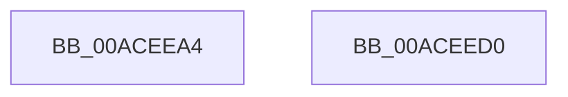

# PopIsDetailedSleepReliabilityDiagEnabled

- RVA: `0x00ACEEA4`–`0x00ACEED1` (길이 `45` bytes)
- VA: `0x0000000140ACEEA4`
- 실행 섹션: `PAGE`
- PDB 이름 있음: `예`; PDB Function 태그: `아니요`
- unwind 정보 RVA: `0x0005CF00`
- 디코드: `12`개 명령, `45/45` bytes 표시
- 미해석 바이트: `0` (있으면 어셈블리에 `.byte`로 보존)

> 이 문서는 커널 이미지의 기계어와 PDB 기호를 분석해 생성했습니다. 4번과 5번은 함수 원형과 자료형을 바이너리 사용 방식에서 추정한 C 해석이며 원본 소스 복구 결과는 아닙니다.

## 1. Dependencies

- 직접 호출 지점: **2**; 고유 호출 대상: **2**
- 직접 호출자로 확인된 함수: **3**
- RIP 상대 이미지 참조: **2**

### Outgoing calls
- `0x00ACEEB1` → [PopAcquireRwLockShared](../../text/2D/PopAcquireRwLockShared_function_002D9A40.md) (function, `0x002D9A40`)
- `0x00ACEEC3` → [PopReleaseRwLock](../../text/2D/PopReleaseRwLock_function_002DFBBC.md) (function, `0x002DFBBC`)

### Direct callers
- [PopUpdatePowerActionWatchdogTimeouts](../75/PopUpdatePowerActionWatchdogTimeouts_function_0075F0BC.md) at `0x0075F0C0`
- [PopEnableSystemSleepCheckpoint](PopEnableSystemSleepCheckpoint_function_00AC4F50.md) at `0x00AC4F94`
- [PopTransitionSystemPowerStateEx](../../pagelk/B7/PopTransitionSystemPowerStateEx_function_00B7E8C0.md) at `0x00B7EFAD`

### Static image references
- `0x00ACEEAA` → RVA `0x00F08500` (`.data`; read)
- `0x00ACEEB6` → RVA `0x00FC6AFD` (`ALMOSTRO`; read)

## 2. Other-region calls and transfers

- 다른 실행 섹션으로 향하는 call: **2**
  - `0x00ACEEB1` → [PopAcquireRwLockShared](../../text/2D/PopAcquireRwLockShared_function_002D9A40.md) (`PAGE` → `.text`)
  - `0x00ACEEC3` → [PopReleaseRwLock](../../text/2D/PopReleaseRwLock_function_002DFBBC.md) (`PAGE` → `.text`)
- 별도 외부 분기/꼬리 이동을 확인하지 못했습니다.

## 3. Assembly (complete function range)

```asm
00ACEEA4  40 53                           push rbx
00ACEEA6  48 83 EC 20                     sub rsp, 0x20
00ACEEAA  48 8D 0D 4F 96 43 00            lea rcx, [rip + 0x43964f]
00ACEEB1  E8 8A AB 80 FF                  call 0x1402d9a40
00ACEEB6  8A 1D 41 7C 4F 00               mov bl, byte ptr [rip + 0x4f7c41]
00ACEEBC  48 8D 0D 3D 96 43 00            lea rcx, [rip + 0x43963d]
00ACEEC3  E8 F4 0C 81 FF                  call 0x1402dfbbc
00ACEEC8  8A C3                           mov al, bl
00ACEECA  48 83 C4 20                     add rsp, 0x20
00ACEECE  5B                              pop rbx
00ACEECF  C3                              ret
00ACEED0  CC                              int3
```

## 4. C-style interpretation (structured pseudocode)

```c
__int64 __fastcall PopIsDetailedSleepReliabilityDiagEnabled(void)
{
    __int64 result;
    __int64 v_rsp;

    v_rsp = (v_rsp) - (32);
    result = PopAcquireRwLockShared(v_rip + 4429391, a2, a3, a4);
    result = PopReleaseRwLock(v_rip + 4429373, a2, a3, a4);
    v_rsp = (v_rsp) + (32);
    return (unsigned __int8)(*(unsigned __int8 *)(v_rip + 5209153));
}
```

## 5. (Beta) C Style

```c
void PopIsDetailedSleepReliabilityDiagEnabled(void)
{
    int64_t result;
    int64_t local_rsp;

    local_rsp = (local_rsp) - (32);
    result = PopAcquireRwLockShared(v_rip + 4429391, a2, a3, a4);
    result = PopReleaseRwLock(v_rip + 4429373, a2, a3, a4);
    local_rsp = (local_rsp) + (32);
    return (uint8_t)(*(uint8_t *)(v_rip + 0x4F7C41));
}
```

## 6. Execution-region graph

[열기: 2D/3D 그래프와 함수 탐색 컨트롤 패널](../../../control-panel.html?section=page&rva=0x00ACEEA4&view=graph)

- 2D 그래프는 위에서 아래로 흐르고, 3D 그래프는 빈 공간을 드래그해 회전합니다. Shift+드래그는 이동, 휠은 확대·축소, 함수 노드 선택은 대상 보고서 이동입니다.

### Static fallback


