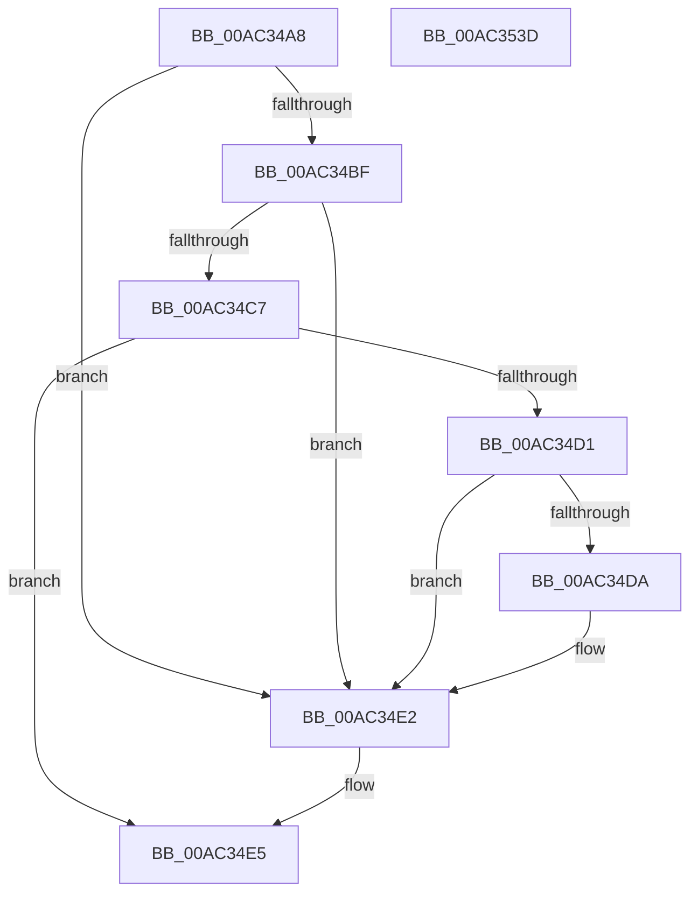

# PopNotifyLidStateChange

- RVA: `0x00AC34A8`–`0x00AC353E` (길이 `150` bytes)
- VA: `0x0000000140AC34A8`
- 실행 섹션: `PAGE`
- PDB 이름 있음: `예`; PDB Function 태그: `아니요`
- unwind 정보 RVA: `0x0008A658`
- 디코드: `40`개 명령, `150/150` bytes 표시
- 미해석 바이트: `0` (있으면 어셈블리에 `.byte`로 보존)

> 이 문서는 커널 이미지의 기계어와 PDB 기호를 분석해 생성했습니다. 4번과 5번은 함수 원형과 자료형을 바이너리 사용 방식에서 추정한 C 해석이며 원본 소스 복구 결과는 아닙니다.

## 1. Dependencies

- 직접 호출 지점: **4**; 고유 호출 대상: **3**
- 직접 호출자로 확인된 함수: **1**
- RIP 상대 이미지 참조: **4**

### Outgoing calls
- `0x00AC34D1` → [PopIsPlatformAoAcCapable](../../text/49/PopIsPlatformAoAcCapable_function_0049BF40.md) (function, `0x0049BF40`)
- `0x00AC34DD` → [PopPowerAggregatorForceSessionSwitch](../76/PopPowerAggregatorForceSessionSwitch_function_007648D0.md) (function, `0x007648D0`)
- `0x00AC350B` → [PopSetPowerSettingValue](../91/PopSetPowerSettingValue_function_00914E54.md) (function, `0x00914E54`)
- `0x00AC352D` → [PopSetPowerSettingValue](../91/PopSetPowerSettingValue_function_00914E54.md) (function, `0x00914E54`)

### Direct callers
- [PdcPoReportLidState](PdcPoReportLidState_function_00AC3480.md) at `0x00AC348F`

### Static image references
- `0x00AC34B7` → RVA `0x00E67A38` (`.data`; read)
- `0x00AC34BF` → RVA `0x00E0B579` (`.data`; read)
- `0x00AC34C7` → RVA `0x00E0B579` (`.data`; write)
- `0x00AC34F1` → RVA `0x0001E2D8` (`.rdata`; read)

## 2. Other-region calls and transfers

- 다른 실행 섹션으로 향하는 call: **1**
  - `0x00AC34D1` → [PopIsPlatformAoAcCapable](../../text/49/PopIsPlatformAoAcCapable_function_0049BF40.md) (`PAGE` → `.text`)
- 별도 외부 분기/꼬리 이동을 확인하지 못했습니다.

## 3. Assembly (complete function range)

```asm
00AC34A8  48 89 5C 24 10                  mov qword ptr [rsp + 0x10], rbx
00AC34AD  57                              push rdi
00AC34AE  48 83 EC 30                     sub rsp, 0x30
00AC34B2  33 DB                           xor ebx, ebx
00AC34B4  40 8A F9                        mov dil, cl
00AC34B7  38 1D 7B 45 3A 00               cmp byte ptr [rip + 0x3a457b], bl
00AC34BD  75 23                           jne 0x140ac34e2
00AC34BF  38 0D B4 80 34 00               cmp byte ptr [rip + 0x3480b4], cl
00AC34C5  74 1B                           je 0x140ac34e2
00AC34C7  88 0D AC 80 34 00               mov byte ptr [rip + 0x3480ac], cl
00AC34CD  84 C9                           test cl, cl
00AC34CF  75 14                           jne 0x140ac34e5
00AC34D1  E8 6A 8A 9D FF                  call 0x14049bf40
00AC34D6  84 C0                           test al, al
00AC34D8  74 08                           je 0x140ac34e2
00AC34DA  8D 4B 04                        lea ecx, [rbx + 4]
00AC34DD  E8 EE 13 CA FF                  call 0x1407648d0
00AC34E2  40 84 FF                        test dil, dil
00AC34E5  0F 95 C3                        setne bl
00AC34E8  48 8D 44 24 40                  lea rax, [rsp + 0x40]
00AC34ED  89 5C 24 40                     mov dword ptr [rsp + 0x40], ebx
00AC34F1  48 8D 0D E0 AD 55 FF            lea rcx, [rip - 0xaa5220]
00AC34F8  83 CB FF                        or ebx, 0xffffffff
00AC34FB  48 89 44 24 20                  mov qword ptr [rsp + 0x20], rax
00AC3500  8B D3                           mov edx, ebx
00AC3502  41 B9 04 00 00 00               mov r9d, 4
00AC3508  45 33 C0                        xor r8d, r8d
00AC350B  E8 44 19 E5 FF                  call 0x140914e54
00AC3510  41 B9 04 00 00 00               mov r9d, 4
00AC3516  48 8D 44 24 40                  lea rax, [rsp + 0x40]
00AC351B  8B D3                           mov edx, ebx
00AC351D  48 89 44 24 20                  mov qword ptr [rsp + 0x20], rax
00AC3522  48 8D 0D AF AD 55 FF            lea rcx, [rip - 0xaa5251]
00AC3529  45 8D 41 FD                     lea r8d, [r9 - 3]
00AC352D  E8 22 19 E5 FF                  call 0x140914e54
00AC3532  48 8B 5C 24 48                  mov rbx, qword ptr [rsp + 0x48]
00AC3537  48 83 C4 30                     add rsp, 0x30
00AC353B  5F                              pop rdi
00AC353C  C3                              ret
00AC353D  CC                              int3
```

## 4. C-style interpretation (structured pseudocode)

```c
__int64 __fastcall PopNotifyLidStateChange(unsigned __int8 a1, __int64 a2, int a3)
{
    __int64 result;
    __int64 v_rbx;
    __int64 v_rsp;
    unsigned __int64 v_stack_m18;
    unsigned __int64 v_stack_p10;
    unsigned __int64 v_stack_p8;

    v_stack_p10 = v_rbx;
    v_rsp = (v_rsp) - (48);
    v_rbx = 0;
    if ((*(unsigned __int8 *)(v_rip + 3818875)) != 0) goto loc_00AC34E2;
    if ((*(unsigned __int8 *)(v_rip + 3440820)) == a1) goto loc_00AC34E2;
    *(unsigned __int8 *)(v_rip + 3440812) = a1;
    if (a1 != 0) goto loc_00AC34E5;
    result = PopIsPlatformAoAcCapable(a1, a2, a3, a4);
    if ((unsigned __int8)(result) != 0) {
        a1 = v_rbx + 4;
        result = PopPowerAggregatorForceSessionSwitch(a1, a2, a3, a4);
    }
loc_00AC34E5:
    v_rbx = (a1 != 0) ? 1 : 0;
    v_stack_p8 = (unsigned int)(v_rbx);
    v_rbx = (unsigned int)((v_rbx) | (0xFFFFFFFFULL));
    v_stack_m18 = v_stack_p8;
    a3 = 0;
    result = PopSetPowerSettingValue(v_rip - 11162144, (unsigned int)((unsigned int)(v_rbx)), a3, 4);
    v_stack_m18 = v_stack_p8;
    result = PopSetPowerSettingValue(v_rip - 11162193, (unsigned int)((unsigned int)(v_rbx)), 4 - 3, 4);
    v_rsp = (v_rsp) + (48);
    return result;
}
```

## 5. (Beta) C Style

```c
int64_t PopNotifyLidStateChange(uint8_t Arg1, int64_t Arg2, int32_t Arg3)
{
    int64_t result;
    int64_t local_rbx;
    int64_t local_rsp;
    uint64_t v_stack_m18;
    uint64_t v_stack_p10;
    uint64_t v_stack_p8;

    v_stack_p10 = local_rbx;
    local_rsp = (local_rsp) - (48);
    local_rbx = 0;
    if ((*(uint8_t *)(v_rip + 0x3A457B)) != 0) goto loc_00AC34E2;
    if ((*(uint8_t *)(v_rip + 0x3480B4)) == Arg1) goto loc_00AC34E2;
    *(uint8_t *)(v_rip + 0x3480AC) = Arg1;
    if (Arg1 != 0) goto loc_00AC34E5;
    result = PopIsPlatformAoAcCapable(Arg1, Arg2, Arg3, a4);
    if ((uint8_t)(result) != 0) {
        Arg1 = local_rbx + 4;
        result = PopPowerAggregatorForceSessionSwitch(Arg1, Arg2, Arg3, a4);
    }
loc_00AC34E5:
    local_rbx = (Arg1 != 0) ? 1 : 0;
    v_stack_p8 = (uint32_t)(local_rbx);
    local_rbx = (uint32_t)((local_rbx) | (0xFFFFFFFFULL));
    v_stack_m18 = v_stack_p8;
    Arg3 = 0;
    result = PopSetPowerSettingValue(v_rip - 11162144, (uint32_t)((uint32_t)(local_rbx)), Arg3, 4);
    v_stack_m18 = v_stack_p8;
    result = PopSetPowerSettingValue(v_rip - 11162193, (uint32_t)((uint32_t)(local_rbx)), 4 - 3, 4);
    local_rsp = (local_rsp) + (48);
    return result;
}
```

## 6. Execution-region graph

[열기: 2D/3D 그래프와 함수 탐색 컨트롤 패널](../../../control-panel.html?section=page&rva=0x00AC34A8&view=graph)

- 2D 그래프는 위에서 아래로 흐르고, 3D 그래프는 빈 공간을 드래그해 회전합니다. Shift+드래그는 이동, 휠은 확대·축소, 함수 노드 선택은 대상 보고서 이동입니다.

### Static fallback


