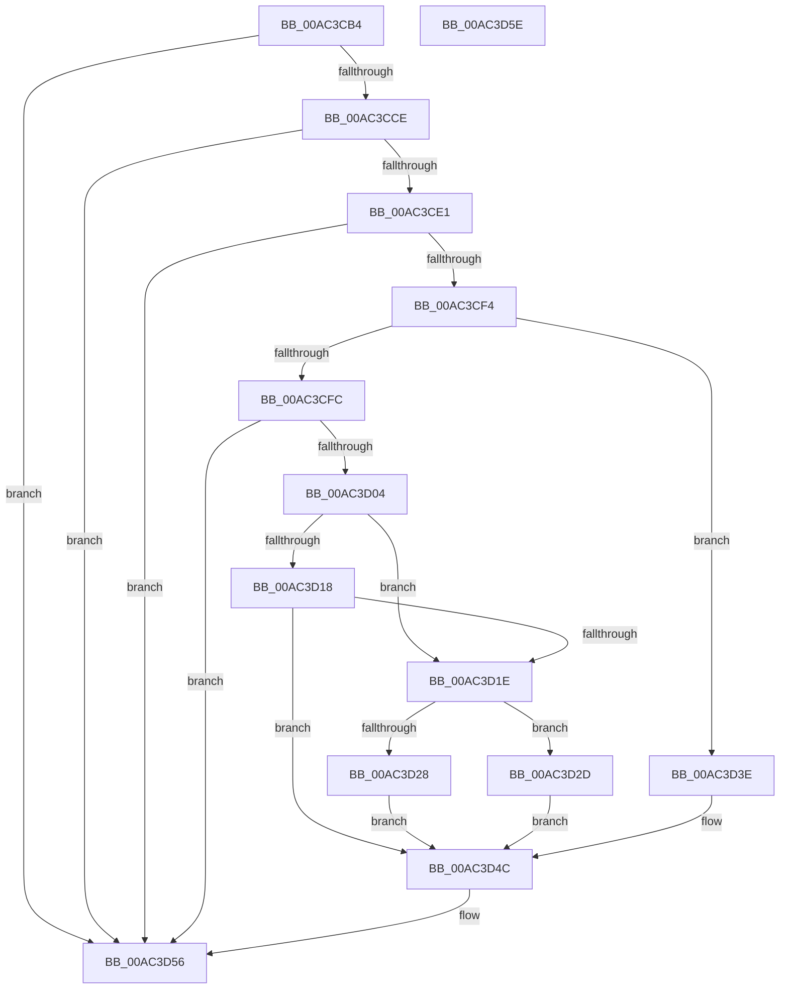

# PopNotifyTelemetryOsState

- RVA: `0x00AC3CB4`–`0x00AC3D5F` (길이 `171` bytes)
- VA: `0x0000000140AC3CB4`
- 실행 섹션: `PAGE`
- PDB 이름 있음: `예`; PDB Function 태그: `아니요`
- unwind 정보 RVA: `0x0005CF00`
- 디코드: `50`개 명령, `171/171` bytes 표시
- 미해석 바이트: `0` (있으면 어셈블리에 `.byte`로 보존)

> 이 문서는 커널 이미지의 기계어와 PDB 기호를 분석해 생성했습니다. 4번과 5번은 함수 원형과 자료형을 바이너리 사용 방식에서 추정한 C 해석이며 원본 소스 복구 결과는 아닙니다.

## 1. Dependencies

- 직접 호출 지점: **1**; 고유 호출 대상: **1**
- 직접 호출자로 확인된 함수: **1**
- RIP 상대 이미지 참조: **3**

### Outgoing calls
- `0x00AC3D4F` → [PopTransitionTelemetryOsState](../A9/PopTransitionTelemetryOsState_function_00A9DD40.md) (function, `0x00A9DD40`)

### Direct callers
- [PopTransitionSystemPowerStateEx](../../pagelk/B7/PopTransitionSystemPowerStateEx_function_00B7E8C0.md) at `0x00B7F00A`
- [PopTransitionSystemPowerStateEx](../../pagelk/B7/PopTransitionSystemPowerStateEx_function_00B7E8C0.md) at `0x00B7F85E`

### Static image references
- `0x00AC3CC2` → RVA `0x00E07748` (`.data`; read)
- `0x00AC3CD8` → RVA `0x00E07758` (`.data`; read)
- `0x00AC3CE1` → RVA `0x00E07760` (`.data`; read)

## 2. Other-region calls and transfers

- 다른 실행 섹션으로 향하는 call: **0**
- 별도 외부 분기/꼬리 이동을 확인하지 못했습니다.

## 3. Assembly (complete function range)

```asm
00AC3CB4  40 53                           push rbx
00AC3CB6  48 83 EC 20                     sub rsp, 0x20
00AC3CBA  44 8B DA                        mov r11d, edx
00AC3CBD  45 8B D0                        mov r10d, r8d
00AC3CC0  33 D2                           xor edx, edx
00AC3CC2  39 15 80 3A 34 00               cmp dword ptr [rip + 0x343a80], edx
00AC3CC8  0F 86 88 00 00 00               jbe 0x140ac3d56
00AC3CCE  48 BB 00 00 00 00 00 80 00 00   movabs rbx, 0x800000000000
00AC3CD8  48 85 1D 79 3A 34 00            test qword ptr [rip + 0x343a79], rbx
00AC3CDF  74 75                           je 0x140ac3d56
00AC3CE1  48 8B 05 78 3A 34 00            mov rax, qword ptr [rip + 0x343a78]
00AC3CE8  48 23 C3                        and rax, rbx
00AC3CEB  48 3B 05 6E 3A 34 00            cmp rax, qword ptr [rip + 0x343a6e]
00AC3CF2  75 62                           jne 0x140ac3d56
00AC3CF4  8D 41 FC                        lea eax, [rcx - 4]
00AC3CF7  83 F8 02                        cmp eax, 2
00AC3CFA  76 42                           jbe 0x140ac3d3e
00AC3CFC  8D 41 FE                        lea eax, [rcx - 2]
00AC3CFF  83 F8 01                        cmp eax, 1
00AC3D02  77 52                           ja 0x140ac3d56
00AC3D04  F6 5C 24 50                     neg byte ptr [rsp + 0x50]
00AC3D08  BA 04 00 00 00                  mov edx, 4
00AC3D0D  45 1B C0                        sbb r8d, r8d
00AC3D10  44 03 C2                        add r8d, edx
00AC3D13  83 F9 03                        cmp ecx, 3
00AC3D16  74 06                           je 0x140ac3d1e
00AC3D18  41 83 FA 05                     cmp r10d, 5
00AC3D1C  75 2E                           jne 0x140ac3d4c
00AC3D1E  B9 08 00 00 00                  mov ecx, 8
00AC3D23  44 84 C9                        test cl, r9b
00AC3D26  74 05                           je 0x140ac3d2d
00AC3D28  8D 51 FB                        lea edx, [rcx - 5]
00AC3D2B  EB 1F                           jmp 0x140ac3d4c
00AC3D2D  41 8D 43 FE                     lea eax, [r11 - 2]
00AC3D31  BA 05 00 00 00                  mov edx, 5
00AC3D36  83 F8 02                        cmp eax, 2
00AC3D39  0F 46 D1                        cmovbe edx, ecx
00AC3D3C  EB 0E                           jmp 0x140ac3d4c
00AC3D3E  83 F9 05                        cmp ecx, 5
00AC3D41  41 B8 02 00 00 00               mov r8d, 2
00AC3D47  0F 94 C2                        sete dl
00AC3D4A  FF C2                           inc edx
00AC3D4C  41 8B C8                        mov ecx, r8d
00AC3D4F  E8 EC 9F FD FF                  call 0x140a9dd40
00AC3D54  8B D0                           mov edx, eax
00AC3D56  8B C2                           mov eax, edx
00AC3D58  48 83 C4 20                     add rsp, 0x20
00AC3D5C  5B                              pop rbx
00AC3D5D  C3                              ret
00AC3D5E  CC                              int3
```

## 4. C-style interpretation (structured pseudocode)

```c
__int64 __fastcall PopNotifyTelemetryOsState(__int64 a1, int a2, int a3, unsigned __int8 a4, unsigned __int8 a5)
{
    __int64 result;
    __int64 v_rsp;

    v_rsp = (v_rsp) - (32);
    a2 = 0;
    if ((*(unsigned int *)(v_rip + 3422848)) <= 0) goto loc_00AC3D56;
    if (((*(unsigned __int64 *)(v_rip + 3422841)) & (v_rbx)) == 0) goto loc_00AC3D56;
    result = (*(unsigned __int64 *)(v_rip + 3422840)) & (v_rbx);
    if (result != (*(unsigned __int64 *)(v_rip + 3422830))) goto loc_00AC3D56;
    if (((unsigned int)(a1 - 4)) <= 2) goto loc_00AC3D3E;
    if (((unsigned int)(a1 - 2)) > 1) goto loc_00AC3D56;
    a3 = (unsigned int)((a3) + (4));
    if (((unsigned int)(a1)) == 3) goto loc_00AC3D1E;
    if (((unsigned int)((unsigned int)(a3))) != 5) goto loc_00AC3D4C;
loc_00AC3D1E:
    if (((8) & (a4)) == 0) goto loc_00AC3D2D;
    goto loc_00AC3D4C;
loc_00AC3D2D:
    a2 = 5;
    if (((unsigned int)((unsigned int)(a2) - 2)) <= 2) { a2 = 8; }
    goto loc_00AC3D4C;
loc_00AC3D3E:
    a2 = (8 == 5) ? 1 : 0;
    a2 = (unsigned int)((a2) + 1);
loc_00AC3D4C:
    result = PopTransitionTelemetryOsState(2, a2, 2, a4);
loc_00AC3D56:
    v_rsp = (v_rsp) + (32);
    return (unsigned int)((unsigned int)((unsigned int)((unsigned int)(result))));
}
```

## 5. (Beta) C Style

```c
int64_t PopNotifyTelemetryOsState(void *Arg1, void *Arg2, int32_t Arg3, uint8_t Arg4, uint8_t Arg5)
{
    uint8_t *arg1 = (uint8_t *)Arg1;
    uint8_t *arg2 = (uint8_t *)Arg2;

    int64_t result;
    int64_t local_rsp;

    local_rsp = (local_rsp) - (32);
    Arg2 = 0;
    if ((*(uint32_t *)(v_rip + 0x343A80)) <= 0) goto loc_00AC3D56;
    if (((*(uint64_t *)(v_rip + 0x343A79)) & (local_rbx)) == 0) goto loc_00AC3D56;
    result = (*(uint64_t *)(v_rip + 0x343A78)) & (local_rbx);
    if (result != (*(uint64_t *)(v_rip + 0x343A6E))) goto loc_00AC3D56;
    if (((uint32_t)(Arg1 - 4)) <= 2) goto loc_00AC3D3E;
    if (((uint32_t)(Arg1 - 2)) > 1) goto loc_00AC3D56;
    Arg3 = (uint32_t)((Arg3) + (4));
    if (((uint32_t)(Arg1)) == 3) goto loc_00AC3D1E;
    if (((uint32_t)((uint32_t)(Arg3))) != 5) goto loc_00AC3D4C;
loc_00AC3D1E:
    if (((8) & (Arg4)) == 0) goto loc_00AC3D2D;
    goto loc_00AC3D4C;
loc_00AC3D2D:
    Arg2 = 5;
    if (((uint32_t)((uint32_t)(Arg2) - 2)) <= 2) { Arg2 = 8; }
    goto loc_00AC3D4C;
loc_00AC3D3E:
    Arg2 = (8 == 5) ? 1 : 0;
    Arg2 = (uint32_t)((Arg2) + 1);
loc_00AC3D4C:
    result = PopTransitionTelemetryOsState(2, Arg2, 2, Arg4);
loc_00AC3D56:
    local_rsp = (local_rsp) + (32);
    return (uint32_t)((uint32_t)((uint32_t)((uint32_t)(result))));
}
```

### 관측된 메모리 오프셋

구조체 형식이 확인되지 않은 접근은 인자 기준의 오프셋으로만 기록했습니다.

| 기준 인자 | 오프셋 표현 | 폭 (bit) | 접근 |
|---|---:|---:|---|
| `Arg1` | `- 0x4` | `32` | `R` |
| `Arg1` | `- 0x2` | `32` | `R` |
| `Arg2` | `- 0x2` | `32` | `R` |

## 6. Execution-region graph

[열기: 2D/3D 그래프와 함수 탐색 컨트롤 패널](../../../control-panel.html?section=page&rva=0x00AC3CB4&view=graph)

- 2D 그래프는 위에서 아래로 흐르고, 3D 그래프는 빈 공간을 드래그해 회전합니다. Shift+드래그는 이동, 휠은 확대·축소, 함수 노드 선택은 대상 보고서 이동입니다.

### Static fallback


