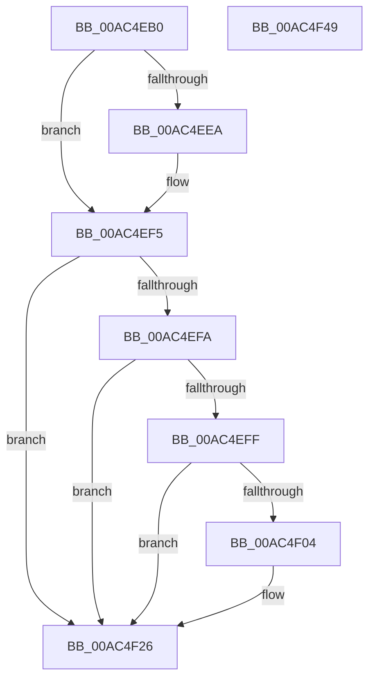

# PopPowerRequestExecutionRequiredSettingCallback

- RVA: `0x00AC4EB0`–`0x00AC4F4A` (길이 `154` bytes)
- VA: `0x0000000140AC4EB0`
- 실행 섹션: `PAGE`
- PDB 이름 있음: `예`; PDB Function 태그: `아니요`
- unwind 정보 RVA: `0x0005C954`
- 디코드: `40`개 명령, `154/154` bytes 표시
- 미해석 바이트: `0` (있으면 어셈블리에 `.byte`로 보존)

> 이 문서는 커널 이미지의 기계어와 PDB 기호를 분석해 생성했습니다. 4번과 5번은 함수 원형과 자료형을 바이너리 사용 방식에서 추정한 C 해석이며 원본 소스 복구 결과는 아닙니다.

## 1. Dependencies

- 직접 호출 지점: **5**; 고유 호출 대상: **5**
- 직접 호출자로 확인된 함수: **0**
- RIP 상대 이미지 참조: **5**

### Outgoing calls
- `0x00AC4ED9` → [PopAcquireRwLockExclusive](../../text/43/PopAcquireRwLockExclusive_function_00430B44.md) (function, `0x00430B44`)
- `0x00AC4F0D` → [KeCancelTimer2](../../text/3A/KeCancelTimer2_function_003A01E0.md) (function, `0x003A01E0`)
- `0x00AC4F1A` → [PopPowerRequestSetExecutionRequiredTimeoutTimer](../75/PopPowerRequestSetExecutionRequiredTimeoutTimer_function_00754C5C.md) (function, `0x00754C5C`)
- `0x00AC4F1F` → [PopPowerRequestHandleExecutionEnablementUpdate](../A4/PopPowerRequestHandleExecutionEnablementUpdate_function_00A4A624.md) (function, `0x00A4A624`)
- `0x00AC4F2D` → [PopReleaseRwLock](../../text/2D/PopReleaseRwLock_function_002DFBBC.md) (function, `0x002DFBBC`)

### Direct callers
- 이 함수 시작 RVA로 연결되는 직접 call은 확인되지 않았습니다. 간접 호출은 완전히 역산할 수 없습니다.

### Static image references
- `0x00AC4ECA` → RVA `0x00F0ED20` (`.data`; read)
- `0x00AC4EDE` → RVA `0x0001E998` (`.rdata`; read)
- `0x00AC4EEA` → RVA `0x0001E9A0` (`.rdata`; read)
- `0x00AC4F06` → RVA `0x00F0EF00` (`.data`; read)
- `0x00AC4F14` → RVA `0x00FD80B0` (`PAGEDATA`; write)

## 2. Other-region calls and transfers

- 다른 실행 섹션으로 향하는 call: **3**
  - `0x00AC4ED9` → [PopAcquireRwLockExclusive](../../text/43/PopAcquireRwLockExclusive_function_00430B44.md) (`PAGE` → `.text`)
  - `0x00AC4F0D` → [KeCancelTimer2](../../text/3A/KeCancelTimer2_function_003A01E0.md) (`PAGE` → `.text`)
  - `0x00AC4F2D` → [PopReleaseRwLock](../../text/2D/PopReleaseRwLock_function_002DFBBC.md) (`PAGE` → `.text`)
- 별도 외부 분기/꼬리 이동을 확인하지 못했습니다.

## 3. Assembly (complete function range)

```asm
00AC4EB0  48 89 5C 24 08                  mov qword ptr [rsp + 8], rbx
00AC4EB5  48 89 6C 24 10                  mov qword ptr [rsp + 0x10], rbp
00AC4EBA  48 89 74 24 18                  mov qword ptr [rsp + 0x18], rsi
00AC4EBF  57                              push rdi
00AC4EC0  48 83 EC 20                     sub rsp, 0x20
00AC4EC4  48 8B F1                        mov rsi, rcx
00AC4EC7  41 8B E8                        mov ebp, r8d
00AC4ECA  48 8D 0D 4F 9E 44 00            lea rcx, [rip + 0x449e4f]
00AC4ED1  48 8B FA                        mov rdi, rdx
00AC4ED4  BB 0D 00 00 C0                  mov ebx, 0xc000000d
00AC4ED9  E8 66 BC 96 FF                  call 0x140430b44
00AC4EDE  4C 8B 0D B3 9A 55 FF            mov r9, qword ptr [rip - 0xaa654d]
00AC4EE5  4C 2B 0E                        sub r9, qword ptr [rsi]
00AC4EE8  75 0B                           jne 0x140ac4ef5
00AC4EEA  4C 8B 0D AF 9A 55 FF            mov r9, qword ptr [rip - 0xaa6551]
00AC4EF1  4C 2B 4E 08                     sub r9, qword ptr [rsi + 8]
00AC4EF5  4D 85 C9                        test r9, r9
00AC4EF8  75 2C                           jne 0x140ac4f26
00AC4EFA  83 FD 04                        cmp ebp, 4
00AC4EFD  75 27                           jne 0x140ac4f26
00AC4EFF  48 85 FF                        test rdi, rdi
00AC4F02  74 22                           je 0x140ac4f26
00AC4F04  33 D2                           xor edx, edx
00AC4F06  48 8D 0D F3 9F 44 00            lea rcx, [rip + 0x449ff3]
00AC4F0D  E8 CE B2 8D FF                  call 0x1403a01e0
00AC4F12  8B 07                           mov eax, dword ptr [rdi]
00AC4F14  89 05 96 31 51 00               mov dword ptr [rip + 0x513196], eax
00AC4F1A  E8 3D FD C8 FF                  call 0x140754c5c
00AC4F1F  E8 00 57 F8 FF                  call 0x140a4a624
00AC4F24  33 DB                           xor ebx, ebx
00AC4F26  48 8D 0D F3 9D 44 00            lea rcx, [rip + 0x449df3]
00AC4F2D  E8 8A AC 81 FF                  call 0x1402dfbbc
00AC4F32  48 8B 6C 24 38                  mov rbp, qword ptr [rsp + 0x38]
00AC4F37  8B C3                           mov eax, ebx
00AC4F39  48 8B 5C 24 30                  mov rbx, qword ptr [rsp + 0x30]
00AC4F3E  48 8B 74 24 40                  mov rsi, qword ptr [rsp + 0x40]
00AC4F43  48 83 C4 20                     add rsp, 0x20
00AC4F47  5F                              pop rdi
00AC4F48  C3                              ret
00AC4F49  CC                              int3
```

## 4. C-style interpretation (structured pseudocode)

```c
__int64 __fastcall PopPowerRequestExecutionRequiredSettingCallback(__int64 a1, __int64 a2, int a3)
{
    __int64 result;
    __int64 v_rbx;
    __int64 v_rsp;
    unsigned __int64 v_stack_p10;
    unsigned __int64 v_stack_p18;
    unsigned __int64 v_stack_p8;

    v_stack_p8 = v_rbx;
    v_stack_p10 = v_rbp;
    v_stack_p18 = v_rsi;
    v_rsp = (v_rsp) - (32);
    result = PopAcquireRwLockExclusive(v_rip + 4496975, a2, a3, a4);
    a4 = (*(unsigned __int64 *)(v_rip - 11167053)) - (*(unsigned __int64 *)(a1));
    if (!(condition_is_not_equal)) {
        a4 = *(unsigned __int64 *)(v_rip - 11167057);
        a4 = (a4) - (*(unsigned __int64 *)(a1 + 8));
    }
    if (a4 != 0) goto loc_00AC4F26;
    if (((unsigned int)((unsigned int)(a3))) != 4) goto loc_00AC4F26;
    v_rbx = (unsigned int)(0xC000000DULL);
    if (a2 != 0) {
        a2 = 0;
        a1 = v_rip + 4497395;
        result = KeCancelTimer2(a1, a2, a3, a4);
        result = *(unsigned int *)(a2);
        *(unsigned int *)(v_rip + 5321110) = (unsigned int)(result);
        result = PopPowerRequestSetExecutionRequiredTimeoutTimer(a1, a2, a3, a4);
        result = PopPowerRequestHandleExecutionEnablementUpdate(a1, a2, a3, a4);
        v_rbx = 0;
    }
    result = PopReleaseRwLock(v_rip + 4496883, a2, a3, a4);
    v_rsp = (v_rsp) + (32);
    return 0;
}
```

## 5. (Beta) C Style

```c
int64_t PopPowerRequestExecutionRequiredSettingCallback(void *Arg1, int64_t Arg2, int32_t Arg3)
{
    uint8_t *arg1 = (uint8_t *)Arg1;

    int64_t result;
    int64_t local_rbx;
    int64_t local_rsp;
    uint64_t v_stack_p10;
    uint64_t v_stack_p18;
    uint64_t v_stack_p8;

    v_stack_p8 = local_rbx;
    v_stack_p10 = local_rbp;
    v_stack_p18 = local_rsi;
    local_rsp = (local_rsp) - (32);
    result = PopAcquireRwLockExclusive(v_rip + 4496975, Arg2, Arg3, a4);
    a4 = (*(uint64_t *)(v_rip - 0xAA654D)) - (*(uint64_t *)(arg1));
    if (!(condition_is_not_equal)) {
        a4 = *(uint64_t *)(v_rip - 0xAA6551);
        a4 = (a4) - (*(uint64_t *)(arg1 + 0x8));
    }
    if (a4 != 0) goto loc_00AC4F26;
    if (((uint32_t)((uint32_t)(Arg3))) != 4) goto loc_00AC4F26;
    local_rbx = (uint32_t)(0xC000000DULL);
    if (Arg2 != 0) {
        Arg2 = 0;
        Arg1 = v_rip + 4497395;
        result = KeCancelTimer2(Arg1, Arg2, Arg3, a4);
        result = *(uint32_t *)(Arg2);
        *(uint32_t *)(v_rip + 0x513196) = (uint32_t)(result);
        result = PopPowerRequestSetExecutionRequiredTimeoutTimer(Arg1, Arg2, Arg3, a4);
        result = PopPowerRequestHandleExecutionEnablementUpdate(Arg1, Arg2, Arg3, a4);
        local_rbx = 0;
    }
    result = PopReleaseRwLock(v_rip + 4496883, Arg2, Arg3, a4);
    local_rsp = (local_rsp) + (32);
    return 0;
}
```

### 관측된 메모리 오프셋

구조체 형식이 확인되지 않은 접근은 인자 기준의 오프셋으로만 기록했습니다.

| 기준 인자 | 오프셋 표현 | 폭 (bit) | 접근 |
|---|---:|---:|---|
| `Arg1` | `+ 0x0` | `64` | `R` |
| `Arg1` | `+ 0x8` | `64` | `R` |

## 6. Execution-region graph

[열기: 2D/3D 그래프와 함수 탐색 컨트롤 패널](../../../control-panel.html?section=page&rva=0x00AC4EB0&view=graph)

- 2D 그래프는 위에서 아래로 흐르고, 3D 그래프는 빈 공간을 드래그해 회전합니다. Shift+드래그는 이동, 휠은 확대·축소, 함수 노드 선택은 대상 보고서 이동입니다.

### Static fallback


