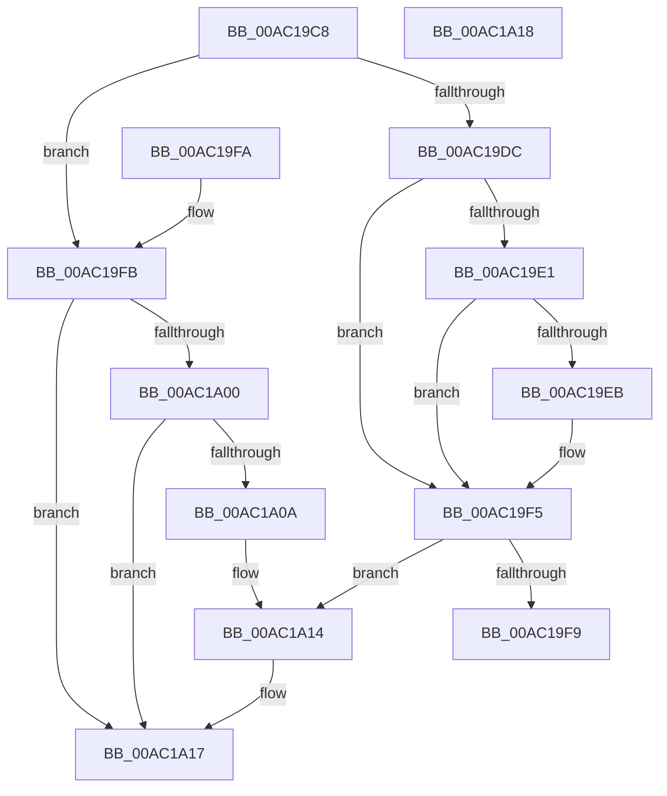

# PopPromoteActionFlag

- RVA: `0x00AC19C8`–`0x00AC1A19` (길이 `81` bytes)
- VA: `0x0000000140AC19C8`
- 실행 섹션: `PAGE`
- PDB 이름 있음: `예`; PDB Function 태그: `아니요`
- unwind 정보 RVA: `0x000DB714`
- 디코드: `30`개 명령, `81/81` bytes 표시
- 미해석 바이트: `0` (있으면 어셈블리에 `.byte`로 보존)

> 이 문서는 커널 이미지의 기계어와 PDB 기호를 분석해 생성했습니다. 4번과 5번은 함수 원형과 자료형을 바이너리 사용 방식에서 추정한 C 해석이며 원본 소스 복구 결과는 아닙니다.

## 1. Dependencies

- 직접 호출 지점: **0**; 고유 호출 대상: **0**
- 직접 호출자로 확인된 함수: **1**
- RIP 상대 이미지 참조: **2**

### Outgoing calls
- 직접 디코드된 call 명령이 없습니다.

### Direct callers
- [PopExecutePowerAction](../75/PopExecutePowerAction_function_0075E6B4.md) at `0x0075E8B8`
- [PopExecutePowerAction](../75/PopExecutePowerAction_function_0075E6B4.md) at `0x0075E8D0`
- [PopExecutePowerAction](../75/PopExecutePowerAction_function_0075E6B4.md) at `0x0075E8E8`
- [PopExecutePowerAction](../75/PopExecutePowerAction_function_0075E6B4.md) at `0x0075E92D`
- [PopExecutePowerAction](../75/PopExecutePowerAction_function_0075E6B4.md) at `0x0075E946`
- [PopExecutePowerAction](../75/PopExecutePowerAction_function_0075E6B4.md) at `0x0075E95C`
- [PopExecutePowerAction](../75/PopExecutePowerAction_function_0075E6B4.md) at `0x0075E972`
- [PopExecutePowerAction](../75/PopExecutePowerAction_function_0075E6B4.md) at `0x0075E988`

### Static image references
- `0x00AC19E1` → RVA `0x00F0BD4C` (`.data`; read)
- `0x00AC19EF` → RVA `0x00F0BD4C` (`.data`; write)

## 2. Other-region calls and transfers

- 다른 실행 섹션으로 향하는 call: **0**
- 별도 외부 분기/꼬리 이동을 확인하지 못했습니다.

## 3. Assembly (complete function range)

```asm
00AC19C8  8B 44 24 28                     mov eax, dword ptr [rsp + 0x28]
00AC19CC  4C 8B D1                        mov r10, rcx
00AC19CF  32 C9                           xor cl, cl
00AC19D1  44 23 C0                        and r8d, eax
00AC19D4  44 8B DA                        mov r11d, edx
00AC19D7  45 84 C9                        test r9b, r9b
00AC19DA  74 1F                           je 0x140ac19fb
00AC19DC  45 85 C0                        test r8d, r8d
00AC19DF  74 14                           je 0x140ac19f5
00AC19E1  8B 15 65 A3 44 00               mov edx, dword ptr [rip + 0x44a365]
00AC19E7  85 D0                           test eax, edx
00AC19E9  75 0A                           jne 0x140ac19f5
00AC19EB  0B D0                           or edx, eax
00AC19ED  B1 01                           mov cl, 1
00AC19EF  89 15 57 A3 44 00               mov dword ptr [rip + 0x44a357], edx
00AC19F5  84 C9                           test cl, cl
00AC19F7  75 1B                           jne 0x140ac1a14
00AC19F9  C3                              ret
00AC19FA  CC                              int3
00AC19FB  45 85 C0                        test r8d, r8d
00AC19FE  75 17                           jne 0x140ac1a17
00AC1A00  8B 0D 46 A3 44 00               mov ecx, dword ptr [rip + 0x44a346]
00AC1A06  85 C8                           test eax, ecx
00AC1A08  74 0D                           je 0x140ac1a17
00AC1A0A  F7 D0                           not eax
00AC1A0C  23 C8                           and ecx, eax
00AC1A0E  89 0D 38 A3 44 00               mov dword ptr [rip + 0x44a338], ecx
00AC1A14  45 08 1A                        or byte ptr [r10], r11b
00AC1A17  C3                              ret
00AC1A18  CC                              int3
```

## 4. C-style interpretation (structured pseudocode)

```c
__int64 __fastcall PopPromoteActionFlag(__int64 a1, int a2, int a3, unsigned __int8 a4, unsigned int a5)
{
    __int64 result;

    a1 = 0;
    a3 = (unsigned int)((a3) & ((unsigned int)((unsigned int)(a5))));
    if (a4 == 0) goto loc_00AC19FB;
    if (a3 == 0) goto loc_00AC19F5;
    if ((((unsigned int)((unsigned int)(a5))) & ((unsigned int)((unsigned int)(*(unsigned int *)(v_rip + 4498277))))) == 0) {
        a2 = (unsigned int)(((unsigned int)(*(unsigned int *)(v_rip + 4498277))) | ((unsigned int)((unsigned int)(a5))));
        a1 = 1;
        *(unsigned int *)(v_rip + 4498263) = a2;
    }
    if ((unsigned __int8)(a1) != 0) goto loc_00AC1A14;
    return (unsigned int)(a5);
loc_00AC19FB:
    if (a3 != 0) goto loc_00AC1A17;
    if ((((unsigned int)((unsigned int)(a5))) & ((unsigned int)((unsigned int)(*(unsigned int *)(v_rip + 4498246))))) == 0) goto loc_00AC1A17;
    result = (unsigned int)(~((unsigned int)(a5)));
    a1 = (unsigned int)(((unsigned int)(*(unsigned int *)(v_rip + 4498246))) & ((unsigned int)(result)));
    *(unsigned int *)(v_rip + 4498232) = (unsigned int)(a1);
loc_00AC1A14:
loc_00AC1A17:
    return result;
}
```

## 5. (Beta) C Style

```c
int64_t PopPromoteActionFlag(void *Arg1, int32_t Arg2, int32_t Arg3, uint8_t Arg4, uint32_t Arg5)
{
    uint8_t *arg1 = (uint8_t *)Arg1;

    int64_t result;

    Arg1 = 0;
    Arg3 = (uint32_t)((Arg3) & ((uint32_t)((uint32_t)(Arg5))));
    if (Arg4 == 0) goto loc_00AC19FB;
    if (Arg3 == 0) goto loc_00AC19F5;
    if ((((uint32_t)((uint32_t)(Arg5))) & ((uint32_t)((uint32_t)(*(uint32_t *)(v_rip + 0x44A365))))) == 0) {
        Arg2 = (uint32_t)(((uint32_t)(*(uint32_t *)(v_rip + 0x44A365))) | ((uint32_t)((uint32_t)(Arg5))));
        Arg1 = 1;
        *(uint32_t *)(v_rip + 0x44A357) = Arg2;
    }
    if ((uint8_t)(Arg1) != 0) goto loc_00AC1A14;
    return (uint32_t)(Arg5);
loc_00AC19FB:
    if (Arg3 != 0) goto loc_00AC1A17;
    if ((((uint32_t)((uint32_t)(Arg5))) & ((uint32_t)((uint32_t)(*(uint32_t *)(v_rip + 0x44A346))))) == 0) goto loc_00AC1A17;
    result = (uint32_t)(~((uint32_t)(Arg5)));
    Arg1 = (uint32_t)(((uint32_t)(*(uint32_t *)(v_rip + 0x44A346))) & ((uint32_t)(result)));
    *(uint32_t *)(v_rip + 0x44A338) = (uint32_t)(Arg1);
loc_00AC1A14:
loc_00AC1A17:
    return result;
}
```

### 관측된 메모리 오프셋

구조체 형식이 확인되지 않은 접근은 인자 기준의 오프셋으로만 기록했습니다.

| 기준 인자 | 오프셋 표현 | 폭 (bit) | 접근 |
|---|---:|---:|---|
| `Arg1` | `+ 0x0` | `8` | `R/W` |

## 6. Execution-region graph

[열기: 2D/3D 그래프와 함수 탐색 컨트롤 패널](../../../control-panel.html?section=page&rva=0x00AC19C8&view=graph)

- 2D 그래프는 위에서 아래로 흐르고, 3D 그래프는 빈 공간을 드래그해 회전합니다. Shift+드래그는 이동, 휠은 확대·축소, 함수 노드 선택은 대상 보고서 이동입니다.

### Static fallback


