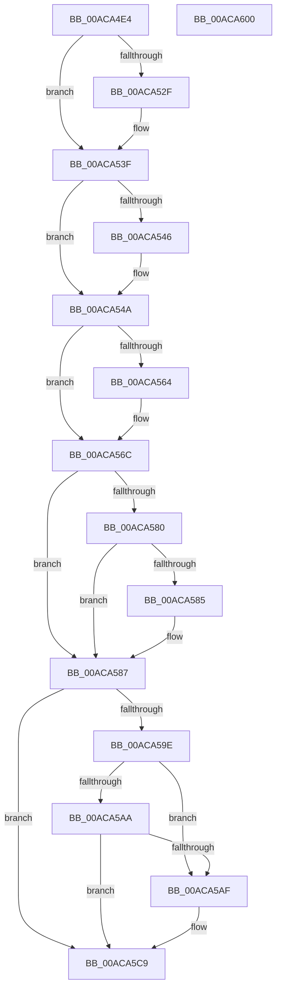

# PopQueryPowerButtonBugcheckEnabled

- RVA: `0x00ACA4E4`–`0x00ACA601` (길이 `285` bytes)
- VA: `0x0000000140ACA4E4`
- 실행 섹션: `PAGE`
- PDB 이름 있음: `예`; PDB Function 태그: `아니요`
- unwind 정보 RVA: `0x000B8D7C`
- 디코드: `78`개 명령, `285/285` bytes 표시
- 미해석 바이트: `0` (있으면 어셈블리에 `.byte`로 보존)

> 이 문서는 커널 이미지의 기계어와 PDB 기호를 분석해 생성했습니다. 4번과 5번은 함수 원형과 자료형을 바이너리 사용 방식에서 추정한 C 해석이며 원본 소스 복구 결과는 아닙니다.

## 1. Dependencies

- 직접 호출 지점: **7**; 고유 호출 대상: **6**
- 직접 호출자로 확인된 함수: **2**
- RIP 상대 이미지 참조: **7**

### Outgoing calls
- `0x00ACA516` → [KeAbPreAcquire](../../text/21/KeAbPreAcquire_function_00210230.md) (function, `0x00210230`)
- `0x00ACA53A` → [ExfAcquirePushLockSharedEx](../../text/21/ExfAcquirePushLockSharedEx_function_0021044C.md) (function, `0x0021044C`)
- `0x00ACA567` → [ExfReleasePushLockShared](../../text/26/ExfReleasePushLockShared_function_00263440.md) (function, `0x00263440`)
- `0x00ACA56F` → [KeAbPostRelease](../../text/2E/KeAbPostRelease_function_002E1600.md) (function, `0x002E1600`)
- `0x00ACA574` → [KeLeaveCriticalRegion](../../text/25/KeLeaveCriticalRegion_function_0025D8B0.md) (function, `0x0025D8B0`)
- `0x00ACA5C4` → [DbgPrintEx](../../text/35/DbgPrintEx_function_00359290.md) (function, `0x00359290`)
- `0x00ACA5E6` → [DbgPrintEx](../../text/35/DbgPrintEx_function_00359290.md) (function, `0x00359290`)

### Direct callers
- [PopPowerButtonWorkCallback](../../text/5D/PopPowerButtonWorkCallback_function_005D9A70.md) at `0x005D9BAF`
- [PopPowerInformationInternal](../A8/PopPowerInformationInternal_function_00A8B7C0.md) at `0x00A8C83F`

### Static image references
- `0x00ACA4FF` → RVA `0x00F085E0` (`.data`; read)
- `0x00ACA54A` → RVA `0x00F086F4` (`.data`; read)
- `0x00ACA553` → RVA `0x00F086F0` (`.data`; read)
- `0x00ACA587` → RVA `0x00F08598` (`.data`; write)
- `0x00ACA5B5` → RVA `0x00B02CB0` (` ?? ::NNGAKEGL::`string'`; read)
- `0x00ACA5CD` → RVA `0x00B02DB0` (` ?? ::NNGAKEGL::`string'`; read)
- `0x00ACA5DD` → RVA `0x00F085A8` (`.data`; write)

## 2. Other-region calls and transfers

- 다른 실행 섹션으로 향하는 call: **7**
  - `0x00ACA516` → [KeAbPreAcquire](../../text/21/KeAbPreAcquire_function_00210230.md) (`PAGE` → `.text`)
  - `0x00ACA53A` → [ExfAcquirePushLockSharedEx](../../text/21/ExfAcquirePushLockSharedEx_function_0021044C.md) (`PAGE` → `.text`)
  - `0x00ACA567` → [ExfReleasePushLockShared](../../text/26/ExfReleasePushLockShared_function_00263440.md) (`PAGE` → `.text`)
  - `0x00ACA56F` → [KeAbPostRelease](../../text/2E/KeAbPostRelease_function_002E1600.md) (`PAGE` → `.text`)
  - `0x00ACA574` → [KeLeaveCriticalRegion](../../text/25/KeLeaveCriticalRegion_function_0025D8B0.md) (`PAGE` → `.text`)
  - `0x00ACA5C4` → [DbgPrintEx](../../text/35/DbgPrintEx_function_00359290.md) (`PAGE` → `.text`)
  - `0x00ACA5E6` → [DbgPrintEx](../../text/35/DbgPrintEx_function_00359290.md) (`PAGE` → `.text`)
- 별도 외부 분기/꼬리 이동을 확인하지 못했습니다.

## 3. Assembly (complete function range)

```asm
00ACA4E4  48 89 5C 24 10                  mov qword ptr [rsp + 0x10], rbx
00ACA4E9  48 89 6C 24 18                  mov qword ptr [rsp + 0x18], rbp
00ACA4EE  56                              push rsi
00ACA4EF  57                              push rdi
00ACA4F0  41 56                           push r14
00ACA4F2  48 83 EC 30                     sub rsp, 0x30
00ACA4F6  65 48 8B 04 25 88 01 00 00      mov rax, qword ptr gs:[0x188]
00ACA4FF  48 8D 2D DA E0 43 00            lea rbp, [rip + 0x43e0da]
00ACA506  45 33 C0                        xor r8d, r8d
00ACA509  33 D2                           xor edx, edx
00ACA50B  48 8B CD                        mov rcx, rbp
00ACA50E  66 FF 88 E4 01 00 00            dec word ptr [rax + 0x1e4]
00ACA515  90                              nop
00ACA516  E8 15 5D 74 FF                  call 0x140210230
00ACA51B  48 8B D8                        mov rbx, rax
00ACA51E  33 C0                           xor eax, eax
00ACA520  44 8D 70 11                     lea r14d, [rax + 0x11]
00ACA524  F0 4C 0F B1 35 B3 E0 43 00      lock cmpxchg qword ptr [rip + 0x43e0b3], r14
00ACA52D  74 10                           je 0x140aca53f
00ACA52F  4C 8B CD                        mov r9, rbp
00ACA532  4C 8B C3                        mov r8, rbx
00ACA535  33 D2                           xor edx, edx
00ACA537  48 8B CD                        mov rcx, rbp
00ACA53A  E8 0D 5F 74 FF                  call 0x14021044c
00ACA53F  33 FF                           xor edi, edi
00ACA541  48 85 DB                        test rbx, rbx
00ACA544  74 04                           je 0x140aca54a
00ACA546  C6 43 0A 01                     mov byte ptr [rbx + 0xa], 1
00ACA54A  8B 35 A4 E1 43 00               mov esi, dword ptr [rip + 0x43e1a4]
00ACA550  49 8B C6                        mov rax, r14
00ACA553  8B 1D 97 E1 43 00               mov ebx, dword ptr [rip + 0x43e197]
00ACA559  F0 48 0F B1 3D 7E E0 43 00      lock cmpxchg qword ptr [rip + 0x43e07e], rdi
00ACA562  74 08                           je 0x140aca56c
00ACA564  48 8B CD                        mov rcx, rbp
00ACA567  E8 D4 8E 79 FF                  call 0x140263440
00ACA56C  48 8B CD                        mov rcx, rbp
00ACA56F  E8 8C 70 81 FF                  call 0x1402e1600
00ACA574  E8 37 33 79 FF                  call 0x14025d8b0
00ACA579  8B CE                           mov ecx, esi
00ACA57B  83 E9 01                        sub ecx, 1
00ACA57E  74 07                           je 0x140aca587
00ACA580  83 F9 01                        cmp ecx, 1
00ACA583  75 02                           jne 0x140aca587
00ACA585  8B F9                           mov edi, ecx
00ACA587  40 88 3D 0A E0 43 00            mov byte ptr [rip + 0x43e00a], dil
00ACA58E  BD 02 00 00 00                  mov ebp, 2
00ACA593  41 BE 92 00 00 00               mov r14d, 0x92
00ACA599  F6 C3 01                        test bl, 1
00ACA59C  74 2B                           je 0x140aca5c9
00ACA59E  8B C3                           mov eax, ebx
00ACA5A0  25 F0 00 00 00                  and eax, 0xf0
00ACA5A5  83 F8 60                        cmp eax, 0x60
00ACA5A8  77 05                           ja 0x140aca5af
00ACA5AA  83 F8 20                        cmp eax, 0x20
00ACA5AD  73 1A                           jae 0x140aca5c9
00ACA5AF  81 E3 5F FF FF FF               and ebx, 0xffffff5f
00ACA5B5  4C 8D 05 F4 86 03 00            lea r8, [rip + 0x386f4]
00ACA5BC  83 CB 50                        or ebx, 0x50
00ACA5BF  8B D5                           mov edx, ebp
00ACA5C1  41 8B CE                        mov ecx, r14d
00ACA5C4  E8 C7 EC 88 FF                  call 0x140359290
00ACA5C9  89 5C 24 28                     mov dword ptr [rsp + 0x28], ebx
00ACA5CD  4C 8D 05 DC 87 03 00            lea r8, [rip + 0x387dc]
00ACA5D4  44 8B CF                        mov r9d, edi
00ACA5D7  89 74 24 20                     mov dword ptr [rsp + 0x20], esi
00ACA5DB  8B D5                           mov edx, ebp
00ACA5DD  89 1D C5 DF 43 00               mov dword ptr [rip + 0x43dfc5], ebx
00ACA5E3  41 8B CE                        mov ecx, r14d
00ACA5E6  E8 A5 EC 88 FF                  call 0x140359290
00ACA5EB  48 8B 5C 24 58                  mov rbx, qword ptr [rsp + 0x58]
00ACA5F0  8B C7                           mov eax, edi
00ACA5F2  48 8B 6C 24 60                  mov rbp, qword ptr [rsp + 0x60]
00ACA5F7  48 83 C4 30                     add rsp, 0x30
00ACA5FB  41 5E                           pop r14
00ACA5FD  5F                              pop rdi
00ACA5FE  5E                              pop rsi
00ACA5FF  C3                              ret
00ACA600  CC                              int3
```

## 4. C-style interpretation (structured pseudocode)

```c
__int64 __fastcall PopQueryPowerButtonBugcheckEnabled(__int64 a1, int a2, int a3)
{
    __int64 result;
    __int64 v_rbx;
    __int64 v_rdi;
    __int64 v_rsp;
    unsigned int v_stack_m20;
    unsigned int v_stack_m28;
    unsigned __int64 v_stack_p10;
    unsigned __int64 v_stack_p18;

    v_stack_p10 = v_rbx;
    v_stack_p18 = v_rbp;
    v_rsp = (v_rsp) - (48);
    a3 = 0;
    a2 = 0;
    result = KeAbPreAcquire(v_rip + 4448474, a2, a3, a4);
    result = 0;
    if (!(condition_is_equal)) {
        a4 = v_rip + 4448474;
        a3 = 0;
        a2 = 0;
        a1 = v_rip + 4448474;
        result = ExfAcquirePushLockSharedEx(a1, a2, a3, a4);
    }
    v_rdi = 0;
    if (result != 0) {
        *(unsigned __int8 *)(result + 10) = 1;
    }
    result = result + 17;
    if (result != 0) {
        a1 = v_rip + 4448474;
        result = ExfReleasePushLockShared(a1, a2, a3, a4);
    }
    result = KeAbPostRelease(v_rip + 4448474, a2, a3, a4);
    result = KeLeaveCriticalRegion(v_rip + 4448474, a2, a3, a4);
    a1 = (unsigned int)(((unsigned int)((unsigned int)((unsigned int)(*(unsigned int *)(v_rip + 4448676))))) - (1));
    if (condition_is_equal) goto loc_00ACA587;
    if (((unsigned int)(a1)) == 1) {
        v_rdi = (unsigned int)(a1);
    }
    *(unsigned __int8 *)(v_rip + 4448266) = (unsigned __int8)(v_rdi);
    if ((((unsigned __int8)((unsigned int)(*(unsigned int *)(v_rip + 4448663)))) & (1)) == 0) goto loc_00ACA5C9;
    result = (unsigned int)(((unsigned int)((unsigned int)((unsigned int)(*(unsigned int *)(v_rip + 4448663))))) & (240));
    if (((unsigned int)(result)) > 96) goto loc_00ACA5AF;
    v_rbx = (unsigned int)(*(unsigned int *)(v_rip + 4448663));
    if (((unsigned int)(result)) < 32) {
        v_rbx = (unsigned int)(((unsigned int)(*(unsigned int *)(v_rip + 4448663))) & (0xFFFFFF5FULL));
        a3 = v_rip + 231156;
        v_rbx = (unsigned int)((v_rbx) | (80));
        a2 = 2;
        a1 = 146;
        result = DbgPrintEx(a1, a2, a3, a4);
    }
    v_stack_m20 = (unsigned int)(v_rbx);
    v_stack_m28 = (unsigned int)((unsigned int)(*(unsigned int *)(v_rip + 4448676)));
    *(unsigned int *)(v_rip + 4448197) = (unsigned int)(v_rbx);
    result = DbgPrintEx(146, 2, v_rip + 231388, (unsigned int)((unsigned int)(v_rdi)));
    v_rsp = (v_rsp) + (48);
    return (unsigned int)((unsigned int)(v_rdi));
}
```

## 5. (Beta) C Style

```c
int64_t PopQueryPowerButtonBugcheckEnabled(int64_t Arg1, int32_t Arg2, int32_t Arg3)
{
    int64_t result;
    int64_t local_rbx;
    int64_t local_rdi;
    int64_t local_rsp;
    uint32_t v_stack_m20;
    uint32_t v_stack_m28;
    uint64_t v_stack_p10;
    uint64_t v_stack_p18;

    v_stack_p10 = local_rbx;
    v_stack_p18 = local_rbp;
    local_rsp = (local_rsp) - (48);
    Arg3 = 0;
    Arg2 = 0;
    result = KeAbPreAcquire(v_rip + 4448474, Arg2, Arg3, a4);
    result = 0;
    if (!(condition_is_equal)) {
        a4 = v_rip + 4448474;
        Arg3 = 0;
        Arg2 = 0;
        Arg1 = v_rip + 4448474;
        result = ExfAcquirePushLockSharedEx(Arg1, Arg2, Arg3, a4);
    }
    local_rdi = 0;
    if (result != 0) {
        *(uint8_t *)(result + 0xA) = 1;
    }
    result = result + 17;
    if (result != 0) {
        Arg1 = v_rip + 4448474;
        result = ExfReleasePushLockShared(Arg1, Arg2, Arg3, a4);
    }
    result = KeAbPostRelease(v_rip + 4448474, Arg2, Arg3, a4);
    result = KeLeaveCriticalRegion(v_rip + 4448474, Arg2, Arg3, a4);
    Arg1 = (uint32_t)(((uint32_t)((uint32_t)((uint32_t)(*(uint32_t *)(v_rip + 0x43E1A4))))) - (1));
    if (condition_is_equal) goto loc_00ACA587;
    if (((uint32_t)(Arg1)) == 1) {
        local_rdi = (uint32_t)(Arg1);
    }
    *(uint8_t *)(v_rip + 0x43E00A) = (uint8_t)(local_rdi);
    if ((((uint8_t)((uint32_t)(*(uint32_t *)(v_rip + 0x43E197)))) & (1)) == 0) goto loc_00ACA5C9;
    result = (uint32_t)(((uint32_t)((uint32_t)((uint32_t)(*(uint32_t *)(v_rip + 0x43E197))))) & (240));
    if (((uint32_t)(result)) > 96) goto loc_00ACA5AF;
    local_rbx = (uint32_t)(*(uint32_t *)(v_rip + 0x43E197));
    if (((uint32_t)(result)) < 32) {
        local_rbx = (uint32_t)(((uint32_t)(*(uint32_t *)(v_rip + 0x43E197))) & (0xFFFFFF5FULL));
        Arg3 = v_rip + 231156;
        local_rbx = (uint32_t)((local_rbx) | (80));
        Arg2 = 2;
        Arg1 = 146;
        result = DbgPrintEx(Arg1, Arg2, Arg3, a4);
    }
    v_stack_m20 = (uint32_t)(local_rbx);
    v_stack_m28 = (uint32_t)((uint32_t)(*(uint32_t *)(v_rip + 0x43E1A4)));
    *(uint32_t *)(v_rip + 0x43DFC5) = (uint32_t)(local_rbx);
    result = DbgPrintEx(146, 2, v_rip + 231388, (uint32_t)((uint32_t)(local_rdi)));
    local_rsp = (local_rsp) + (48);
    return (uint32_t)((uint32_t)(local_rdi));
}
```

## 6. Execution-region graph

[열기: 2D/3D 그래프와 함수 탐색 컨트롤 패널](../../../control-panel.html?section=page&rva=0x00ACA4E4&view=graph)

- 2D 그래프는 위에서 아래로 흐르고, 3D 그래프는 빈 공간을 드래그해 회전합니다. Shift+드래그는 이동, 휠은 확대·축소, 함수 노드 선택은 대상 보고서 이동입니다.

### Static fallback


