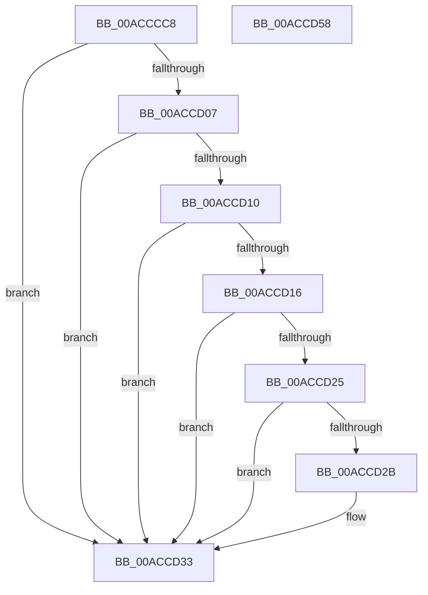

# PopQueryPowerSettingUlong

- RVA: `0x00ACCCC8`–`0x00ACCD59` (길이 `145` bytes)
- VA: `0x0000000140ACCCC8`
- 실행 섹션: `PAGE`
- PDB 이름 있음: `예`; PDB Function 태그: `아니요`
- unwind 정보 RVA: `0x0006F978`
- 디코드: `42`개 명령, `145/145` bytes 표시
- 미해석 바이트: `0` (있으면 어셈블리에 `.byte`로 보존)

> 이 문서는 커널 이미지의 기계어와 PDB 기호를 분석해 생성했습니다. 4번과 5번은 함수 원형과 자료형을 바이너리 사용 방식에서 추정한 C 해석이며 원본 소스 복구 결과는 아닙니다.

## 1. Dependencies

- 직접 호출 지점: **3**; 고유 호출 대상: **3**
- 직접 호출자로 확인된 함수: **3**
- RIP 상대 이미지 참조: **1**

### Outgoing calls
- `0x00ACCCEF` → [ExAcquireFastMutex](../../text/20/ExAcquireFastMutex_function_0020E5A0.md) (function, `0x0020E5A0`)
- `0x00ACCCFA` → [PopFindPowerSettingConfiguration](../91/PopFindPowerSettingConfiguration_function_009152E0.md) (function, `0x009152E0`)
- `0x00ACCD3A` → [ExReleaseFastMutex](../../text/25/ExReleaseFastMutex_function_002519C0.md) (function, `0x002519C0`)

### Direct callers
- [PopDeferDoze](../75/PopDeferDoze_function_0075FF88.md) at `0x00760036`
- [PopCheckPowerSourceAfterRtcWakeTimerWorker](../../pagelk/B7/PopCheckPowerSourceAfterRtcWakeTimerWorker_function_00B70AB0.md) at `0x00B70AEE`
- [PopTransitionSystemPowerStateEx](../../pagelk/B7/PopTransitionSystemPowerStateEx_function_00B7E8C0.md) at `0x00B7EC4D`
- [PopTransitionSystemPowerStateEx](../../pagelk/B7/PopTransitionSystemPowerStateEx_function_00B7E8C0.md) at `0x00B7F3F6`

### Static image references
- `0x00ACCCE3` → RVA `0x00F0DF40` (`.data`; read)

## 2. Other-region calls and transfers

- 다른 실행 섹션으로 향하는 call: **2**
  - `0x00ACCCEF` → [ExAcquireFastMutex](../../text/20/ExAcquireFastMutex_function_0020E5A0.md) (`PAGE` → `.text`)
  - `0x00ACCD3A` → [ExReleaseFastMutex](../../text/25/ExReleaseFastMutex_function_002519C0.md) (`PAGE` → `.text`)
- 별도 외부 분기/꼬리 이동을 확인하지 못했습니다.

## 3. Assembly (complete function range)

```asm
00ACCCC8  48 89 5C 24 08                  mov qword ptr [rsp + 8], rbx
00ACCCCD  48 89 74 24 10                  mov qword ptr [rsp + 0x10], rsi
00ACCCD2  48 89 7C 24 18                  mov qword ptr [rsp + 0x18], rdi
00ACCCD7  41 56                           push r14
00ACCCD9  48 83 EC 20                     sub rsp, 0x20
00ACCCDD  48 8B D9                        mov rbx, rcx
00ACCCE0  49 8B F0                        mov rsi, r8
00ACCCE3  48 8D 0D 56 12 44 00            lea rcx, [rip + 0x441256]
00ACCCEA  4C 8B F2                        mov r14, rdx
00ACCCED  33 FF                           xor edi, edi
00ACCCEF  E8 AC 18 74 FF                  call 0x14020e5a0
00ACCCF4  83 CA FF                        or edx, 0xffffffff
00ACCCF7  48 8B CB                        mov rcx, rbx
00ACCCFA  E8 E1 85 E4 FF                  call 0x1409152e0
00ACCCFF  4C 8B C8                        mov r9, rax
00ACCD02  48 85 C0                        test rax, rax
00ACCD05  74 2C                           je 0x140accd33
00ACCD07  48 8B 40 40                     mov rax, qword ptr [rax + 0x40]
00ACCD0B  48 85 C0                        test rax, rax
00ACCD0E  74 23                           je 0x140accd33
00ACCD10  83 78 04 04                     cmp dword ptr [rax + 4], 4
00ACCD14  72 1D                           jb 0x140accd33
00ACCD16  8B 40 0C                        mov eax, dword ptr [rax + 0xc]
00ACCD19  41 89 06                        mov dword ptr [r14], eax
00ACCD1C  49 8B 41 48                     mov rax, qword ptr [r9 + 0x48]
00ACCD20  48 85 C0                        test rax, rax
00ACCD23  74 0E                           je 0x140accd33
00ACCD25  83 78 04 04                     cmp dword ptr [rax + 4], 4
00ACCD29  72 08                           jb 0x140accd33
00ACCD2B  8B 40 0C                        mov eax, dword ptr [rax + 0xc]
00ACCD2E  40 B7 01                        mov dil, 1
00ACCD31  89 06                           mov dword ptr [rsi], eax
00ACCD33  48 8D 0D 06 12 44 00            lea rcx, [rip + 0x441206]
00ACCD3A  E8 81 4C 78 FF                  call 0x1402519c0
00ACCD3F  48 8B 5C 24 30                  mov rbx, qword ptr [rsp + 0x30]
00ACCD44  40 8A C7                        mov al, dil
00ACCD47  48 8B 7C 24 40                  mov rdi, qword ptr [rsp + 0x40]
00ACCD4C  48 8B 74 24 38                  mov rsi, qword ptr [rsp + 0x38]
00ACCD51  48 83 C4 20                     add rsp, 0x20
00ACCD55  41 5E                           pop r14
00ACCD57  C3                              ret
00ACCD58  CC                              int3
```

## 4. C-style interpretation (structured pseudocode)

```c
__int64 __fastcall PopQueryPowerSettingUlong(__int64 a1, __int64 a2, __int64 a3)
{
    __int64 result;
    __int64 v_rdi;
    __int64 v_rsp;
    unsigned __int64 v_stack_p10;
    unsigned __int64 v_stack_p18;
    unsigned __int64 v_stack_p8;

    v_stack_p8 = v_rbx;
    v_stack_p10 = v_rsi;
    v_stack_p18 = v_rdi;
    v_rsp = (v_rsp) - (32);
    v_rdi = 0;
    result = ExAcquireFastMutex(v_rip + 4461142, a2, a3, a4);
    a2 = (unsigned int)((a2) | (0xFFFFFFFFULL));
    result = PopFindPowerSettingConfiguration(a1, a2, a3, a4);
    if (result == 0) goto loc_00ACCD33;
    if (*(unsigned __int64 *)(result + 64) == 0) goto loc_00ACCD33;
    if ((*(unsigned int *)(*(unsigned __int64 *)(result + 64) + 4)) < 4) goto loc_00ACCD33;
    *(unsigned int *)(a2) = (unsigned int)((unsigned int)(*(unsigned int *)(*(unsigned __int64 *)(result + 64) + 12)));
    if (*(unsigned __int64 *)(result + 72) == 0) goto loc_00ACCD33;
    result = *(unsigned __int64 *)(result + 72);
    if ((*(unsigned int *)(*(unsigned __int64 *)(result + 72) + 4)) >= 4) {
        result = *(unsigned int *)(*(unsigned __int64 *)(result + 72) + 12);
        v_rdi = 1;
        *(unsigned int *)(a3) = (unsigned int)(result);
    }
    result = ExReleaseFastMutex(v_rip + 4461062, a2, a3, result);
    v_rsp = (v_rsp) + (32);
    return (unsigned __int8)(v_rdi);
}
```

## 5. (Beta) C Style

```c
int64_t PopQueryPowerSettingUlong(int64_t Arg1, void *Arg2, void *Arg3)
{
    uint8_t *arg2 = (uint8_t *)Arg2;
    uint8_t *arg3 = (uint8_t *)Arg3;

    int64_t result;
    int64_t local_rdi;
    int64_t local_rsp;
    uint64_t v_stack_p10;
    uint64_t v_stack_p18;
    uint64_t v_stack_p8;

    v_stack_p8 = local_rbx;
    v_stack_p10 = local_rsi;
    v_stack_p18 = local_rdi;
    local_rsp = (local_rsp) - (32);
    local_rdi = 0;
    result = ExAcquireFastMutex(v_rip + 4461142, Arg2, Arg3, a4);
    Arg2 = (uint32_t)((Arg2) | (0xFFFFFFFFULL));
    result = PopFindPowerSettingConfiguration(Arg1, Arg2, Arg3, a4);
    if (result == 0) goto loc_00ACCD33;
    if (*(uint64_t *)(result + 0x40) == 0) goto loc_00ACCD33;
    if ((*(uint32_t *)(*(uint64_t *)(result + 0x40) + 0x4)) < 4) goto loc_00ACCD33;
    *(uint32_t *)(arg2) = (uint32_t)((uint32_t)(*(uint32_t *)(*(uint64_t *)(result + 0x40) + 0xC)));
    if (*(uint64_t *)(result + 0x48) == 0) goto loc_00ACCD33;
    result = *(uint64_t *)(result + 0x48);
    if ((*(uint32_t *)(*(uint64_t *)(result + 0x48) + 0x4)) >= 4) {
        result = *(uint32_t *)(*(uint64_t *)(result + 0x48) + 0xC);
        local_rdi = 1;
        *(uint32_t *)(arg3) = (uint32_t)(result);
    }
    result = ExReleaseFastMutex(v_rip + 4461062, Arg2, Arg3, result);
    local_rsp = (local_rsp) + (32);
    return (uint8_t)(local_rdi);
}
```

### 관측된 메모리 오프셋

구조체 형식이 확인되지 않은 접근은 인자 기준의 오프셋으로만 기록했습니다.

| 기준 인자 | 오프셋 표현 | 폭 (bit) | 접근 |
|---|---:|---:|---|
| `Arg2` | `+ 0x0` | `32` | `W` |
| `Arg3` | `+ 0x0` | `32` | `W` |

## 6. Execution-region graph

[열기: 2D/3D 그래프와 함수 탐색 컨트롤 패널](../../../control-panel.html?section=page&rva=0x00ACCCC8&view=graph)

- 2D 그래프는 위에서 아래로 흐르고, 3D 그래프는 빈 공간을 드래그해 회전합니다. Shift+드래그는 이동, 휠은 확대·축소, 함수 노드 선택은 대상 보고서 이동입니다.

### Static fallback


