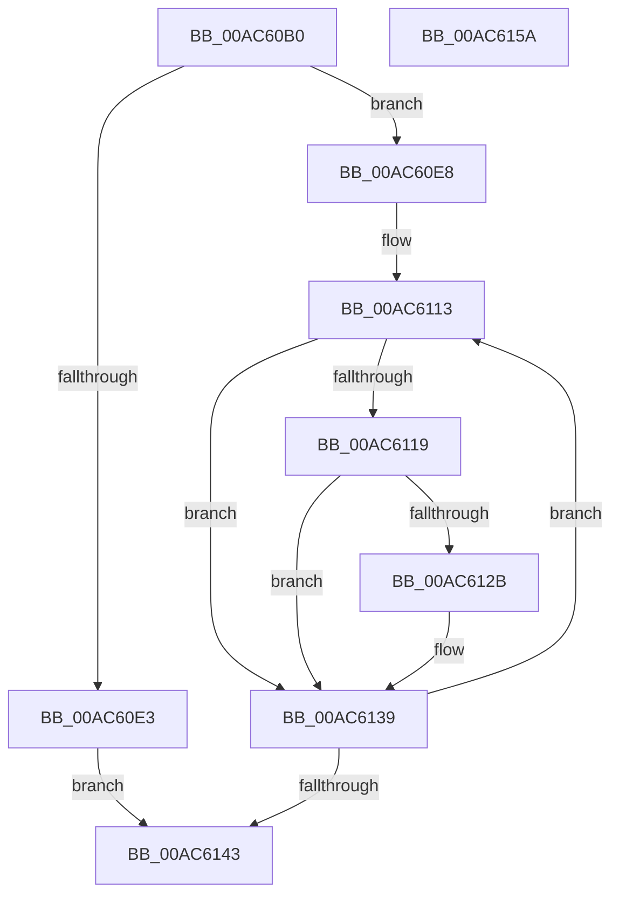

# PopQueryRemainingSystemIdleTime

- RVA: `0x00AC60B0`–`0x00AC615B` (길이 `171` bytes)
- VA: `0x0000000140AC60B0`
- 실행 섹션: `PAGE`
- PDB 이름 있음: `예`; PDB Function 태그: `아니요`
- unwind 정보 RVA: `0x0005CAAC`
- 디코드: `44`개 명령, `171/171` bytes 표시
- 미해석 바이트: `0` (있으면 어셈블리에 `.byte`로 보존)

> 이 문서는 커널 이미지의 기계어와 PDB 기호를 분석해 생성했습니다. 4번과 5번은 함수 원형과 자료형을 바이너리 사용 방식에서 추정한 C 해석이며 원본 소스 복구 결과는 아닙니다.

## 1. Dependencies

- 직접 호출 지점: **2**; 고유 호출 대상: **2**
- 직접 호출자로 확인된 함수: **1**
- RIP 상대 이미지 참조: **4**

### Outgoing calls
- `0x00AC60C7` → [PopAcquireRwLockExclusive](../../text/43/PopAcquireRwLockExclusive_function_00430B44.md) (function, `0x00430B44`)
- `0x00AC614A` → [PopReleaseRwLock](../../text/2D/PopReleaseRwLock_function_002DFBBC.md) (function, `0x002DFBBC`)

### Direct callers
- [PopCaptureSleepStudyStatistics](../../text/43/PopCaptureSleepStudyStatistics_function_004399F4.md) at `0x00439D55`

### Static image references
- `0x00AC60C0` → RVA `0x00F093E0` (`.data`; read)
- `0x00AC60D2` → RVA `0x00E0B6B4` (`.data`; read)
- `0x00AC60DA` → RVA `0x00E0B6B8` (`.data`; read)
- `0x00AC60F2` → RVA `0x00E0B6D0` (`.data`; read)

## 2. Other-region calls and transfers

- 다른 실행 섹션으로 향하는 call: **2**
  - `0x00AC60C7` → [PopAcquireRwLockExclusive](../../text/43/PopAcquireRwLockExclusive_function_00430B44.md) (`PAGE` → `.text`)
  - `0x00AC614A` → [PopReleaseRwLock](../../text/2D/PopReleaseRwLock_function_002DFBBC.md) (`PAGE` → `.text`)
- 별도 외부 분기/꼬리 이동을 확인하지 못했습니다.

## 3. Assembly (complete function range)

```asm
00AC60B0  48 89 5C 24 08                  mov qword ptr [rsp + 8], rbx
00AC60B5  57                              push rdi
00AC60B6  48 83 EC 20                     sub rsp, 0x20
00AC60BA  48 8B F9                        mov rdi, rcx
00AC60BD  48 8B DA                        mov rbx, rdx
00AC60C0  48 8D 0D 19 33 44 00            lea rcx, [rip + 0x443319]
00AC60C7  E8 78 AA 96 FF                  call 0x140430b44
00AC60CC  45 33 DB                        xor r11d, r11d
00AC60CF  44 89 1F                        mov dword ptr [rdi], r11d
00AC60D2  8B 05 DC 55 34 00               mov eax, dword ptr [rip + 0x3455dc]
00AC60D8  89 03                           mov dword ptr [rbx], eax
00AC60DA  44 39 1D D7 55 34 00            cmp dword ptr [rip + 0x3455d7], r11d
00AC60E1  75 05                           jne 0x140ac60e8
00AC60E3  83 0F FF                        or dword ptr [rdi], 0xffffffff
00AC60E6  EB 5B                           jmp 0x140ac6143
00AC60E8  48 B9 08 00 00 00 80 F7 FF FF   movabs rcx, 0xfffff78000000008
00AC60F2  4C 8D 05 D7 55 34 00            lea r8, [rip + 0x3455d7]
00AC60F9  48 B8 BD 42 7A E5 D5 94 BF D6   movabs rax, 0xd6bf94d5e57a42bd
00AC6103  41 BA 04 00 00 00               mov r10d, 4
00AC6109  48 8B 09                        mov rcx, qword ptr [rcx]
00AC610C  48 F7 E1                        mul rcx
00AC610F  48 C1 EA 17                     shr rdx, 0x17
00AC6113  45 38 58 08                     cmp byte ptr [r8 + 8], r11b
00AC6117  75 20                           jne 0x140ac6139
00AC6119  44 8B 0D 98 55 34 00            mov r9d, dword ptr [rip + 0x345598]
00AC6120  48 8B CA                        mov rcx, rdx
00AC6123  49 2B 08                        sub rcx, qword ptr [r8]
00AC6126  49 3B C9                        cmp rcx, r9
00AC6129  77 0E                           ja 0x140ac6139
00AC612B  8B 07                           mov eax, dword ptr [rdi]
00AC612D  44 2B C9                        sub r9d, ecx
00AC6130  41 3B C1                        cmp eax, r9d
00AC6133  41 0F 46 C1                     cmovbe eax, r9d
00AC6137  89 07                           mov dword ptr [rdi], eax
00AC6139  49 83 C0 38                     add r8, 0x38
00AC613D  49 83 EA 01                     sub r10, 1
00AC6141  75 D0                           jne 0x140ac6113
00AC6143  48 8D 0D 96 32 44 00            lea rcx, [rip + 0x443296]
00AC614A  E8 6D 9A 81 FF                  call 0x1402dfbbc
00AC614F  48 8B 5C 24 30                  mov rbx, qword ptr [rsp + 0x30]
00AC6154  48 83 C4 20                     add rsp, 0x20
00AC6158  5F                              pop rdi
00AC6159  C3                              ret
00AC615A  CC                              int3
```

## 4. C-style interpretation (structured pseudocode)

```c
__int64 __fastcall PopQueryRemainingSystemIdleTime(__int64 a1, __int64 a2)
{
    __int64 result;
    __int64 v_r10;
    __int64 v_r11;
    __int64 v_rsp;
    unsigned __int64 v_stack_p8;

    v_stack_p8 = v_rbx;
    v_rsp = (v_rsp) - (32);
    result = PopAcquireRwLockExclusive(v_rip + 4469529, a2, a3, a4);
    v_r11 = 0;
    *(unsigned int *)(a1) = 0;
    *(unsigned int *)(a2) = (unsigned int)((unsigned int)(*(unsigned int *)(v_rip + 3429852)));
    if ((*(unsigned int *)(v_rip + 3429847)) != 0) goto loc_00AC60E8;
    goto loc_00AC6143;
loc_00AC60E8:
    a2 = (a2) >> (23);
loc_00AC6113:
    if ((*(unsigned __int8 *)(v_rip + 3429847 + 8)) != 0) goto loc_00AC6139;
    a1 = (a2) - (*(unsigned __int64 *)(v_rip + 3429847));
    result = (unsigned int)(*(unsigned int *)(v_rip + 3429852));
    if (a1 <= ((unsigned int)(*(unsigned int *)(v_rip + 3429784)))) {
        result = *(unsigned int *)(a1);
        a4 = (unsigned int)(((unsigned int)(*(unsigned int *)(v_rip + 3429784))) - ((unsigned int)(a1)));
        if (((unsigned int)(result)) <= ((unsigned int)(a4))) { result = (unsigned int)(a4); }
        *(unsigned int *)(a1) = (unsigned int)(result);
    }
    a3 = (v_rip + 3429847) + (56);
    v_r10 = (4) - (1);
    if (condition_is_not_equal) goto loc_00AC6113;
loc_00AC6143:
    result = PopReleaseRwLock(v_rip + 4469398, a2, a3, a4);
    v_rsp = (v_rsp) + (32);
    return result;
}
```

## 5. (Beta) C Style

```c
int64_t PopQueryRemainingSystemIdleTime(void *Arg1, void *Arg2)
{
    uint8_t *arg1 = (uint8_t *)Arg1;
    uint8_t *arg2 = (uint8_t *)Arg2;

    int64_t result;
    int64_t local_r10;
    int64_t local_r11;
    int64_t local_rsp;
    uint64_t v_stack_p8;

    v_stack_p8 = local_rbx;
    local_rsp = (local_rsp) - (32);
    result = PopAcquireRwLockExclusive(v_rip + 4469529, Arg2, a3, a4);
    local_r11 = 0;
    *(uint32_t *)(arg1) = 0;
    *(uint32_t *)(arg2) = (uint32_t)((uint32_t)(*(uint32_t *)(v_rip + 0x3455DC)));
    if ((*(uint32_t *)(v_rip + 0x3455D7)) != 0) goto loc_00AC60E8;
    goto loc_00AC6143;
loc_00AC60E8:
    Arg2 = (Arg2) >> (23);
loc_00AC6113:
    if ((*(uint8_t *)(v_rip + 0x3455D7 + 0x8)) != 0) goto loc_00AC6139;
    Arg1 = (Arg2) - (*(uint64_t *)(v_rip + 0x3455D7));
    result = (uint32_t)(*(uint32_t *)(v_rip + 0x3455DC));
    if (Arg1 <= ((uint32_t)(*(uint32_t *)(v_rip + 0x345598)))) {
        result = *(uint32_t *)(arg1);
        a4 = (uint32_t)(((uint32_t)(*(uint32_t *)(v_rip + 0x345598))) - ((uint32_t)(Arg1)));
        if (((uint32_t)(result)) <= ((uint32_t)(a4))) { result = (uint32_t)(a4); }
        *(uint32_t *)(arg1) = (uint32_t)(result);
    }
    a3 = (v_rip + 3429847) + (56);
    local_r10 = (4) - (1);
    if (condition_is_not_equal) goto loc_00AC6113;
loc_00AC6143:
    result = PopReleaseRwLock(v_rip + 4469398, Arg2, a3, a4);
    local_rsp = (local_rsp) + (32);
    return result;
}
```

### 관측된 메모리 오프셋

구조체 형식이 확인되지 않은 접근은 인자 기준의 오프셋으로만 기록했습니다.

| 기준 인자 | 오프셋 표현 | 폭 (bit) | 접근 |
|---|---:|---:|---|
| `Arg1` | `+ 0x0` | `32` | `R` |
| `Arg1` | `+ 0x0` | `32` | `R/W` |
| `Arg1` | `+ 0x0` | `32` | `W` |
| `Arg2` | `+ 0x0` | `32` | `W` |

## 6. Execution-region graph

[열기: 2D/3D 그래프와 함수 탐색 컨트롤 패널](../../../control-panel.html?section=page&rva=0x00AC60B0&view=graph)

- 2D 그래프는 위에서 아래로 흐르고, 3D 그래프는 빈 공간을 드래그해 회전합니다. Shift+드래그는 이동, 휠은 확대·축소, 함수 노드 선택은 대상 보고서 이동입니다.

### Static fallback


