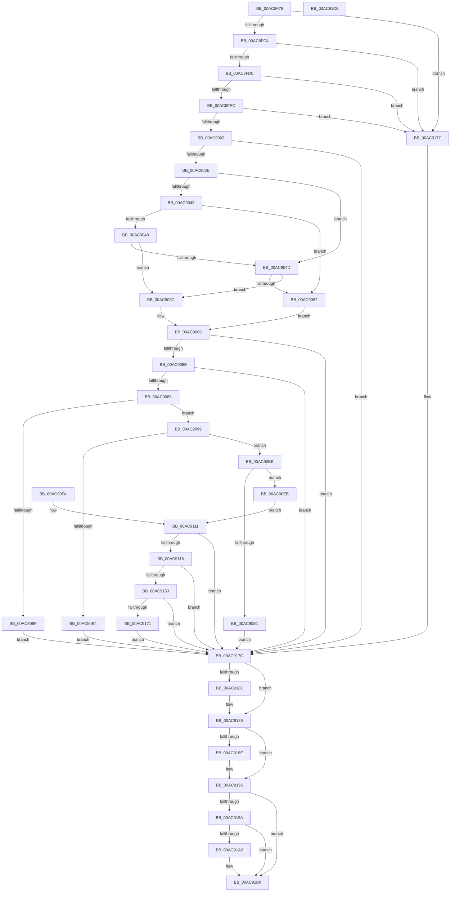

# PopReadPagesFromHiberFile

- RVA: `0x00AC8F78`–`0x00AC91C9` (길이 `593` bytes)
- VA: `0x0000000140AC8F78`
- 실행 섹션: `PAGE`
- PDB 이름 있음: `예`; PDB Function 태그: `아니요`
- unwind 정보 RVA: `0x000BE1E8`
- 디코드: `162`개 명령, `593/593` bytes 표시
- 미해석 바이트: `0` (있으면 어셈블리에 `.byte`로 보존)

> 이 문서는 커널 이미지의 기계어와 PDB 기호를 분석해 생성했습니다. 4번과 5번은 함수 원형과 자료형을 바이너리 사용 방식에서 추정한 C 해석이며 원본 소스 복구 결과는 아닙니다.

## 1. Dependencies

- 직접 호출 지점: **10**; 고유 호출 대상: **10**
- 직접 호출자로 확인된 함수: **2**
- RIP 상대 이미지 참조: **4**

### Outgoing calls
- `0x00AC9079` → [RtlLongLongAdd](../../text/5D/RtlLongLongAdd_function_005D5128.md) (function, `0x005D5128`)
- `0x00AC90A7` → [ExAllocatePool2](../../poolcode/B8/ExAllocatePool2_function_00B820F0.md) (function, `0x00B820F0`)
- `0x00AC90CF` → [IoAllocateMdl](../../text/29/IoAllocateMdl_function_0029EBF0.md) (function, `0x0029EBF0`)
- `0x00AC90F3` → [MmProbeAndLockPages](../../text/23/MmProbeAndLockPages_function_0023B990.md) (function, `0x0023B990`)
- `0x00AC9122` → [KeInitializeEvent](../../text/40/KeInitializeEvent_function_0040DD10.md) (function, `0x0040DD10`)
- `0x00AC9145` → [IoPageRead](../../text/4F/IoPageRead_function_004FCCB0.md) (function, `0x004FCCB0`)
- `0x00AC9166` → [KeWaitForSingleObject](../../text/20/KeWaitForSingleObject_function_0020E6B0.md) (function, `0x0020E6B0`)
- `0x00AC9184` → [MmUnlockPages](../../text/29/MmUnlockPages_function_0029EEE0.md) (function, `0x0029EEE0`)
- `0x00AC9191` → [IoFreeMdl](../../text/29/IoFreeMdl_function_0029EA80.md) (function, `0x0029EA80`)
- `0x00AC91A7` → [ExFreePoolWithTag](../../poolcode/B8/ExFreePoolWithTag_function_00B82870.md) (function, `0x00B82870`)

### Direct callers
- [PopPowerInformationInternal](../A8/PopPowerInformationInternal_function_00A8B7C0.md) at `0x00A8B96E`
- [PopReadResumeContext](PopReadResumeContext_function_00AC8E20.md) at `0x00AC8E52`
- [PopReadResumeContext](PopReadResumeContext_function_00AC8E20.md) at `0x00AC8EAD`

### Static image references
- `0x00AC8FB8` → RVA `0x00F0CEC8` (`.data`; read)
- `0x00AC8FC4` → RVA `0x00F0BF20` (`.data`; read)
- `0x00AC8FD8` → RVA `0x00F0BF28` (`.data`; read)
- `0x00AC8FEC` → RVA `0x00F0BF30` (`.data`; read)

## 2. Other-region calls and transfers

- 다른 실행 섹션으로 향하는 call: **10**
  - `0x00AC9079` → [RtlLongLongAdd](../../text/5D/RtlLongLongAdd_function_005D5128.md) (`PAGE` → `.text`)
  - `0x00AC90A7` → [ExAllocatePool2](../../poolcode/B8/ExAllocatePool2_function_00B820F0.md) (`PAGE` → `POOLCODE`)
  - `0x00AC90CF` → [IoAllocateMdl](../../text/29/IoAllocateMdl_function_0029EBF0.md) (`PAGE` → `.text`)
  - `0x00AC90F3` → [MmProbeAndLockPages](../../text/23/MmProbeAndLockPages_function_0023B990.md) (`PAGE` → `.text`)
  - `0x00AC9122` → [KeInitializeEvent](../../text/40/KeInitializeEvent_function_0040DD10.md) (`PAGE` → `.text`)
  - `0x00AC9145` → [IoPageRead](../../text/4F/IoPageRead_function_004FCCB0.md) (`PAGE` → `.text`)
  - `0x00AC9166` → [KeWaitForSingleObject](../../text/20/KeWaitForSingleObject_function_0020E6B0.md) (`PAGE` → `.text`)
  - `0x00AC9184` → [MmUnlockPages](../../text/29/MmUnlockPages_function_0029EEE0.md) (`PAGE` → `.text`)
  - `0x00AC9191` → [IoFreeMdl](../../text/29/IoFreeMdl_function_0029EA80.md) (`PAGE` → `.text`)
  - `0x00AC91A7` → [ExFreePoolWithTag](../../poolcode/B8/ExFreePoolWithTag_function_00B82870.md) (`PAGE` → `POOLCODE`)
- 별도 외부 분기/꼬리 이동을 확인하지 못했습니다.

## 3. Assembly (complete function range)

```asm
00AC8F78  4C 8B DC                        mov r11, rsp
00AC8F7B  49 89 73 08                     mov qword ptr [r11 + 8], rsi
00AC8F7F  4D 89 43 18                     mov qword ptr [r11 + 0x18], r8
00AC8F83  57                              push rdi
00AC8F84  41 54                           push r12
00AC8F86  41 55                           push r13
00AC8F88  41 56                           push r14
00AC8F8A  41 57                           push r15
00AC8F8C  48 83 EC 70                     sub rsp, 0x70
00AC8F90  4D 8B F0                        mov r14, r8
00AC8F93  49 83 63 98 00                  and qword ptr [r11 - 0x68], 0
00AC8F98  0F 57 C0                        xorps xmm0, xmm0
00AC8F9B  33 C0                           xor eax, eax
00AC8F9D  0F 11 44 24 50                  movups xmmword ptr [rsp + 0x50], xmm0
00AC8FA2  49 89 43 C8                     mov qword ptr [r11 - 0x38], rax
00AC8FA6  0F 11 44 24 40                  movups xmmword ptr [rsp + 0x40], xmm0
00AC8FAB  33 F6                           xor esi, esi
00AC8FAD  45 32 FF                        xor r15b, r15b
00AC8FB0  44 88 BC 24 B8 00 00 00         mov byte ptr [rsp + 0xb8], r15b
00AC8FB8  38 05 0A 3F 44 00               cmp byte ptr [rip + 0x443f0a], al
00AC8FBE  0F 84 B3 01 00 00               je 0x140ac9177
00AC8FC4  48 8B 05 55 2F 44 00            mov rax, qword ptr [rip + 0x442f55]
00AC8FCB  48 FF C8                        dec rax
00AC8FCE  48 83 F8 FD                     cmp rax, -3
00AC8FD2  0F 87 9F 01 00 00               ja 0x140ac9177
00AC8FD8  48 8B 05 49 2F 44 00            mov rax, qword ptr [rip + 0x442f49]
00AC8FDF  48 FF C8                        dec rax
00AC8FE2  48 83 F8 FD                     cmp rax, -3
00AC8FE6  0F 87 8B 01 00 00               ja 0x140ac9177
00AC8FEC  4C 8B 25 3D 2F 44 00            mov r12, qword ptr [rip + 0x442f3d]
00AC8FF3  41 B8 00 10 00 00               mov r8d, 0x1000
00AC8FF9  4D 3B E0                        cmp r12, r8
00AC8FFC  0F 82 75 01 00 00               jb 0x140ac9177
00AC9002  8B C2                           mov eax, edx
00AC9004  48 C1 E0 0C                     shl rax, 0xc
00AC9008  BA FF FF FF FF                  mov edx, 0xffffffff
00AC900D  44 8B EA                        mov r13d, edx
00AC9010  48 3B C2                        cmp rax, rdx
00AC9013  44 0F 46 E8                     cmovbe r13d, eax
00AC9017  48 3B D0                        cmp rdx, rax
00AC901A  1B FF                           sbb edi, edi
00AC901C  41 B9 95 00 00 C0               mov r9d, 0xc0000095
00AC9022  41 23 F9                        and edi, r9d
00AC9025  48 3B C2                        cmp rax, rdx
00AC9028  0F 87 4E 01 00 00               ja 0x140ac917c
00AC902E  49 21 73 A0                     and qword ptr [r11 - 0x60], rsi
00AC9032  8B C9                           mov ecx, ecx
00AC9034  41 8B C0                        mov eax, r8d
00AC9037  48 F7 E9                        imul rcx
00AC903A  48 83 C9 FF                     or rcx, 0xffffffffffffffff
00AC903E  48 85 C0                        test rax, rax
00AC9041  79 0A                           jns 0x140ac904d
00AC9043  48 3B D1                        cmp rdx, rcx
00AC9046  75 0A                           jne 0x140ac9052
00AC9048  48 85 C0                        test rax, rax
00AC904B  78 0F                           js 0x140ac905c
00AC904D  48 85 D2                        test rdx, rdx
00AC9050  74 0A                           je 0x140ac905c
00AC9052  48 89 4C 24 38                  mov qword ptr [rsp + 0x38], rcx
00AC9057  41 8B F9                        mov edi, r9d
00AC905A  EB 0A                           jmp 0x140ac9066
00AC905C  48 8B C8                        mov rcx, rax
00AC905F  48 89 44 24 38                  mov qword ptr [rsp + 0x38], rax
00AC9064  33 FF                           xor edi, edi
00AC9066  85 FF                           test edi, edi
00AC9068  0F 88 0E 01 00 00               js 0x140ac917c
00AC906E  45 8B DD                        mov r11d, r13d
00AC9071  4C 8D 44 24 30                  lea r8, [rsp + 0x30]
00AC9076  41 8B D5                        mov edx, r13d
00AC9079  E8 AA C0 B0 FF                  call 0x1405d5128
00AC907E  8B F8                           mov edi, eax
00AC9080  85 C0                           test eax, eax
00AC9082  0F 88 F4 00 00 00               js 0x140ac917c
00AC9088  4C 39 64 24 30                  cmp qword ptr [rsp + 0x30], r12
00AC908D  76 0A                           jbe 0x140ac9099
00AC908F  BF 11 00 00 C0                  mov edi, 0xc0000011
00AC9094  E9 E3 00 00 00                  jmp 0x140ac917c
00AC9099  41 B8 4D 65 6D 20               mov r8d, 0x206d654d
00AC909F  49 8B D3                        mov rdx, r11
00AC90A2  B9 00 01 00 00                  mov ecx, 0x100
00AC90A7  E8 44 90 0B 00                  call 0x140b820f0
00AC90AC  49 89 06                        mov qword ptr [r14], rax
00AC90AF  48 85 C0                        test rax, rax
00AC90B2  75 0A                           jne 0x140ac90be
00AC90B4  BF 17 00 00 C0                  mov edi, 0xc0000017
00AC90B9  E9 BE 00 00 00                  jmp 0x140ac917c
00AC90BE  48 21 74 24 20                  and qword ptr [rsp + 0x20], rsi
00AC90C3  45 33 C9                        xor r9d, r9d
00AC90C6  45 33 C0                        xor r8d, r8d
00AC90C9  41 8B D5                        mov edx, r13d
00AC90CC  48 8B C8                        mov rcx, rax
00AC90CF  E8 1C 5B 7D FF                  call 0x14029ebf0
00AC90D4  48 8B F0                        mov rsi, rax
00AC90D7  48 89 44 24 30                  mov qword ptr [rsp + 0x30], rax
00AC90DC  48 85 C0                        test rax, rax
00AC90DF  75 0A                           jne 0x140ac90eb
00AC90E1  BF 9A 00 00 C0                  mov edi, 0xc000009a
00AC90E6  E9 91 00 00 00                  jmp 0x140ac917c
00AC90EB  45 33 C0                        xor r8d, r8d
00AC90EE  33 D2                           xor edx, edx
00AC90F0  48 8B C8                        mov rcx, rax
00AC90F3  E8 98 28 77 FF                  call 0x14023b990
00AC90F8  EB 17                           jmp 0x140ac9111
00AC90FA  8B F8                           mov edi, eax
00AC90FC  4C 8B B4 24 B0 00 00 00         mov r14, qword ptr [rsp + 0xb0]
00AC9104  48 8B 74 24 30                  mov rsi, qword ptr [rsp + 0x30]
00AC9109  44 8A BC 24 B8 00 00 00         mov r15b, byte ptr [rsp + 0xb8]
00AC9111  85 FF                           test edi, edi
00AC9113  78 67                           js 0x140ac917c
00AC9115  41 B7 01                        mov r15b, 1
00AC9118  45 33 C0                        xor r8d, r8d
00AC911B  33 D2                           xor edx, edx
00AC911D  48 8D 4C 24 50                  lea rcx, [rsp + 0x50]
00AC9122  E8 E9 4B 94 FF                  call 0x14040dd10
00AC9127  48 8D 44 24 40                  lea rax, [rsp + 0x40]
00AC912C  48 89 44 24 20                  mov qword ptr [rsp + 0x20], rax
00AC9131  4C 8D 4C 24 50                  lea r9, [rsp + 0x50]
00AC9136  4C 8D 44 24 38                  lea r8, [rsp + 0x38]
00AC913B  48 8B D6                        mov rdx, rsi
00AC913E  48 8B 0D E3 2D 44 00            mov rcx, qword ptr [rip + 0x442de3]
00AC9145  E8 66 3B A3 FF                  call 0x1404fccb0
00AC914A  8B F8                           mov edi, eax
00AC914C  3D 03 01 00 00                  cmp eax, 0x103
00AC9151  75 29                           jne 0x140ac917c
00AC9153  48 83 64 24 20 00               and qword ptr [rsp + 0x20], 0
00AC9159  45 33 C9                        xor r9d, r9d
00AC915C  45 33 C0                        xor r8d, r8d
00AC915F  33 D2                           xor edx, edx
00AC9161  48 8D 4C 24 50                  lea rcx, [rsp + 0x50]
00AC9166  E8 45 55 74 FF                  call 0x14020e6b0
00AC916B  8B F8                           mov edi, eax
00AC916D  85 C0                           test eax, eax
00AC916F  78 0B                           js 0x140ac917c
00AC9171  8B 7C 24 40                     mov edi, dword ptr [rsp + 0x40]
00AC9175  EB 05                           jmp 0x140ac917c
00AC9177  BF BB 00 00 C0                  mov edi, 0xc00000bb
00AC917C  45 84 FF                        test r15b, r15b
00AC917F  74 08                           je 0x140ac9189
00AC9181  48 8B CE                        mov rcx, rsi
00AC9184  E8 57 5D 7D FF                  call 0x14029eee0
00AC9189  48 85 F6                        test rsi, rsi
00AC918C  74 08                           je 0x140ac9196
00AC918E  48 8B CE                        mov rcx, rsi
00AC9191  E8 EA 58 7D FF                  call 0x14029ea80
00AC9196  85 FF                           test edi, edi
00AC9198  79 16                           jns 0x140ac91b0
00AC919A  49 8B 0E                        mov rcx, qword ptr [r14]
00AC919D  48 85 C9                        test rcx, rcx
00AC91A0  74 0E                           je 0x140ac91b0
00AC91A2  BA 4D 65 6D 20                  mov edx, 0x206d654d
00AC91A7  E8 C4 96 0B 00                  call 0x140b82870
00AC91AC  49 83 26 00                     and qword ptr [r14], 0
00AC91B0  8B C7                           mov eax, edi
00AC91B2  48 8B B4 24 A0 00 00 00         mov rsi, qword ptr [rsp + 0xa0]
00AC91BA  48 83 C4 70                     add rsp, 0x70
00AC91BE  41 5F                           pop r15
00AC91C0  41 5E                           pop r14
00AC91C2  41 5D                           pop r13
00AC91C4  41 5C                           pop r12
00AC91C6  5F                              pop rdi
00AC91C7  C3                              ret
00AC91C8  CC                              int3
```

## 4. C-style interpretation (structured pseudocode)

```c
__int64 __fastcall PopReadPagesFromHiberFile(int a1, int a2, __int64 a3)
{
    __int64 result;
    __int64 v_r13;
    __int64 v_r15;
    __int64 v_rdi;
    __int64 v_rsi;
    __int64 v_rsp;
    unsigned __int64 v_stack_m48;
    unsigned __int64 v_stack_m58;
    unsigned __int64 v_stack_m60;
    unsigned __int64 v_stack_m68;
    unsigned __int64 v_stack_m78;
    unsigned __int64 v_stack_p18;
    unsigned __int8 v_stack_p20;
    unsigned __int64 v_stack_p8;

    *(unsigned __int64 *)(v_rsp + 8) = v_rsi;
    *(unsigned __int64 *)(v_rsp + 24) = a3;
    v_rsp = (v_rsp) - (112);
    result = 0;
    v_stack_m48 = v_xmm0;
    *(unsigned __int64 *)(v_rsp - 56) = 0;
    v_stack_m58 = v_xmm0;
    v_rsi = 0;
    v_r15 = 0;
    v_stack_p20 = 0;
    if ((*(unsigned __int8 *)(v_rip + 4472586)) == 0) goto loc_00AC9177;
    result = (*(unsigned __int64 *)(v_rip + 4468565)) - 1;
    if (result > -3) goto loc_00AC9177;
    result = (*(unsigned __int64 *)(v_rip + 4468553)) - 1;
    if (result > -3) goto loc_00AC9177;
    if ((*(unsigned __int64 *)(v_rip + 4468541)) < ((unsigned int)(0x1000ULL))) goto loc_00AC9177;
    result = ((unsigned int)(a2)) << (12);
    v_r13 = (unsigned int)((unsigned int)((unsigned int)(0xFFFFFFFFULL)));
    if (result <= ((unsigned int)(0xFFFFFFFFULL))) { v_r13 = (unsigned int)(result); }
    v_rdi = (unsigned int)((v_rdi) & ((unsigned int)((unsigned int)(0xC0000095ULL))));
    if (result > ((unsigned int)(0xFFFFFFFFULL))) goto loc_00AC917C;
    a1 = ((unsigned int)(a1)) | (-1);
    if (!sign_flag) goto loc_00AC904D;
    if (((unsigned int)(0xFFFFFFFFULL)) != a1) goto loc_00AC9052;
    if (sign_flag) goto loc_00AC905C;
loc_00AC904D:
    if ((unsigned int)(0xFFFFFFFFULL) == 0) goto loc_00AC905C;
loc_00AC9052:
    v_stack_m60 = a1;
    goto loc_00AC9066;
loc_00AC905C:
    v_stack_m60 = (unsigned int)((unsigned int)((unsigned int)(0x1000ULL)));
    v_rdi = 0;
loc_00AC9066:
    if (sign_flag) goto loc_00AC917C;
    result = RtlLongLongAdd((unsigned int)((unsigned int)((unsigned int)(0x1000ULL))), (unsigned int)((unsigned int)(v_r13)), v_stack_m68, (unsigned int)(0xC0000095ULL));
    if (sign_flag) goto loc_00AC917C;
    if (v_stack_m68 <= (*(unsigned __int64 *)(v_rip + 4468541))) goto loc_00AC9099;
    goto loc_00AC917C;
loc_00AC9099:
    result = ExAllocatePool2(256, (unsigned int)((unsigned int)(v_r13)), (unsigned int)(0x206D654DULL), (unsigned int)(0xC0000095ULL));
    *(unsigned __int64 *)(a3) = result;
    if (result != 0) goto loc_00AC90BE;
    goto loc_00AC917C;
loc_00AC90BE:
    a4 = 0;
    a3 = 0;
    result = IoAllocateMdl(result, (unsigned int)((unsigned int)(v_r13)), a3, a4);
    v_stack_m68 = result;
    if (result != 0) goto loc_00AC90EB;
    goto loc_00AC917C;
loc_00AC90EB:
    a3 = 0;
    a2 = 0;
    result = MmProbeAndLockPages(result, a2, a3, a4);
    goto loc_00AC9111;
loc_00AC9111:
    if (sign_flag) goto loc_00AC917C;
    a3 = 0;
    a2 = 0;
    result = KeInitializeEvent(v_stack_m48, a2, a3, a4);
    v_stack_m78 = v_stack_m58;
    result = IoPageRead(*(unsigned __int64 *)(v_rip + 4468195), result, v_stack_m60, v_stack_m48);
    if (((unsigned int)(result)) != 259) goto loc_00AC917C;
    a4 = 0;
    a3 = 0;
    a2 = 0;
    result = KeWaitForSingleObject(v_stack_m48, a2, a3, a4);
    if (sign_flag) goto loc_00AC917C;
    goto loc_00AC917C;
loc_00AC9177:
loc_00AC917C:
    if (1 != 0) {
        a1 = result;
        result = MmUnlockPages(a1, a2, a3, a4);
    }
    if (result != 0) {
        a1 = result;
        result = IoFreeMdl(a1, a2, a3, a4);
    }
    if (!sign_flag) goto loc_00AC91B0;
    if (*(unsigned __int64 *)(a3) != 0) {
        a2 = 0x206D654DULL;
        result = ExFreePoolWithTag(*(unsigned __int64 *)(a3), a2, a3, a4);
    }
    v_rsp = (v_rsp) + (112);
    return (unsigned int)((unsigned int)((unsigned int)(0xC00000BBULL)));
}
```

## 5. (Beta) C Style

```c
int64_t PopReadPagesFromHiberFile(int32_t Arg1, int32_t Arg2, void *Arg3)
{
    uint8_t *arg3 = (uint8_t *)Arg3;

    int64_t result;
    int64_t local_r13;
    int64_t local_r15;
    int64_t local_rdi;
    int64_t local_rsi;
    int64_t local_rsp;
    uint64_t v_stack_m48;
    uint64_t v_stack_m58;
    uint64_t v_stack_m60;
    uint64_t v_stack_m68;
    uint64_t v_stack_m78;
    uint64_t v_stack_p18;
    uint8_t v_stack_p20;
    uint64_t v_stack_p8;

    *(uint64_t *)(local_rsp + 0x8) = local_rsi;
    *(void **)(local_rsp + 0x18) = Arg3;
    local_rsp = (local_rsp) - (112);
    result = 0;
    v_stack_m48 = v_xmm0;
    *(uint64_t *)(local_rsp - 0x38) = 0;
    v_stack_m58 = v_xmm0;
    local_rsi = 0;
    local_r15 = 0;
    v_stack_p20 = 0;
    if ((*(uint8_t *)(v_rip + 0x443F0A)) == 0) goto loc_00AC9177;
    result = (*(uint64_t *)(v_rip + 0x442F55)) - 1;
    if (result > -3) goto loc_00AC9177;
    result = (*(uint64_t *)(v_rip + 0x442F49)) - 1;
    if (result > -3) goto loc_00AC9177;
    if ((*(uint64_t *)(v_rip + 0x442F3D)) < ((uint32_t)(0x1000ULL))) goto loc_00AC9177;
    result = ((uint32_t)(Arg2)) << (12);
    local_r13 = (uint32_t)((uint32_t)((uint32_t)(0xFFFFFFFFULL)));
    if (result <= ((uint32_t)(0xFFFFFFFFULL))) { local_r13 = (uint32_t)(result); }
    local_rdi = (uint32_t)((local_rdi) & ((uint32_t)((uint32_t)(0xC0000095ULL))));
    if (result > ((uint32_t)(0xFFFFFFFFULL))) goto loc_00AC917C;
    Arg1 = ((uint32_t)(Arg1)) | (-1);
    if (!sign_flag) goto loc_00AC904D;
    if (((uint32_t)(0xFFFFFFFFULL)) != Arg1) goto loc_00AC9052;
    if (sign_flag) goto loc_00AC905C;
loc_00AC904D:
    if ((uint32_t)(0xFFFFFFFFULL) == 0) goto loc_00AC905C;
loc_00AC9052:
    v_stack_m60 = Arg1;
    goto loc_00AC9066;
loc_00AC905C:
    v_stack_m60 = (uint32_t)((uint32_t)((uint32_t)(0x1000ULL)));
    local_rdi = 0;
loc_00AC9066:
    if (sign_flag) goto loc_00AC917C;
    result = RtlLongLongAdd((uint32_t)((uint32_t)((uint32_t)(0x1000ULL))), (uint32_t)((uint32_t)(local_r13)), v_stack_m68, (uint32_t)(0xC0000095ULL));
    if (sign_flag) goto loc_00AC917C;
    if (v_stack_m68 <= (*(uint64_t *)(v_rip + 0x442F3D))) goto loc_00AC9099;
    goto loc_00AC917C;
loc_00AC9099:
    result = ExAllocatePool2(256, (uint32_t)((uint32_t)(local_r13)), (uint32_t)(0x206D654DULL), (uint32_t)(0xC0000095ULL));
    *(uint64_t *)(arg3) = result;
    if (result != 0) goto loc_00AC90BE;
    goto loc_00AC917C;
loc_00AC90BE:
    a4 = 0;
    Arg3 = 0;
    result = IoAllocateMdl(result, (uint32_t)((uint32_t)(local_r13)), Arg3, a4);
    v_stack_m68 = result;
    if (result != 0) goto loc_00AC90EB;
    goto loc_00AC917C;
loc_00AC90EB:
    Arg3 = 0;
    Arg2 = 0;
    result = MmProbeAndLockPages(result, Arg2, Arg3, a4);
    goto loc_00AC9111;
loc_00AC9111:
    if (sign_flag) goto loc_00AC917C;
    Arg3 = 0;
    Arg2 = 0;
    result = KeInitializeEvent(v_stack_m48, Arg2, Arg3, a4);
    v_stack_m78 = v_stack_m58;
    result = IoPageRead(*(uint64_t *)(v_rip + 0x442DE3), result, v_stack_m60, v_stack_m48);
    if (((uint32_t)(result)) != 259) goto loc_00AC917C;
    a4 = 0;
    Arg3 = 0;
    Arg2 = 0;
    result = KeWaitForSingleObject(v_stack_m48, Arg2, Arg3, a4);
    if (sign_flag) goto loc_00AC917C;
    goto loc_00AC917C;
loc_00AC9177:
loc_00AC917C:
    if (1 != 0) {
        Arg1 = result;
        result = MmUnlockPages(Arg1, Arg2, Arg3, a4);
    }
    if (result != 0) {
        Arg1 = result;
        result = IoFreeMdl(Arg1, Arg2, Arg3, a4);
    }
    if (!sign_flag) goto loc_00AC91B0;
    if (*(uint64_t *)(arg3) != 0) {
        Arg2 = 0x206D654DULL;
        result = ExFreePoolWithTag(*(uint64_t *)(arg3), Arg2, Arg3, a4);
    }
    local_rsp = (local_rsp) + (112);
    return (uint32_t)((uint32_t)((uint32_t)(0xC00000BBULL)));
}
```

### 관측된 메모리 오프셋

구조체 형식이 확인되지 않은 접근은 인자 기준의 오프셋으로만 기록했습니다.

| 기준 인자 | 오프셋 표현 | 폭 (bit) | 접근 |
|---|---:|---:|---|
| `Arg3` | `+ 0x0` | `64` | `R` |
| `Arg3` | `+ 0x0` | `64` | `R/W` |
| `Arg3` | `+ 0x0` | `64` | `W` |

## 6. Execution-region graph

[열기: 2D/3D 그래프와 함수 탐색 컨트롤 패널](../../../control-panel.html?section=page&rva=0x00AC8F78&view=graph)

- 2D 그래프는 위에서 아래로 흐르고, 3D 그래프는 빈 공간을 드래그해 회전합니다. Shift+드래그는 이동, 휠은 확대·축소, 함수 노드 선택은 대상 보고서 이동입니다.

### Static fallback


