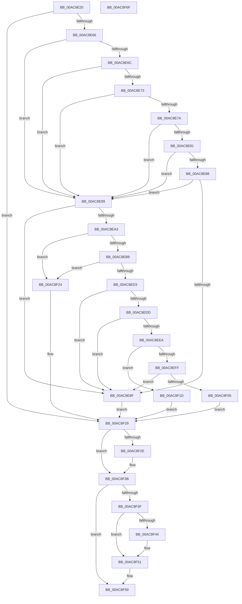

# PopReadResumeContext

- RVA: `0x00AC8E20`–`0x00AC8F70` (길이 `336` bytes)
- VA: `0x0000000140AC8E20`
- 실행 섹션: `PAGE`
- PDB 이름 있음: `예`; PDB Function 태그: `아니요`
- unwind 정보 RVA: `0x000BE1D0`
- 디코드: `102`개 명령, `336/336` bytes 표시
- 미해석 바이트: `0` (있으면 어셈블리에 `.byte`로 보존)

> 이 문서는 커널 이미지의 기계어와 PDB 기호를 분석해 생성했습니다. 4번과 5번은 함수 원형과 자료형을 바이너리 사용 방식에서 추정한 C 해석이며 원본 소스 복구 결과는 아닙니다.

## 1. Dependencies

- 직접 호출 지점: **6**; 고유 호출 대상: **4**
- 직접 호출자로 확인된 함수: **1**
- RIP 상대 이미지 참조: **0**

### Outgoing calls
- `0x00AC8E52` → [PopReadPagesFromHiberFile](PopReadPagesFromHiberFile_function_00AC8F78.md) (function, `0x00AC8F78`)
- `0x00AC8EAD` → [PopReadPagesFromHiberFile](PopReadPagesFromHiberFile_function_00AC8F78.md) (function, `0x00AC8F78`)
- `0x00AC8EC8` → [RtlULongLongMult](../../text/43/RtlULongLongMult_function_0043E530.md) (function, `0x0043E530`)
- `0x00AC8F0D` → [memset](../../text/6C/memset_function_006C6C40.md) (function, `0x006C6C40`)
- `0x00AC8F36` → [ExFreePoolWithTag](../../poolcode/B8/ExFreePoolWithTag_function_00B82870.md) (function, `0x00B82870`)
- `0x00AC8F4C` → [ExFreePoolWithTag](../../poolcode/B8/ExFreePoolWithTag_function_00B82870.md) (function, `0x00B82870`)

### Direct callers
- [PopPowerInformationInternal](../A8/PopPowerInformationInternal_function_00A8B7C0.md) at `0x00A8C8B8`

### Static image references
- 디코드된 RIP-relative 메모리 참조가 없습니다.

## 2. Other-region calls and transfers

- 다른 실행 섹션으로 향하는 call: **4**
  - `0x00AC8EC8` → [RtlULongLongMult](../../text/43/RtlULongLongMult_function_0043E530.md) (`PAGE` → `.text`)
  - `0x00AC8F0D` → [memset](../../text/6C/memset_function_006C6C40.md) (`PAGE` → `.text`)
  - `0x00AC8F36` → [ExFreePoolWithTag](../../poolcode/B8/ExFreePoolWithTag_function_00B82870.md) (`PAGE` → `POOLCODE`)
  - `0x00AC8F4C` → [ExFreePoolWithTag](../../poolcode/B8/ExFreePoolWithTag_function_00B82870.md) (`PAGE` → `POOLCODE`)
- 별도 외부 분기/꼬리 이동을 확인하지 못했습니다.

## 3. Assembly (complete function range)

```asm
00AC8E20  48 8B C4                        mov rax, rsp
00AC8E23  48 89 58 08                     mov qword ptr [rax + 8], rbx
00AC8E27  48 89 70 10                     mov qword ptr [rax + 0x10], rsi
00AC8E2B  57                              push rdi
00AC8E2C  41 56                           push r14
00AC8E2E  41 57                           push r15
00AC8E30  48 83 EC 30                     sub rsp, 0x30
00AC8E34  48 83 60 20 00                  and qword ptr [rax + 0x20], 0
00AC8E39  4C 8D 40 20                     lea r8, [rax + 0x20]
00AC8E3D  33 FF                           xor edi, edi
00AC8E3F  4C 8B F2                        mov r14, rdx
00AC8E42  48 21 78 D8                     and qword ptr [rax - 0x28], rdi
00AC8E46  4C 8B F9                        mov r15, rcx
00AC8E49  33 C9                           xor ecx, ecx
00AC8E4B  48 89 78 18                     mov qword ptr [rax + 0x18], rdi
00AC8E4F  8D 57 01                        lea edx, [rdi + 1]
00AC8E52  E8 21 01 00 00                  call 0x140ac8f78
00AC8E57  48 8B 74 24 68                  mov rsi, qword ptr [rsp + 0x68]
00AC8E5C  8B D8                           mov ebx, eax
00AC8E5E  85 C0                           test eax, eax
00AC8E60  0F 88 C3 00 00 00               js 0x140ac8f29
00AC8E66  8B 06                           mov eax, dword ptr [rsi]
00AC8E68  85 C0                           test eax, eax
00AC8E6A  74 2D                           je 0x140ac8e99
00AC8E6C  3D 48 49 42 52                  cmp eax, 0x52424948
00AC8E71  74 26                           je 0x140ac8e99
00AC8E73  3D 52 53 54 52                  cmp eax, 0x52545352
00AC8E78  74 1F                           je 0x140ac8e99
00AC8E7A  3D 57 41 4B 45                  cmp eax, 0x454b4157
00AC8E7F  74 18                           je 0x140ac8e99
00AC8E81  3D 42 52 4B 50                  cmp eax, 0x504b5242
00AC8E86  74 11                           je 0x140ac8e99
00AC8E88  3D 48 4F 52 4D                  cmp eax, 0x4d524f48
00AC8E8D  74 0A                           je 0x140ac8e99
00AC8E8F  BB 29 02 00 C0                  mov ebx, 0xc0000229
00AC8E94  E9 90 00 00 00                  jmp 0x140ac8f29
00AC8E99  8B 96 78 04 00 00               mov edx, dword ptr [rsi + 0x478]
00AC8E9F  85 D2                           test edx, edx
00AC8EA1  74 EC                           je 0x140ac8e8f
00AC8EA3  4C 8D 44 24 60                  lea r8, [rsp + 0x60]
00AC8EA8  B9 02 00 00 00                  mov ecx, 2
00AC8EAD  E8 C6 00 00 00                  call 0x140ac8f78
00AC8EB2  8B D8                           mov ebx, eax
00AC8EB4  85 C0                           test eax, eax
00AC8EB6  78 6C                           js 0x140ac8f24
00AC8EB8  8B 8E 78 04 00 00               mov ecx, dword ptr [rsi + 0x478]
00AC8EBE  4C 8D 44 24 20                  lea r8, [rsp + 0x20]
00AC8EC3  BA 00 10 00 00                  mov edx, 0x1000
00AC8EC8  E8 63 56 97 FF                  call 0x14043e530
00AC8ECD  8B D8                           mov ebx, eax
00AC8ECF  85 C0                           test eax, eax
00AC8ED1  78 51                           js 0x140ac8f24
00AC8ED3  48 8B 7C 24 60                  mov rdi, qword ptr [rsp + 0x60]
00AC8ED8  83 3F 01                        cmp dword ptr [rdi], 1
00AC8EDB  75 B2                           jne 0x140ac8e8f
00AC8EDD  8B 4F 04                        mov ecx, dword ptr [rdi + 4]
00AC8EE0  4C 8B 44 24 20                  mov r8, qword ptr [rsp + 0x20]
00AC8EE5  49 3B C8                        cmp rcx, r8
00AC8EE8  77 A5                           ja 0x140ac8e8f
00AC8EEA  8B 47 08                        mov eax, dword ptr [rdi + 8]
00AC8EED  48 8D 14 40                     lea rdx, [rax + rax*2]
00AC8EF1  B8 FF FF FF FF                  mov eax, 0xffffffff
00AC8EF6  48 C1 E2 04                     shl rdx, 4
00AC8EFA  48 3B D0                        cmp rdx, rax
00AC8EFD  77 1E                           ja 0x140ac8f1d
00AC8EFF  33 DB                           xor ebx, ebx
00AC8F01  3B D1                           cmp edx, ecx
00AC8F03  77 8A                           ja 0x140ac8e8f
00AC8F05  4C 2B C1                        sub r8, rcx
00AC8F08  33 D2                           xor edx, edx
00AC8F0A  48 03 CF                        add rcx, rdi
00AC8F0D  E8 2E DD BF FF                  call 0x1406c6c40
00AC8F12  8B 47 04                        mov eax, dword ptr [rdi + 4]
00AC8F15  41 89 07                        mov dword ptr [r15], eax
00AC8F18  49 89 3E                        mov qword ptr [r14], rdi
00AC8F1B  EB 0C                           jmp 0x140ac8f29
00AC8F1D  BB 95 00 00 C0                  mov ebx, 0xc0000095
00AC8F22  EB 05                           jmp 0x140ac8f29
00AC8F24  48 8B 7C 24 60                  mov rdi, qword ptr [rsp + 0x60]
00AC8F29  48 85 F6                        test rsi, rsi
00AC8F2C  74 0D                           je 0x140ac8f3b
00AC8F2E  BA 4D 65 6D 20                  mov edx, 0x206d654d
00AC8F33  48 8B CE                        mov rcx, rsi
00AC8F36  E8 35 99 0B 00                  call 0x140b82870
00AC8F3B  85 DB                           test ebx, ebx
00AC8F3D  79 1A                           jns 0x140ac8f59
00AC8F3F  48 85 FF                        test rdi, rdi
00AC8F42  74 0D                           je 0x140ac8f51
00AC8F44  BA 4D 65 6D 20                  mov edx, 0x206d654d
00AC8F49  48 8B CF                        mov rcx, rdi
00AC8F4C  E8 1F 99 0B 00                  call 0x140b82870
00AC8F51  49 83 26 00                     and qword ptr [r14], 0
00AC8F55  41 83 27 00                     and dword ptr [r15], 0
00AC8F59  48 8B 74 24 58                  mov rsi, qword ptr [rsp + 0x58]
00AC8F5E  8B C3                           mov eax, ebx
00AC8F60  48 8B 5C 24 50                  mov rbx, qword ptr [rsp + 0x50]
00AC8F65  48 83 C4 30                     add rsp, 0x30
00AC8F69  41 5F                           pop r15
00AC8F6B  41 5E                           pop r14
00AC8F6D  5F                              pop rdi
00AC8F6E  C3                              ret
00AC8F6F  CC                              int3
```

## 4. C-style interpretation (structured pseudocode)

```c
__int64 __fastcall PopReadResumeContext(__int64 a1, __int64 a2)
{
    __int64 result;
    __int64 v_rbx;
    __int64 v_rdi;
    __int64 v_rsp;
    unsigned __int64 v_stack_m28;
    unsigned __int64 v_stack_p10;
    unsigned __int64 v_stack_p18;
    unsigned __int64 v_stack_p20;
    unsigned __int64 v_stack_p8;

    *(unsigned __int64 *)(v_rsp + 8) = v_rbx;
    *(unsigned __int64 *)(v_rsp + 16) = v_rsi;
    v_rsp = (v_rsp) - (48);
    v_rdi = 0;
    a1 = 0;
    *(unsigned __int64 *)(v_rsp + 24) = 0;
    result = PopReadPagesFromHiberFile(a1, v_rdi + 1, v_rsp + 32, a4);
    if (sign_flag) goto loc_00AC8F29;
    if ((unsigned int)((unsigned int)(*(unsigned int *)(v_stack_p20))) == 0) goto loc_00AC8E99;
    if (((unsigned int)((unsigned int)(*(unsigned int *)(v_stack_p20)))) == 0x52424948ULL) goto loc_00AC8E99;
    if (((unsigned int)((unsigned int)(*(unsigned int *)(v_stack_p20)))) == 0x52545352ULL) goto loc_00AC8E99;
    if (((unsigned int)((unsigned int)(*(unsigned int *)(v_stack_p20)))) == 0x454B4157ULL) goto loc_00AC8E99;
    if (((unsigned int)((unsigned int)(*(unsigned int *)(v_stack_p20)))) == 0x504B5242ULL) goto loc_00AC8E99;
    if (((unsigned int)((unsigned int)(*(unsigned int *)(v_stack_p20)))) == 0x4D524F48ULL) goto loc_00AC8E99;
loc_00AC8E8F:
    goto loc_00AC8F29;
loc_00AC8E99:
    if ((unsigned int)((unsigned int)(*(unsigned int *)(v_stack_p20 + 1144))) == 0) goto loc_00AC8E8F;
    result = PopReadPagesFromHiberFile(2, (unsigned int)(*(unsigned int *)(v_stack_p20 + 1144)), v_stack_p18, a4);
    if (sign_flag) goto loc_00AC8F24;
    result = RtlULongLongMult((unsigned int)(*(unsigned int *)(v_stack_p20 + 1144)), (unsigned int)(0x1000ULL), v_stack_m28, a4);
    if (sign_flag) goto loc_00AC8F24;
    if ((*(unsigned int *)(v_stack_p18)) != 1) goto loc_00AC8E8F;
    if (((unsigned int)(*(unsigned int *)(v_stack_p18 + 4))) > v_stack_m28) goto loc_00AC8E8F;
    a2 = ((unsigned int)(*(unsigned int *)(v_stack_p18 + 8)) + (unsigned int)(*(unsigned int *)(v_stack_p18 + 8)) * 2) << (4);
    if (a2 > ((unsigned int)(0xFFFFFFFFULL))) goto loc_00AC8F1D;
    v_rbx = 0;
    if (((unsigned int)(a2)) > ((unsigned int)((unsigned int)(*(unsigned int *)(v_stack_p18 + 4))))) goto loc_00AC8E8F;
    a3 = (v_stack_m28) - ((unsigned int)(*(unsigned int *)(v_stack_p18 + 4)));
    a2 = 0;
    a1 = ((unsigned int)(*(unsigned int *)(v_stack_p18 + 4))) + (v_stack_p18);
    result = memset(a1, a2, a3, a4);
    *(unsigned int *)(a1) = (unsigned int)((unsigned int)(*(unsigned int *)(v_stack_p18 + 4)));
    *(unsigned __int64 *)(a2) = v_stack_p18;
    goto loc_00AC8F29;
loc_00AC8F1D:
    goto loc_00AC8F29;
loc_00AC8F24:
loc_00AC8F29:
    result = (unsigned int)(*(unsigned int *)(v_stack_p18 + 4));
    if (v_stack_p20 != 0) {
        a2 = 0x206D654DULL;
        a1 = v_stack_p20;
        result = ExFreePoolWithTag(a1, a2, a3, a4);
    }
    if (!sign_flag) goto loc_00AC8F59;
    if (v_stack_p18 != 0) {
        a2 = 0x206D654DULL;
        a1 = v_stack_p18;
        result = ExFreePoolWithTag(a1, a2, a3, a4);
    }
loc_00AC8F59:
    v_rsp = (v_rsp) + (48);
    return (unsigned int)((unsigned int)((unsigned int)(0xC0000095ULL)));
}
```

## 5. (Beta) C Style

```c
int64_t PopReadResumeContext(void *Arg1, void *Arg2)
{
    uint8_t *arg1 = (uint8_t *)Arg1;
    uint8_t *arg2 = (uint8_t *)Arg2;

    int64_t result;
    int64_t local_rbx;
    int64_t local_rdi;
    int64_t local_rsp;
    uint64_t v_stack_m28;
    uint64_t v_stack_p10;
    uint64_t v_stack_p18;
    uint64_t v_stack_p20;
    uint64_t v_stack_p8;

    *(uint64_t *)(local_rsp + 0x8) = local_rbx;
    *(uint64_t *)(local_rsp + 0x10) = local_rsi;
    local_rsp = (local_rsp) - (48);
    local_rdi = 0;
    Arg1 = 0;
    *(uint64_t *)(local_rsp + 0x18) = 0;
    result = PopReadPagesFromHiberFile(Arg1, local_rdi + 1, local_rsp + 32, a4);
    if (sign_flag) goto loc_00AC8F29;
    if ((uint32_t)((uint32_t)(*(uint32_t *)(v_stack_p20))) == 0) goto loc_00AC8E99;
    if (((uint32_t)((uint32_t)(*(uint32_t *)(v_stack_p20)))) == 0x52424948ULL) goto loc_00AC8E99;
    if (((uint32_t)((uint32_t)(*(uint32_t *)(v_stack_p20)))) == 0x52545352ULL) goto loc_00AC8E99;
    if (((uint32_t)((uint32_t)(*(uint32_t *)(v_stack_p20)))) == 0x454B4157ULL) goto loc_00AC8E99;
    if (((uint32_t)((uint32_t)(*(uint32_t *)(v_stack_p20)))) == 0x504B5242ULL) goto loc_00AC8E99;
    if (((uint32_t)((uint32_t)(*(uint32_t *)(v_stack_p20)))) == 0x4D524F48ULL) goto loc_00AC8E99;
loc_00AC8E8F:
    goto loc_00AC8F29;
loc_00AC8E99:
    if ((uint32_t)((uint32_t)(*(uint32_t *)(v_stack_p20 + 0x478))) == 0) goto loc_00AC8E8F;
    result = PopReadPagesFromHiberFile(2, (uint32_t)(*(uint32_t *)(v_stack_p20 + 0x478)), v_stack_p18, a4);
    if (sign_flag) goto loc_00AC8F24;
    result = RtlULongLongMult((uint32_t)(*(uint32_t *)(v_stack_p20 + 0x478)), (uint32_t)(0x1000ULL), v_stack_m28, a4);
    if (sign_flag) goto loc_00AC8F24;
    if ((*(uint32_t *)(v_stack_p18)) != 1) goto loc_00AC8E8F;
    if (((uint32_t)(*(uint32_t *)(v_stack_p18 + 0x4))) > v_stack_m28) goto loc_00AC8E8F;
    Arg2 = ((uint32_t)(*(uint32_t *)(v_stack_p18 + 0x8)) + (uint32_t)(*(uint32_t *)(v_stack_p18 + 0x8)) * 2) << (4);
    if (Arg2 > ((uint32_t)(0xFFFFFFFFULL))) goto loc_00AC8F1D;
    local_rbx = 0;
    if (((uint32_t)(Arg2)) > ((uint32_t)((uint32_t)(*(uint32_t *)(v_stack_p18 + 0x4))))) goto loc_00AC8E8F;
    a3 = (v_stack_m28) - ((uint32_t)(*(uint32_t *)(v_stack_p18 + 0x4)));
    Arg2 = 0;
    Arg1 = ((uint32_t)(*(uint32_t *)(v_stack_p18 + 0x4))) + (v_stack_p18);
    result = memset(Arg1, Arg2, a3, a4);
    *(uint32_t *)(arg1) = (uint32_t)((uint32_t)(*(uint32_t *)(v_stack_p18 + 0x4)));
    *(uint64_t *)(arg2) = v_stack_p18;
    goto loc_00AC8F29;
loc_00AC8F1D:
    goto loc_00AC8F29;
loc_00AC8F24:
loc_00AC8F29:
    result = (uint32_t)(*(uint32_t *)(v_stack_p18 + 0x4));
    if (v_stack_p20 != 0) {
        Arg2 = 0x206D654DULL;
        Arg1 = v_stack_p20;
        result = ExFreePoolWithTag(Arg1, Arg2, a3, a4);
    }
    if (!sign_flag) goto loc_00AC8F59;
    if (v_stack_p18 != 0) {
        Arg2 = 0x206D654DULL;
        Arg1 = v_stack_p18;
        result = ExFreePoolWithTag(Arg1, Arg2, a3, a4);
    }
loc_00AC8F59:
    local_rsp = (local_rsp) + (48);
    return (uint32_t)((uint32_t)((uint32_t)(0xC0000095ULL)));
}
```

### 관측된 메모리 오프셋

구조체 형식이 확인되지 않은 접근은 인자 기준의 오프셋으로만 기록했습니다.

| 기준 인자 | 오프셋 표현 | 폭 (bit) | 접근 |
|---|---:|---:|---|
| `Arg1` | `+ 0x0` | `32` | `R/W` |
| `Arg1` | `+ 0x0` | `32` | `W` |
| `Arg2` | `+ 0x0` | `64` | `R/W` |
| `Arg2` | `+ 0x0` | `64` | `W` |

## 6. Execution-region graph

[열기: 2D/3D 그래프와 함수 탐색 컨트롤 패널](../../../control-panel.html?section=page&rva=0x00AC8E20&view=graph)

- 2D 그래프는 위에서 아래로 흐르고, 3D 그래프는 빈 공간을 드래그해 회전합니다. Shift+드래그는 이동, 휠은 확대·축소, 함수 노드 선택은 대상 보고서 이동입니다.

### Static fallback


