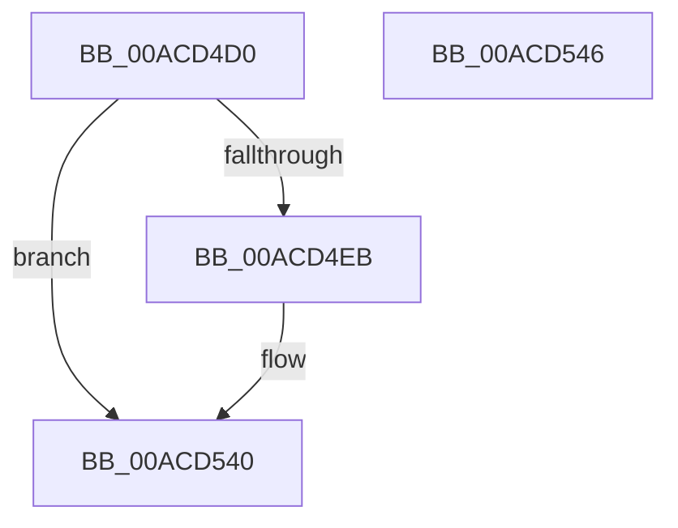

# PopRecordLidStateWorker

- RVA: `0x00ACD4D0`–`0x00ACD547` (길이 `119` bytes)
- VA: `0x0000000140ACD4D0`
- 실행 섹션: `PAGE`
- PDB 이름 있음: `예`; PDB Function 태그: `아니요`
- unwind 정보 RVA: `0x0005CF00`
- 디코드: `29`개 명령, `119/119` bytes 표시
- 미해석 바이트: `0` (있으면 어셈블리에 `.byte`로 보존)

> 이 문서는 커널 이미지의 기계어와 PDB 기호를 분석해 생성했습니다. 4번과 5번은 함수 원형과 자료형을 바이너리 사용 방식에서 추정한 C 해석이며 원본 소스 복구 결과는 아닙니다.

## 1. Dependencies

- 직접 호출 지점: **6**; 고유 호출 대상: **6**
- 직접 호출자로 확인된 함수: **0**
- RIP 상대 이미지 참조: **7**

### Outgoing calls
- `0x00ACD4DD` → [PopOkayToQueueNextWorkItem](../../text/4A/PopOkayToQueueNextWorkItem_function_004AED54.md) (function, `0x004AED54`)
- `0x00ACD4EB` → [PopAcquirePolicyLock](../../pagelk/B7/PopAcquirePolicyLock_function_00B783C0.md) (function, `0x00B783C0`)
- `0x00ACD4FD` → [PopReleasePolicyLock](../../pagelk/B7/PopReleasePolicyLock_function_00B78410.md) (function, `0x00B78410`)
- `0x00ACD509` → [PopAcquireRwLockExclusive](../../text/43/PopAcquireRwLockExclusive_function_00430B44.md) (function, `0x00430B44`)
- `0x00ACD52F` → [PopBsdHandleRequest](../../text/4B/PopBsdHandleRequest_function_004B27A0.md) (function, `0x004B27A0`)
- `0x00ACD53B` → [PopReleaseRwLock](../../text/2D/PopReleaseRwLock_function_002DFBBC.md) (function, `0x002DFBBC`)

### Direct callers
- 이 함수 시작 RVA로 연결되는 직접 call은 확인되지 않았습니다. 간접 호출은 완전히 역산할 수 없습니다.

### Static image references
- `0x00ACD4D6` → RVA `0x00F0EA40` (`.data`; read)
- `0x00ACD4E2` → RVA `0x00E67A38` (`.data`; read)
- `0x00ACD4F0` → RVA `0x00E0B579` (`.data`; read)
- `0x00ACD502` → RVA `0x00F0F1E0` (`.data`; read)
- `0x00ACD50E` → RVA `0x00E6741B` (`.data`; read)
- `0x00ACD520` → RVA `0x00E6741B` (`.data`; write)
- `0x00ACD529` → RVA `0x00F0858C` (`.data`; write)

## 2. Other-region calls and transfers

- 다른 실행 섹션으로 향하는 call: **6**
  - `0x00ACD4DD` → [PopOkayToQueueNextWorkItem](../../text/4A/PopOkayToQueueNextWorkItem_function_004AED54.md) (`PAGE` → `.text`)
  - `0x00ACD4EB` → [PopAcquirePolicyLock](../../pagelk/B7/PopAcquirePolicyLock_function_00B783C0.md) (`PAGE` → `PAGELK`)
  - `0x00ACD4FD` → [PopReleasePolicyLock](../../pagelk/B7/PopReleasePolicyLock_function_00B78410.md) (`PAGE` → `PAGELK`)
  - `0x00ACD509` → [PopAcquireRwLockExclusive](../../text/43/PopAcquireRwLockExclusive_function_00430B44.md) (`PAGE` → `.text`)
  - `0x00ACD52F` → [PopBsdHandleRequest](../../text/4B/PopBsdHandleRequest_function_004B27A0.md) (`PAGE` → `.text`)
  - `0x00ACD53B` → [PopReleaseRwLock](../../text/2D/PopReleaseRwLock_function_002DFBBC.md) (`PAGE` → `.text`)
- 별도 외부 분기/꼬리 이동을 확인하지 못했습니다.

## 3. Assembly (complete function range)

```asm
00ACD4D0  40 53                           push rbx
00ACD4D2  48 83 EC 20                     sub rsp, 0x20
00ACD4D6  48 8D 0D 63 15 44 00            lea rcx, [rip + 0x441563]
00ACD4DD  E8 72 18 9E FF                  call 0x1404aed54
00ACD4E2  80 3D 4F A5 39 00 00            cmp byte ptr [rip + 0x39a54f], 0
00ACD4E9  75 55                           jne 0x140acd540
00ACD4EB  E8 D0 AE 0A 00                  call 0x140b783c0
00ACD4F0  8A 05 83 E0 33 00               mov al, byte ptr [rip + 0x33e083]
00ACD4F6  F6 D8                           neg al
00ACD4F8  1A DB                           sbb bl, bl
00ACD4FA  80 E3 40                        and bl, 0x40
00ACD4FD  E8 0E AF 0A 00                  call 0x140b78410
00ACD502  48 8D 0D D7 1C 44 00            lea rcx, [rip + 0x441cd7]
00ACD509  E8 36 36 96 FF                  call 0x140430b44
00ACD50E  8A 05 07 9F 39 00               mov al, byte ptr [rip + 0x399f07]
00ACD514  B9 01 00 00 00                  mov ecx, 1
00ACD519  24 3F                           and al, 0x3f
00ACD51B  0A C3                           or al, bl
00ACD51D  0F B6 D0                        movzx edx, al
00ACD520  88 15 F5 9E 39 00               mov byte ptr [rip + 0x399ef5], dl
00ACD526  C1 EA 06                        shr edx, 6
00ACD529  89 15 5D B0 43 00               mov dword ptr [rip + 0x43b05d], edx
00ACD52F  E8 6C 52 9E FF                  call 0x1404b27a0
00ACD534  48 8D 0D A5 1C 44 00            lea rcx, [rip + 0x441ca5]
00ACD53B  E8 7C 26 81 FF                  call 0x1402dfbbc
00ACD540  48 83 C4 20                     add rsp, 0x20
00ACD544  5B                              pop rbx
00ACD545  C3                              ret
00ACD546  CC                              int3
```

## 4. C-style interpretation (structured pseudocode)

```c
__int64 __fastcall PopRecordLidStateWorker(void)
{
    __int64 result;
    __int64 v_rbx;
    __int64 v_rsp;

    v_rsp = (v_rsp) - (32);
    result = PopOkayToQueueNextWorkItem(v_rip + 4461923, a2, a3, a4);
    if ((*(unsigned __int8 *)(v_rip + 3777871)) == 0) {
        result = PopAcquirePolicyLock(v_rip + 4461923, a2, a3, a4);
        result = *(unsigned __int8 *)(v_rip + 3399811);
        result = (unsigned __int8)(-(result));
        v_rbx = (unsigned __int8)((v_rbx) & (64));
        result = PopReleasePolicyLock(v_rip + 4461923, a2, a3, a4);
        a1 = v_rip + 4463831;
        result = PopAcquireRwLockExclusive(a1, a2, a3, a4);
        result = *(unsigned __int8 *)(v_rip + 3776263);
        a1 = 1;
        result = (unsigned __int8)((result) & (63));
        result = (unsigned __int8)((result) | ((unsigned __int8)(v_rbx)));
        a2 = (unsigned __int8)(result);
        *(unsigned __int8 *)(v_rip + 3776245) = (unsigned __int8)(a2);
        a2 = (unsigned int)((a2) >> (6));
        *(unsigned int *)(v_rip + 4436061) = (unsigned int)(a2);
        result = PopBsdHandleRequest(a1, a2, a3, a4);
        a1 = v_rip + 4463781;
        result = PopReleaseRwLock(a1, a2, a3, a4);
    }
    v_rsp = (v_rsp) + (32);
    return result;
}
```

## 5. (Beta) C Style

```c
void PopRecordLidStateWorker(void)
{
    int64_t result;
    int64_t local_rbx;
    int64_t local_rsp;

    local_rsp = (local_rsp) - (32);
    result = PopOkayToQueueNextWorkItem(v_rip + 4461923, a2, a3, a4);
    if ((*(uint8_t *)(v_rip + 0x39A54F)) == 0) {
        result = PopAcquirePolicyLock(v_rip + 4461923, a2, a3, a4);
        result = *(uint8_t *)(v_rip + 0x33E083);
        result = (uint8_t)(-(result));
        local_rbx = (uint8_t)((local_rbx) & (64));
        result = PopReleasePolicyLock(v_rip + 4461923, a2, a3, a4);
        a1 = v_rip + 4463831;
        result = PopAcquireRwLockExclusive(a1, a2, a3, a4);
        result = *(uint8_t *)(v_rip + 0x399F07);
        a1 = 1;
        result = (uint8_t)((result) & (63));
        result = (uint8_t)((result) | ((uint8_t)(local_rbx)));
        a2 = (uint8_t)(result);
        *(uint8_t *)(v_rip + 0x399EF5) = (uint8_t)(a2);
        a2 = (uint32_t)((a2) >> (6));
        *(uint32_t *)(v_rip + 0x43B05D) = (uint32_t)(a2);
        result = PopBsdHandleRequest(a1, a2, a3, a4);
        a1 = v_rip + 4463781;
        result = PopReleaseRwLock(a1, a2, a3, a4);
    }
    local_rsp = (local_rsp) + (32);
    return result;
}
```

## 6. Execution-region graph

[열기: 2D/3D 그래프와 함수 탐색 컨트롤 패널](../../../control-panel.html?section=page&rva=0x00ACD4D0&view=graph)

- 2D 그래프는 위에서 아래로 흐르고, 3D 그래프는 빈 공간을 드래그해 회전합니다. Shift+드래그는 이동, 휠은 확대·축소, 함수 노드 선택은 대상 보고서 이동입니다.

### Static fallback


