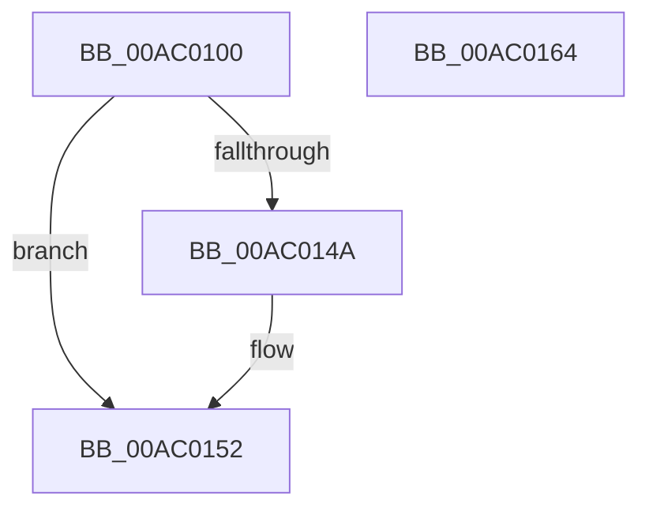

# PopSleepstudyScenarioStopWorker

- RVA: `0x00AC0100`–`0x00AC0165` (길이 `101` bytes)
- VA: `0x0000000140AC0100`
- 실행 섹션: `PAGE`
- PDB 이름 있음: `예`; PDB Function 태그: `아니요`
- unwind 정보 RVA: `0x0005CF00`
- 디코드: `24`개 명령, `101/101` bytes 표시
- 미해석 바이트: `0` (있으면 어셈블리에 `.byte`로 보존)

> 이 문서는 커널 이미지의 기계어와 PDB 기호를 분석해 생성했습니다. 4번과 5번은 함수 원형과 자료형을 바이너리 사용 방식에서 추정한 C 해석이며 원본 소스 복구 결과는 아닙니다.

## 1. Dependencies

- 직접 호출 지점: **4**; 고유 호출 대상: **4**
- 직접 호출자로 확인된 함수: **0**
- RIP 상대 이미지 참조: **6**

### Outgoing calls
- `0x00AC010D` → [PopAcquireRwLockExclusive](../../text/43/PopAcquireRwLockExclusive_function_00430B44.md) (function, `0x00430B44`)
- `0x00AC0134` → [PopDiagTraceSleepStudyStop](PopDiagTraceSleepStudyStop_function_00AC016C.md) (function, `0x00AC016C`)
- `0x00AC014D` → [PopDiagTraceSleepStudyStart](../76/PopDiagTraceSleepStudyStart_function_00762FC0.md) (function, `0x00762FC0`)
- `0x00AC0159` → [PopReleaseRwLock](../../text/2D/PopReleaseRwLock_function_002DFBBC.md) (function, `0x002DFBBC`)

### Direct callers
- 이 함수 시작 RVA로 연결되는 직접 call은 확인되지 않았습니다. 간접 호출은 완전히 역산할 수 없습니다.

### Static image references
- `0x00AC0106` → RVA `0x00F0AD80` (`.data`; read)
- `0x00AC0112` → RVA `0x00F0AE68` (`.data`; read)
- `0x00AC0118` → RVA `0x00F0ADB0` (`.data`; read)
- `0x00AC0123` → RVA `0x00F0AE70` (`.data`; read)
- `0x00AC012A` → RVA `0x00F0ADB8` (`.data`; write)
- `0x00AC0139` → RVA `0x00F0ADB0` (`.data`; read/write)

## 2. Other-region calls and transfers

- 다른 실행 섹션으로 향하는 call: **2**
  - `0x00AC010D` → [PopAcquireRwLockExclusive](../../text/43/PopAcquireRwLockExclusive_function_00430B44.md) (`PAGE` → `.text`)
  - `0x00AC0159` → [PopReleaseRwLock](../../text/2D/PopReleaseRwLock_function_002DFBBC.md) (`PAGE` → `.text`)
- 별도 외부 분기/꼬리 이동을 확인하지 못했습니다.

## 3. Assembly (complete function range)

```asm
00AC0100  40 53                           push rbx
00AC0102  48 83 EC 20                     sub rsp, 0x20
00AC0106  48 8D 0D 73 AC 44 00            lea rcx, [rip + 0x44ac73]
00AC010D  E8 32 0A 97 FF                  call 0x140430b44
00AC0112  8B 05 50 AD 44 00               mov eax, dword ptr [rip + 0x44ad50]
00AC0118  48 8B 0D 91 AC 44 00            mov rcx, qword ptr [rip + 0x44ac91]
00AC011F  48 6B D8 70                     imul rbx, rax, 0x70
00AC0123  48 8D 05 46 AD 44 00            lea rax, [rip + 0x44ad46]
00AC012A  C6 05 87 AC 44 00 00            mov byte ptr [rip + 0x44ac87], 0
00AC0131  48 03 D8                        add rbx, rax
00AC0134  E8 33 00 00 00                  call 0x140ac016c
00AC0139  48 83 0D 6F AC 44 00 FF         or qword ptr [rip + 0x44ac6f], 0xffffffffffffffff
00AC0141  8B 03                           mov eax, dword ptr [rbx]
00AC0143  FF C8                           dec eax
00AC0145  83 F8 01                        cmp eax, 1
00AC0148  77 08                           ja 0x140ac0152
00AC014A  8A 4B 39                        mov cl, byte ptr [rbx + 0x39]
00AC014D  E8 6E 2E CA FF                  call 0x140762fc0
00AC0152  48 8D 0D 27 AC 44 00            lea rcx, [rip + 0x44ac27]
00AC0159  E8 5E FA 81 FF                  call 0x1402dfbbc
00AC015E  48 83 C4 20                     add rsp, 0x20
00AC0162  5B                              pop rbx
00AC0163  C3                              ret
00AC0164  CC                              int3
```

## 4. C-style interpretation (structured pseudocode)

```c
__int64 __fastcall PopSleepstudyScenarioStopWorker(void)
{
    __int64 result;
    __int64 v_rbx;
    __int64 v_rsp;

    v_rsp = (v_rsp) - (32);
    result = PopAcquireRwLockExclusive(v_rip + 4500595, a2, a3, a4);
    v_rbx = (v_rbx) * ((unsigned int)(*(unsigned int *)(v_rip + 4500816)));
    *(unsigned __int8 *)(v_rip + 4500615) = 0;
    v_rbx = (v_rbx) + (v_rip + 4500806);
    result = PopDiagTraceSleepStudyStop(*(unsigned __int64 *)(v_rip + 4500625), a2, a3, a4);
    result = (unsigned int)(((unsigned int)(*(unsigned int *)(v_rbx))) - 1);
    if (((unsigned int)(result)) <= 1) {
        a1 = *(unsigned __int8 *)(v_rbx + 57);
        result = PopDiagTraceSleepStudyStart(a1, a2, a3, a4);
    }
    result = PopReleaseRwLock(v_rip + 4500519, a2, a3, a4);
    v_rsp = (v_rsp) + (32);
    return result;
}
```

## 5. (Beta) C Style

```c
void PopSleepstudyScenarioStopWorker(void)
{
    int64_t result;
    int64_t local_rbx;
    int64_t local_rsp;

    local_rsp = (local_rsp) - (32);
    result = PopAcquireRwLockExclusive(v_rip + 4500595, a2, a3, a4);
    local_rbx = (local_rbx) * ((uint32_t)(*(uint32_t *)(v_rip + 0x44AD50)));
    *(uint8_t *)(v_rip + 0x44AC87) = 0;
    local_rbx = (local_rbx) + (v_rip + 4500806);
    result = PopDiagTraceSleepStudyStop(*(uint64_t *)(v_rip + 0x44AC91), a2, a3, a4);
    result = (uint32_t)(((uint32_t)(*(uint32_t *)(local_rbx))) - 1);
    if (((uint32_t)(result)) <= 1) {
        a1 = *(uint8_t *)(local_rbx + 0x39);
        result = PopDiagTraceSleepStudyStart(a1, a2, a3, a4);
    }
    result = PopReleaseRwLock(v_rip + 4500519, a2, a3, a4);
    local_rsp = (local_rsp) + (32);
    return result;
}
```

## 6. Execution-region graph

[열기: 2D/3D 그래프와 함수 탐색 컨트롤 패널](../../../control-panel.html?section=page&rva=0x00AC0100&view=graph)

- 2D 그래프는 위에서 아래로 흐르고, 3D 그래프는 빈 공간을 드래그해 회전합니다. Shift+드래그는 이동, 휠은 확대·축소, 함수 노드 선택은 대상 보고서 이동입니다.

### Static fallback


