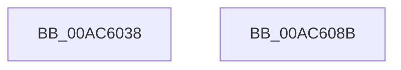

# PopSleepstudySendWnfNotification

- RVA: `0x00AC6038`–`0x00AC608C` (길이 `84` bytes)
- VA: `0x0000000140AC6038`
- 실행 섹션: `PAGE`
- PDB 이름 있음: `예`; PDB Function 태그: `아니요`
- unwind 정보 RVA: `0x00080A9C`
- 디코드: `21`개 명령, `84/84` bytes 표시
- 미해석 바이트: `0` (있으면 어셈블리에 `.byte`로 보존)

> 이 문서는 커널 이미지의 기계어와 PDB 기호를 분석해 생성했습니다. 4번과 5번은 함수 원형과 자료형을 바이너리 사용 방식에서 추정한 C 해석이며 원본 소스 복구 결과는 아닙니다.

## 1. Dependencies

- 직접 호출 지점: **2**; 고유 호출 대상: **2**
- 직접 호출자로 확인된 함수: **1**
- RIP 상대 이미지 참조: **1**

### Outgoing calls
- `0x00AC6074` → [ZwUpdateWnfStateData](../../text/6B/ZwUpdateWnfStateData_function_006B0D10.md) (function, `0x006B0D10`)
- `0x00AC6081` → [_security_check_cookie](../../text/6A/_security_check_cookie_function_006AC640.md) (function, `0x006AC640`)

### Direct callers
- [PopSleepstudyStartNextSession](PopSleepstudyStartNextSession_function_00AC4720.md) at `0x00AC497D`
- [PopSleepstudyStartNextSession](PopSleepstudyStartNextSession_function_00AC4720.md) at `0x00AC4B51`
- [PopSleepstudyStartNextSession](PopSleepstudyStartNextSession_function_00AC4720.md) at `0x00AC4C5B`

### Static image references
- `0x00AC603C` → RVA `0x00E0A740` (`.data`; read)

## 2. Other-region calls and transfers

- 다른 실행 섹션으로 향하는 call: **2**
  - `0x00AC6074` → [ZwUpdateWnfStateData](../../text/6B/ZwUpdateWnfStateData_function_006B0D10.md) (`PAGE` → `.text`)
  - `0x00AC6081` → [_security_check_cookie](../../text/6A/_security_check_cookie_function_006AC640.md) (`PAGE` → `.text`)
- 별도 외부 분기/꼬리 이동을 확인하지 못했습니다.

## 3. Assembly (complete function range)

```asm
00AC6038  48 83 EC 68                     sub rsp, 0x68
00AC603C  48 8B 05 FD 46 34 00            mov rax, qword ptr [rip + 0x3446fd]
00AC6043  48 33 C4                        xor rax, rsp
00AC6046  48 89 44 24 58                  mov qword ptr [rsp + 0x58], rax
00AC604B  0F 10 02                        movups xmm0, xmmword ptr [rdx]
00AC604E  33 C0                           xor eax, eax
00AC6050  4C 89 44 24 50                  mov qword ptr [rsp + 0x50], r8
00AC6055  89 44 24 30                     mov dword ptr [rsp + 0x30], eax
00AC6059  48 8D 54 24 40                  lea rdx, [rsp + 0x40]
00AC605E  89 44 24 28                     mov dword ptr [rsp + 0x28], eax
00AC6062  45 33 C9                        xor r9d, r9d
00AC6065  F3 0F 7F 44 24 40               movdqu xmmword ptr [rsp + 0x40], xmm0
00AC606B  44 8D 40 18                     lea r8d, [rax + 0x18]
00AC606F  48 89 44 24 20                  mov qword ptr [rsp + 0x20], rax
00AC6074  E8 97 AC BE FF                  call 0x1406b0d10
00AC6079  48 8B 4C 24 58                  mov rcx, qword ptr [rsp + 0x58]
00AC607E  48 33 CC                        xor rcx, rsp
00AC6081  E8 BA 65 BE FF                  call 0x1406ac640
00AC6086  48 83 C4 68                     add rsp, 0x68
00AC608A  C3                              ret
00AC608B  CC                              int3
```

## 4. C-style interpretation (structured pseudocode)

```c
__int64 __fastcall PopSleepstudySendWnfNotification(__int64 a1, __int64 a2, __int64 a3, int a4)
{
    __int64 result;
    __int64 v_rsp;
    unsigned __int64 v_stack_m10;
    unsigned __int64 v_stack_m18;
    unsigned __int64 v_stack_m28;
    unsigned int v_stack_m38;
    unsigned int v_stack_m40;
    unsigned __int64 v_stack_m48;

    v_rsp = (v_rsp) - (104);
    result = (*(unsigned __int64 *)(v_rip + 3426045)) ^ (v_rsp);
    v_stack_m10 = result;
    result = 0;
    v_stack_m18 = a3;
    v_stack_m38 = 0;
    v_stack_m40 = 0;
    a4 = 0;
    v_stack_m28 = v_xmm0;
    v_stack_m48 = 0;
    result = ZwUpdateWnfStateData(a1, v_stack_m28, result + 24, a4);
    a1 = (v_stack_m10) ^ (v_rsp);
    result = _security_check_cookie(a1, v_stack_m28, result + 24, a4);
    v_rsp = (v_rsp) + (104);
    return result;
}
```

## 5. (Beta) C Style

```c
int64_t PopSleepstudySendWnfNotification(int64_t Arg1, void *Arg2, int64_t Arg3, int32_t Arg4)
{
    uint8_t *arg2 = (uint8_t *)Arg2;

    int64_t result;
    int64_t local_rsp;
    uint64_t v_stack_m10;
    uint64_t v_stack_m18;
    uint64_t v_stack_m28;
    uint32_t v_stack_m38;
    uint32_t v_stack_m40;
    uint64_t v_stack_m48;

    local_rsp = (local_rsp) - (104);
    result = (*(uint64_t *)(v_rip + 0x3446FD)) ^ (local_rsp);
    v_stack_m10 = result;
    result = 0;
    v_stack_m18 = Arg3;
    v_stack_m38 = 0;
    v_stack_m40 = 0;
    Arg4 = 0;
    v_stack_m28 = v_xmm0;
    v_stack_m48 = 0;
    result = ZwUpdateWnfStateData(Arg1, v_stack_m28, result + 24, Arg4);
    Arg1 = (v_stack_m10) ^ (local_rsp);
    result = _security_check_cookie(Arg1, v_stack_m28, result + 24, Arg4);
    local_rsp = (local_rsp) + (104);
    return result;
}
```

### 관측된 메모리 오프셋

구조체 형식이 확인되지 않은 접근은 인자 기준의 오프셋으로만 기록했습니다.

| 기준 인자 | 오프셋 표현 | 폭 (bit) | 접근 |
|---|---:|---:|---|
| `Arg2` | `+ 0x0` | `128` | `R` |

## 6. Execution-region graph

[열기: 2D/3D 그래프와 함수 탐색 컨트롤 패널](../../../control-panel.html?section=page&rva=0x00AC6038&view=graph)

- 2D 그래프는 위에서 아래로 흐르고, 3D 그래프는 빈 공간을 드래그해 회전합니다. Shift+드래그는 이동, 휠은 확대·축소, 함수 노드 선택은 대상 보고서 이동입니다.

### Static fallback


