# PopSleepstudyStartNextSession

- RVA: `0x00AC4720`–`0x00AC4CC5` (길이 `1,445` bytes)
- VA: `0x0000000140AC4720`
- 실행 섹션: `PAGE`
- PDB 이름 있음: `예`; PDB Function 태그: `아니요`
- unwind 정보 RVA: `0x000BDE58`
- 디코드: `352`개 명령, `1,445/1,445` bytes 표시
- 미해석 바이트: `0` (있으면 어셈블리에 `.byte`로 보존)

> 이 문서는 커널 이미지의 기계어와 PDB 기호를 분석해 생성했습니다. 4번과 5번은 함수 원형과 자료형을 바이너리 사용 방식에서 추정한 C 해석이며 원본 소스 복구 결과는 아닙니다.

## 1. Dependencies

- 직접 호출 지점: **37**; 고유 호출 대상: **24**
- 직접 호출자로 확인된 함수: **6**
- RIP 상대 이미지 참조: **23**

### Outgoing calls
- `0x00AC476E` → [memset](../../text/6C/memset_function_006C6C40.md) (function, `0x006C6C40`)
- `0x00AC478F` → [PopAcquirePolicyLock](../../pagelk/B7/PopAcquirePolicyLock_function_00B783C0.md) (function, `0x00B783C0`)
- `0x00AC47D9` → [PopReleasePolicyLock](../../pagelk/B7/PopReleasePolicyLock_function_00B78410.md) (function, `0x00B78410`)
- `0x00AC47E5` → [PopAcquireRwLockExclusive](../../text/43/PopAcquireRwLockExclusive_function_00430B44.md) (function, `0x00430B44`)
- `0x00AC47F7` → [PopReleaseRwLock](../../text/2D/PopReleaseRwLock_function_002DFBBC.md) (function, `0x002DFBBC`)
- `0x00AC482B` → [PopAcquireRwLockExclusive](../../text/43/PopAcquireRwLockExclusive_function_00430B44.md) (function, `0x00430B44`)
- `0x00AC4874` → [KeQueryInterruptTimePrecise](../../text/20/KeQueryInterruptTimePrecise_function_00209530.md) (function, `0x00209530`)
- `0x00AC488C` → [PopCurrentPowerStatePrecise](../A3/PopCurrentPowerStatePrecise_function_00A35624.md) (function, `0x00A35624`)
- `0x00AC48F3` → [memset](../../text/6C/memset_function_006C6C40.md) (function, `0x006C6C40`)
- `0x00AC497D` → [PopSleepstudySendWnfNotification](PopSleepstudySendWnfNotification_function_00AC6038.md) (function, `0x00AC6038`)
- `0x00AC4982` → [PopIdleWakeNotifyModernStandbyExit](../../text/4B/PopIdleWakeNotifyModernStandbyExit_function_004B4034.md) (function, `0x004B4034`)
- `0x00AC4999` → [PopSleepstudyCaptureResiliencyStatistics](../AD/PopSleepstudyCaptureResiliencyStatistics_function_00AD6B74.md) (function, `0x00AD6B74`)
- `0x00AC49A5` → [PopIsPlatformAoAcCapable](../../text/49/PopIsPlatformAoAcCapable_function_0049BF40.md) (function, `0x0049BF40`)
- `0x00AC49C5` → [PopTransitionTelemetryOsState](../A9/PopTransitionTelemetryOsState_function_00A9DD40.md) (function, `0x00A9DD40`)
- `0x00AC49CA` → [PopThermalCsExit](../../text/5D/PopThermalCsExit_function_005D54C8.md) (function, `0x005D54C8`)
- `0x00AC49D9` → [PopCalculateIdleInformation](../../text/43/PopCalculateIdleInformation_function_0043ADEC.md) (function, `0x0043ADEC`)
- `0x00AC49F5` → [KeQueryInterruptTimePrecise](../../text/20/KeQueryInterruptTimePrecise_function_00209530.md) (function, `0x00209530`)
- `0x00AC4A60` → [PopSetModernStandbyTransitionReason](../../text/4B/PopSetModernStandbyTransitionReason_function_004BFFCC.md) (function, `0x004BFFCC`)
- `0x00AC4A7D` → [PopSleepstudyCaptureSessionStatistics](../AD/PopSleepstudyCaptureSessionStatistics_function_00AD7554.md) (function, `0x00AD7554`)
- `0x00AC4B24` → [KeSetTimer2](../../text/3A/KeSetTimer2_function_003A08E0.md) (function, `0x003A08E0`)
- `0x00AC4B51` → [PopSleepstudySendWnfNotification](PopSleepstudySendWnfNotification_function_00AC6038.md) (function, `0x00AC6038`)
- `0x00AC4B6A` → [PopSleepstudySendSessionChangeEvent](../A9/PopSleepstudySendSessionChangeEvent_function_00A92720.md) (function, `0x00A92720`)
- `0x00AC4B75` → [SshNotifySystemSessionChange](../A6/SshNotifySystemSessionChange_function_00A602BC.md) (function, `0x00A602BC`)
- `0x00AC4B8D` → [PopCalculateIdleInformation](../../text/43/PopCalculateIdleInformation_function_0043ADEC.md) (function, `0x0043ADEC`)
- `0x00AC4BA4` → [PopIdleWakeNotifyModernStandbyEnter](../../text/4B/PopIdleWakeNotifyModernStandbyEnter_function_004B30A0.md) (function, `0x004B30A0`)
- `0x00AC4BB6` → [PopSleepstudyCaptureResiliencyStatistics](../AD/PopSleepstudyCaptureResiliencyStatistics_function_00AD6B74.md) (function, `0x00AD6B74`)
- `0x00AC4BCB` → [PopIsPlatformAoAcCapable](../../text/49/PopIsPlatformAoAcCapable_function_0049BF40.md) (function, `0x0049BF40`)
- `0x00AC4BE5` → [PopTransitionTelemetryOsState](../A9/PopTransitionTelemetryOsState_function_00A9DD40.md) (function, `0x00A9DD40`)
- `0x00AC4BF0` → [PopThermalCsEntry](../../text/42/PopThermalCsEntry_function_0042FE14.md) (function, `0x0042FE14`)
- `0x00AC4BFA` → [PopCalculateIdleInformation](../../text/43/PopCalculateIdleInformation_function_0043ADEC.md) (function, `0x0043ADEC`)
- `0x00AC4C15` → [PopSetModernStandbyTransitionReason](../../text/4B/PopSetModernStandbyTransitionReason_function_004BFFCC.md) (function, `0x004BFFCC`)
- `0x00AC4C32` → [PopSleepstudyCaptureSessionStatistics](../AD/PopSleepstudyCaptureSessionStatistics_function_00AD7554.md) (function, `0x00AD7554`)
- `0x00AC4C44` → [PopDiagTraceSleepStudyStart](../76/PopDiagTraceSleepStudyStart_function_00762FC0.md) (function, `0x00762FC0`)
- `0x00AC4C5B` → [PopSleepstudySendWnfNotification](PopSleepstudySendWnfNotification_function_00AC6038.md) (function, `0x00AC6038`)
- `0x00AC4C7B` → [guard_dispatch_icall](../../text/6B/guard_dispatch_icall_function_006BAAD0.md) (function, `0x006BAAD0`)
- `0x00AC4C8F` → [PopReleaseRwLock](../../text/2D/PopReleaseRwLock_function_002DFBBC.md) (function, `0x002DFBBC`)
- `0x00AC4C9E` → [_security_check_cookie](../../text/6A/_security_check_cookie_function_006AC640.md) (function, `0x006AC640`)

### Direct callers
- [PopPowerAggregatorActiveToScreenOffStateHandler](../76/PopPowerAggregatorActiveToScreenOffStateHandler_function_007642F0.md) at `0x00764340`
- [PopPowerAggregatorEngageModernStandby](../76/PopPowerAggregatorEngageModernStandby_function_00764784.md) at `0x007647FE`
- [PopPowerAggregatorSystemTransitionEnterStateHandler](../76/PopPowerAggregatorSystemTransitionEnterStateHandler_function_007650E0.md) at `0x00765158`
- [PopPowerAggregatorSystemTransitionExitStateHandler](../76/PopPowerAggregatorSystemTransitionExitStateHandler_function_00765180.md) at `0x007651CB`
- [PopPowerAggregatorEnterScreenOff](../98/PopPowerAggregatorEnterScreenOff_function_00989F38.md) at `0x0098A054`
- [PopPowerAggregatorDisplayPoweringOnStateHandler](PopPowerAggregatorDisplayPoweringOnStateHandler_function_00AC1BA0.md) at `0x00AC1BE5`

### Static image references
- `0x00AC4746` → RVA `0x00E0A740` (`.data`; read)
- `0x00AC4794` → RVA `0x00E0B579` (`.data`; read)
- `0x00AC47A3` → RVA `0x00E67A54` (`.data`; read)
- `0x00AC47AC` → RVA `0x00E67884` (`.data`; read)
- `0x00AC47DE` → RVA `0x00F0C020` (`.data`; read)
- `0x00AC47EA` → RVA `0x00F0C060` (`.data`; read)
- `0x00AC47FF` → RVA `0x00F0AD80` (`.data`; read)
- `0x00AC4830` → RVA `0x00F0AE68` (`.data`; read)
- `0x00AC4836` → RVA `0x00F0AE70` (`.data`; read)
- `0x00AC4853` → RVA `0x00F0AE68` (`.data`; write)
- `0x00AC4859` → RVA `0x00F0ADA0` (`.data`; read)
- `0x00AC496F` → RVA `0x000112D0` (`.rdata`; read)
- `0x00AC4976` → RVA `0x00020AD0` (`.rdata`; read)
- `0x00AC4A1A` → RVA `0x00E27DE4` (`.data`; write)
- `0x00AC4A26` → RVA `0x00F0BD54` (`.data`; read)
- `0x00AC4A2C` → RVA `0x00F0B4E0` (`.data`; write)
- `0x00AC4A82` → RVA `0x00F0ADB8` (`.data`; read)
- `0x00AC4A8F` → RVA `0x00F0B500` (`.data`; read)
- `0x00AC4B15` → RVA `0x00F0ADC0` (`.data`; read)
- `0x00AC4B31` → RVA `0x00F0ADB8` (`.data`; write)
- `0x00AC4B38` → RVA `0x00F0ADB0` (`.data`; write)
- `0x00AC4B4A` → RVA `0x00020BE0` (`.rdata`; read)
- `0x00AC4C2B` → RVA `0x000146E0` (`.rdata`; read)

## 2. Other-region calls and transfers

- 다른 실행 섹션으로 향하는 call: **24**
  - `0x00AC476E` → [memset](../../text/6C/memset_function_006C6C40.md) (`PAGE` → `.text`)
  - `0x00AC478F` → [PopAcquirePolicyLock](../../pagelk/B7/PopAcquirePolicyLock_function_00B783C0.md) (`PAGE` → `PAGELK`)
  - `0x00AC47D9` → [PopReleasePolicyLock](../../pagelk/B7/PopReleasePolicyLock_function_00B78410.md) (`PAGE` → `PAGELK`)
  - `0x00AC47E5` → [PopAcquireRwLockExclusive](../../text/43/PopAcquireRwLockExclusive_function_00430B44.md) (`PAGE` → `.text`)
  - `0x00AC47F7` → [PopReleaseRwLock](../../text/2D/PopReleaseRwLock_function_002DFBBC.md) (`PAGE` → `.text`)
  - `0x00AC482B` → [PopAcquireRwLockExclusive](../../text/43/PopAcquireRwLockExclusive_function_00430B44.md) (`PAGE` → `.text`)
  - `0x00AC4874` → [KeQueryInterruptTimePrecise](../../text/20/KeQueryInterruptTimePrecise_function_00209530.md) (`PAGE` → `.text`)
  - `0x00AC48F3` → [memset](../../text/6C/memset_function_006C6C40.md) (`PAGE` → `.text`)
  - `0x00AC4982` → [PopIdleWakeNotifyModernStandbyExit](../../text/4B/PopIdleWakeNotifyModernStandbyExit_function_004B4034.md) (`PAGE` → `.text`)
  - `0x00AC49A5` → [PopIsPlatformAoAcCapable](../../text/49/PopIsPlatformAoAcCapable_function_0049BF40.md) (`PAGE` → `.text`)
  - `0x00AC49CA` → [PopThermalCsExit](../../text/5D/PopThermalCsExit_function_005D54C8.md) (`PAGE` → `.text`)
  - `0x00AC49D9` → [PopCalculateIdleInformation](../../text/43/PopCalculateIdleInformation_function_0043ADEC.md) (`PAGE` → `.text`)
  - `0x00AC49F5` → [KeQueryInterruptTimePrecise](../../text/20/KeQueryInterruptTimePrecise_function_00209530.md) (`PAGE` → `.text`)
  - `0x00AC4A60` → [PopSetModernStandbyTransitionReason](../../text/4B/PopSetModernStandbyTransitionReason_function_004BFFCC.md) (`PAGE` → `.text`)
  - `0x00AC4B24` → [KeSetTimer2](../../text/3A/KeSetTimer2_function_003A08E0.md) (`PAGE` → `.text`)
  - `0x00AC4B8D` → [PopCalculateIdleInformation](../../text/43/PopCalculateIdleInformation_function_0043ADEC.md) (`PAGE` → `.text`)
  - `0x00AC4BA4` → [PopIdleWakeNotifyModernStandbyEnter](../../text/4B/PopIdleWakeNotifyModernStandbyEnter_function_004B30A0.md) (`PAGE` → `.text`)
  - `0x00AC4BCB` → [PopIsPlatformAoAcCapable](../../text/49/PopIsPlatformAoAcCapable_function_0049BF40.md) (`PAGE` → `.text`)
  - `0x00AC4BF0` → [PopThermalCsEntry](../../text/42/PopThermalCsEntry_function_0042FE14.md) (`PAGE` → `.text`)
  - `0x00AC4BFA` → [PopCalculateIdleInformation](../../text/43/PopCalculateIdleInformation_function_0043ADEC.md) (`PAGE` → `.text`)
  - `0x00AC4C15` → [PopSetModernStandbyTransitionReason](../../text/4B/PopSetModernStandbyTransitionReason_function_004BFFCC.md) (`PAGE` → `.text`)
  - `0x00AC4C7B` → [guard_dispatch_icall](../../text/6B/guard_dispatch_icall_function_006BAAD0.md) (`PAGE` → `.text`)
  - `0x00AC4C8F` → [PopReleaseRwLock](../../text/2D/PopReleaseRwLock_function_002DFBBC.md) (`PAGE` → `.text`)
  - `0x00AC4C9E` → [_security_check_cookie](../../text/6A/_security_check_cookie_function_006AC640.md) (`PAGE` → `.text`)
- 별도 외부 분기/꼬리 이동을 확인하지 못했습니다.

## 3. Assembly (complete function range)

```asm
00AC4720  48 8B C4                        mov rax, rsp
00AC4723  48 89 58 08                     mov qword ptr [rax + 8], rbx
00AC4727  48 89 70 18                     mov qword ptr [rax + 0x18], rsi
00AC472B  48 89 78 20                     mov qword ptr [rax + 0x20], rdi
00AC472F  55                              push rbp
00AC4730  41 54                           push r12
00AC4732  41 55                           push r13
00AC4734  41 56                           push r14
00AC4736  41 57                           push r15
00AC4738  48 8D A8 68 FE FF FF            lea rbp, [rax - 0x198]
00AC473F  48 81 EC 70 02 00 00            sub rsp, 0x270
00AC4746  48 8B 05 F3 5F 34 00            mov rax, qword ptr [rip + 0x345ff3]
00AC474D  48 33 C4                        xor rax, rsp
00AC4750  48 89 85 60 01 00 00            mov qword ptr [rbp + 0x160], rax
00AC4757  8B DA                           mov ebx, edx
00AC4759  89 4C 24 34                     mov dword ptr [rsp + 0x34], ecx
00AC475D  33 C0                           xor eax, eax
00AC475F  48 8D 4D B0                     lea rcx, [rbp - 0x50]
00AC4763  33 D2                           xor edx, edx
00AC4765  89 45 B4                        mov dword ptr [rbp - 0x4c], eax
00AC4768  41 B8 AC 01 00 00               mov r8d, 0x1ac
00AC476E  E8 CD 24 C0 FF                  call 0x1406c6c40
00AC4773  0F 57 C0                        xorps xmm0, xmm0
00AC4776  33 FF                           xor edi, edi
00AC4778  0F 11 45 80                     movups xmmword ptr [rbp - 0x80], xmm0
00AC477C  40 88 7C 24 31                  mov byte ptr [rsp + 0x31], dil
00AC4781  0F 11 45 90                     movups xmmword ptr [rbp - 0x70], xmm0
00AC4785  0F 11 44 24 60                  movups xmmword ptr [rsp + 0x60], xmm0
00AC478A  0F 11 44 24 70                  movups xmmword ptr [rsp + 0x70], xmm0
00AC478F  E8 2C 3C 0B 00                  call 0x140b783c0
00AC4794  40 38 3D DE 6D 34 00            cmp byte ptr [rip + 0x346dde], dil
00AC479B  8D 77 01                        lea esi, [rdi + 1]
00AC479E  0F 95 44 24 32                  setne byte ptr [rsp + 0x32]
00AC47A3  40 38 3D AA 32 3A 00            cmp byte ptr [rip + 0x3a32aa], dil
00AC47AA  75 15                           jne 0x140ac47c1
00AC47AC  40 38 3D D1 30 3A 00            cmp byte ptr [rip + 0x3a30d1], dil
00AC47B3  40 88 7C 24 30                  mov byte ptr [rsp + 0x30], dil
00AC47B8  74 1F                           je 0x140ac47d9
00AC47BA  C6 44 24 31 02                  mov byte ptr [rsp + 0x31], 2
00AC47BF  EB 13                           jmp 0x140ac47d4
00AC47C1  8A 05 BD 30 3A 00               mov al, byte ptr [rip + 0x3a30bd]
00AC47C7  F6 D8                           neg al
00AC47C9  1A C0                           sbb al, al
00AC47CB  24 02                           and al, 2
00AC47CD  40 02 C6                        add al, sil
00AC47D0  88 44 24 31                     mov byte ptr [rsp + 0x31], al
00AC47D4  40 88 74 24 30                  mov byte ptr [rsp + 0x30], sil
00AC47D9  E8 32 3C 0B 00                  call 0x140b78410
00AC47DE  48 8D 0D 3B 78 44 00            lea rcx, [rip + 0x44783b]
00AC47E5  E8 5A C3 96 FF                  call 0x140430b44
00AC47EA  8B 3D 70 78 44 00               mov edi, dword ptr [rip + 0x447870]
00AC47F0  48 8D 0D 29 78 44 00            lea rcx, [rip + 0x447829]
00AC47F7  E8 C0 B3 81 FF                  call 0x1402dfbbc
00AC47FC  44 8B EF                        mov r13d, edi
00AC47FF  48 8D 0D 7A 65 44 00            lea rcx, [rip + 0x44657a]
00AC4806  44 8B E7                        mov r12d, edi
00AC4809  41 C1 ED 04                     shr r13d, 4
00AC480D  44 8B FF                        mov r15d, edi
00AC4810  41 C1 EC 05                     shr r12d, 5
00AC4814  C1 EF 07                        shr edi, 7
00AC4817  44 22 EE                        and r13b, sil
00AC481A  40 22 FE                        and dil, sil
00AC481D  41 C1 EF 06                     shr r15d, 6
00AC4821  89 7C 24 40                     mov dword ptr [rsp + 0x40], edi
00AC4825  44 22 E6                        and r12b, sil
00AC4828  44 22 FE                        and r15b, sil
00AC482B  E8 14 C3 96 FF                  call 0x140430b44
00AC4830  8B 05 32 66 44 00               mov eax, dword ptr [rip + 0x446632]
00AC4836  48 8D 15 33 66 44 00            lea rdx, [rip + 0x446633]
00AC483D  48 6B C8 70                     imul rcx, rax, 0x70
00AC4841  48 03 CA                        add rcx, rdx
00AC4844  48 89 4C 24 50                  mov qword ptr [rsp + 0x50], rcx
00AC4849  8D 48 01                        lea ecx, [rax + 1]
00AC484C  83 E1 07                        and ecx, 7
00AC484F  48 6B C1 70                     imul rax, rcx, 0x70
00AC4853  89 0D 0F 66 44 00               mov dword ptr [rip + 0x44660f], ecx
00AC4859  48 8D 0D 40 65 44 00            lea rcx, [rip + 0x446540]
00AC4860  48 81 C1 D0 00 00 00            add rcx, 0xd0
00AC4867  48 03 C1                        add rax, rcx
00AC486A  48 8D 4C 24 38                  lea rcx, [rsp + 0x38]
00AC486F  48 89 44 24 48                  mov qword ptr [rsp + 0x48], rax
00AC4874  E8 B7 4C 74 FF                  call 0x140209530
00AC4879  48 8D 55 A0                     lea rdx, [rbp - 0x60]
00AC487D  48 C7 45 A0 60 DA D9 FF         mov qword ptr [rbp - 0x60], 0xffffffffffd9da60
00AC4885  48 8D 4D 80                     lea rcx, [rbp - 0x80]
00AC4889  4C 8B F0                        mov r14, rax
00AC488C  E8 93 0D F7 FF                  call 0x140a35624
00AC4891  8B 7D 88                        mov edi, dword ptr [rbp - 0x78]
00AC4894  3D 02 01 00 00                  cmp eax, 0x102
00AC4899  B8 00 00 00 00                  mov eax, 0
00AC489E  8B CE                           mov ecx, esi
00AC48A0  8B 75 8C                        mov esi, dword ptr [rbp - 0x74]
00AC48A3  0F 44 C8                        cmove ecx, eax
00AC48A6  8A 44 24 32                     mov al, byte ptr [rsp + 0x32]
00AC48AA  33 D2                           xor edx, edx
00AC48AC  89 4C 24 38                     mov dword ptr [rsp + 0x38], ecx
00AC48B0  48 8B 4C 24 50                  mov rcx, qword ptr [rsp + 0x50]
00AC48B5  44 8D 42 6C                     lea r8d, [rdx + 0x6c]
00AC48B9  88 41 3A                        mov byte ptr [rcx + 0x3a], al
00AC48BC  8B 44 24 40                     mov eax, dword ptr [rsp + 0x40]
00AC48C0  88 41 42                        mov byte ptr [rcx + 0x42], al
00AC48C3  8A 44 24 30                     mov al, byte ptr [rsp + 0x30]
00AC48C7  88 41 3C                        mov byte ptr [rcx + 0x3c], al
00AC48CA  8A 44 24 31                     mov al, byte ptr [rsp + 0x31]
00AC48CE  88 41 3E                        mov byte ptr [rcx + 0x3e], al
00AC48D1  4C 89 71 18                     mov qword ptr [rcx + 0x18], r14
00AC48D5  89 59 24                        mov dword ptr [rcx + 0x24], ebx
00AC48D8  89 71 2C                        mov dword ptr [rcx + 0x2c], esi
00AC48DB  89 79 34                        mov dword ptr [rcx + 0x34], edi
00AC48DE  44 88 69 3F                     mov byte ptr [rcx + 0x3f], r13b
00AC48E2  44 88 61 40                     mov byte ptr [rcx + 0x40], r12b
00AC48E6  44 88 79 41                     mov byte ptr [rcx + 0x41], r15b
00AC48EA  48 8B 4C 24 48                  mov rcx, qword ptr [rsp + 0x48]
00AC48EF  48 83 C1 04                     add rcx, 4
00AC48F3  E8 48 23 C0 FF                  call 0x1406c6c40
00AC48F8  48 8B 44 24 48                  mov rax, qword ptr [rsp + 0x48]
00AC48FD  8B 4C 24 34                     mov ecx, dword ptr [rsp + 0x34]
00AC4901  89 08                           mov dword ptr [rax], ecx
00AC4903  48 8B 4C 24 50                  mov rcx, qword ptr [rsp + 0x50]
00AC4908  4C 8B 41 08                     mov r8, qword ptr [rcx + 8]
00AC490C  4C 89 70 10                     mov qword ptr [rax + 0x10], r14
00AC4910  49 FF C0                        inc r8
00AC4913  4C 89 40 08                     mov qword ptr [rax + 8], r8
00AC4917  4C 8B F0                        mov r14, rax
00AC491A  89 58 20                        mov dword ptr [rax + 0x20], ebx
00AC491D  89 70 28                        mov dword ptr [rax + 0x28], esi
00AC4920  89 78 30                        mov dword ptr [rax + 0x30], edi
00AC4923  8A 45 80                        mov al, byte ptr [rbp - 0x80]
00AC4926  41 88 46 38                     mov byte ptr [r14 + 0x38], al
00AC492A  48 8B F1                        mov rsi, rcx
00AC492D  8A 44 24 32                     mov al, byte ptr [rsp + 0x32]
00AC4931  41 88 46 39                     mov byte ptr [r14 + 0x39], al
00AC4935  8B 44 24 40                     mov eax, dword ptr [rsp + 0x40]
00AC4939  41 88 46 42                     mov byte ptr [r14 + 0x42], al
00AC493D  8A 44 24 30                     mov al, byte ptr [rsp + 0x30]
00AC4941  41 88 46 3B                     mov byte ptr [r14 + 0x3b], al
00AC4945  8A 44 24 31                     mov al, byte ptr [rsp + 0x31]
00AC4949  45 88 6E 3F                     mov byte ptr [r14 + 0x3f], r13b
00AC494D  41 BD 03 00 00 00               mov r13d, 3
00AC4953  41 88 46 3D                     mov byte ptr [r14 + 0x3d], al
00AC4957  45 88 66 40                     mov byte ptr [r14 + 0x40], r12b
00AC495B  45 88 7E 41                     mov byte ptr [r14 + 0x41], r15b
00AC495F  8B 09                           mov ecx, dword ptr [rcx]
00AC4961  83 E9 01                        sub ecx, 1
00AC4964  74 3A                           je 0x140ac49a0
00AC4966  83 F9 01                        cmp ecx, 1
00AC4969  0F 85 E9 01 00 00               jne 0x140ac4b58
00AC496F  48 8D 15 5A C9 54 FF            lea rdx, [rip - 0xab36a6]
00AC4976  48 8D 0D 53 C1 55 FF            lea rcx, [rip - 0xaa3ead]
00AC497D  E8 B6 16 00 00                  call 0x140ac6038
00AC4982  E8 AD F6 9E FF                  call 0x1404b4034
00AC4987  44 8B 7C 24 38                  mov r15d, dword ptr [rsp + 0x38]
00AC498C  48 8D 55 80                     lea rdx, [rbp - 0x80]
00AC4990  45 33 C9                        xor r9d, r9d
00AC4993  45 8A C7                        mov r8b, r15b
00AC4996  48 8B CE                        mov rcx, rsi
00AC4999  E8 D6 21 01 00                  call 0x140ad6b74
00AC499E  EB 05                           jmp 0x140ac49a5
00AC49A0  44 8B 7C 24 38                  mov r15d, dword ptr [rsp + 0x38]
00AC49A5  E8 96 75 9D FF                  call 0x14049bf40
00AC49AA  8B 7C 24 34                     mov edi, dword ptr [rsp + 0x34]
00AC49AE  45 33 E4                        xor r12d, r12d
00AC49B1  84 C0                           test al, al
00AC49B3  74 1A                           je 0x140ac49cf
00AC49B5  8D 47 FF                        lea eax, [rdi - 1]
00AC49B8  83 F8 01                        cmp eax, 1
00AC49BB  76 12                           jbe 0x140ac49cf
00AC49BD  41 8D 54 24 06                  lea edx, [r12 + 6]
00AC49C2  8D 4A FE                        lea ecx, [rdx - 2]
00AC49C5  E8 76 93 FD FF                  call 0x140a9dd40
00AC49CA  E8 F9 0A B1 FF                  call 0x1405d54c8
00AC49CF  83 3E 01                        cmp dword ptr [rsi], 1
00AC49D2  75 2A                           jne 0x140ac49fe
00AC49D4  48 8D 4C 24 60                  lea rcx, [rsp + 0x60]
00AC49D9  E8 0E 64 97 FF                  call 0x14043adec
00AC49DE  48 8B 44 24 70                  mov rax, qword ptr [rsp + 0x70]
00AC49E3  48 8D 4C 24 38                  lea rcx, [rsp + 0x38]
00AC49E8  48 89 46 58                     mov qword ptr [rsi + 0x58], rax
00AC49EC  48 8B 44 24 68                  mov rax, qword ptr [rsp + 0x68]
00AC49F1  48 89 46 60                     mov qword ptr [rsi + 0x60], rax
00AC49F5  E8 36 4B 74 FF                  call 0x140209530
00AC49FA  48 89 46 68                     mov qword ptr [rsi + 0x68], rax
00AC49FE  83 FF 02                        cmp edi, 2
00AC4A01  0F 84 5D 01 00 00               je 0x140ac4b64
00AC4A07  83 3E 01                        cmp dword ptr [rsi], 1
00AC4A0A  75 04                           jne 0x140ac4a10
00AC4A0C  49 FF 46 08                     inc qword ptr [r14 + 8]
00AC4A10  8D 47 FF                        lea eax, [rdi - 1]
00AC4A13  A9 FD FF FF FF                  test eax, 0xfffffffd
00AC4A18  75 1A                           jne 0x140ac4a34
00AC4A1A  C6 05 C3 33 36 00 01            mov byte ptr [rip + 0x3633c3], 1
00AC4A21  41 3B FD                        cmp edi, r13d
00AC4A24  75 0E                           jne 0x140ac4a34
00AC4A26  8B 05 28 73 44 00               mov eax, dword ptr [rip + 0x447328]
00AC4A2C  89 05 AE 6A 44 00               mov dword ptr [rip + 0x446aae], eax
00AC4A32  EB 28                           jmp 0x140ac4a5c
00AC4A34  81 FB 00 00 00 01               cmp ebx, 0x1000000
00AC4A3A  73 16                           jae 0x140ac4a52
00AC4A3C  8B C3                           mov eax, ebx
00AC4A3E  C7 05 98 6A 44 00 02 00 00 00   mov dword ptr [rip + 0x446a98], 2
00AC4A48  25 FF FF FF 00                  and eax, 0xffffff
00AC4A4D  83 F8 35                        cmp eax, 0x35
00AC4A50  74 0A                           je 0x140ac4a5c
00AC4A52  C7 05 84 6A 44 00 12 00 00 00   mov dword ptr [rip + 0x446a84], 0x12
00AC4A5C  8B D3                           mov edx, ebx
00AC4A5E  33 C9                           xor ecx, ecx
00AC4A60  E8 67 B5 9F FF                  call 0x1404bffcc
00AC4A65  4D 8B 46 08                     mov r8, qword ptr [r14 + 8]
00AC4A69  48 8D 45 B0                     lea rax, [rbp - 0x50]
00AC4A6D  4C 8D 4D 80                     lea r9, [rbp - 0x80]
00AC4A71  48 89 44 24 20                  mov qword ptr [rsp + 0x20], rax
00AC4A76  48 8D 15 53 C8 54 FF            lea rdx, [rip - 0xab37ad]
00AC4A7D  E8 D2 2A 01 00                  call 0x140ad7554
00AC4A82  44 38 25 2F 63 44 00            cmp byte ptr [rip + 0x44632f], r12b
00AC4A89  0F 85 B0 00 00 00               jne 0x140ac4b3f
00AC4A8F  48 8D 05 6A 6A 44 00            lea rax, [rip + 0x446a6a]
00AC4A96  49 8B D5                        mov rdx, r13
00AC4A99  48 8D 4D B0                     lea rcx, [rbp - 0x50]
00AC4A9D  41 B8 80 00 00 00               mov r8d, 0x80
00AC4AA3  0F 10 01                        movups xmm0, xmmword ptr [rcx]
00AC4AA6  0F 10 49 10                     movups xmm1, xmmword ptr [rcx + 0x10]
00AC4AAA  0F 11 00                        movups xmmword ptr [rax], xmm0
00AC4AAD  0F 10 41 20                     movups xmm0, xmmword ptr [rcx + 0x20]
00AC4AB1  0F 11 48 10                     movups xmmword ptr [rax + 0x10], xmm1
00AC4AB5  0F 10 49 30                     movups xmm1, xmmword ptr [rcx + 0x30]
00AC4AB9  0F 11 40 20                     movups xmmword ptr [rax + 0x20], xmm0
00AC4ABD  0F 10 41 40                     movups xmm0, xmmword ptr [rcx + 0x40]
00AC4AC1  0F 11 48 30                     movups xmmword ptr [rax + 0x30], xmm1
00AC4AC5  0F 10 49 50                     movups xmm1, xmmword ptr [rcx + 0x50]
00AC4AC9  0F 11 40 40                     movups xmmword ptr [rax + 0x40], xmm0
00AC4ACD  0F 10 41 60                     movups xmm0, xmmword ptr [rcx + 0x60]
00AC4AD1  0F 11 48 50                     movups xmmword ptr [rax + 0x50], xmm1
00AC4AD5  0F 10 49 70                     movups xmm1, xmmword ptr [rcx + 0x70]
00AC4AD9  49 03 C8                        add rcx, r8
00AC4ADC  0F 11 40 60                     movups xmmword ptr [rax + 0x60], xmm0
00AC4AE0  49 03 C0                        add rax, r8
00AC4AE3  0F 11 48 F0                     movups xmmword ptr [rax - 0x10], xmm1
00AC4AE7  48 83 EA 01                     sub rdx, 1
00AC4AEB  75 B6                           jne 0x140ac4aa3
00AC4AED  0F 10 01                        movups xmm0, xmmword ptr [rcx]
00AC4AF0  48 83 4C 24 58 FF               or qword ptr [rsp + 0x58], 0xffffffffffffffff
00AC4AF6  4C 8D 4C 24 50                  lea r9, [rsp + 0x50]
00AC4AFB  0F 10 49 10                     movups xmm1, xmmword ptr [rcx + 0x10]
00AC4AFF  45 33 C0                        xor r8d, r8d
00AC4B02  48 C7 C2 80 0F 05 FD            mov rdx, 0xfffffffffd050f80
00AC4B09  0F 11 00                        movups xmmword ptr [rax], xmm0
00AC4B0C  4C 89 64 24 50                  mov qword ptr [rsp + 0x50], r12
00AC4B11  0F 10 41 20                     movups xmm0, xmmword ptr [rcx + 0x20]
00AC4B15  48 8D 0D A4 62 44 00            lea rcx, [rip + 0x4462a4]
00AC4B1C  0F 11 48 10                     movups xmmword ptr [rax + 0x10], xmm1
00AC4B20  0F 11 40 20                     movups xmmword ptr [rax + 0x20], xmm0
00AC4B24  E8 B7 BD 8D FF                  call 0x1403a08e0
00AC4B29  49 8B 46 08                     mov rax, qword ptr [r14 + 8]
00AC4B2D  48 83 E8 02                     sub rax, 2
00AC4B31  C6 05 80 62 44 00 01            mov byte ptr [rip + 0x446280], 1
00AC4B38  48 89 05 71 62 44 00            mov qword ptr [rip + 0x446271], rax
00AC4B3F  4D 8B 46 08                     mov r8, qword ptr [r14 + 8]
00AC4B43  48 8D 15 86 C7 54 FF            lea rdx, [rip - 0xab387a]
00AC4B4A  48 8D 0D 8F C0 55 FF            lea rcx, [rip - 0xaa3f71]
00AC4B51  E8 E2 14 00 00                  call 0x140ac6038
00AC4B56  EB 0C                           jmp 0x140ac4b64
00AC4B58  8B 7C 24 34                     mov edi, dword ptr [rsp + 0x34]
00AC4B5C  45 33 E4                        xor r12d, r12d
00AC4B5F  44 8B 7C 24 38                  mov r15d, dword ptr [rsp + 0x38]
00AC4B64  49 8B D6                        mov rdx, r14
00AC4B67  48 8B CE                        mov rcx, rsi
00AC4B6A  E8 B1 DB FC FF                  call 0x140a92720
00AC4B6F  49 8B 56 08                     mov rdx, qword ptr [r14 + 8]
00AC4B73  8B CF                           mov ecx, edi
00AC4B75  E8 42 B7 F9 FF                  call 0x140a602bc
00AC4B7A  83 EF 01                        sub edi, 1
00AC4B7D  74 4C                           je 0x140ac4bcb
00AC4B7F  83 FF 01                        cmp edi, 1
00AC4B82  0F 85 D8 00 00 00               jne 0x140ac4c60
00AC4B88  48 8D 4C 24 60                  lea rcx, [rsp + 0x60]
00AC4B8D  E8 5A 62 97 FF                  call 0x14043adec
00AC4B92  48 8B 44 24 70                  mov rax, qword ptr [rsp + 0x70]
00AC4B97  49 89 46 48                     mov qword ptr [r14 + 0x48], rax
00AC4B9B  48 8B 44 24 68                  mov rax, qword ptr [rsp + 0x68]
00AC4BA0  49 89 46 50                     mov qword ptr [r14 + 0x50], rax
00AC4BA4  E8 F7 E4 9E FF                  call 0x1404b30a0
00AC4BA9  44 8A CF                        mov r9b, dil
00AC4BAC  48 8D 55 80                     lea rdx, [rbp - 0x80]
00AC4BB0  45 8A C7                        mov r8b, r15b
00AC4BB3  49 8B CE                        mov rcx, r14
00AC4BB6  E8 B9 1F 01 00                  call 0x140ad6b74
00AC4BBB  4C 8B 46 08                     mov r8, qword ptr [rsi + 8]
00AC4BBF  48 8D 0D 0A BF 55 FF            lea rcx, [rip - 0xaa40f6]
00AC4BC6  E9 89 00 00 00                  jmp 0x140ac4c54
00AC4BCB  E8 70 73 9D FF                  call 0x14049bf40
00AC4BD0  84 C0                           test al, al
00AC4BD2  74 21                           je 0x140ac4bf5
00AC4BD4  8B 06                           mov eax, dword ptr [rsi]
00AC4BD6  FF C8                           dec eax
00AC4BD8  83 F8 01                        cmp eax, 1
00AC4BDB  76 18                           jbe 0x140ac4bf5
00AC4BDD  BA 06 00 00 00                  mov edx, 6
00AC4BE2  41 8B CD                        mov ecx, r13d
00AC4BE5  E8 56 91 FD FF                  call 0x140a9dd40
00AC4BEA  83 FB 17                        cmp ebx, 0x17
00AC4BED  0F 94 C1                        sete cl
00AC4BF0  E8 1F B2 96 FF                  call 0x14042fe14
00AC4BF5  48 8D 4C 24 60                  lea rcx, [rsp + 0x60]
00AC4BFA  E8 ED 61 97 FF                  call 0x14043adec
00AC4BFF  48 8B 44 24 70                  mov rax, qword ptr [rsp + 0x70]
00AC4C04  8B D3                           mov edx, ebx
00AC4C06  49 89 46 48                     mov qword ptr [r14 + 0x48], rax
00AC4C0A  B1 01                           mov cl, 1
00AC4C0C  48 8B 44 24 68                  mov rax, qword ptr [rsp + 0x68]
00AC4C11  49 89 46 50                     mov qword ptr [r14 + 0x50], rax
00AC4C15  E8 B2 B3 9F FF                  call 0x1404bffcc
00AC4C1A  4D 8B 46 08                     mov r8, qword ptr [r14 + 8]
00AC4C1E  48 8D 45 B0                     lea rax, [rbp - 0x50]
00AC4C22  4C 8D 4D 80                     lea r9, [rbp - 0x80]
00AC4C26  48 89 44 24 20                  mov qword ptr [rsp + 0x20], rax
00AC4C2B  48 8D 15 AE FA 54 FF            lea rdx, [rip - 0xab0552]
00AC4C32  E8 1D 29 01 00                  call 0x140ad7554
00AC4C37  44 38 25 7A 61 44 00            cmp byte ptr [rip + 0x44617a], r12b
00AC4C3E  75 09                           jne 0x140ac4c49
00AC4C40  8A 4C 24 32                     mov cl, byte ptr [rsp + 0x32]
00AC4C44  E8 77 E3 C9 FF                  call 0x140762fc0
00AC4C49  4D 8B 46 08                     mov r8, qword ptr [r14 + 8]
00AC4C4D  48 8D 0D 8C BF 55 FF            lea rcx, [rip - 0xaa4074]
00AC4C54  48 8D 15 85 FA 54 FF            lea rdx, [rip - 0xab057b]
00AC4C5B  E8 D8 13 00 00                  call 0x140ac6038
00AC4C60  48 8B 1D 39 61 44 00            mov rbx, qword ptr [rip + 0x446139]
00AC4C67  48 8D 3D 32 61 44 00            lea rdi, [rip + 0x446132]
00AC4C6E  EB 13                           jmp 0x140ac4c83
00AC4C70  48 8B 43 10                     mov rax, qword ptr [rbx + 0x10]
00AC4C74  49 8B 56 08                     mov rdx, qword ptr [r14 + 8]
00AC4C78  41 8B 0E                        mov ecx, dword ptr [r14]
00AC4C7B  E8 50 5E BF FF                  call 0x1406baad0
00AC4C80  48 8B 1B                        mov rbx, qword ptr [rbx]
00AC4C83  48 3B DF                        cmp rbx, rdi
00AC4C86  75 E8                           jne 0x140ac4c70
00AC4C88  48 8D 0D F1 60 44 00            lea rcx, [rip + 0x4460f1]
00AC4C8F  E8 28 AF 81 FF                  call 0x1402dfbbc
00AC4C94  48 8B 8D 60 01 00 00            mov rcx, qword ptr [rbp + 0x160]
00AC4C9B  48 33 CC                        xor rcx, rsp
00AC4C9E  E8 9D 79 BE FF                  call 0x1406ac640
00AC4CA3  4C 8D 9C 24 70 02 00 00         lea r11, [rsp + 0x270]
00AC4CAB  49 8B 5B 30                     mov rbx, qword ptr [r11 + 0x30]
00AC4CAF  49 8B 73 40                     mov rsi, qword ptr [r11 + 0x40]
00AC4CB3  49 8B 7B 48                     mov rdi, qword ptr [r11 + 0x48]
00AC4CB7  49 8B E3                        mov rsp, r11
00AC4CBA  41 5F                           pop r15
00AC4CBC  41 5E                           pop r14
00AC4CBE  41 5D                           pop r13
00AC4CC0  41 5C                           pop r12
00AC4CC2  5D                              pop rbp
00AC4CC3  C3                              ret
00AC4CC4  CC                              int3
```

## 4. C-style interpretation (structured pseudocode)

```c
__int64 __fastcall PopSleepstudyStartNextSession(int a1, int a2, __int64 a3, int a4)
{
    __int64 result;
    __int64 v_r12;
    __int64 v_r13;
    __int64 v_r15;
    __int64 v_rdi;
    __int64 v_rsp;
    unsigned __int64 v_stack_m228;
    unsigned __int64 v_stack_m230;
    unsigned __int64 v_stack_m238;
    unsigned __int64 v_stack_m240;
    unsigned __int64 v_stack_m248;
    unsigned __int64 v_stack_m250;
    unsigned int v_stack_m258;
    unsigned __int64 v_stack_m260;
    unsigned int v_stack_m264;
    unsigned __int8 v_stack_m266;
    unsigned __int8 v_stack_m267;
    unsigned __int8 v_stack_m268;
    unsigned __int64 v_stack_m278;
    unsigned __int64 v_stack_m28;

    *(unsigned __int64 *)(v_rsp + 8) = v_rbx;
    *(unsigned __int64 *)(v_rsp + 24) = v_rsi;
    *(unsigned __int64 *)(v_rsp + 32) = v_rdi;
    v_rsp = (v_rsp) - (624);
    result = (*(unsigned __int64 *)(v_rip + 3432435)) ^ (v_rsp);
    *(unsigned __int64 *)(v_rsp - 408 + 352) = result;
    v_stack_m264 = a1;
    result = 0;
    a2 = 0;
    *(unsigned int *)(v_rsp - 408 - 76) = 0;
    result = memset(v_rsp - 408 - 80, a2, 428, a4);
    v_rdi = 0;
    *(unsigned __int64 *)(v_rsp - 408 - 128) = v_xmm0;
    v_stack_m267 = 0;
    *(unsigned __int64 *)(v_rsp - 408 - 112) = v_xmm0;
    v_stack_m238 = v_xmm0;
    v_stack_m228 = v_xmm0;
    result = PopAcquirePolicyLock(v_rsp - 408 - 80, a2, 428, a4);
    if ((*(unsigned __int8 *)(v_rip + 3814058)) != 0) goto loc_00AC47C1;
    v_stack_m268 = 0;
    if ((*(unsigned __int8 *)(v_rip + 3813585)) == 0) goto loc_00AC47D9;
    v_stack_m267 = 2;
    goto loc_00AC47D4;
loc_00AC47C1:
    result = (unsigned __int8)(-(*(unsigned __int8 *)(v_rip + 3813565)));
    result = (unsigned __int8)((result) & (2));
    result = (unsigned __int8)((result) + ((unsigned __int8)(v_rdi + 1)));
    v_stack_m267 = (unsigned __int8)(result);
loc_00AC47D4:
    v_stack_m268 = (unsigned __int8)(v_rdi + 1);
loc_00AC47D9:
    result = PopReleasePolicyLock(v_rsp - 408 - 80, a2, 428, a4);
    result = PopAcquireRwLockExclusive(v_rip + 4487227, a2, 428, a4);
    result = PopReleaseRwLock(v_rip + 4487209, a2, 428, a4);
    v_r13 = (unsigned int)(((unsigned int)((unsigned int)((unsigned int)(*(unsigned int *)(v_rip + 4487280))))) >> (4));
    v_r12 = (unsigned int)(((unsigned int)((unsigned int)((unsigned int)(*(unsigned int *)(v_rip + 4487280))))) >> (5));
    v_rdi = (unsigned int)(((unsigned int)(*(unsigned int *)(v_rip + 4487280))) >> (7));
    v_r13 = (unsigned __int8)((v_r13) & ((unsigned __int8)(v_rdi + 1)));
    v_rdi = (unsigned __int8)((v_rdi) & ((unsigned __int8)(v_rdi + 1)));
    v_r15 = (unsigned int)(((unsigned int)((unsigned int)((unsigned int)(*(unsigned int *)(v_rip + 4487280))))) >> (6));
    v_stack_m258 = (unsigned int)(v_rdi);
    v_r12 = (unsigned __int8)((v_r12) & ((unsigned __int8)(v_rdi + 1)));
    v_r15 = (unsigned __int8)((v_r15) & ((unsigned __int8)(v_rdi + 1)));
    result = PopAcquireRwLockExclusive(v_rip + 4482426, a2, 428, a4);
    a1 = (v_rip + 4482426) * ((unsigned int)(*(unsigned int *)(v_rip + 4482610)));
    a1 = (a1) + (v_rip + 4482611);
    v_stack_m248 = a1;
    a1 = (unsigned int)(((unsigned int)(*(unsigned int *)(v_rip + 4482610)) + 1) & (7));
    result = ((unsigned int)(*(unsigned int *)(v_rip + 4482610))) * (a1);
    *(unsigned int *)(v_rip + 4482575) = a1;
    a1 = (v_rip + 4482368) + (208);
    result = (result) + (a1);
    v_stack_m250 = result;
    result = KeQueryInterruptTimePrecise(v_stack_m260, v_rip + 4482611, 428, a4);
    *(unsigned __int64 *)(v_rsp - 408 - 96) = 0xFFFFFFFFFFD9DA60ULL;
    result = PopCurrentPowerStatePrecise(v_rsp - 408 - 128, v_rsp - 408 - 96, 428, a4);
    a1 = (unsigned int)((unsigned int)(v_rdi + 1));
    if (((unsigned int)(result)) == 258) { a1 = 0; }
    a2 = 0;
    v_stack_m260 = a1;
    *(unsigned __int8 *)(v_stack_m248 + 58) = (unsigned __int8)(v_stack_m266);
    *(unsigned __int8 *)(v_stack_m248 + 66) = (unsigned __int8)((unsigned int)(v_stack_m258));
    *(unsigned __int8 *)(v_stack_m248 + 60) = (unsigned __int8)(v_stack_m268);
    *(unsigned __int8 *)(v_stack_m248 + 62) = (unsigned __int8)(v_stack_m267);
    *(unsigned __int64 *)(v_stack_m248 + 24) = result;
    *(unsigned int *)(v_stack_m248 + 36) = (unsigned int)((unsigned int)(a2));
    *(unsigned int *)(v_stack_m248 + 44) = (unsigned int)((unsigned int)(*(unsigned int *)(v_rsp - 408 - 116)));
    *(unsigned int *)(v_stack_m248 + 52) = (unsigned int)((unsigned int)(*(unsigned int *)(v_rsp - 408 - 120)));
    *(unsigned __int8 *)(v_stack_m248 + 63) = (unsigned __int8)(v_r13);
    *(unsigned __int8 *)(v_stack_m248 + 64) = (unsigned __int8)(v_r12);
    *(unsigned __int8 *)(v_stack_m248 + 65) = (unsigned __int8)(v_r15);
    a1 = (v_stack_m250) + (4);
    result = memset(a1, a2, a2 + 108, a4);
    *(unsigned int *)(v_stack_m250) = (unsigned int)((unsigned int)(v_stack_m264));
    *(unsigned __int64 *)(v_stack_m250 + 16) = result;
    a3 = (*(unsigned __int64 *)(v_stack_m248 + 8)) + 1;
    *(unsigned __int64 *)(v_stack_m250 + 8) = a3;
    *(unsigned int *)(v_stack_m250 + 32) = (unsigned int)((unsigned int)(a2));
    *(unsigned int *)(v_stack_m250 + 40) = (unsigned int)((unsigned int)(*(unsigned int *)(v_rsp - 408 - 116)));
    *(unsigned int *)(v_stack_m250 + 48) = (unsigned int)((unsigned int)(*(unsigned int *)(v_rsp - 408 - 120)));
    *(unsigned __int8 *)(v_stack_m250 + 56) = (unsigned __int8)(*(unsigned __int8 *)(v_rsp - 408 - 128));
    *(unsigned __int8 *)(v_stack_m250 + 57) = (unsigned __int8)(v_stack_m266);
    *(unsigned __int8 *)(v_stack_m250 + 66) = (unsigned __int8)((unsigned int)(v_stack_m258));
    *(unsigned __int8 *)(v_stack_m250 + 59) = (unsigned __int8)(v_stack_m268);
    *(unsigned __int8 *)(v_stack_m250 + 63) = (unsigned __int8)(v_r13);
    *(unsigned __int8 *)(v_stack_m250 + 61) = (unsigned __int8)(v_stack_m267);
    *(unsigned __int8 *)(v_stack_m250 + 64) = (unsigned __int8)(v_r12);
    *(unsigned __int8 *)(v_stack_m250 + 65) = (unsigned __int8)(v_r15);
    a1 = (unsigned int)(((unsigned int)(*(unsigned int *)(v_stack_m248))) - (1));
    if (condition_is_equal) goto loc_00AC49A0;
    if (a1 != 1) goto loc_00AC4B58;
    result = PopSleepstudySendWnfNotification(v_rip - 11157165, v_rip - 11220646, a3, a4);
    result = PopIdleWakeNotifyModernStandbyExit(v_rip - 11157165, v_rip - 11220646, a3, a4);
    a4 = 0;
    result = PopSleepstudyCaptureResiliencyStatistics(v_stack_m248, v_rsp - 408 - 128, (unsigned __int8)((unsigned int)(v_stack_m260)), a4);
    goto loc_00AC49A5;
loc_00AC49A0:
loc_00AC49A5:
    result = PopIsPlatformAoAcCapable(v_stack_m248, v_rsp - 408 - 128, (unsigned __int8)((unsigned int)(v_stack_m260)), a4);
    v_r12 = 0;
    if ((unsigned __int8)(result) == 0) goto loc_00AC49CF;
    result = (unsigned int)(v_stack_m264) - 1;
    if (((unsigned int)((unsigned int)(v_stack_m264) - 1)) >= = 1) {
        a2 = v_r12 + 6;
        a1 = a2 - 2;
        result = PopTransitionTelemetryOsState(a1, a2, (unsigned __int8)((unsigned int)(v_stack_m260)), a4);
        result = PopThermalCsExit(a1, a2, (unsigned __int8)((unsigned int)(v_stack_m260)), a4);
    }
    if ((*(unsigned int *)(v_stack_m248)) == 1) {
        a1 = v_stack_m238;
        result = PopCalculateIdleInformation(a1, a2, (unsigned __int8)((unsigned int)(v_stack_m260)), a4);
        result = v_stack_m228;
        a1 = v_stack_m260;
        *(unsigned __int64 *)(v_stack_m248 + 88) = result;
        result = v_stack_m230;
        *(unsigned __int64 *)(v_stack_m248 + 96) = result;
        result = KeQueryInterruptTimePrecise(a1, a2, (unsigned __int8)((unsigned int)(v_stack_m260)), a4);
        *(unsigned __int64 *)(v_stack_m248 + 104) = result;
    }
    if (((unsigned int)((unsigned int)(v_stack_m264))) == 2) goto loc_00AC4B64;
    if ((*(unsigned int *)(v_stack_m248)) == 1) {
    }
    if ((((unsigned int)((unsigned int)(v_stack_m264) - 1)) & (0xFFFFFFFDULL)) != 0) goto loc_00AC4A34;
    *(unsigned __int8 *)(v_rip + 3552195) = 1;
    if (((unsigned int)((unsigned int)(v_stack_m264))) != 3) goto loc_00AC4A34;
    *(unsigned int *)(v_rip + 4483758) = (unsigned int)((unsigned int)(*(unsigned int *)(v_rip + 4485928)));
    goto loc_00AC4A5C;
loc_00AC4A34:
    if (((unsigned int)((unsigned int)(a2))) >= 0x1000000ULL) goto loc_00AC4A52;
    *(unsigned int *)(v_rip + 4483736) = 2;
    result = (unsigned int)(((unsigned int)((unsigned int)((unsigned int)(a2)))) & (0xFFFFFFULL));
    if (((unsigned int)(result)) != 53) {
        *(unsigned int *)(v_rip + 4483716) = 18;
    }
    a1 = 0;
    result = PopSetModernStandbyTransitionReason(a1, (unsigned int)((unsigned int)((unsigned int)(a2))), (unsigned __int8)((unsigned int)(v_stack_m260)), a4);
    v_stack_m278 = v_rsp - 408 - 80;
    result = PopSleepstudyCaptureSessionStatistics(a1, v_rip - 11220909, *(unsigned __int64 *)(v_stack_m250 + 8), v_rsp - 408 - 128);
    if ((*(unsigned __int8 *)(v_rip + 4481839)) != 0) goto loc_00AC4B3F;
loc_00AC4AA3:
    *(unsigned __int64 *)(v_rip + 4483690) = v_xmm0;
    *(unsigned __int64 *)(v_rip + 4483690 + 16) = v_xmm1;
    *(unsigned __int64 *)(v_rip + 4483690 + 32) = v_xmm0;
    *(unsigned __int64 *)(v_rip + 4483690 + 48) = v_xmm1;
    *(unsigned __int64 *)(v_rip + 4483690 + 64) = v_xmm0;
    *(unsigned __int64 *)(v_rip + 4483690 + 80) = v_xmm1;
    a1 = (v_rsp - 408 - 80) + (128);
    *(unsigned __int64 *)(v_rip + 4483690 + 96) = v_xmm0;
    result = (v_rip + 4483690) + (128);
    *(unsigned __int64 *)(result - 16) = v_xmm1;
    a2 = (3) - (1);
    if (condition_is_not_equal) goto loc_00AC4AA3;
    a3 = 0;
    *(unsigned __int64 *)(result) = v_xmm0;
    v_stack_m248 = 0;
    *(unsigned __int64 *)(result + 16) = v_xmm1;
    *(unsigned __int64 *)(result + 32) = v_xmm0;
    result = KeSetTimer2(v_rip + 4481700, 0xFFFFFFFFFD050F80ULL, a3, v_stack_m248);
    result = (*(unsigned __int64 *)(v_stack_m250 + 8)) - (2);
    *(unsigned __int8 *)(v_rip + 4481664) = 1;
    *(unsigned __int64 *)(v_rip + 4481649) = result;
loc_00AC4B3F:
    result = PopSleepstudySendWnfNotification(v_rip - 11157361, v_rip - 11221114, *(unsigned __int64 *)(v_stack_m250 + 8), v_stack_m248);
    goto loc_00AC4B64;
loc_00AC4B58:
    v_r12 = 0;
loc_00AC4B64:
    result = PopSleepstudySendSessionChangeEvent(v_stack_m248, v_stack_m250, *(unsigned __int64 *)(v_stack_m250 + 8), v_stack_m248);
    result = SshNotifySystemSessionChange((unsigned int)((unsigned int)((unsigned int)(v_stack_m264))), *(unsigned __int64 *)(v_stack_m250 + 8), *(unsigned __int64 *)(v_stack_m250 + 8), v_stack_m248);
    v_rdi = (unsigned int)(((unsigned int)(v_stack_m264)) - (1));
    if (condition_is_equal) goto loc_00AC4BCB;
    if (((unsigned int)(v_rdi)) != 1) goto loc_00AC4C60;
    result = PopCalculateIdleInformation(v_stack_m238, *(unsigned __int64 *)(v_stack_m250 + 8), *(unsigned __int64 *)(v_stack_m250 + 8), v_stack_m248);
    *(unsigned __int64 *)(v_stack_m250 + 72) = v_stack_m228;
    *(unsigned __int64 *)(v_stack_m250 + 80) = v_stack_m230;
    result = PopIdleWakeNotifyModernStandbyEnter(v_stack_m238, *(unsigned __int64 *)(v_stack_m250 + 8), *(unsigned __int64 *)(v_stack_m250 + 8), v_stack_m248);
    result = PopSleepstudyCaptureResiliencyStatistics(v_stack_m250, v_rsp - 408 - 128, (unsigned __int8)((unsigned int)(v_stack_m260)), (unsigned __int8)(v_rdi));
    goto loc_00AC4C54;
loc_00AC4BCB:
    result = PopIsPlatformAoAcCapable(v_rip - 11157750, v_rsp - 408 - 128, *(unsigned __int64 *)(v_stack_m248 + 8), (unsigned __int8)(v_rdi));
    if ((unsigned __int8)(result) == 0) goto loc_00AC4BF5;
    result = (unsigned int)(((unsigned int)(*(unsigned int *)(v_stack_m248))) - 1);
    if (((unsigned int)(result)) >= = 1) {
        a2 = 6;
        a1 = 3;
        result = PopTransitionTelemetryOsState(a1, a2, *(unsigned __int64 *)(v_stack_m248 + 8), (unsigned __int8)(v_rdi));
        a1 = (((unsigned int)((unsigned int)(a2))) == 23) ? 1 : 0;
        result = PopThermalCsEntry(a1, a2, *(unsigned __int64 *)(v_stack_m248 + 8), (unsigned __int8)(v_rdi));
    }
    result = PopCalculateIdleInformation(v_stack_m238, a2, *(unsigned __int64 *)(v_stack_m248 + 8), (unsigned __int8)(v_rdi));
    *(unsigned __int64 *)(v_stack_m250 + 72) = v_stack_m228;
    *(unsigned __int64 *)(v_stack_m250 + 80) = v_stack_m230;
    result = PopSetModernStandbyTransitionReason(1, (unsigned int)((unsigned int)((unsigned int)(a2))), *(unsigned __int64 *)(v_stack_m248 + 8), (unsigned __int8)(v_rdi));
    v_stack_m278 = v_rsp - 408 - 80;
    result = PopSleepstudyCaptureSessionStatistics(1, v_rip - 11208018, *(unsigned __int64 *)(v_stack_m250 + 8), v_rsp - 408 - 128);
    if ((*(unsigned __int8 *)(v_rip + 4481402)) == 0) {
        a1 = v_stack_m266;
        result = PopDiagTraceSleepStudyStart(a1, v_rip - 11208018, *(unsigned __int64 *)(v_stack_m250 + 8), v_rsp - 408 - 128);
    }
loc_00AC4C54:
    result = PopSleepstudySendWnfNotification(v_rip - 11157620, v_rip - 11208059, *(unsigned __int64 *)(v_stack_m250 + 8), v_rsp - 408 - 128);
loc_00AC4C60:
    goto loc_00AC4C83;
loc_00AC4C70:
    result = guard_dispatch_icall((unsigned int)(*(unsigned int *)(v_stack_m250)), *(unsigned __int64 *)(v_stack_m250 + 8), *(unsigned __int64 *)(v_stack_m250 + 8), v_rsp - 408 - 128);
loc_00AC4C83:
    if ((*(unsigned __int64 *)(*(unsigned __int64 *)(v_rip + 4481337))) != (v_rip + 4481330)) goto loc_00AC4C70;
    result = PopReleaseRwLock(v_rip + 4481265, *(unsigned __int64 *)(v_stack_m250 + 8), *(unsigned __int64 *)(v_stack_m250 + 8), v_rsp - 408 - 128);
    a1 = (*(unsigned __int64 *)(v_rsp - 408 + 352)) ^ (v_rsp);
    result = _security_check_cookie(a1, *(unsigned __int64 *)(v_stack_m250 + 8), *(unsigned __int64 *)(v_stack_m250 + 8), v_rsp - 408 - 128);
    return result;
}
```

## 5. (Beta) C Style

```c
int64_t PopSleepstudyStartNextSession(int32_t Arg1, int32_t Arg2, int64_t Arg3, int32_t Arg4)
{
    int64_t result;
    int64_t local_r12;
    int64_t local_r13;
    int64_t local_r15;
    int64_t local_rdi;
    int64_t local_rsp;
    uint64_t v_stack_m228;
    uint64_t v_stack_m230;
    uint64_t v_stack_m238;
    uint64_t v_stack_m240;
    uint64_t v_stack_m248;
    uint64_t v_stack_m250;
    uint32_t v_stack_m258;
    uint64_t v_stack_m260;
    uint32_t v_stack_m264;
    uint8_t v_stack_m266;
    uint8_t v_stack_m267;
    uint8_t v_stack_m268;
    uint64_t v_stack_m278;
    uint64_t v_stack_m28;

    *(uint64_t *)(local_rsp + 0x8) = local_rbx;
    *(uint64_t *)(local_rsp + 0x18) = local_rsi;
    *(uint64_t *)(local_rsp + 0x20) = local_rdi;
    local_rsp = (local_rsp) - (624);
    result = (*(uint64_t *)(v_rip + 0x345FF3)) ^ (local_rsp);
    *(uint64_t *)(local_rsp - 0x198 + 0x160) = result;
    v_stack_m264 = Arg1;
    result = 0;
    Arg2 = 0;
    *(uint32_t *)(local_rsp - 0x198 - 0x4C) = 0;
    result = memset(local_rsp - 408 - 80, Arg2, 428, Arg4);
    local_rdi = 0;
    *(uint64_t *)(local_rsp - 0x198 - 0x80) = v_xmm0;
    v_stack_m267 = 0;
    *(uint64_t *)(local_rsp - 0x198 - 0x70) = v_xmm0;
    v_stack_m238 = v_xmm0;
    v_stack_m228 = v_xmm0;
    result = PopAcquirePolicyLock(local_rsp - 408 - 80, Arg2, 428, Arg4);
    if ((*(uint8_t *)(v_rip + 0x3A32AA)) != 0) goto loc_00AC47C1;
    v_stack_m268 = 0;
    if ((*(uint8_t *)(v_rip + 0x3A30D1)) == 0) goto loc_00AC47D9;
    v_stack_m267 = 2;
    goto loc_00AC47D4;
loc_00AC47C1:
    result = (uint8_t)(-(*(uint8_t *)(v_rip + 0x3A30BD)));
    result = (uint8_t)((result) & (2));
    result = (uint8_t)((result) + ((uint8_t)(local_rdi + 1)));
    v_stack_m267 = (uint8_t)(result);
loc_00AC47D4:
    v_stack_m268 = (uint8_t)(local_rdi + 1);
loc_00AC47D9:
    result = PopReleasePolicyLock(local_rsp - 408 - 80, Arg2, 428, Arg4);
    result = PopAcquireRwLockExclusive(v_rip + 4487227, Arg2, 428, Arg4);
    result = PopReleaseRwLock(v_rip + 4487209, Arg2, 428, Arg4);
    local_r13 = (uint32_t)(((uint32_t)((uint32_t)((uint32_t)(*(uint32_t *)(v_rip + 0x447870))))) >> (4));
    local_r12 = (uint32_t)(((uint32_t)((uint32_t)((uint32_t)(*(uint32_t *)(v_rip + 0x447870))))) >> (5));
    local_rdi = (uint32_t)(((uint32_t)(*(uint32_t *)(v_rip + 0x447870))) >> (7));
    local_r13 = (uint8_t)((local_r13) & ((uint8_t)(local_rdi + 1)));
    local_rdi = (uint8_t)((local_rdi) & ((uint8_t)(local_rdi + 1)));
    local_r15 = (uint32_t)(((uint32_t)((uint32_t)((uint32_t)(*(uint32_t *)(v_rip + 0x447870))))) >> (6));
    v_stack_m258 = (uint32_t)(local_rdi);
    local_r12 = (uint8_t)((local_r12) & ((uint8_t)(local_rdi + 1)));
    local_r15 = (uint8_t)((local_r15) & ((uint8_t)(local_rdi + 1)));
    result = PopAcquireRwLockExclusive(v_rip + 4482426, Arg2, 428, Arg4);
    Arg1 = (v_rip + 4482426) * ((uint32_t)(*(uint32_t *)(v_rip + 0x446632)));
    Arg1 = (Arg1) + (v_rip + 4482611);
    v_stack_m248 = Arg1;
    Arg1 = (uint32_t)(((uint32_t)(*(uint32_t *)(v_rip + 0x446632)) + 1) & (7));
    result = ((uint32_t)(*(uint32_t *)(v_rip + 0x446632))) * (Arg1);
    *(uint32_t *)(v_rip + 0x44660F) = Arg1;
    Arg1 = (v_rip + 4482368) + (208);
    result = (result) + (Arg1);
    v_stack_m250 = result;
    result = KeQueryInterruptTimePrecise(v_stack_m260, v_rip + 4482611, 428, Arg4);
    *(uint64_t *)(local_rsp - 0x198 - 0x60) = 0xFFFFFFFFFFD9DA60ULL;
    result = PopCurrentPowerStatePrecise(local_rsp - 408 - 128, local_rsp - 408 - 96, 428, Arg4);
    Arg1 = (uint32_t)((uint32_t)(local_rdi + 1));
    if (((uint32_t)(result)) == 258) { Arg1 = 0; }
    Arg2 = 0;
    v_stack_m260 = Arg1;
    *(uint8_t *)(v_stack_m248 + 0x3A) = (uint8_t)(v_stack_m266);
    *(uint8_t *)(v_stack_m248 + 0x42) = (uint8_t)((uint32_t)(v_stack_m258));
    *(uint8_t *)(v_stack_m248 + 0x3C) = (uint8_t)(v_stack_m268);
    *(uint8_t *)(v_stack_m248 + 0x3E) = (uint8_t)(v_stack_m267);
    *(uint64_t *)(v_stack_m248 + 0x18) = result;
    *(uint32_t *)(v_stack_m248 + 0x24) = (uint32_t)((uint32_t)(Arg2));
    *(uint32_t *)(v_stack_m248 + 0x2C) = (uint32_t)((uint32_t)(*(uint32_t *)(local_rsp - 0x198 - 0x74)));
    *(uint32_t *)(v_stack_m248 + 0x34) = (uint32_t)((uint32_t)(*(uint32_t *)(local_rsp - 0x198 - 0x78)));
    *(uint8_t *)(v_stack_m248 + 0x3F) = (uint8_t)(local_r13);
    *(uint8_t *)(v_stack_m248 + 0x40) = (uint8_t)(local_r12);
    *(uint8_t *)(v_stack_m248 + 0x41) = (uint8_t)(local_r15);
    Arg1 = (v_stack_m250) + (4);
    result = memset(Arg1, Arg2, Arg2 + 108, Arg4);
    *(uint32_t *)(v_stack_m250) = (uint32_t)((uint32_t)(v_stack_m264));
    *(uint64_t *)(v_stack_m250 + 0x10) = result;
    Arg3 = (*(uint64_t *)(v_stack_m248 + 0x8)) + 1;
    *(uint64_t *)(v_stack_m250 + 0x8) = Arg3;
    *(uint32_t *)(v_stack_m250 + 0x20) = (uint32_t)((uint32_t)(Arg2));
    *(uint32_t *)(v_stack_m250 + 0x28) = (uint32_t)((uint32_t)(*(uint32_t *)(local_rsp - 0x198 - 0x74)));
    *(uint32_t *)(v_stack_m250 + 0x30) = (uint32_t)((uint32_t)(*(uint32_t *)(local_rsp - 0x198 - 0x78)));
    *(uint8_t *)(v_stack_m250 + 0x38) = (uint8_t)(*(uint8_t *)(local_rsp - 0x198 - 0x80));
    *(uint8_t *)(v_stack_m250 + 0x39) = (uint8_t)(v_stack_m266);
    *(uint8_t *)(v_stack_m250 + 0x42) = (uint8_t)((uint32_t)(v_stack_m258));
    *(uint8_t *)(v_stack_m250 + 0x3B) = (uint8_t)(v_stack_m268);
    *(uint8_t *)(v_stack_m250 + 0x3F) = (uint8_t)(local_r13);
    *(uint8_t *)(v_stack_m250 + 0x3D) = (uint8_t)(v_stack_m267);
    *(uint8_t *)(v_stack_m250 + 0x40) = (uint8_t)(local_r12);
    *(uint8_t *)(v_stack_m250 + 0x41) = (uint8_t)(local_r15);
    Arg1 = (uint32_t)(((uint32_t)(*(uint32_t *)(v_stack_m248))) - (1));
    if (condition_is_equal) goto loc_00AC49A0;
    if (Arg1 != 1) goto loc_00AC4B58;
    result = PopSleepstudySendWnfNotification(v_rip - 11157165, v_rip - 11220646, Arg3, Arg4);
    result = PopIdleWakeNotifyModernStandbyExit(v_rip - 11157165, v_rip - 11220646, Arg3, Arg4);
    Arg4 = 0;
    result = PopSleepstudyCaptureResiliencyStatistics(v_stack_m248, local_rsp - 408 - 128, (uint8_t)((uint32_t)(v_stack_m260)), Arg4);
    goto loc_00AC49A5;
loc_00AC49A0:
loc_00AC49A5:
    result = PopIsPlatformAoAcCapable(v_stack_m248, local_rsp - 408 - 128, (uint8_t)((uint32_t)(v_stack_m260)), Arg4);
    local_r12 = 0;
    if ((uint8_t)(result) == 0) goto loc_00AC49CF;
    result = (uint32_t)(v_stack_m264) - 1;
    if (((uint32_t)((uint32_t)(v_stack_m264) - 1)) >= = 1) {
        Arg2 = local_r12 + 6;
        Arg1 = Arg2 - 2;
        result = PopTransitionTelemetryOsState(Arg1, Arg2, (uint8_t)((uint32_t)(v_stack_m260)), Arg4);
        result = PopThermalCsExit(Arg1, Arg2, (uint8_t)((uint32_t)(v_stack_m260)), Arg4);
    }
    if ((*(uint32_t *)(v_stack_m248)) == 1) {
        Arg1 = v_stack_m238;
        result = PopCalculateIdleInformation(Arg1, Arg2, (uint8_t)((uint32_t)(v_stack_m260)), Arg4);
        result = v_stack_m228;
        Arg1 = v_stack_m260;
        *(uint64_t *)(v_stack_m248 + 0x58) = result;
        result = v_stack_m230;
        *(uint64_t *)(v_stack_m248 + 0x60) = result;
        result = KeQueryInterruptTimePrecise(Arg1, Arg2, (uint8_t)((uint32_t)(v_stack_m260)), Arg4);
        *(uint64_t *)(v_stack_m248 + 0x68) = result;
    }
    if (((uint32_t)((uint32_t)(v_stack_m264))) == 2) goto loc_00AC4B64;
    if ((*(uint32_t *)(v_stack_m248)) == 1) {
    }
    if ((((uint32_t)((uint32_t)(v_stack_m264) - 1)) & (0xFFFFFFFDULL)) != 0) goto loc_00AC4A34;
    *(uint8_t *)(v_rip + 0x3633C3) = 1;
    if (((uint32_t)((uint32_t)(v_stack_m264))) != 3) goto loc_00AC4A34;
    *(uint32_t *)(v_rip + 0x446AAE) = (uint32_t)((uint32_t)(*(uint32_t *)(v_rip + 0x447328)));
    goto loc_00AC4A5C;
loc_00AC4A34:
    if (((uint32_t)((uint32_t)(Arg2))) >= 0x1000000ULL) goto loc_00AC4A52;
    *(uint32_t *)(v_rip + 0x446A98) = 2;
    result = (uint32_t)(((uint32_t)((uint32_t)((uint32_t)(Arg2)))) & (0xFFFFFFULL));
    if (((uint32_t)(result)) != 53) {
        *(uint32_t *)(v_rip + 0x446A84) = 18;
    }
    Arg1 = 0;
    result = PopSetModernStandbyTransitionReason(Arg1, (uint32_t)((uint32_t)((uint32_t)(Arg2))), (uint8_t)((uint32_t)(v_stack_m260)), Arg4);
    v_stack_m278 = local_rsp - 408 - 80;
    result = PopSleepstudyCaptureSessionStatistics(Arg1, v_rip - 11220909, *(uint64_t *)(v_stack_m250 + 0x8), local_rsp - 408 - 128);
    if ((*(uint8_t *)(v_rip + 0x44632F)) != 0) goto loc_00AC4B3F;
loc_00AC4AA3:
    *(uint64_t *)(v_rip + 0x446A6A) = v_xmm0;
    *(uint64_t *)(v_rip + 0x446A6A + 0x10) = v_xmm1;
    *(uint64_t *)(v_rip + 0x446A6A + 0x20) = v_xmm0;
    *(uint64_t *)(v_rip + 0x446A6A + 0x30) = v_xmm1;
    *(uint64_t *)(v_rip + 0x446A6A + 0x40) = v_xmm0;
    *(uint64_t *)(v_rip + 0x446A6A + 0x50) = v_xmm1;
    Arg1 = (local_rsp - 408 - 80) + (128);
    *(uint64_t *)(v_rip + 0x446A6A + 0x60) = v_xmm0;
    result = (v_rip + 4483690) + (128);
    *(uint64_t *)(result - 0x10) = v_xmm1;
    Arg2 = (3) - (1);
    if (condition_is_not_equal) goto loc_00AC4AA3;
    Arg3 = 0;
    *(uint64_t *)(result) = v_xmm0;
    v_stack_m248 = 0;
    *(uint64_t *)(result + 0x10) = v_xmm1;
    *(uint64_t *)(result + 0x20) = v_xmm0;
    result = KeSetTimer2(v_rip + 4481700, 0xFFFFFFFFFD050F80ULL, Arg3, v_stack_m248);
    result = (*(uint64_t *)(v_stack_m250 + 0x8)) - (2);
    *(uint8_t *)(v_rip + 0x446280) = 1;
    *(uint64_t *)(v_rip + 0x446271) = result;
loc_00AC4B3F:
    result = PopSleepstudySendWnfNotification(v_rip - 11157361, v_rip - 11221114, *(uint64_t *)(v_stack_m250 + 0x8), v_stack_m248);
    goto loc_00AC4B64;
loc_00AC4B58:
    local_r12 = 0;
loc_00AC4B64:
    result = PopSleepstudySendSessionChangeEvent(v_stack_m248, v_stack_m250, *(uint64_t *)(v_stack_m250 + 0x8), v_stack_m248);
    result = SshNotifySystemSessionChange((uint32_t)((uint32_t)((uint32_t)(v_stack_m264))), *(uint64_t *)(v_stack_m250 + 0x8), *(uint64_t *)(v_stack_m250 + 0x8), v_stack_m248);
    local_rdi = (uint32_t)(((uint32_t)(v_stack_m264)) - (1));
    if (condition_is_equal) goto loc_00AC4BCB;
    if (((uint32_t)(local_rdi)) != 1) goto loc_00AC4C60;
    result = PopCalculateIdleInformation(v_stack_m238, *(uint64_t *)(v_stack_m250 + 0x8), *(uint64_t *)(v_stack_m250 + 0x8), v_stack_m248);
    *(uint64_t *)(v_stack_m250 + 0x48) = v_stack_m228;
    *(uint64_t *)(v_stack_m250 + 0x50) = v_stack_m230;
    result = PopIdleWakeNotifyModernStandbyEnter(v_stack_m238, *(uint64_t *)(v_stack_m250 + 0x8), *(uint64_t *)(v_stack_m250 + 0x8), v_stack_m248);
    result = PopSleepstudyCaptureResiliencyStatistics(v_stack_m250, local_rsp - 408 - 128, (uint8_t)((uint32_t)(v_stack_m260)), (uint8_t)(local_rdi));
    goto loc_00AC4C54;
loc_00AC4BCB:
    result = PopIsPlatformAoAcCapable(v_rip - 11157750, local_rsp - 408 - 128, *(uint64_t *)(v_stack_m248 + 0x8), (uint8_t)(local_rdi));
    if ((uint8_t)(result) == 0) goto loc_00AC4BF5;
    result = (uint32_t)(((uint32_t)(*(uint32_t *)(v_stack_m248))) - 1);
    if (((uint32_t)(result)) >= = 1) {
        Arg2 = 6;
        Arg1 = 3;
        result = PopTransitionTelemetryOsState(Arg1, Arg2, *(uint64_t *)(v_stack_m248 + 0x8), (uint8_t)(local_rdi));
        Arg1 = (((uint32_t)((uint32_t)(Arg2))) == 23) ? 1 : 0;
        result = PopThermalCsEntry(Arg1, Arg2, *(uint64_t *)(v_stack_m248 + 0x8), (uint8_t)(local_rdi));
    }
    result = PopCalculateIdleInformation(v_stack_m238, Arg2, *(uint64_t *)(v_stack_m248 + 0x8), (uint8_t)(local_rdi));
    *(uint64_t *)(v_stack_m250 + 0x48) = v_stack_m228;
    *(uint64_t *)(v_stack_m250 + 0x50) = v_stack_m230;
    result = PopSetModernStandbyTransitionReason(1, (uint32_t)((uint32_t)((uint32_t)(Arg2))), *(uint64_t *)(v_stack_m248 + 0x8), (uint8_t)(local_rdi));
    v_stack_m278 = local_rsp - 408 - 80;
    result = PopSleepstudyCaptureSessionStatistics(1, v_rip - 11208018, *(uint64_t *)(v_stack_m250 + 0x8), local_rsp - 408 - 128);
    if ((*(uint8_t *)(v_rip + 0x44617A)) == 0) {
        Arg1 = v_stack_m266;
        result = PopDiagTraceSleepStudyStart(Arg1, v_rip - 11208018, *(uint64_t *)(v_stack_m250 + 0x8), local_rsp - 408 - 128);
    }
loc_00AC4C54:
    result = PopSleepstudySendWnfNotification(v_rip - 11157620, v_rip - 11208059, *(uint64_t *)(v_stack_m250 + 0x8), local_rsp - 408 - 128);
loc_00AC4C60:
    goto loc_00AC4C83;
loc_00AC4C70:
    result = guard_dispatch_icall((uint32_t)(*(uint32_t *)(v_stack_m250)), *(uint64_t *)(v_stack_m250 + 0x8), *(uint64_t *)(v_stack_m250 + 0x8), local_rsp - 408 - 128);
loc_00AC4C83:
    if ((*(uint64_t *)(*(uint64_t *)(v_rip + 0x446139))) != (v_rip + 4481330)) goto loc_00AC4C70;
    result = PopReleaseRwLock(v_rip + 4481265, *(uint64_t *)(v_stack_m250 + 0x8), *(uint64_t *)(v_stack_m250 + 0x8), local_rsp - 408 - 128);
    Arg1 = (*(uint64_t *)(local_rsp - 0x198 + 0x160)) ^ (local_rsp);
    result = _security_check_cookie(Arg1, *(uint64_t *)(v_stack_m250 + 0x8), *(uint64_t *)(v_stack_m250 + 0x8), local_rsp - 408 - 128);
    return result;
}
```

## 6. Execution-region graph

[열기: 2D/3D 그래프와 함수 탐색 컨트롤 패널](../../../control-panel.html?section=page&rva=0x00AC4720&view=graph)

- 2D 그래프는 위에서 아래로 흐르고, 3D 그래프는 빈 공간을 드래그해 회전합니다. Shift+드래그는 이동, 휠은 확대·축소, 함수 노드 선택은 대상 보고서 이동입니다.

### Static fallback

```mermaid
flowchart TD
  bb_00AC4720[BB_00AC4720]
  bb_00AC47AC[BB_00AC47AC]
  bb_00AC47BA[BB_00AC47BA]
  bb_00AC47C1[BB_00AC47C1]
  bb_00AC47D4[BB_00AC47D4]
  bb_00AC47D9[BB_00AC47D9]
  bb_00AC4966[BB_00AC4966]
  bb_00AC496F[BB_00AC496F]
  bb_00AC49A0[BB_00AC49A0]
  bb_00AC49A5[BB_00AC49A5]
  bb_00AC49B5[BB_00AC49B5]
  bb_00AC49BD[BB_00AC49BD]
  bb_00AC49CF[BB_00AC49CF]
  bb_00AC49D4[BB_00AC49D4]
  bb_00AC49FE[BB_00AC49FE]
  bb_00AC4A07[BB_00AC4A07]
  bb_00AC4A0C[BB_00AC4A0C]
  bb_00AC4A10[BB_00AC4A10]
  bb_00AC4A1A[BB_00AC4A1A]
  bb_00AC4A26[BB_00AC4A26]
  bb_00AC4A34[BB_00AC4A34]
  bb_00AC4A3C[BB_00AC4A3C]
  bb_00AC4A52[BB_00AC4A52]
  bb_00AC4A5C[BB_00AC4A5C]
  bb_00AC4A8F[BB_00AC4A8F]
  bb_00AC4AA3[BB_00AC4AA3]
  bb_00AC4AED[BB_00AC4AED]
  bb_00AC4B3F[BB_00AC4B3F]
  bb_00AC4B58[BB_00AC4B58]
  bb_00AC4B64[BB_00AC4B64]
  bb_00AC4B7F[BB_00AC4B7F]
  bb_00AC4B88[BB_00AC4B88]
  bb_00AC4BCB[BB_00AC4BCB]
  bb_00AC4BD4[BB_00AC4BD4]
  bb_00AC4BDD[BB_00AC4BDD]
  bb_00AC4BF5[BB_00AC4BF5]
  bb_00AC4C40[BB_00AC4C40]
  bb_00AC4C49[BB_00AC4C49]
  bb_00AC4C54[BB_00AC4C54]
  bb_00AC4C60[BB_00AC4C60]
  bb_00AC4C70[BB_00AC4C70]
  bb_00AC4C83[BB_00AC4C83]
  bb_00AC4C88[BB_00AC4C88]
  bb_00AC4CC4[BB_00AC4CC4]
  bb_00AC4720 -->|branch| bb_00AC47C1
  bb_00AC4720 -->|fallthrough| bb_00AC47AC
  bb_00AC47AC -->|branch| bb_00AC47D9
  bb_00AC47AC -->|fallthrough| bb_00AC47BA
  bb_00AC47BA -->|branch| bb_00AC47D4
  bb_00AC47C1 -->|flow| bb_00AC47D4
  bb_00AC47D4 -->|flow| bb_00AC47D9
  bb_00AC47D9 -->|branch| bb_00AC49A0
  bb_00AC47D9 -->|fallthrough| bb_00AC4966
  bb_00AC4966 -->|branch| bb_00AC4B58
  bb_00AC4966 -->|fallthrough| bb_00AC496F
  bb_00AC496F -->|branch| bb_00AC49A5
  bb_00AC49A0 -->|flow| bb_00AC49A5
  bb_00AC49A5 -->|branch| bb_00AC49CF
  bb_00AC49A5 -->|fallthrough| bb_00AC49B5
  bb_00AC49B5 -->|branch| bb_00AC49CF
  bb_00AC49B5 -->|fallthrough| bb_00AC49BD
  bb_00AC49BD -->|flow| bb_00AC49CF
  bb_00AC49CF -->|branch| bb_00AC49FE
  bb_00AC49CF -->|fallthrough| bb_00AC49D4
  bb_00AC49D4 -->|flow| bb_00AC49FE
  bb_00AC49FE -->|branch| bb_00AC4B64
  bb_00AC49FE -->|fallthrough| bb_00AC4A07
  bb_00AC4A07 -->|branch| bb_00AC4A10
  bb_00AC4A07 -->|fallthrough| bb_00AC4A0C
  bb_00AC4A0C -->|flow| bb_00AC4A10
  bb_00AC4A10 -->|branch| bb_00AC4A34
  bb_00AC4A10 -->|fallthrough| bb_00AC4A1A
  bb_00AC4A1A -->|branch| bb_00AC4A34
  bb_00AC4A1A -->|fallthrough| bb_00AC4A26
  bb_00AC4A26 -->|branch| bb_00AC4A5C
  bb_00AC4A34 -->|branch| bb_00AC4A52
  bb_00AC4A34 -->|fallthrough| bb_00AC4A3C
  bb_00AC4A3C -->|branch| bb_00AC4A5C
  bb_00AC4A3C -->|fallthrough| bb_00AC4A52
  bb_00AC4A52 -->|flow| bb_00AC4A5C
  bb_00AC4A5C -->|branch| bb_00AC4B3F
  bb_00AC4A5C -->|fallthrough| bb_00AC4A8F
  bb_00AC4A8F -->|flow| bb_00AC4AA3
  bb_00AC4AA3 -->|branch| bb_00AC4AA3
  bb_00AC4AA3 -->|fallthrough| bb_00AC4AED
  bb_00AC4AED -->|flow| bb_00AC4B3F
  bb_00AC4B3F -->|branch| bb_00AC4B64
  bb_00AC4B58 -->|flow| bb_00AC4B64
  bb_00AC4B64 -->|branch| bb_00AC4BCB
  bb_00AC4B64 -->|fallthrough| bb_00AC4B7F
  bb_00AC4B7F -->|branch| bb_00AC4C60
  bb_00AC4B7F -->|fallthrough| bb_00AC4B88
  bb_00AC4B88 -->|branch| bb_00AC4C54
  bb_00AC4BCB -->|branch| bb_00AC4BF5
  bb_00AC4BCB -->|fallthrough| bb_00AC4BD4
  bb_00AC4BD4 -->|branch| bb_00AC4BF5
  bb_00AC4BD4 -->|fallthrough| bb_00AC4BDD
  bb_00AC4BDD -->|flow| bb_00AC4BF5
  bb_00AC4BF5 -->|branch| bb_00AC4C49
  bb_00AC4BF5 -->|fallthrough| bb_00AC4C40
  bb_00AC4C40 -->|flow| bb_00AC4C49
  bb_00AC4C49 -->|flow| bb_00AC4C54
  bb_00AC4C54 -->|flow| bb_00AC4C60
  bb_00AC4C60 -->|branch| bb_00AC4C83
  bb_00AC4C70 -->|flow| bb_00AC4C83
  bb_00AC4C83 -->|branch| bb_00AC4C70
  bb_00AC4C83 -->|fallthrough| bb_00AC4C88
```


