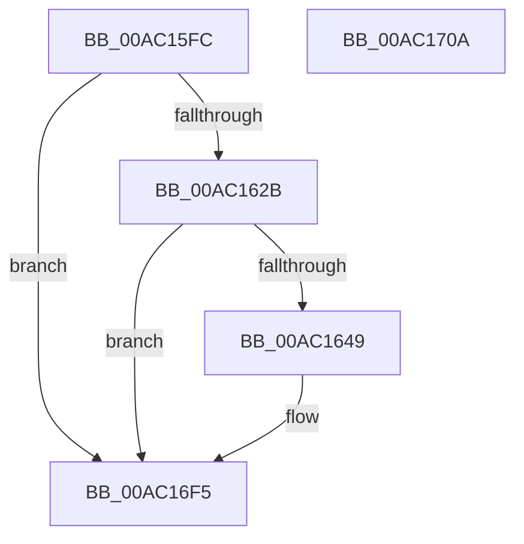

# PopTracePowerButtonSuppressionActionUpdate

- RVA: `0x00AC15FC`–`0x00AC170B` (길이 `271` bytes)
- VA: `0x0000000140AC15FC`
- 실행 섹션: `PAGE`
- PDB 이름 있음: `예`; PDB Function 태그: `아니요`
- unwind 정보 RVA: `0x000B43CC`
- 디코드: `63`개 명령, `271/271` bytes 표시
- 미해석 바이트: `0` (있으면 어셈블리에 `.byte`로 보존)

> 이 문서는 커널 이미지의 기계어와 PDB 기호를 분석해 생성했습니다. 4번과 5번은 함수 원형과 자료형을 바이너리 사용 방식에서 추정한 C 해석이며 원본 소스 복구 결과는 아닙니다.

## 1. Dependencies

- 직접 호출 지점: **3**; 고유 호출 대상: **3**
- 직접 호출자로 확인된 함수: **1**
- RIP 상대 이미지 참조: **3**

### Outgoing calls
- `0x00AC163C` → [tlgKeywordOn](../../text/42/tlgKeywordOn_function_0042EAA0.md) (function, `0x0042EAA0`)
- `0x00AC16F0` → [tlgWriteTransfer_EtwWriteTransfer](../../text/42/tlgWriteTransfer_EtwWriteTransfer_function_004260E0.md) (function, `0x004260E0`)
- `0x00AC16FC` → [_security_check_cookie](../../text/6A/_security_check_cookie_function_006AC640.md) (function, `0x006AC640`)

### Direct callers
- [PopEvaluatePowerButtonSuppressionState](../76/PopEvaluatePowerButtonSuppressionState_function_00765954.md) at `0x007659FB`

### Static image references
- `0x00AC160A` → RVA `0x00E0A740` (`.data`; read)
- `0x00AC1618` → RVA `0x00E07748` (`.data`; read)
- `0x00AC16D2` → RVA `0x00049ADA` (`.rdata`; read)

## 2. Other-region calls and transfers

- 다른 실행 섹션으로 향하는 call: **3**
  - `0x00AC163C` → [tlgKeywordOn](../../text/42/tlgKeywordOn_function_0042EAA0.md) (`PAGE` → `.text`)
  - `0x00AC16F0` → [tlgWriteTransfer_EtwWriteTransfer](../../text/42/tlgWriteTransfer_EtwWriteTransfer_function_004260E0.md) (`PAGE` → `.text`)
  - `0x00AC16FC` → [_security_check_cookie](../../text/6A/_security_check_cookie_function_006AC640.md) (`PAGE` → `.text`)
- 별도 외부 분기/꼬리 이동을 확인하지 못했습니다.

## 3. Assembly (complete function range)

```asm
00AC15FC  40 55                           push rbp
00AC15FE  48 8D 6C 24 B1                  lea rbp, [rsp - 0x4f]
00AC1603  48 81 EC E0 00 00 00            sub rsp, 0xe0
00AC160A  48 8B 05 2F 91 34 00            mov rax, qword ptr [rip + 0x34912f]
00AC1611  48 33 C4                        xor rax, rsp
00AC1614  48 89 45 3F                     mov qword ptr [rbp + 0x3f], rax
00AC1618  83 3D 29 61 34 00 05            cmp dword ptr [rip + 0x346129], 5
00AC161F  44 8B D2                        mov r10d, edx
00AC1622  44 8A D9                        mov r11b, cl
00AC1625  0F 86 CA 00 00 00               jbe 0x140ac16f5
00AC162B  48 BA 00 00 00 00 00 40 00 00   movabs rdx, 0x400000000000
00AC1635  48 8D 0D 0C 61 34 00            lea rcx, [rip + 0x34610c]
00AC163C  E8 5F D4 96 FF                  call 0x14042eaa0
00AC1641  84 C0                           test al, al
00AC1643  0F 84 AC 00 00 00               je 0x140ac16f5
00AC1649  83 65 EB 00                     and dword ptr [rbp - 0x15], 0
00AC164D  48 8D 45 9F                     lea rax, [rbp - 0x61]
00AC1651  83 65 FB 00                     and dword ptr [rbp - 5], 0
00AC1655  48 8D 0D EC 60 34 00            lea rcx, [rip + 0x3460ec]
00AC165C  83 65 0B 00                     and dword ptr [rbp + 0xb], 0
00AC1660  BA 04 00 00 00                  mov edx, 4
00AC1665  83 65 1B 00                     and dword ptr [rbp + 0x1b], 0
00AC1669  83 65 2B 00                     and dword ptr [rbp + 0x2b], 0
00AC166D  83 65 3B 00                     and dword ptr [rbp + 0x3b], 0
00AC1671  48 89 45 DF                     mov qword ptr [rbp - 0x21], rax
00AC1675  48 8D 45 A3                     lea rax, [rbp - 0x5d]
00AC1679  48 89 45 EF                     mov qword ptr [rbp - 0x11], rax
00AC167D  48 8D 45 A7                     lea rax, [rbp - 0x59]
00AC1681  48 89 45 FF                     mov qword ptr [rbp - 1], rax
00AC1685  48 8D 45 AB                     lea rax, [rbp - 0x55]
00AC1689  48 89 45 0F                     mov qword ptr [rbp + 0xf], rax
00AC168D  8B 45 7F                        mov eax, dword ptr [rbp + 0x7f]
00AC1690  89 45 AF                        mov dword ptr [rbp - 0x51], eax
00AC1693  48 8D 45 AF                     lea rax, [rbp - 0x51]
00AC1697  48 89 45 1F                     mov qword ptr [rbp + 0x1f], rax
00AC169B  48 8D 45 B7                     lea rax, [rbp - 0x49]
00AC169F  89 55 F7                        mov dword ptr [rbp - 9], edx
00AC16A2  89 55 07                        mov dword ptr [rbp + 7], edx
00AC16A5  89 55 17                        mov dword ptr [rbp + 0x17], edx
00AC16A8  89 55 27                        mov dword ptr [rbp + 0x27], edx
00AC16AB  BA 08 00 00 00                  mov edx, 8
00AC16B0  48 89 45 2F                     mov qword ptr [rbp + 0x2f], rax
00AC16B4  48 8D 45 BF                     lea rax, [rbp - 0x41]
00AC16B8  48 89 44 24 28                  mov qword ptr [rsp + 0x28], rax
00AC16BD  89 54 24 20                     mov dword ptr [rsp + 0x20], edx
00AC16C1  44 89 45 A7                     mov dword ptr [rbp - 0x59], r8d
00AC16C5  45 33 C0                        xor r8d, r8d
00AC16C8  44 89 4D AB                     mov dword ptr [rbp - 0x55], r9d
00AC16CC  45 33 C9                        xor r9d, r9d
00AC16CF  89 55 37                        mov dword ptr [rbp + 0x37], edx
00AC16D2  48 8D 15 01 84 58 FF            lea rdx, [rip - 0xa77bff]
00AC16D9  44 88 5D 9F                     mov byte ptr [rbp - 0x61], r11b
00AC16DD  C7 45 E7 01 00 00 00            mov dword ptr [rbp - 0x19], 1
00AC16E4  44 89 55 A3                     mov dword ptr [rbp - 0x5d], r10d
00AC16E8  48 C7 45 B7 00 00 00 01         mov qword ptr [rbp - 0x49], 0x1000000
00AC16F0  E8 EB 49 96 FF                  call 0x1404260e0
00AC16F5  48 8B 4D 3F                     mov rcx, qword ptr [rbp + 0x3f]
00AC16F9  48 33 CC                        xor rcx, rsp
00AC16FC  E8 3F AF BE FF                  call 0x1406ac640
00AC1701  48 81 C4 E0 00 00 00            add rsp, 0xe0
00AC1708  5D                              pop rbp
00AC1709  C3                              ret
00AC170A  CC                              int3
```

## 4. C-style interpretation (structured pseudocode)

```c
__int64 __fastcall PopTracePowerButtonSuppressionActionUpdate(unsigned __int8 a1, int a2, int a3, int a4, unsigned int a5)
{
    __int64 result;
    __int64 v_rsp;
    unsigned __int64 v_stack_m18;
    unsigned int v_stack_m1C;
    unsigned int v_stack_m20;
    unsigned __int64 v_stack_m28;
    unsigned int v_stack_m2C;
    unsigned int v_stack_m30;
    unsigned __int64 v_stack_m38;
    unsigned int v_stack_m3C;
    unsigned int v_stack_m40;
    unsigned __int64 v_stack_m48;
    unsigned int v_stack_m4C;
    unsigned int v_stack_m50;
    unsigned __int64 v_stack_m57;
    unsigned __int64 v_stack_m58;
    unsigned int v_stack_m5C;
    unsigned int v_stack_m60;
    unsigned __int64 v_stack_m68;
    unsigned int v_stack_m6C;
    unsigned int v_stack_m70;
    unsigned __int64 v_stack_m78;
    unsigned __int64 v_stack_m98;
    unsigned __int64 v_stack_mA0;
    unsigned int v_stack_mA8;
    unsigned __int64 v_stack_mAC;
    unsigned __int64 v_stack_mB0;
    unsigned __int64 v_stack_mB4;
    unsigned __int64 v_stack_mB8;
    unsigned __int64 v_stack_mC0;
    unsigned int v_stack_mC8;

    v_rsp = (v_rsp) - (224);
    result = (*(unsigned __int64 *)(v_rip + 3445039)) ^ (v_rsp);
    v_stack_m18 = result;
    if ((*(unsigned int *)(v_rip + 3432745)) <= 5) goto loc_00AC16F5;
    result = tlgKeywordOn(v_rip + 3432716, a2, a3, a4);
    if ((unsigned __int8)(result) != 0) {
        result = v_stack_mB8;
        a1 = v_rip + 3432684;
        a2 = 4;
        v_stack_m78 = result;
        result = v_stack_mB4;
        v_stack_m68 = result;
        result = v_stack_mB0;
        v_stack_m58 = result;
        result = v_stack_mAC;
        v_stack_m48 = result;
        result = a5;
        v_stack_mA8 = (unsigned int)(result);
        result = v_stack_mA8;
        v_stack_m38 = result;
        result = v_stack_mA0;
        v_stack_m60 = a2;
        v_stack_m50 = a2;
        v_stack_m40 = a2;
        v_stack_m30 = a2;
        a2 = 8;
        v_stack_m28 = result;
        result = v_stack_m98;
        v_stack_mC0 = result;
        v_stack_mC8 = a2;
        v_stack_mB0 = a3;
        a3 = 0;
        v_stack_mAC = a4;
        a4 = 0;
        v_stack_m20 = a2;
        a2 = v_rip - 10976255;
        v_stack_mB8 = a1;
        v_stack_m70 = 1;
        v_stack_mB4 = (unsigned int)((unsigned int)(a2));
        v_stack_mA0 = 0x1000000ULL;
        result = tlgWriteTransfer_EtwWriteTransfer(a1, a2, a3, a4);
    }
    a1 = (v_stack_m18) ^ (v_rsp);
    result = _security_check_cookie(a1, a2, a3, a4);
    v_rsp = (v_rsp) + (224);
    return result;
}
```

## 5. (Beta) C Style

```c
int64_t PopTracePowerButtonSuppressionActionUpdate(uint8_t Arg1, int32_t Arg2, int32_t Arg3, int32_t Arg4, uint32_t Arg5)
{
    int64_t result;
    int64_t local_rsp;
    uint64_t v_stack_m18;
    uint32_t v_stack_m1C;
    uint32_t v_stack_m20;
    uint64_t v_stack_m28;
    uint32_t v_stack_m2C;
    uint32_t v_stack_m30;
    uint64_t v_stack_m38;
    uint32_t v_stack_m3C;
    uint32_t v_stack_m40;
    uint64_t v_stack_m48;
    uint32_t v_stack_m4C;
    uint32_t v_stack_m50;
    uint64_t v_stack_m57;
    uint64_t v_stack_m58;
    uint32_t v_stack_m5C;
    uint32_t v_stack_m60;
    uint64_t v_stack_m68;
    uint32_t v_stack_m6C;
    uint32_t v_stack_m70;
    uint64_t v_stack_m78;
    uint64_t v_stack_m98;
    uint64_t v_stack_mA0;
    uint32_t v_stack_mA8;
    uint64_t v_stack_mAC;
    uint64_t v_stack_mB0;
    uint64_t v_stack_mB4;
    uint64_t v_stack_mB8;
    uint64_t v_stack_mC0;
    uint32_t v_stack_mC8;

    local_rsp = (local_rsp) - (224);
    result = (*(uint64_t *)(v_rip + 0x34912F)) ^ (local_rsp);
    v_stack_m18 = result;
    if ((*(uint32_t *)(v_rip + 0x346129)) <= 5) goto loc_00AC16F5;
    result = tlgKeywordOn(v_rip + 3432716, Arg2, Arg3, Arg4);
    if ((uint8_t)(result) != 0) {
        result = v_stack_mB8;
        Arg1 = v_rip + 3432684;
        Arg2 = 4;
        v_stack_m78 = result;
        result = v_stack_mB4;
        v_stack_m68 = result;
        result = v_stack_mB0;
        v_stack_m58 = result;
        result = v_stack_mAC;
        v_stack_m48 = result;
        result = Arg5;
        v_stack_mA8 = (uint32_t)(result);
        result = v_stack_mA8;
        v_stack_m38 = result;
        result = v_stack_mA0;
        v_stack_m60 = Arg2;
        v_stack_m50 = Arg2;
        v_stack_m40 = Arg2;
        v_stack_m30 = Arg2;
        Arg2 = 8;
        v_stack_m28 = result;
        result = v_stack_m98;
        v_stack_mC0 = result;
        v_stack_mC8 = Arg2;
        v_stack_mB0 = Arg3;
        Arg3 = 0;
        v_stack_mAC = Arg4;
        Arg4 = 0;
        v_stack_m20 = Arg2;
        Arg2 = v_rip - 10976255;
        v_stack_mB8 = Arg1;
        v_stack_m70 = 1;
        v_stack_mB4 = (uint32_t)((uint32_t)(Arg2));
        v_stack_mA0 = 0x1000000ULL;
        result = tlgWriteTransfer_EtwWriteTransfer(Arg1, Arg2, Arg3, Arg4);
    }
    Arg1 = (v_stack_m18) ^ (local_rsp);
    result = _security_check_cookie(Arg1, Arg2, Arg3, Arg4);
    local_rsp = (local_rsp) + (224);
    return result;
}
```

## 6. Execution-region graph

[열기: 2D/3D 그래프와 함수 탐색 컨트롤 패널](../../../control-panel.html?section=page&rva=0x00AC15FC&view=graph)

- 2D 그래프는 위에서 아래로 흐르고, 3D 그래프는 빈 공간을 드래그해 회전합니다. Shift+드래그는 이동, 휠은 확대·축소, 함수 노드 선택은 대상 보고서 이동입니다.

### Static fallback


