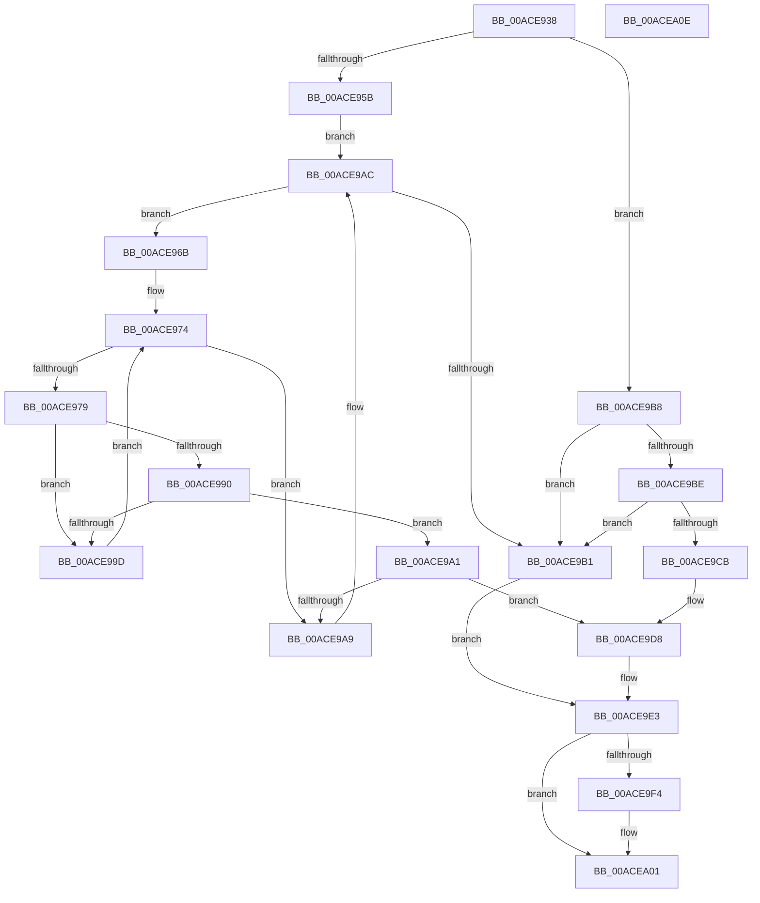

# PpmClearSimulatedLoad

- RVA: `0x00ACE938`–`0x00ACEA0F` (길이 `215` bytes)
- VA: `0x0000000140ACE938`
- 실행 섹션: `PAGE`
- PDB 이름 있음: `예`; PDB Function 태그: `아니요`
- unwind 정보 RVA: `0x0005CAAC`
- 디코드: `61`개 명령, `215/215` bytes 표시
- 미해석 바이트: `0` (있으면 어셈블리에 `.byte`로 보존)

> 이 문서는 커널 이미지의 기계어와 PDB 기호를 분석해 생성했습니다. 4번과 5번은 함수 원형과 자료형을 바이너리 사용 방식에서 추정한 C 해석이며 원본 소스 복구 결과는 아닙니다.

## 1. Dependencies

- 직접 호출 지점: **5**; 고유 호출 대상: **5**
- 직접 호출자로 확인된 함수: **1**
- RIP 상대 이미지 참조: **2**

### Outgoing calls
- `0x00ACE94E` → [PpmAcquireLock](../../text/2D/PpmAcquireLock_function_002D9AA4.md) (function, `0x002D9AA4`)
- `0x00ACE9C1` → [KeGetProcessorIndexFromNumber](../../text/2D/KeGetProcessorIndexFromNumber_function_002DD2D0.md) (function, `0x002DD2D0`)
- `0x00ACE9CD` → [KeGetPrcb](../../text/2D/KeGetPrcb_function_002D85D0.md) (function, `0x002D85D0`)
- `0x00ACE9EA` → [PpmReleaseLock](../../text/2D/PpmReleaseLock_function_002DA428.md) (function, `0x002DA428`)
- `0x00ACE9FC` → [ExFreePoolWithTag](../../poolcode/B8/ExFreePoolWithTag_function_00B82870.md) (function, `0x00B82870`)

### Direct callers
- [NtPowerInformation](../95/NtPowerInformation_function_00955D80.md) at `0x00956C54`

### Static image references
- `0x00ACE947` → RVA `0x00F0CC00` (`.data`; read)
- `0x00ACE95B` → RVA `0x00FC6BA8` (`ALMOSTRO`; read)

## 2. Other-region calls and transfers

- 다른 실행 섹션으로 향하는 call: **5**
  - `0x00ACE94E` → [PpmAcquireLock](../../text/2D/PpmAcquireLock_function_002D9AA4.md) (`PAGE` → `.text`)
  - `0x00ACE9C1` → [KeGetProcessorIndexFromNumber](../../text/2D/KeGetProcessorIndexFromNumber_function_002DD2D0.md) (`PAGE` → `.text`)
  - `0x00ACE9CD` → [KeGetPrcb](../../text/2D/KeGetPrcb_function_002D85D0.md) (`PAGE` → `.text`)
  - `0x00ACE9EA` → [PpmReleaseLock](../../text/2D/PpmReleaseLock_function_002DA428.md) (`PAGE` → `.text`)
  - `0x00ACE9FC` → [ExFreePoolWithTag](../../poolcode/B8/ExFreePoolWithTag_function_00B82870.md) (`PAGE` → `POOLCODE`)
- 별도 외부 분기/꼬리 이동을 확인하지 못했습니다.

## 3. Assembly (complete function range)

```asm
00ACE938  48 89 5C 24 08                  mov qword ptr [rsp + 8], rbx
00ACE93D  57                              push rdi
00ACE93E  48 83 EC 20                     sub rsp, 0x20
00ACE942  48 8B D9                        mov rbx, rcx
00ACE945  33 FF                           xor edi, edi
00ACE947  48 8D 0D B2 E2 43 00            lea rcx, [rip + 0x43e2b2]
00ACE94E  E8 51 B1 80 FF                  call 0x1402d9aa4
00ACE953  44 8B 0B                        mov r9d, dword ptr [rbx]
00ACE956  45 85 C9                        test r9d, r9d
00ACE959  79 5D                           jns 0x140ace9b8
00ACE95B  48 8B 0D 46 82 4F 00            mov rcx, qword ptr [rip + 0x4f8246]
00ACE962  4C 8D 1D 3F 82 4F 00            lea r11, [rip + 0x4f823f]
00ACE969  EB 41                           jmp 0x140ace9ac
00ACE96B  44 8B 91 28 01 00 00            mov r10d, dword ptr [rcx + 0x128]
00ACE972  33 D2                           xor edx, edx
00ACE974  41 3B D2                        cmp edx, r10d
00ACE977  73 30                           jae 0x140ace9a9
00ACE979  8B C2                           mov eax, edx
00ACE97B  4C 69 C0 A8 04 00 00            imul r8, rax, 0x4a8
00ACE982  4C 03 81 38 01 00 00            add r8, qword ptr [rcx + 0x138]
00ACE989  41 83 78 10 01                  cmp dword ptr [r8 + 0x10], 1
00ACE98E  75 0D                           jne 0x140ace99d
00ACE990  41 8B C1                        mov eax, r9d
00ACE993  0F BA F0 1F                     btr eax, 0x1f
00ACE997  41 39 40 14                     cmp dword ptr [r8 + 0x14], eax
00ACE99B  74 04                           je 0x140ace9a1
00ACE99D  FF C2                           inc edx
00ACE99F  EB D3                           jmp 0x140ace974
00ACE9A1  49 8B 00                        mov rax, qword ptr [r8]
00ACE9A4  48 85 C0                        test rax, rax
00ACE9A7  75 2F                           jne 0x140ace9d8
00ACE9A9  48 8B 09                        mov rcx, qword ptr [rcx]
00ACE9AC  49 3B CB                        cmp rcx, r11
00ACE9AF  75 BA                           jne 0x140ace96b
00ACE9B1  BB 0D 00 00 C0                  mov ebx, 0xc000000d
00ACE9B6  EB 2B                           jmp 0x140ace9e3
00ACE9B8  40 38 7B 03                     cmp byte ptr [rbx + 3], dil
00ACE9BC  75 F3                           jne 0x140ace9b1
00ACE9BE  48 8B CB                        mov rcx, rbx
00ACE9C1  E8 0A E9 80 FF                  call 0x1402dd2d0
00ACE9C6  83 F8 FF                        cmp eax, -1
00ACE9C9  74 E6                           je 0x140ace9b1
00ACE9CB  8B C8                           mov ecx, eax
00ACE9CD  E8 FE 9B 80 FF                  call 0x1402d85d0
00ACE9D2  48 05 B0 89 00 00               add rax, 0x89b0
00ACE9D8  48 8B 78 18                     mov rdi, qword ptr [rax + 0x18]
00ACE9DC  48 83 60 18 00                  and qword ptr [rax + 0x18], 0
00ACE9E1  33 DB                           xor ebx, ebx
00ACE9E3  48 8D 0D 16 E2 43 00            lea rcx, [rip + 0x43e216]
00ACE9EA  E8 39 BA 80 FF                  call 0x1402da428
00ACE9EF  48 85 FF                        test rdi, rdi
00ACE9F2  74 0D                           je 0x140acea01
00ACE9F4  BA 50 50 4D 70                  mov edx, 0x704d5050
00ACE9F9  48 8B CF                        mov rcx, rdi
00ACE9FC  E8 6F 3E 0B 00                  call 0x140b82870
00ACEA01  8B C3                           mov eax, ebx
00ACEA03  48 8B 5C 24 30                  mov rbx, qword ptr [rsp + 0x30]
00ACEA08  48 83 C4 20                     add rsp, 0x20
00ACEA0C  5F                              pop rdi
00ACEA0D  C3                              ret
00ACEA0E  CC                              int3
```

## 4. C-style interpretation (structured pseudocode)

```c
__int64 __fastcall PpmClearSimulatedLoad(__int64 a1, int a2)
{
    __int64 result;
    __int64 v_rbx;
    __int64 v_rdi;
    __int64 v_rsp;
    unsigned __int64 v_stack_p8;

    v_stack_p8 = v_rbx;
    v_rsp = (v_rsp) - (32);
    v_rdi = 0;
    result = PpmAcquireLock(v_rip + 4448946, a2, a3, a4);
    if (!sign_flag) goto loc_00ACE9B8;
    goto loc_00ACE9AC;
loc_00ACE96B:
    a2 = 0;
loc_00ACE974:
    if (0 >= ((unsigned int)((unsigned int)(*(unsigned int *)(*(unsigned __int64 *)(v_rip + 5210694) + 296))))) goto loc_00ACE9A9;
    a3 = (a3) * (0);
    a3 = (a3) + (*(unsigned __int64 *)(*(unsigned __int64 *)(v_rip + 5210694) + 312));
    if ((*(unsigned int *)(a3 + 16)) != 1) goto loc_00ACE99D;
    if ((*(unsigned int *)(a3 + 20)) == ((unsigned int)((unsigned int)((unsigned int)((unsigned int)(*(unsigned int *)(a1))))))) goto loc_00ACE9A1;
loc_00ACE99D:
    a2 = (unsigned int)((a2) + 1);
    goto loc_00ACE974;
loc_00ACE9A1:
    if (*(unsigned __int64 *)(a3) != 0) goto loc_00ACE9D8;
loc_00ACE9A9:
loc_00ACE9AC:
    if ((*(unsigned __int64 *)(*(unsigned __int64 *)(v_rip + 5210694))) != (v_rip + 5210687)) goto loc_00ACE96B;
loc_00ACE9B1:
    goto loc_00ACE9E3;
loc_00ACE9B8:
    if ((*(unsigned __int8 *)((unsigned int)(0xC000000DULL) + 3)) != 0) goto loc_00ACE9B1;
    result = KeGetProcessorIndexFromNumber((unsigned int)(0xC000000DULL), a2, a3, (unsigned int)(*(unsigned int *)(a1)));
    if (((unsigned int)(result)) == -1) goto loc_00ACE9B1;
    result = KeGetPrcb((unsigned int)((unsigned int)(result)), a2, a3, (unsigned int)(*(unsigned int *)(a1)));
    result = (result) + (0x89B0ULL);
loc_00ACE9D8:
    v_rbx = 0;
loc_00ACE9E3:
    result = PpmReleaseLock(v_rip + 4448790, a2, a3, (unsigned int)(*(unsigned int *)(a1)));
    if (*(unsigned __int64 *)(result + 24) != 0) {
        a2 = 0x704D5050ULL;
        a1 = *(unsigned __int64 *)(result + 24);
        result = ExFreePoolWithTag(a1, a2, a3, (unsigned int)(*(unsigned int *)(a1)));
    }
    v_rsp = (v_rsp) + (32);
    return 0;
}
```

## 5. (Beta) C Style

```c
int64_t PpmClearSimulatedLoad(void *Arg1, int32_t Arg2)
{
    uint8_t *arg1 = (uint8_t *)Arg1;

    int64_t result;
    int64_t local_rbx;
    int64_t local_rdi;
    int64_t local_rsp;
    uint64_t v_stack_p8;

    v_stack_p8 = local_rbx;
    local_rsp = (local_rsp) - (32);
    local_rdi = 0;
    result = PpmAcquireLock(v_rip + 4448946, Arg2, a3, a4);
    if (!sign_flag) goto loc_00ACE9B8;
    goto loc_00ACE9AC;
loc_00ACE96B:
    Arg2 = 0;
loc_00ACE974:
    if (0 >= ((uint32_t)((uint32_t)(*(uint32_t *)(*(uint64_t *)(v_rip + 0x4F8246) + 0x128))))) goto loc_00ACE9A9;
    a3 = (a3) * (0);
    a3 = (a3) + (*(uint64_t *)(*(uint64_t *)(v_rip + 0x4F8246) + 0x138));
    if ((*(uint32_t *)(a3 + 0x10)) != 1) goto loc_00ACE99D;
    if ((*(uint32_t *)(a3 + 0x14)) == ((uint32_t)((uint32_t)((uint32_t)((uint32_t)(*(uint32_t *)(arg1))))))) goto loc_00ACE9A1;
loc_00ACE99D:
    Arg2 = (uint32_t)((Arg2) + 1);
    goto loc_00ACE974;
loc_00ACE9A1:
    if (*(uint64_t *)(a3) != 0) goto loc_00ACE9D8;
loc_00ACE9A9:
loc_00ACE9AC:
    if ((*(uint64_t *)(*(uint64_t *)(v_rip + 0x4F8246))) != (v_rip + 5210687)) goto loc_00ACE96B;
loc_00ACE9B1:
    goto loc_00ACE9E3;
loc_00ACE9B8:
    if ((*(uint8_t *)((uint32_t)(0xC000000DULL) + 0x3)) != 0) goto loc_00ACE9B1;
    result = KeGetProcessorIndexFromNumber((uint32_t)(0xC000000DULL), Arg2, a3, (uint32_t)(*(uint32_t *)(arg1)));
    if (((uint32_t)(result)) == -1) goto loc_00ACE9B1;
    result = KeGetPrcb((uint32_t)((uint32_t)(result)), Arg2, a3, (uint32_t)(*(uint32_t *)(arg1)));
    result = (result) + (0x89B0ULL);
loc_00ACE9D8:
    local_rbx = 0;
loc_00ACE9E3:
    result = PpmReleaseLock(v_rip + 4448790, Arg2, a3, (uint32_t)(*(uint32_t *)(arg1)));
    if (*(uint64_t *)(result + 0x18) != 0) {
        Arg2 = 0x704D5050ULL;
        Arg1 = *(uint64_t *)(result + 0x18);
        result = ExFreePoolWithTag(Arg1, Arg2, a3, (uint32_t)(*(uint32_t *)(arg1)));
    }
    local_rsp = (local_rsp) + (32);
    return 0;
}
```

### 관측된 메모리 오프셋

구조체 형식이 확인되지 않은 접근은 인자 기준의 오프셋으로만 기록했습니다.

| 기준 인자 | 오프셋 표현 | 폭 (bit) | 접근 |
|---|---:|---:|---|
| `Arg1` | `+ 0x0` | `32` | `R` |
| `Arg1` | `+ 0x3` | `8` | `R` |

## 6. Execution-region graph

[열기: 2D/3D 그래프와 함수 탐색 컨트롤 패널](../../../control-panel.html?section=page&rva=0x00ACE938&view=graph)

- 2D 그래프는 위에서 아래로 흐르고, 3D 그래프는 빈 공간을 드래그해 회전합니다. Shift+드래그는 이동, 휠은 확대·축소, 함수 노드 선택은 대상 보고서 이동입니다.

### Static fallback


