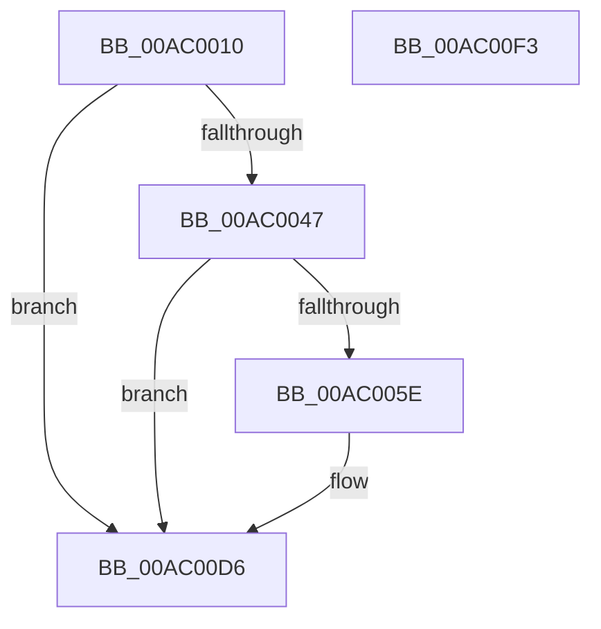

# PpmEventTraceDripsAccountingSnapshot

- RVA: `0x00AC0010`–`0x00AC00F4` (길이 `228` bytes)
- VA: `0x0000000140AC0010`
- 실행 섹션: `PAGE`
- PDB 이름 있음: `예`; PDB Function 태그: `아니요`
- unwind 정보 RVA: `0x000BD124`
- 디코드: `50`개 명령, `228/228` bytes 표시
- 미해석 바이트: `0` (있으면 어셈블리에 `.byte`로 보존)

> 이 문서는 커널 이미지의 기계어와 PDB 기호를 분석해 생성했습니다. 4번과 5번은 함수 원형과 자료형을 바이너리 사용 방식에서 추정한 C 해석이며 원본 소스 복구 결과는 아닙니다.

## 1. Dependencies

- 직접 호출 지점: **3**; 고유 호출 대상: **3**
- 직접 호출자로 확인된 함수: **1**
- RIP 상대 이미지 참조: **5**

### Outgoing calls
- `0x00AC0055` → [EtwEventEnabled](../../text/39/EtwEventEnabled_function_00392450.md) (function, `0x00392450`)
- `0x00AC00D1` → [EtwWrite](../../text/41/EtwWrite_function_0041C720.md) (function, `0x0041C720`)
- `0x00AC00DD` → [_security_check_cookie](../../text/6A/_security_check_cookie_function_006AC640.md) (function, `0x006AC640`)

### Direct callers
- [PpmSnapDripsAccountingSnapshot](../../text/43/PpmSnapDripsAccountingSnapshot_function_0043B11C.md) at `0x0043B1AE`

### Static image references
- `0x00AC0022` → RVA `0x00E0A740` (`.data`; read)
- `0x00AC0030` → RVA `0x00E67A39` (`.data`; read)
- `0x00AC0047` → RVA `0x00F083E8` (`.data`; read)
- `0x00AC004E` → RVA `0x0001E810` (`.rdata`; read)
- `0x00AC005E` → RVA `0x00F0B6B0` (`.data`; read)

## 2. Other-region calls and transfers

- 다른 실행 섹션으로 향하는 call: **3**
  - `0x00AC0055` → [EtwEventEnabled](../../text/39/EtwEventEnabled_function_00392450.md) (`PAGE` → `.text`)
  - `0x00AC00D1` → [EtwWrite](../../text/41/EtwWrite_function_0041C720.md) (`PAGE` → `.text`)
  - `0x00AC00DD` → [_security_check_cookie](../../text/6A/_security_check_cookie_function_006AC640.md) (`PAGE` → `.text`)
- 별도 외부 분기/꼬리 이동을 확인하지 못했습니다.

## 3. Assembly (complete function range)

```asm
00AC0010  48 89 5C 24 08                  mov qword ptr [rsp + 8], rbx
00AC0015  55                              push rbp
00AC0016  48 8D 6C 24 A9                  lea rbp, [rsp - 0x57]
00AC001B  48 81 EC 90 00 00 00            sub rsp, 0x90
00AC0022  48 8B 05 17 A7 34 00            mov rax, qword ptr [rip + 0x34a717]
00AC0029  48 33 C4                        xor rax, rsp
00AC002C  48 89 45 47                     mov qword ptr [rbp + 0x47], rax
00AC0030  80 3D 02 7A 3A 00 00            cmp byte ptr [rip + 0x3a7a02], 0
00AC0037  48 8B DA                        mov rbx, rdx
00AC003A  C7 45 FF 1A 00 00 00            mov dword ptr [rbp - 1], 0x1a
00AC0041  0F 84 8F 00 00 00               je 0x140ac00d6
00AC0047  48 8B 0D 9A 83 44 00            mov rcx, qword ptr [rip + 0x44839a]
00AC004E  48 8D 15 BB E7 55 FF            lea rdx, [rip - 0xaa1845]
00AC0055  E8 F6 23 8D FF                  call 0x140392450
00AC005A  84 C0                           test al, al
00AC005C  74 78                           je 0x140ac00d6
00AC005E  8A 05 4C B6 44 00               mov al, byte ptr [rip + 0x44b64c]
00AC0064  48 8D 15 A5 E7 55 FF            lea rdx, [rip - 0xaa185b]
00AC006B  83 65 13 00                     and dword ptr [rbp + 0x13], 0
00AC006F  41 B9 04 00 00 00               mov r9d, 4
00AC0075  83 65 23 00                     and dword ptr [rbp + 0x23], 0
00AC0079  45 33 C0                        xor r8d, r8d
00AC007C  83 65 33 00                     and dword ptr [rbp + 0x33], 0
00AC0080  83 65 43 00                     and dword ptr [rbp + 0x43], 0
00AC0084  48 8B 0D 5D 83 44 00            mov rcx, qword ptr [rip + 0x44835d]
00AC008B  88 45 F7                        mov byte ptr [rbp - 9], al
00AC008E  48 8D 45 F7                     lea rax, [rbp - 9]
00AC0092  48 89 45 07                     mov qword ptr [rbp + 7], rax
00AC0096  48 8D 45 FF                     lea rax, [rbp - 1]
00AC009A  48 89 45 17                     mov qword ptr [rbp + 0x17], rax
00AC009E  8B 45 FF                        mov eax, dword ptr [rbp - 1]
00AC00A1  C1 E0 03                        shl eax, 3
00AC00A4  89 45 2F                        mov dword ptr [rbp + 0x2f], eax
00AC00A7  48 8D 05 02 B6 44 00            lea rax, [rip + 0x44b602]
00AC00AE  48 89 45 37                     mov qword ptr [rbp + 0x37], rax
00AC00B2  48 8D 45 07                     lea rax, [rbp + 7]
00AC00B6  48 89 44 24 20                  mov qword ptr [rsp + 0x20], rax
00AC00BB  C7 45 0F 01 00 00 00            mov dword ptr [rbp + 0xf], 1
00AC00C2  44 89 4D 1F                     mov dword ptr [rbp + 0x1f], r9d
00AC00C6  48 89 5D 27                     mov qword ptr [rbp + 0x27], rbx
00AC00CA  C7 45 3F 08 00 00 00            mov dword ptr [rbp + 0x3f], 8
00AC00D1  E8 4A C6 95 FF                  call 0x14041c720
00AC00D6  48 8B 4D 47                     mov rcx, qword ptr [rbp + 0x47]
00AC00DA  48 33 CC                        xor rcx, rsp
00AC00DD  E8 5E C5 BE FF                  call 0x1406ac640
00AC00E2  48 8B 9C 24 A0 00 00 00         mov rbx, qword ptr [rsp + 0xa0]
00AC00EA  48 81 C4 90 00 00 00            add rsp, 0x90
00AC00F1  5D                              pop rbp
00AC00F2  C3                              ret
00AC00F3  CC                              int3
```

## 4. C-style interpretation (structured pseudocode)

```c
__int64 __fastcall PpmEventTraceDripsAccountingSnapshot(__int64 a1, __int64 a2, int a3)
{
    __int64 result;
    __int64 v_rsp;
    unsigned __int64 v_stack_m18;
    unsigned int v_stack_m1C;
    unsigned int v_stack_m20;
    unsigned __int64 v_stack_m28;
    unsigned int v_stack_m2C;
    unsigned int v_stack_m30;
    unsigned __int64 v_stack_m38;
    unsigned int v_stack_m3C;
    unsigned int v_stack_m40;
    unsigned __int64 v_stack_m48;
    unsigned int v_stack_m4C;
    unsigned int v_stack_m50;
    unsigned __int64 v_stack_m58;
    unsigned __int64 v_stack_m5F;
    unsigned int v_stack_m60;
    unsigned __int8 v_stack_m68;
    unsigned __int64 v_stack_m78;
    unsigned __int64 v_stack_p8;

    v_stack_p8 = v_rbx;
    v_rsp = (v_rsp) - (144);
    result = (*(unsigned __int64 *)(v_rip + 3450647)) ^ (v_rsp);
    v_stack_m18 = result;
    v_stack_m60 = 26;
    if ((*(unsigned __int8 *)(v_rip + 3832322)) == 0) goto loc_00AC00D6;
    result = EtwEventEnabled(*(unsigned __int64 *)(v_rip + 4490138), v_rip - 11147333, a3, a4);
    if ((unsigned __int8)(result) != 0) {
        result = *(unsigned __int8 *)(v_rip + 4503116);
        a2 = v_rip - 11147355;
        a4 = 4;
        a3 = 0;
        a1 = *(unsigned __int64 *)(v_rip + 4490077);
        v_stack_m68 = (unsigned __int8)(result);
        result = v_stack_m68;
        v_stack_m58 = result;
        result = v_stack_m60;
        v_stack_m48 = result;
        result = v_stack_m60;
        result = (unsigned int)((result) << (3));
        v_stack_m30 = (unsigned int)(result);
        result = v_rip + 4503042;
        v_stack_m28 = result;
        result = v_stack_m58;
        v_stack_m78 = result;
        v_stack_m50 = 1;
        v_stack_m40 = (unsigned int)(a4);
        v_stack_m38 = a2;
        v_stack_m20 = 8;
        result = EtwWrite(a1, a2, a3, a4);
    }
    a1 = (v_stack_m18) ^ (v_rsp);
    result = _security_check_cookie(a1, a2, a3, a4);
    v_rsp = (v_rsp) + (144);
    return result;
}
```

## 5. (Beta) C Style

```c
int64_t PpmEventTraceDripsAccountingSnapshot(int64_t Arg1, int64_t Arg2, int32_t Arg3)
{
    int64_t result;
    int64_t local_rsp;
    uint64_t v_stack_m18;
    uint32_t v_stack_m1C;
    uint32_t v_stack_m20;
    uint64_t v_stack_m28;
    uint32_t v_stack_m2C;
    uint32_t v_stack_m30;
    uint64_t v_stack_m38;
    uint32_t v_stack_m3C;
    uint32_t v_stack_m40;
    uint64_t v_stack_m48;
    uint32_t v_stack_m4C;
    uint32_t v_stack_m50;
    uint64_t v_stack_m58;
    uint64_t v_stack_m5F;
    uint32_t v_stack_m60;
    uint8_t v_stack_m68;
    uint64_t v_stack_m78;
    uint64_t v_stack_p8;

    v_stack_p8 = local_rbx;
    local_rsp = (local_rsp) - (144);
    result = (*(uint64_t *)(v_rip + 0x34A717)) ^ (local_rsp);
    v_stack_m18 = result;
    v_stack_m60 = 26;
    if ((*(uint8_t *)(v_rip + 0x3A7A02)) == 0) goto loc_00AC00D6;
    result = EtwEventEnabled(*(uint64_t *)(v_rip + 0x44839A), v_rip - 11147333, Arg3, a4);
    if ((uint8_t)(result) != 0) {
        result = *(uint8_t *)(v_rip + 0x44B64C);
        Arg2 = v_rip - 11147355;
        a4 = 4;
        Arg3 = 0;
        Arg1 = *(uint64_t *)(v_rip + 0x44835D);
        v_stack_m68 = (uint8_t)(result);
        result = v_stack_m68;
        v_stack_m58 = result;
        result = v_stack_m60;
        v_stack_m48 = result;
        result = v_stack_m60;
        result = (uint32_t)((result) << (3));
        v_stack_m30 = (uint32_t)(result);
        result = v_rip + 4503042;
        v_stack_m28 = result;
        result = v_stack_m58;
        v_stack_m78 = result;
        v_stack_m50 = 1;
        v_stack_m40 = (uint32_t)(a4);
        v_stack_m38 = Arg2;
        v_stack_m20 = 8;
        result = EtwWrite(Arg1, Arg2, Arg3, a4);
    }
    Arg1 = (v_stack_m18) ^ (local_rsp);
    result = _security_check_cookie(Arg1, Arg2, Arg3, a4);
    local_rsp = (local_rsp) + (144);
    return result;
}
```

## 6. Execution-region graph

[열기: 2D/3D 그래프와 함수 탐색 컨트롤 패널](../../../control-panel.html?section=page&rva=0x00AC0010&view=graph)

- 2D 그래프는 위에서 아래로 흐르고, 3D 그래프는 빈 공간을 드래그해 회전합니다. Shift+드래그는 이동, 휠은 확대·축소, 함수 노드 선택은 대상 보고서 이동입니다.

### Static fallback


