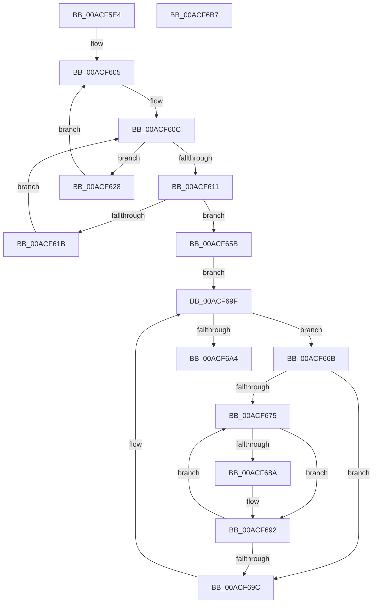

# PpmPerfResetHistoryAll

- RVA: `0x00ACF5E4`–`0x00ACF6B8` (길이 `212` bytes)
- VA: `0x0000000140ACF5E4`
- 실행 섹션: `PAGE`
- PDB 이름 있음: `예`; PDB Function 태그: `아니요`
- unwind 정보 RVA: `0x000701D4`
- 디코드: `60`개 명령, `212/212` bytes 표시
- 미해석 바이트: `0` (있으면 어셈블리에 `.byte`로 보존)

> 이 문서는 커널 이미지의 기계어와 PDB 기호를 분석해 생성했습니다. 4번과 5번은 함수 원형과 자료형을 바이너리 사용 방식에서 추정한 C 해석이며 원본 소스 복구 결과는 아닙니다.

## 1. Dependencies

- 직접 호출 지점: **3**; 고유 호출 대상: **2**
- 직접 호출자로 확인된 함수: **1**
- RIP 상대 이미지 참조: **4**

### Outgoing calls
- `0x00ACF648` → [KeGetPrcb](../../text/2D/KeGetPrcb_function_002D85D0.md) (function, `0x002D85D0`)
- `0x00ACF654` → [PpmPerfResetHistory](../../text/40/PpmPerfResetHistory_function_0040AF08.md) (function, `0x0040AF08`)
- `0x00ACF68D` → [PpmPerfResetHistory](../../text/40/PpmPerfResetHistory_function_0040AF08.md) (function, `0x0040AF08`)

### Direct callers
- [PpmCheckReInit](../A8/PpmCheckReInit_function_00A84DD8.md) at `0x00A84E91`

### Static image references
- `0x00ACF5F6` → RVA `0x00E0B5A8` (`.data`; read)
- `0x00ACF605` → RVA `0x00E0B5A0` (`.data`; read)
- `0x00ACF63E` → RVA `0x00F231B8` (`.data`; read)
- `0x00ACF65B` → RVA `0x00FC6BA8` (`ALMOSTRO`; read)

## 2. Other-region calls and transfers

- 다른 실행 섹션으로 향하는 call: **3**
  - `0x00ACF648` → [KeGetPrcb](../../text/2D/KeGetPrcb_function_002D85D0.md) (`PAGE` → `.text`)
  - `0x00ACF654` → [PpmPerfResetHistory](../../text/40/PpmPerfResetHistory_function_0040AF08.md) (`PAGE` → `.text`)
  - `0x00ACF68D` → [PpmPerfResetHistory](../../text/40/PpmPerfResetHistory_function_0040AF08.md) (`PAGE` → `.text`)
- 별도 외부 분기/꼬리 이동을 확인하지 못했습니다.

## 3. Assembly (complete function range)

```asm
00ACF5E4  48 89 5C 24 10                  mov qword ptr [rsp + 0x10], rbx
00ACF5E9  48 89 6C 24 18                  mov qword ptr [rsp + 0x18], rbp
00ACF5EE  56                              push rsi
00ACF5EF  57                              push rdi
00ACF5F0  41 56                           push r14
00ACF5F2  48 83 EC 20                     sub rsp, 0x20
00ACF5F6  48 8B 3D AB BF 33 00            mov rdi, qword ptr [rip + 0x33bfab]
00ACF5FD  33 F6                           xor esi, esi
00ACF5FF  0F B7 DE                        movzx ebx, si
00ACF602  8D 6E 01                        lea ebp, [rsi + 1]
00ACF605  0F B7 0D 94 BF 33 00            movzx ecx, word ptr [rip + 0x33bf94]
00ACF60C  48 85 FF                        test rdi, rdi
00ACF60F  75 17                           jne 0x140acf628
00ACF611  66 03 DD                        add bx, bp
00ACF614  0F B7 DB                        movzx ebx, bx
00ACF617  3B D9                           cmp ebx, ecx
00ACF619  73 40                           jae 0x140acf65b
00ACF61B  48 8D 3D 86 BF 33 00            lea rdi, [rip + 0x33bf86]
00ACF622  48 8B 3C DF                     mov rdi, qword ptr [rdi + rbx*8]
00ACF626  EB E4                           jmp 0x140acf60c
00ACF628  48 0F BC D7                     bsf rdx, rdi
00ACF62C  0F B7 CB                        movzx ecx, bx
00ACF62F  0F B6 C2                        movzx eax, dl
00ACF632  48 0F B3 C7                     btr rdi, rax
00ACF636  C1 E1 06                        shl ecx, 6
00ACF639  0F B6 C2                        movzx eax, dl
00ACF63C  03 C8                           add ecx, eax
00ACF63E  48 8B 05 73 3B 45 00            mov rax, qword ptr [rip + 0x453b73]
00ACF645  8B 0C 88                        mov ecx, dword ptr [rax + rcx*4]
00ACF648  E8 83 8F 80 FF                  call 0x1402d85d0
00ACF64D  48 8D 88 B0 89 00 00            lea rcx, [rax + 0x89b0]
00ACF654  E8 AF B8 93 FF                  call 0x14040af08
00ACF659  EB AA                           jmp 0x140acf605
00ACF65B  48 8B 1D 46 75 4F 00            mov rbx, qword ptr [rip + 0x4f7546]
00ACF662  4C 8D 35 3F 75 4F 00            lea r14, [rip + 0x4f753f]
00ACF669  EB 34                           jmp 0x140acf69f
00ACF66B  8B FE                           mov edi, esi
00ACF66D  39 B3 28 01 00 00               cmp dword ptr [rbx + 0x128], esi
00ACF673  76 27                           jbe 0x140acf69c
00ACF675  8B C7                           mov eax, edi
00ACF677  48 69 C8 A8 04 00 00            imul rcx, rax, 0x4a8
00ACF67E  48 03 8B 38 01 00 00            add rcx, qword ptr [rbx + 0x138]
00ACF685  39 69 10                        cmp dword ptr [rcx + 0x10], ebp
00ACF688  75 08                           jne 0x140acf692
00ACF68A  48 8B 09                        mov rcx, qword ptr [rcx]
00ACF68D  E8 76 B8 93 FF                  call 0x14040af08
00ACF692  03 FD                           add edi, ebp
00ACF694  3B BB 28 01 00 00               cmp edi, dword ptr [rbx + 0x128]
00ACF69A  72 D9                           jb 0x140acf675
00ACF69C  48 8B 1B                        mov rbx, qword ptr [rbx]
00ACF69F  49 3B DE                        cmp rbx, r14
00ACF6A2  75 C7                           jne 0x140acf66b
00ACF6A4  48 8B 5C 24 48                  mov rbx, qword ptr [rsp + 0x48]
00ACF6A9  48 8B 6C 24 50                  mov rbp, qword ptr [rsp + 0x50]
00ACF6AE  48 83 C4 20                     add rsp, 0x20
00ACF6B2  41 5E                           pop r14
00ACF6B4  5F                              pop rdi
00ACF6B5  5E                              pop rsi
00ACF6B6  C3                              ret
00ACF6B7  CC                              int3
```

## 4. C-style interpretation (structured pseudocode)

```c
__int64 __fastcall PpmPerfResetHistoryAll(void)
{
    __int64 result;
    __int64 v_rbx;
    __int64 v_rdi;
    __int64 v_rsi;
    __int64 v_rsp;
    unsigned __int64 v_stack_p10;
    unsigned __int64 v_stack_p18;

    v_stack_p10 = v_rbx;
    v_stack_p18 = v_rbp;
    v_rsp = (v_rsp) - (32);
    v_rsi = 0;
loc_00ACF605:
loc_00ACF60C:
    if (*(unsigned __int64 *)(v_rip + 3391403) != 0) goto loc_00ACF628;
    v_rbx = (unsigned __int16)((0) + ((unsigned __int16)(v_rsi + 1)));
    if (((unsigned int)((unsigned __int16)(v_rbx))) >= ((unsigned int)(*(unsigned __int16 *)(v_rip + 3391380)))) goto loc_00ACF65B;
    goto loc_00ACF60C;
loc_00ACF628:
    a1 = (unsigned int)(((unsigned __int16)((unsigned __int16)(v_rbx))) << (6));
    a1 = (unsigned int)((a1) + ((unsigned int)((unsigned __int8)(a2))));
    result = KeGetPrcb((unsigned int)(*(unsigned int *)(*(unsigned __int64 *)(v_rip + 4537203) + a1 * 4)), a2, a3, a4);
    result = PpmPerfResetHistory(result + 35248, a2, a3, a4);
    goto loc_00ACF605;
loc_00ACF65B:
    goto loc_00ACF69F;
loc_00ACF66B:
    if ((*(unsigned int *)(*(unsigned __int64 *)(v_rip + 5207366) + 296)) <= 0) goto loc_00ACF69C;
loc_00ACF675:
    a1 = (result + 35248) * (0);
    a1 = (a1) + (*(unsigned __int64 *)(*(unsigned __int64 *)(v_rip + 5207366) + 312));
    result = 0;
    if ((*(unsigned int *)(a1 + 16)) == ((unsigned int)(v_rsi + 1))) {
        a1 = *(unsigned __int64 *)(a1);
        result = PpmPerfResetHistory(a1, a2, a3, a4);
    }
    v_rdi = (unsigned int)((0) + ((unsigned int)(v_rsi + 1)));
    if (((unsigned int)(v_rdi)) < (*(unsigned int *)(*(unsigned __int64 *)(v_rip + 5207366) + 296))) goto loc_00ACF675;
loc_00ACF69C:
loc_00ACF69F:
    if ((*(unsigned __int64 *)(*(unsigned __int64 *)(v_rip + 5207366))) != (v_rip + 5207359)) goto loc_00ACF66B;
    v_rsp = (v_rsp) + (32);
    return result;
}
```

## 5. (Beta) C Style

```c
void PpmPerfResetHistoryAll(void)
{
    int64_t result;
    int64_t local_rbx;
    int64_t local_rdi;
    int64_t local_rsi;
    int64_t local_rsp;
    uint64_t v_stack_p10;
    uint64_t v_stack_p18;

    v_stack_p10 = local_rbx;
    v_stack_p18 = local_rbp;
    local_rsp = (local_rsp) - (32);
    local_rsi = 0;
loc_00ACF605:
loc_00ACF60C:
    if (*(uint64_t *)(v_rip + 0x33BFAB) != 0) goto loc_00ACF628;
    local_rbx = (uint16_t)((0) + ((uint16_t)(local_rsi + 1)));
    if (((uint32_t)((uint16_t)(local_rbx))) >= ((uint32_t)(*(uint16_t *)(v_rip + 0x33BF94)))) goto loc_00ACF65B;
    goto loc_00ACF60C;
loc_00ACF628:
    a1 = (uint32_t)(((uint16_t)((uint16_t)(local_rbx))) << (6));
    a1 = (uint32_t)((a1) + ((uint32_t)((uint8_t)(a2))));
    result = KeGetPrcb((uint32_t)(*(uint32_t *)(*(uint64_t *)(v_rip + 0x453B73) + a1 * 4)), a2, a3, a4);
    result = PpmPerfResetHistory(result + 35248, a2, a3, a4);
    goto loc_00ACF605;
loc_00ACF65B:
    goto loc_00ACF69F;
loc_00ACF66B:
    if ((*(uint32_t *)(*(uint64_t *)(v_rip + 0x4F7546) + 0x128)) <= 0) goto loc_00ACF69C;
loc_00ACF675:
    a1 = (result + 35248) * (0);
    a1 = (a1) + (*(uint64_t *)(*(uint64_t *)(v_rip + 0x4F7546) + 0x138));
    result = 0;
    if ((*(uint32_t *)(a1 + 0x10)) == ((uint32_t)(local_rsi + 1))) {
        a1 = *(uint64_t *)(a1);
        result = PpmPerfResetHistory(a1, a2, a3, a4);
    }
    local_rdi = (uint32_t)((0) + ((uint32_t)(local_rsi + 1)));
    if (((uint32_t)(local_rdi)) < (*(uint32_t *)(*(uint64_t *)(v_rip + 0x4F7546) + 0x128))) goto loc_00ACF675;
loc_00ACF69C:
loc_00ACF69F:
    if ((*(uint64_t *)(*(uint64_t *)(v_rip + 0x4F7546))) != (v_rip + 5207359)) goto loc_00ACF66B;
    local_rsp = (local_rsp) + (32);
    return result;
}
```

## 6. Execution-region graph

[열기: 2D/3D 그래프와 함수 탐색 컨트롤 패널](../../../control-panel.html?section=page&rva=0x00ACF5E4&view=graph)

- 2D 그래프는 위에서 아래로 흐르고, 3D 그래프는 빈 공간을 드래그해 회전합니다. Shift+드래그는 이동, 휠은 확대·축소, 함수 노드 선택은 대상 보고서 이동입니다.

### Static fallback


