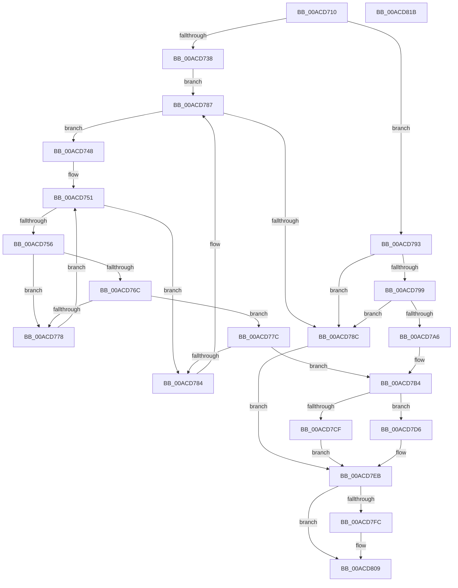

# PpmSetSimulatedLoad

- RVA: `0x00ACD710`–`0x00ACD81C` (길이 `268` bytes)
- VA: `0x0000000140ACD710`
- 실행 섹션: `PAGE`
- PDB 이름 있음: `예`; PDB Function 태그: `아니요`
- unwind 정보 RVA: `0x00060BC4`
- 디코드: `76`개 명령, `268/268` bytes 표시
- 미해석 바이트: `0` (있으면 어셈블리에 `.byte`로 보존)

> 이 문서는 커널 이미지의 기계어와 PDB 기호를 분석해 생성했습니다. 4번과 5번은 함수 원형과 자료형을 바이너리 사용 방식에서 추정한 C 해석이며 원본 소스 복구 결과는 아닙니다.

## 1. Dependencies

- 직접 호출 지점: **6**; 고유 호출 대상: **6**
- 직접 호출자로 확인된 함수: **1**
- RIP 상대 이미지 참조: **2**

### Outgoing calls
- `0x00ACD72B` → [PpmAcquireLock](../../text/2D/PpmAcquireLock_function_002D9AA4.md) (function, `0x002D9AA4`)
- `0x00ACD79C` → [KeGetProcessorIndexFromNumber](../../text/2D/KeGetProcessorIndexFromNumber_function_002DD2D0.md) (function, `0x002DD2D0`)
- `0x00ACD7A8` → [KeGetPrcb](../../text/2D/KeGetPrcb_function_002D85D0.md) (function, `0x002D85D0`)
- `0x00ACD7C2` → [ExAllocatePool2](../../poolcode/B8/ExAllocatePool2_function_00B820F0.md) (function, `0x00B820F0`)
- `0x00ACD7F2` → [PpmReleaseLock](../../text/2D/PpmReleaseLock_function_002DA428.md) (function, `0x002DA428`)
- `0x00ACD804` → [ExFreePoolWithTag](../../poolcode/B8/ExFreePoolWithTag_function_00B82870.md) (function, `0x00B82870`)

### Direct callers
- [NtPowerInformation](../95/NtPowerInformation_function_00955D80.md) at `0x00956C44`

### Static image references
- `0x00ACD724` → RVA `0x00F0CC00` (`.data`; read)
- `0x00ACD738` → RVA `0x00FC6BA8` (`ALMOSTRO`; read)

## 2. Other-region calls and transfers

- 다른 실행 섹션으로 향하는 call: **6**
  - `0x00ACD72B` → [PpmAcquireLock](../../text/2D/PpmAcquireLock_function_002D9AA4.md) (`PAGE` → `.text`)
  - `0x00ACD79C` → [KeGetProcessorIndexFromNumber](../../text/2D/KeGetProcessorIndexFromNumber_function_002DD2D0.md) (`PAGE` → `.text`)
  - `0x00ACD7A8` → [KeGetPrcb](../../text/2D/KeGetPrcb_function_002D85D0.md) (`PAGE` → `.text`)
  - `0x00ACD7C2` → [ExAllocatePool2](../../poolcode/B8/ExAllocatePool2_function_00B820F0.md) (`PAGE` → `POOLCODE`)
  - `0x00ACD7F2` → [PpmReleaseLock](../../text/2D/PpmReleaseLock_function_002DA428.md) (`PAGE` → `.text`)
  - `0x00ACD804` → [ExFreePoolWithTag](../../poolcode/B8/ExFreePoolWithTag_function_00B82870.md) (`PAGE` → `POOLCODE`)
- 별도 외부 분기/꼬리 이동을 확인하지 못했습니다.

## 3. Assembly (complete function range)

```asm
00ACD710  48 89 5C 24 08                  mov qword ptr [rsp + 8], rbx
00ACD715  48 89 74 24 10                  mov qword ptr [rsp + 0x10], rsi
00ACD71A  57                              push rdi
00ACD71B  48 83 EC 20                     sub rsp, 0x20
00ACD71F  48 8B F9                        mov rdi, rcx
00ACD722  33 F6                           xor esi, esi
00ACD724  48 8D 0D D5 F4 43 00            lea rcx, [rip + 0x43f4d5]
00ACD72B  E8 74 C3 80 FF                  call 0x1402d9aa4
00ACD730  44 8B 07                        mov r8d, dword ptr [rdi]
00ACD733  45 85 C0                        test r8d, r8d
00ACD736  79 5B                           jns 0x140acd793
00ACD738  48 8B 15 69 94 4F 00            mov rdx, qword ptr [rip + 0x4f9469]
00ACD73F  4C 8D 15 62 94 4F 00            lea r10, [rip + 0x4f9462]
00ACD746  EB 3F                           jmp 0x140acd787
00ACD748  44 8B 8A 28 01 00 00            mov r9d, dword ptr [rdx + 0x128]
00ACD74F  33 C9                           xor ecx, ecx
00ACD751  41 3B C9                        cmp ecx, r9d
00ACD754  73 2E                           jae 0x140acd784
00ACD756  8B C1                           mov eax, ecx
00ACD758  48 69 D8 A8 04 00 00            imul rbx, rax, 0x4a8
00ACD75F  48 03 9A 38 01 00 00            add rbx, qword ptr [rdx + 0x138]
00ACD766  83 7B 10 01                     cmp dword ptr [rbx + 0x10], 1
00ACD76A  75 0C                           jne 0x140acd778
00ACD76C  41 8B C0                        mov eax, r8d
00ACD76F  0F BA F0 1F                     btr eax, 0x1f
00ACD773  39 43 14                        cmp dword ptr [rbx + 0x14], eax
00ACD776  74 04                           je 0x140acd77c
00ACD778  FF C1                           inc ecx
00ACD77A  EB D5                           jmp 0x140acd751
00ACD77C  48 8B 1B                        mov rbx, qword ptr [rbx]
00ACD77F  48 85 DB                        test rbx, rbx
00ACD782  75 30                           jne 0x140acd7b4
00ACD784  48 8B 12                        mov rdx, qword ptr [rdx]
00ACD787  49 3B D2                        cmp rdx, r10
00ACD78A  75 BC                           jne 0x140acd748
00ACD78C  BB 0D 00 00 C0                  mov ebx, 0xc000000d
00ACD791  EB 58                           jmp 0x140acd7eb
00ACD793  40 38 77 03                     cmp byte ptr [rdi + 3], sil
00ACD797  75 F3                           jne 0x140acd78c
00ACD799  48 8B CF                        mov rcx, rdi
00ACD79C  E8 2F FB 80 FF                  call 0x1402dd2d0
00ACD7A1  83 F8 FF                        cmp eax, -1
00ACD7A4  74 E6                           je 0x140acd78c
00ACD7A6  8B C8                           mov ecx, eax
00ACD7A8  E8 23 AE 80 FF                  call 0x1402d85d0
00ACD7AD  48 8D 98 B0 89 00 00            lea rbx, [rax + 0x89b0]
00ACD7B4  BA 02 00 00 00                  mov edx, 2
00ACD7B9  41 B8 50 50 4D 70               mov r8d, 0x704d5050
00ACD7BF  8D 4A 3E                        lea ecx, [rdx + 0x3e]
00ACD7C2  E8 29 49 0B 00                  call 0x140b820f0
00ACD7C7  48 8B C8                        mov rcx, rax
00ACD7CA  48 85 C0                        test rax, rax
00ACD7CD  75 07                           jne 0x140acd7d6
00ACD7CF  BB 9A 00 00 C0                  mov ebx, 0xc000009a
00ACD7D4  EB 15                           jmp 0x140acd7eb
00ACD7D6  8A 47 04                        mov al, byte ptr [rdi + 4]
00ACD7D9  88 01                           mov byte ptr [rcx], al
00ACD7DB  8A 47 05                        mov al, byte ptr [rdi + 5]
00ACD7DE  88 41 01                        mov byte ptr [rcx + 1], al
00ACD7E1  48 8B 73 18                     mov rsi, qword ptr [rbx + 0x18]
00ACD7E5  48 89 4B 18                     mov qword ptr [rbx + 0x18], rcx
00ACD7E9  33 DB                           xor ebx, ebx
00ACD7EB  48 8D 0D 0E F4 43 00            lea rcx, [rip + 0x43f40e]
00ACD7F2  E8 31 CC 80 FF                  call 0x1402da428
00ACD7F7  48 85 F6                        test rsi, rsi
00ACD7FA  74 0D                           je 0x140acd809
00ACD7FC  BA 50 50 4D 70                  mov edx, 0x704d5050
00ACD801  48 8B CE                        mov rcx, rsi
00ACD804  E8 67 50 0B 00                  call 0x140b82870
00ACD809  48 8B 74 24 38                  mov rsi, qword ptr [rsp + 0x38]
00ACD80E  8B C3                           mov eax, ebx
00ACD810  48 8B 5C 24 30                  mov rbx, qword ptr [rsp + 0x30]
00ACD815  48 83 C4 20                     add rsp, 0x20
00ACD819  5F                              pop rdi
00ACD81A  C3                              ret
00ACD81B  CC                              int3
```

## 4. C-style interpretation (structured pseudocode)

```c
__int64 __fastcall PpmSetSimulatedLoad(__int64 a1)
{
    __int64 result;
    __int64 v_rbx;
    __int64 v_rsi;
    __int64 v_rsp;
    unsigned __int64 v_stack_p10;
    unsigned __int64 v_stack_p8;

    v_stack_p8 = v_rbx;
    v_stack_p10 = v_rsi;
    v_rsp = (v_rsp) - (32);
    v_rsi = 0;
    result = PpmAcquireLock(v_rip + 4453589, a2, a3, a4);
    if (!sign_flag) goto loc_00ACD793;
    goto loc_00ACD787;
loc_00ACD748:
    a1 = 0;
loc_00ACD751:
    if (0 >= ((unsigned int)((unsigned int)(*(unsigned int *)(*(unsigned __int64 *)(v_rip + 5215337) + 296))))) goto loc_00ACD784;
    v_rbx = (v_rbx) * (0);
    v_rbx = (v_rbx) + (*(unsigned __int64 *)(*(unsigned __int64 *)(v_rip + 5215337) + 312));
    if ((*(unsigned int *)(v_rbx + 16)) != 1) goto loc_00ACD778;
    if ((*(unsigned int *)(v_rbx + 20)) == ((unsigned int)((unsigned int)((unsigned int)((unsigned int)(*(unsigned int *)(a1))))))) goto loc_00ACD77C;
loc_00ACD778:
    a1 = (unsigned int)((a1) + 1);
    goto loc_00ACD751;
loc_00ACD77C:
    if (*(unsigned __int64 *)(v_rbx) != 0) goto loc_00ACD7B4;
loc_00ACD784:
loc_00ACD787:
    if ((*(unsigned __int64 *)(*(unsigned __int64 *)(v_rip + 5215337))) != (v_rip + 5215330)) goto loc_00ACD748;
loc_00ACD78C:
    goto loc_00ACD7EB;
loc_00ACD793:
    if ((*(unsigned __int8 *)(a1 + 3)) != 0) goto loc_00ACD78C;
    result = KeGetProcessorIndexFromNumber(a1, *(unsigned __int64 *)(*(unsigned __int64 *)(v_rip + 5215337)), (unsigned int)(*(unsigned int *)(a1)), (unsigned int)(*(unsigned int *)(*(unsigned __int64 *)(v_rip + 5215337) + 296)));
    if (((unsigned int)(result)) == -1) goto loc_00ACD78C;
    result = KeGetPrcb((unsigned int)((unsigned int)(result)), *(unsigned __int64 *)(*(unsigned __int64 *)(v_rip + 5215337)), (unsigned int)(*(unsigned int *)(a1)), (unsigned int)(*(unsigned int *)(*(unsigned __int64 *)(v_rip + 5215337) + 296)));
loc_00ACD7B4:
    result = ExAllocatePool2(2 + 62, 2, (unsigned int)(0x704D5050ULL), (unsigned int)(*(unsigned int *)(*(unsigned __int64 *)(v_rip + 5215337) + 296)));
    if (result != 0) goto loc_00ACD7D6;
    goto loc_00ACD7EB;
loc_00ACD7D6:
    *(unsigned __int8 *)(result) = (unsigned __int8)(*(unsigned __int8 *)(a1 + 4));
    *(unsigned __int8 *)(result + 1) = (unsigned __int8)(*(unsigned __int8 *)(a1 + 5));
    *(unsigned __int64 *)((unsigned int)(0xC000009AULL) + 24) = result;
    v_rbx = 0;
loc_00ACD7EB:
    result = PpmReleaseLock(v_rip + 4453390, 2, (unsigned int)(0x704D5050ULL), (unsigned int)(*(unsigned int *)(*(unsigned __int64 *)(v_rip + 5215337) + 296)));
    if (*(unsigned __int64 *)((unsigned int)(0xC000009AULL) + 24) != 0) {
        a2 = 0x704D5050ULL;
        a1 = *(unsigned __int64 *)((unsigned int)(0xC000009AULL) + 24);
        result = ExFreePoolWithTag(a1, a2, (unsigned int)(0x704D5050ULL), (unsigned int)(*(unsigned int *)(*(unsigned __int64 *)(v_rip + 5215337) + 296)));
    }
    v_rsp = (v_rsp) + (32);
    return 0;
}
```

## 5. (Beta) C Style

```c
int64_t PpmSetSimulatedLoad(void *Arg1)
{
    uint8_t *arg1 = (uint8_t *)Arg1;

    int64_t result;
    int64_t local_rbx;
    int64_t local_rsi;
    int64_t local_rsp;
    uint64_t v_stack_p10;
    uint64_t v_stack_p8;

    v_stack_p8 = local_rbx;
    v_stack_p10 = local_rsi;
    local_rsp = (local_rsp) - (32);
    local_rsi = 0;
    result = PpmAcquireLock(v_rip + 4453589, a2, a3, a4);
    if (!sign_flag) goto loc_00ACD793;
    goto loc_00ACD787;
loc_00ACD748:
    Arg1 = 0;
loc_00ACD751:
    if (0 >= ((uint32_t)((uint32_t)(*(uint32_t *)(*(uint64_t *)(v_rip + 0x4F9469) + 0x128))))) goto loc_00ACD784;
    local_rbx = (local_rbx) * (0);
    local_rbx = (local_rbx) + (*(uint64_t *)(*(uint64_t *)(v_rip + 0x4F9469) + 0x138));
    if ((*(uint32_t *)(local_rbx + 0x10)) != 1) goto loc_00ACD778;
    if ((*(uint32_t *)(local_rbx + 0x14)) == ((uint32_t)((uint32_t)((uint32_t)((uint32_t)(*(uint32_t *)(arg1))))))) goto loc_00ACD77C;
loc_00ACD778:
    Arg1 = (uint32_t)((Arg1) + 1);
    goto loc_00ACD751;
loc_00ACD77C:
    if (*(uint64_t *)(local_rbx) != 0) goto loc_00ACD7B4;
loc_00ACD784:
loc_00ACD787:
    if ((*(uint64_t *)(*(uint64_t *)(v_rip + 0x4F9469))) != (v_rip + 5215330)) goto loc_00ACD748;
loc_00ACD78C:
    goto loc_00ACD7EB;
loc_00ACD793:
    if ((*(uint8_t *)(arg1 + 0x3)) != 0) goto loc_00ACD78C;
    result = KeGetProcessorIndexFromNumber(Arg1, *(uint64_t *)(*(uint64_t *)(v_rip + 0x4F9469)), (uint32_t)(*(uint32_t *)(arg1)), (uint32_t)(*(uint32_t *)(*(uint64_t *)(v_rip + 0x4F9469) + 0x128)));
    if (((uint32_t)(result)) == -1) goto loc_00ACD78C;
    result = KeGetPrcb((uint32_t)((uint32_t)(result)), *(uint64_t *)(*(uint64_t *)(v_rip + 0x4F9469)), (uint32_t)(*(uint32_t *)(arg1)), (uint32_t)(*(uint32_t *)(*(uint64_t *)(v_rip + 0x4F9469) + 0x128)));
loc_00ACD7B4:
    result = ExAllocatePool2(2 + 62, 2, (uint32_t)(0x704D5050ULL), (uint32_t)(*(uint32_t *)(*(uint64_t *)(v_rip + 0x4F9469) + 0x128)));
    if (result != 0) goto loc_00ACD7D6;
    goto loc_00ACD7EB;
loc_00ACD7D6:
    *(uint8_t *)(result) = (uint8_t)(*(uint8_t *)(arg1 + 0x4));
    *(uint8_t *)(result + 0x1) = (uint8_t)(*(uint8_t *)(arg1 + 0x5));
    *(uint64_t *)((uint32_t)(0xC000009AULL) + 0x18) = result;
    local_rbx = 0;
loc_00ACD7EB:
    result = PpmReleaseLock(v_rip + 4453390, 2, (uint32_t)(0x704D5050ULL), (uint32_t)(*(uint32_t *)(*(uint64_t *)(v_rip + 0x4F9469) + 0x128)));
    if (*(uint64_t *)((uint32_t)(0xC000009AULL) + 0x18) != 0) {
        a2 = 0x704D5050ULL;
        Arg1 = *(uint64_t *)((uint32_t)(0xC000009AULL) + 0x18);
        result = ExFreePoolWithTag(Arg1, a2, (uint32_t)(0x704D5050ULL), (uint32_t)(*(uint32_t *)(*(uint64_t *)(v_rip + 0x4F9469) + 0x128)));
    }
    local_rsp = (local_rsp) + (32);
    return 0;
}
```

### 관측된 메모리 오프셋

구조체 형식이 확인되지 않은 접근은 인자 기준의 오프셋으로만 기록했습니다.

| 기준 인자 | 오프셋 표현 | 폭 (bit) | 접근 |
|---|---:|---:|---|
| `Arg1` | `+ 0x0` | `32` | `R` |
| `Arg1` | `+ 0x3` | `8` | `R` |
| `Arg1` | `+ 0x4` | `8` | `R` |
| `Arg1` | `+ 0x5` | `8` | `R` |

## 6. Execution-region graph

[열기: 2D/3D 그래프와 함수 탐색 컨트롤 패널](../../../control-panel.html?section=page&rva=0x00ACD710&view=graph)

- 2D 그래프는 위에서 아래로 흐르고, 3D 그래프는 빈 공간을 드래그해 회전합니다. Shift+드래그는 이동, 휠은 확대·축소, 함수 노드 선택은 대상 보고서 이동입니다.

### Static fallback


