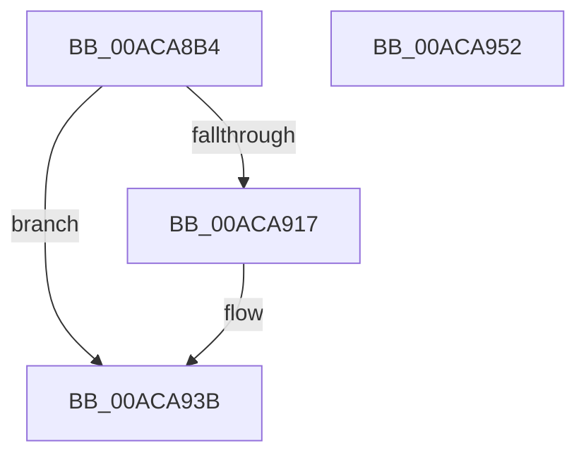

# PsIumGetOnDemandDebugChallenge

- RVA: `0x00ACA8B4`–`0x00ACA953` (길이 `159` bytes)
- VA: `0x0000000140ACA8B4`
- 실행 섹션: `PAGE`
- PDB 이름 있음: `예`; PDB Function 태그: `아니요`
- unwind 정보 RVA: `0x0006F874`
- 디코드: `40`개 명령, `159/159` bytes 표시
- 미해석 바이트: `0` (있으면 어셈블리에 `.byte`로 보존)

> 이 문서는 커널 이미지의 기계어와 PDB 기호를 분석해 생성했습니다. 4번과 5번은 함수 원형과 자료형을 바이너리 사용 방식에서 추정한 C 해석이며 원본 소스 복구 결과는 아닙니다.

## 1. Dependencies

- 직접 호출 지점: **3**; 고유 호출 대상: **3**
- 직접 호출자로 확인된 함수: **1**
- RIP 상대 이미지 참조: **1**

### Outgoing calls
- `0x00ACA90C` → [ObpReferenceObjectByHandleWithTag](../86/ObpReferenceObjectByHandleWithTag_function_00869650.md) (function, `0x00869650`)
- `0x00ACA925` → [VslGetOnDemandDebugChallenge](../71/VslGetOnDemandDebugChallenge_function_00718B58.md) (function, `0x00718B58`)
- `0x00ACA936` → [ObfDereferenceObjectWithTag](../../text/2F/ObfDereferenceObjectWithTag_function_002F78E0.md) (function, `0x002F78E0`)

### Direct callers
- [NtQueryInformationProcess](../9A/NtQueryInformationProcess_function_009AA250.md) at `0x009AE1A6`

### Static image references
- `0x00ACA8E4` → RVA `0x00FC6A98` (`ALMOSTRO`; read)

## 2. Other-region calls and transfers

- 다른 실행 섹션으로 향하는 call: **1**
  - `0x00ACA936` → [ObfDereferenceObjectWithTag](../../text/2F/ObfDereferenceObjectWithTag_function_002F78E0.md) (`PAGE` → `.text`)
- 별도 외부 분기/꼬리 이동을 확인하지 못했습니다.

## 3. Assembly (complete function range)

```asm
00ACA8B4  4C 8B DC                        mov r11, rsp
00ACA8B7  49 89 5B 08                     mov qword ptr [r11 + 8], rbx
00ACA8BB  49 89 6B 10                     mov qword ptr [r11 + 0x10], rbp
00ACA8BF  49 89 73 18                     mov qword ptr [r11 + 0x18], rsi
00ACA8C3  57                              push rdi
00ACA8C4  48 83 EC 50                     sub rsp, 0x50
00ACA8C8  65 48 8B 04 25 88 01 00 00      mov rax, qword ptr gs:[0x188]
00ACA8D1  49 8B F9                        mov rdi, r9
00ACA8D4  49 83 63 E0 00                  and qword ptr [r11 - 0x20], 0
00ACA8D9  41 8B F0                        mov esi, r8d
00ACA8DC  49 83 63 D8 00                  and qword ptr [r11 - 0x28], 0
00ACA8E1  48 8B EA                        mov rbp, rdx
00ACA8E4  4C 8B 05 AD C1 4F 00            mov r8, qword ptr [rip + 0x4fc1ad]
00ACA8EB  BA 00 10 00 00                  mov edx, 0x1000
00ACA8F0  44 8A 88 32 02 00 00            mov r9b, byte ptr [rax + 0x232]
00ACA8F7  49 8D 43 E8                     lea rax, [r11 - 0x18]
00ACA8FB  49 83 63 E8 00                  and qword ptr [r11 - 0x18], 0
00ACA900  49 89 43 D0                     mov qword ptr [r11 - 0x30], rax
00ACA904  C7 44 24 20 50 73 51 79         mov dword ptr [rsp + 0x20], 0x79517350
00ACA90C  E8 3F ED D9 FF                  call 0x140869650
00ACA911  8B D8                           mov ebx, eax
00ACA913  85 C0                           test eax, eax
00ACA915  78 24                           js 0x140aca93b
00ACA917  48 8B 4C 24 40                  mov rcx, qword ptr [rsp + 0x40]
00ACA91C  4C 8B CF                        mov r9, rdi
00ACA91F  44 8B C6                        mov r8d, esi
00ACA922  48 8B D5                        mov rdx, rbp
00ACA925  E8 2E E2 C4 FF                  call 0x140718b58
00ACA92A  48 8B 4C 24 40                  mov rcx, qword ptr [rsp + 0x40]
00ACA92F  BA 50 73 51 79                  mov edx, 0x79517350
00ACA934  8B D8                           mov ebx, eax
00ACA936  E8 A5 CF 82 FF                  call 0x1402f78e0
00ACA93B  48 8B 6C 24 68                  mov rbp, qword ptr [rsp + 0x68]
00ACA940  8B C3                           mov eax, ebx
00ACA942  48 8B 5C 24 60                  mov rbx, qword ptr [rsp + 0x60]
00ACA947  48 8B 74 24 70                  mov rsi, qword ptr [rsp + 0x70]
00ACA94C  48 83 C4 50                     add rsp, 0x50
00ACA950  5F                              pop rdi
00ACA951  C3                              ret
00ACA952  CC                              int3
```

## 4. C-style interpretation (structured pseudocode)

```c
__int64 __fastcall PsIumGetOnDemandDebugChallenge(__int64 a1, __int64 a2, int a3, __int64 a4)
{
    __int64 result;
    __int64 v_rbx;
    __int64 v_rsp;
    unsigned __int64 v_stack_m18;
    unsigned int v_stack_m38;
    unsigned __int64 v_stack_p10;
    unsigned __int64 v_stack_p18;
    unsigned __int64 v_stack_p8;

    *(unsigned __int64 *)(v_rsp + 8) = v_rbx;
    *(unsigned __int64 *)(v_rsp + 16) = v_rbp;
    *(unsigned __int64 *)(v_rsp + 24) = v_rsi;
    v_rsp = (v_rsp) - (80);
    *(unsigned __int64 *)(v_rsp - 48) = v_rsp - 24;
    v_stack_m38 = 0x79517350ULL;
    result = ObpReferenceObjectByHandleWithTag(a1, (unsigned int)(0x1000ULL), *(unsigned __int64 *)(v_rip + 5226925), *(unsigned __int8 *)(*(unsigned __int64 *)(gs_base + (0 + 392)) + 562));
    v_rbx = (unsigned int)((unsigned int)(result));
    if (!(sign_flag)) {
        a1 = v_stack_m18;
        a4 = a4;
        a3 = (unsigned int)((unsigned int)(a3));
        a2 = a2;
        result = VslGetOnDemandDebugChallenge(a1, a2, a3, a4);
        a1 = v_stack_m18;
        a2 = 0x79517350ULL;
        v_rbx = (unsigned int)(result);
        result = ObfDereferenceObjectWithTag(a1, a2, a3, a4);
    }
    v_rsp = (v_rsp) + (80);
    return (unsigned int)((unsigned int)(v_rbx));
}
```

## 5. (Beta) C Style

```c
int64_t PsIumGetOnDemandDebugChallenge(int64_t Arg1, int64_t Arg2, int32_t Arg3, int64_t Arg4)
{
    int64_t result;
    int64_t local_rbx;
    int64_t local_rsp;
    uint64_t v_stack_m18;
    uint32_t v_stack_m38;
    uint64_t v_stack_p10;
    uint64_t v_stack_p18;
    uint64_t v_stack_p8;

    *(uint64_t *)(local_rsp + 0x8) = local_rbx;
    *(uint64_t *)(local_rsp + 0x10) = local_rbp;
    *(uint64_t *)(local_rsp + 0x18) = local_rsi;
    local_rsp = (local_rsp) - (80);
    *(uint64_t *)(local_rsp - 0x30) = local_rsp - 24;
    v_stack_m38 = 0x79517350ULL;
    result = ObpReferenceObjectByHandleWithTag(Arg1, (uint32_t)(0x1000ULL), *(uint64_t *)(v_rip + 0x4FC1AD), *(uint8_t *)(*(uint64_t *)(gs_base + (0 + 0x188)) + 0x232));
    local_rbx = (uint32_t)((uint32_t)(result));
    if (!(sign_flag)) {
        Arg1 = v_stack_m18;
        Arg4 = Arg4;
        Arg3 = (uint32_t)((uint32_t)(Arg3));
        Arg2 = Arg2;
        result = VslGetOnDemandDebugChallenge(Arg1, Arg2, Arg3, Arg4);
        Arg1 = v_stack_m18;
        Arg2 = 0x79517350ULL;
        local_rbx = (uint32_t)(result);
        result = ObfDereferenceObjectWithTag(Arg1, Arg2, Arg3, Arg4);
    }
    local_rsp = (local_rsp) + (80);
    return (uint32_t)((uint32_t)(local_rbx));
}
```

## 6. Execution-region graph

[열기: 2D/3D 그래프와 함수 탐색 컨트롤 패널](../../../control-panel.html?section=page&rva=0x00ACA8B4&view=graph)

- 2D 그래프는 위에서 아래로 흐르고, 3D 그래프는 빈 공간을 드래그해 회전합니다. Shift+드래그는 이동, 휠은 확대·축소, 함수 노드 선택은 대상 보고서 이동입니다.

### Static fallback


