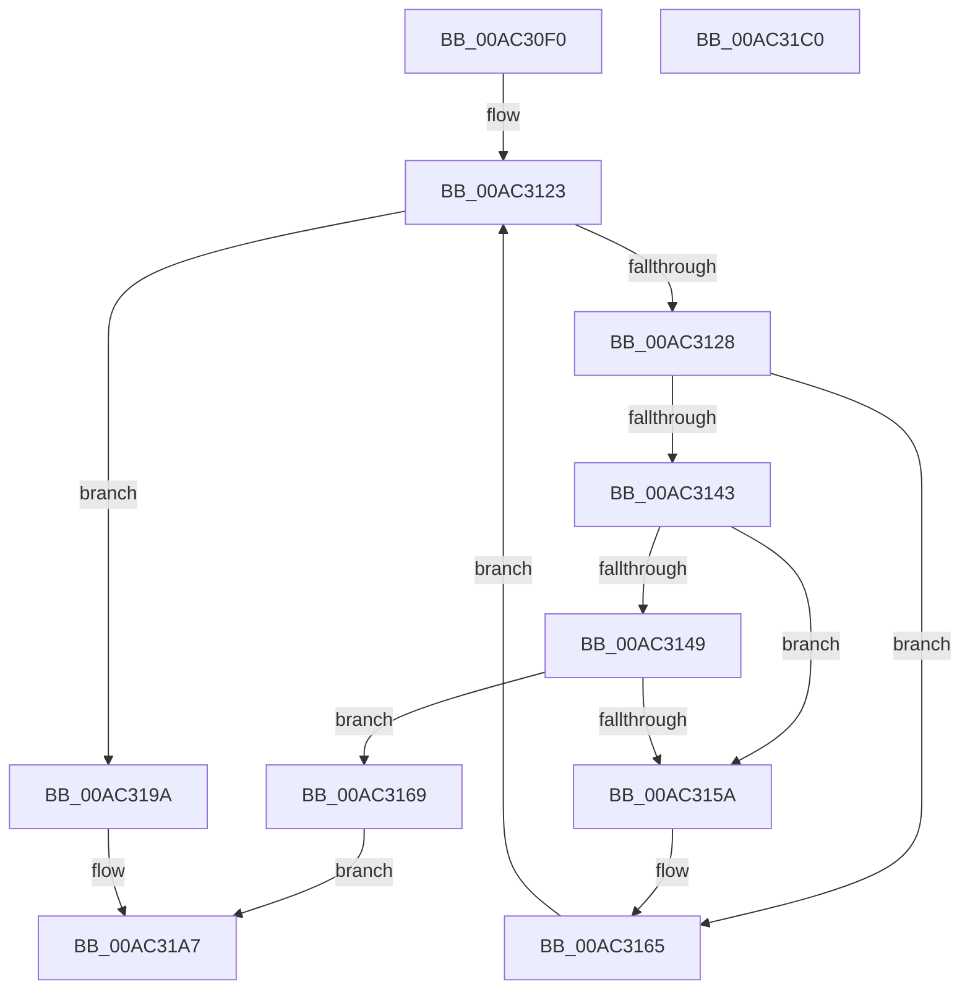

# PsRemoveLoadImageNotifyRoutine

- RVA: `0x00AC30F0`–`0x00AC31C1` (길이 `209` bytes)
- VA: `0x0000000140AC30F0`
- 실행 섹션: `PAGE`
- PDB 이름 있음: `예`; PDB Function 태그: `아니요`
- unwind 정보 RVA: `0x00060300`
- 디코드: `60`개 명령, `209/209` bytes 표시
- 미해석 바이트: `0` (있으면 어셈블리에 `.byte`로 보존)

> 이 문서는 커널 이미지의 기계어와 PDB 기호를 분석해 생성했습니다. 4번과 5번은 함수 원형과 자료형을 바이너리 사용 방식에서 추정한 C 해석이며 원본 소스 복구 결과는 아닙니다.

## 1. Dependencies

- 직접 호출 지점: **8**; 고유 호출 대상: **6**
- 직접 호출자로 확인된 함수: **1**
- RIP 상대 이미지 참조: **2**

### Outgoing calls
- `0x00AC3136` → [ExReferenceCallBackBlock](../../text/2F/ExReferenceCallBackBlock_function_002F0040.md) (function, `0x002F0040`)
- `0x00AC3151` → [ExCompareExchangeCallBack](../../text/41/ExCompareExchangeCallBack_function_0041BCD0.md) (function, `0x0041BCD0`)
- `0x00AC3160` → [ExDereferenceCallBackBlock](../../text/44/ExDereferenceCallBackBlock_function_0044D730.md) (function, `0x0044D730`)
- `0x00AC3177` → [ExDereferenceCallBackBlock](../../text/44/ExDereferenceCallBackBlock_function_0044D730.md) (function, `0x0044D730`)
- `0x00AC317F` → [KiLeaveCriticalRegionUnsafe](../../text/25/KiLeaveCriticalRegionUnsafe_function_0025F010.md) (function, `0x0025F010`)
- `0x00AC3187` → [ExWaitForRundownProtectionRelease](../../text/2A/ExWaitForRundownProtectionRelease_function_002A4CB0.md) (function, `0x002A4CB0`)
- `0x00AC3191` → [ExFreePoolWithTag](../../poolcode/B8/ExFreePoolWithTag_function_00B82870.md) (function, `0x00B82870`)
- `0x00AC319D` → [KiLeaveCriticalRegionUnsafe](../../text/25/KiLeaveCriticalRegionUnsafe_function_0025F010.md) (function, `0x0025F010`)

### Direct callers
- [EtwpCoverageSamplerStop](../7C/EtwpCoverageSamplerStop_function_007C2564.md) at `0x007C26E0`

### Static image references
- `0x00AC3128` → RVA `0x00F05F20` (`.data`; read)
- `0x00AC3169` → RVA `0x00FD9E1C` (`PAGEDATA`; read/write)

## 2. Other-region calls and transfers

- 다른 실행 섹션으로 향하는 call: **8**
  - `0x00AC3136` → [ExReferenceCallBackBlock](../../text/2F/ExReferenceCallBackBlock_function_002F0040.md) (`PAGE` → `.text`)
  - `0x00AC3151` → [ExCompareExchangeCallBack](../../text/41/ExCompareExchangeCallBack_function_0041BCD0.md) (`PAGE` → `.text`)
  - `0x00AC3160` → [ExDereferenceCallBackBlock](../../text/44/ExDereferenceCallBackBlock_function_0044D730.md) (`PAGE` → `.text`)
  - `0x00AC3177` → [ExDereferenceCallBackBlock](../../text/44/ExDereferenceCallBackBlock_function_0044D730.md) (`PAGE` → `.text`)
  - `0x00AC317F` → [KiLeaveCriticalRegionUnsafe](../../text/25/KiLeaveCriticalRegionUnsafe_function_0025F010.md) (`PAGE` → `.text`)
  - `0x00AC3187` → [ExWaitForRundownProtectionRelease](../../text/2A/ExWaitForRundownProtectionRelease_function_002A4CB0.md) (`PAGE` → `.text`)
  - `0x00AC3191` → [ExFreePoolWithTag](../../poolcode/B8/ExFreePoolWithTag_function_00B82870.md) (`PAGE` → `POOLCODE`)
  - `0x00AC319D` → [KiLeaveCriticalRegionUnsafe](../../text/25/KiLeaveCriticalRegionUnsafe_function_0025F010.md) (`PAGE` → `.text`)
- 별도 외부 분기/꼬리 이동을 확인하지 못했습니다.

## 3. Assembly (complete function range)

```asm
00AC30F0  48 89 5C 24 08                  mov qword ptr [rsp + 8], rbx
00AC30F5  48 89 6C 24 10                  mov qword ptr [rsp + 0x10], rbp
00AC30FA  48 89 74 24 18                  mov qword ptr [rsp + 0x18], rsi
00AC30FF  57                              push rdi
00AC3100  41 56                           push r14
00AC3102  41 57                           push r15
00AC3104  48 83 EC 20                     sub rsp, 0x20
00AC3108  65 48 8B 34 25 88 01 00 00      mov rsi, qword ptr gs:[0x188]
00AC3111  41 83 CF FF                     or r15d, 0xffffffff
00AC3115  4C 8B F1                        mov r14, rcx
00AC3118  66 44 01 BE E4 01 00 00         add word ptr [rsi + 0x1e4], r15w
00AC3120  90                              nop
00AC3121  33 FF                           xor edi, edi
00AC3123  83 FF 40                        cmp edi, 0x40
00AC3126  73 72                           jae 0x140ac319a
00AC3128  48 8D 0D F1 2D 44 00            lea rcx, [rip + 0x442df1]
00AC312F  48 8D 2C F9                     lea rbp, [rcx + rdi*8]
00AC3133  48 8B CD                        mov rcx, rbp
00AC3136  E8 05 CF 82 FF                  call 0x1402f0040
00AC313B  48 8B D8                        mov rbx, rax
00AC313E  48 85 C0                        test rax, rax
00AC3141  74 22                           je 0x140ac3165
00AC3143  4C 39 70 08                     cmp qword ptr [rax + 8], r14
00AC3147  75 11                           jne 0x140ac315a
00AC3149  4C 8B C0                        mov r8, rax
00AC314C  33 D2                           xor edx, edx
00AC314E  48 8B CD                        mov rcx, rbp
00AC3151  E8 7A 8B 95 FF                  call 0x14041bcd0
00AC3156  84 C0                           test al, al
00AC3158  75 0F                           jne 0x140ac3169
00AC315A  48 8B D3                        mov rdx, rbx
00AC315D  48 8B CD                        mov rcx, rbp
00AC3160  E8 CB A5 98 FF                  call 0x14044d730
00AC3165  FF C7                           inc edi
00AC3167  EB BA                           jmp 0x140ac3123
00AC3169  F0 44 01 3D AB 6C 51 00         lock add dword ptr [rip + 0x516cab], r15d
00AC3171  48 8B D3                        mov rdx, rbx
00AC3174  48 8B CD                        mov rcx, rbp
00AC3177  E8 B4 A5 98 FF                  call 0x14044d730
00AC317C  48 8B CE                        mov rcx, rsi
00AC317F  E8 8C BE 79 FF                  call 0x14025f010
00AC3184  48 8B CB                        mov rcx, rbx
00AC3187  E8 24 1B 7E FF                  call 0x1402a4cb0
00AC318C  33 D2                           xor edx, edx
00AC318E  48 8B CB                        mov rcx, rbx
00AC3191  E8 DA F6 0B 00                  call 0x140b82870
00AC3196  33 C0                           xor eax, eax
00AC3198  EB 0D                           jmp 0x140ac31a7
00AC319A  48 8B CE                        mov rcx, rsi
00AC319D  E8 6E BE 79 FF                  call 0x14025f010
00AC31A2  B8 7A 00 00 C0                  mov eax, 0xc000007a
00AC31A7  48 8B 5C 24 40                  mov rbx, qword ptr [rsp + 0x40]
00AC31AC  48 8B 6C 24 48                  mov rbp, qword ptr [rsp + 0x48]
00AC31B1  48 8B 74 24 50                  mov rsi, qword ptr [rsp + 0x50]
00AC31B6  48 83 C4 20                     add rsp, 0x20
00AC31BA  41 5F                           pop r15
00AC31BC  41 5E                           pop r14
00AC31BE  5F                              pop rdi
00AC31BF  C3                              ret
00AC31C0  CC                              int3
```

## 4. C-style interpretation (structured pseudocode)

```c
__int64 __fastcall PsRemoveLoadImageNotifyRoutine(__int64 a1, int a2)
{
    __int64 result;
    __int64 v_r15;
    __int64 v_rdi;
    __int64 v_rsp;
    unsigned __int64 v_stack_p10;
    unsigned __int64 v_stack_p18;
    unsigned __int64 v_stack_p8;

    v_stack_p8 = v_rbx;
    v_stack_p10 = v_rbp;
    v_stack_p18 = v_rsi;
    v_rsp = (v_rsp) - (32);
    v_r15 = (unsigned int)((v_r15) | (0xFFFFFFFFULL));
    v_rdi = 0;
loc_00AC3123:
    if (0 >= 64) goto loc_00AC319A;
    result = ExReferenceCallBackBlock(v_rip + 4468209 + v_rdi * 8, a2, a3, a4);
    if (result == 0) goto loc_00AC3165;
    if ((*(unsigned __int64 *)(result + 8)) != a1) goto loc_00AC315A;
    a2 = 0;
    result = ExCompareExchangeCallBack(v_rip + 4468209 + v_rdi * 8, a2, result, a4);
    if ((unsigned __int8)(result) != 0) goto loc_00AC3169;
loc_00AC315A:
    result = ExDereferenceCallBackBlock(v_rip + 4468209 + v_rdi * 8, result, result, a4);
loc_00AC3165:
    v_rdi = (unsigned int)((v_rdi) + 1);
    goto loc_00AC3123;
loc_00AC3169:
    result = ExDereferenceCallBackBlock(v_rip + 4468209 + v_rdi * 8, result, result, a4);
    result = KiLeaveCriticalRegionUnsafe(*(unsigned __int64 *)(gs_base + (0 + 392)), result, result, a4);
    result = ExWaitForRundownProtectionRelease(result, result, result, a4);
    a2 = 0;
    result = ExFreePoolWithTag(result, a2, result, a4);
    result = 0;
    goto loc_00AC31A7;
loc_00AC319A:
    result = KiLeaveCriticalRegionUnsafe(*(unsigned __int64 *)(gs_base + (0 + 392)), a2, result, a4);
loc_00AC31A7:
    v_rsp = (v_rsp) + (32);
    return (unsigned int)(0xC000007AULL);
}
```

## 5. (Beta) C Style

```c
int64_t PsRemoveLoadImageNotifyRoutine(int64_t Arg1, int32_t Arg2)
{
    int64_t result;
    int64_t local_r15;
    int64_t local_rdi;
    int64_t local_rsp;
    uint64_t v_stack_p10;
    uint64_t v_stack_p18;
    uint64_t v_stack_p8;

    v_stack_p8 = local_rbx;
    v_stack_p10 = local_rbp;
    v_stack_p18 = local_rsi;
    local_rsp = (local_rsp) - (32);
    local_r15 = (uint32_t)((local_r15) | (0xFFFFFFFFULL));
    local_rdi = 0;
loc_00AC3123:
    if (0 >= 64) goto loc_00AC319A;
    result = ExReferenceCallBackBlock(v_rip + 4468209 + local_rdi * 8, Arg2, a3, a4);
    if (result == 0) goto loc_00AC3165;
    if ((*(uint64_t *)(result + 0x8)) != Arg1) goto loc_00AC315A;
    Arg2 = 0;
    result = ExCompareExchangeCallBack(v_rip + 4468209 + local_rdi * 8, Arg2, result, a4);
    if ((uint8_t)(result) != 0) goto loc_00AC3169;
loc_00AC315A:
    result = ExDereferenceCallBackBlock(v_rip + 4468209 + local_rdi * 8, result, result, a4);
loc_00AC3165:
    local_rdi = (uint32_t)((local_rdi) + 1);
    goto loc_00AC3123;
loc_00AC3169:
    result = ExDereferenceCallBackBlock(v_rip + 4468209 + local_rdi * 8, result, result, a4);
    result = KiLeaveCriticalRegionUnsafe(*(uint64_t *)(gs_base + (0 + 0x188)), result, result, a4);
    result = ExWaitForRundownProtectionRelease(result, result, result, a4);
    Arg2 = 0;
    result = ExFreePoolWithTag(result, Arg2, result, a4);
    result = 0;
    goto loc_00AC31A7;
loc_00AC319A:
    result = KiLeaveCriticalRegionUnsafe(*(uint64_t *)(gs_base + (0 + 0x188)), Arg2, result, a4);
loc_00AC31A7:
    local_rsp = (local_rsp) + (32);
    return (uint32_t)(0xC000007AULL);
}
```

## 6. Execution-region graph

[열기: 2D/3D 그래프와 함수 탐색 컨트롤 패널](../../../control-panel.html?section=page&rva=0x00AC30F0&view=graph)

- 2D 그래프는 위에서 아래로 흐르고, 3D 그래프는 빈 공간을 드래그해 회전합니다. Shift+드래그는 이동, 휠은 확대·축소, 함수 노드 선택은 대상 보고서 이동입니다.

### Static fallback


