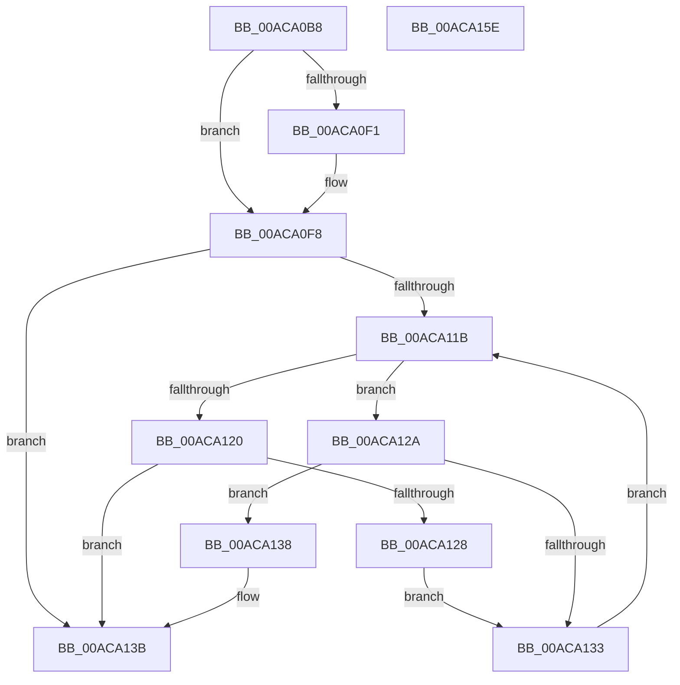

# PspMakeSessionVisible

- RVA: `0x00ACA0B8`–`0x00ACA15F` (길이 `167` bytes)
- VA: `0x0000000140ACA0B8`
- 실행 섹션: `PAGE`
- PDB 이름 있음: `예`; PDB Function 태그: `아니요`
- unwind 정보 RVA: `0x0005CAAC`
- 디코드: `46`개 명령, `167/167` bytes 표시
- 미해석 바이트: `0` (있으면 어셈블리에 `.byte`로 보존)

> 이 문서는 커널 이미지의 기계어와 PDB 기호를 분석해 생성했습니다. 4번과 5번은 함수 원형과 자료형을 바이너리 사용 방식에서 추정한 C 해석이며 원본 소스 복구 결과는 아닙니다.

## 1. Dependencies

- 직접 호출 지점: **3**; 고유 호출 대상: **3**
- 직접 호출자로 확인된 함수: **1**
- RIP 상대 이미지 참조: **4**

### Outgoing calls
- `0x00ACA0D1` → [PspLockProcessListExclusive](../../text/22/PspLockProcessListExclusive_function_0022578C.md) (function, `0x0022578C`)
- `0x00ACA146` → [RtlAvlInsertNodeEx](../../text/26/RtlAvlInsertNodeEx_function_00265790.md) (function, `0x00265790`)
- `0x00ACA14E` → [PspUnlockProcessListExclusive](../../text/2D/PspUnlockProcessListExclusive_function_002DFD18.md) (function, `0x002DFD18`)

### Direct callers
- [PsSessionCreate](../70/PsSessionCreate_function_00700438.md) at `0x0070057C`

### Static image references
- `0x00ACA0DA` → RVA `0x00F066C0` (`.data`; read)
- `0x00ACA0E1` → RVA `0x00F066C8` (`.data`; read)
- `0x00ACA105` → RVA `0x00F05D50` (`.data`; read)
- `0x00ACA10C` → RVA `0x00F066C8` (`.data`; write)

## 2. Other-region calls and transfers

- 다른 실행 섹션으로 향하는 call: **3**
  - `0x00ACA0D1` → [PspLockProcessListExclusive](../../text/22/PspLockProcessListExclusive_function_0022578C.md) (`PAGE` → `.text`)
  - `0x00ACA146` → [RtlAvlInsertNodeEx](../../text/26/RtlAvlInsertNodeEx_function_00265790.md) (`PAGE` → `.text`)
  - `0x00ACA14E` → [PspUnlockProcessListExclusive](../../text/2D/PspUnlockProcessListExclusive_function_002DFD18.md) (`PAGE` → `.text`)
- 별도 외부 분기/꼬리 이동을 확인하지 못했습니다.

## 3. Assembly (complete function range)

```asm
00ACA0B8  48 89 5C 24 08                  mov qword ptr [rsp + 8], rbx
00ACA0BD  57                              push rdi
00ACA0BE  48 83 EC 20                     sub rsp, 0x20
00ACA0C2  65 48 8B 3C 25 88 01 00 00      mov rdi, qword ptr gs:[0x188]
00ACA0CB  48 8B D9                        mov rbx, rcx
00ACA0CE  48 8B CF                        mov rcx, rdi
00ACA0D1  E8 B6 B6 75 FF                  call 0x14022578c
00ACA0D6  83 4B 04 01                     or dword ptr [rbx + 4], 1
00ACA0DA  48 8D 15 DF C5 43 00            lea rdx, [rip + 0x43c5df]
00ACA0E1  48 8B 0D E0 C5 43 00            mov rcx, qword ptr [rip + 0x43c5e0]
00ACA0E8  48 8D 43 50                     lea rax, [rbx + 0x50]
00ACA0EC  48 39 11                        cmp qword ptr [rcx], rdx
00ACA0EF  74 07                           je 0x140aca0f8
00ACA0F1  B9 03 00 00 00                  mov ecx, 3
00ACA0F6  CD 29                           int 0x29
00ACA0F8  48 89 10                        mov qword ptr [rax], rdx
00ACA0FB  45 33 C0                        xor r8d, r8d
00ACA0FE  48 89 48 08                     mov qword ptr [rax + 8], rcx
00ACA102  48 89 01                        mov qword ptr [rcx], rax
00ACA105  48 8B 15 44 BC 43 00            mov rdx, qword ptr [rip + 0x43bc44]
00ACA10C  48 89 05 B5 C5 43 00            mov qword ptr [rip + 0x43c5b5], rax
00ACA113  8B 4B 08                        mov ecx, dword ptr [rbx + 8]
00ACA116  48 85 D2                        test rdx, rdx
00ACA119  74 20                           je 0x140aca13b
00ACA11B  3B 4A A8                        cmp ecx, dword ptr [rdx - 0x58]
00ACA11E  73 0A                           jae 0x140aca12a
00ACA120  48 8B 02                        mov rax, qword ptr [rdx]
00ACA123  48 85 C0                        test rax, rax
00ACA126  74 13                           je 0x140aca13b
00ACA128  EB 09                           jmp 0x140aca133
00ACA12A  48 8B 42 08                     mov rax, qword ptr [rdx + 8]
00ACA12E  48 85 C0                        test rax, rax
00ACA131  74 05                           je 0x140aca138
00ACA133  48 8B D0                        mov rdx, rax
00ACA136  EB E3                           jmp 0x140aca11b
00ACA138  41 B0 01                        mov r8b, 1
00ACA13B  4C 8D 4B 60                     lea r9, [rbx + 0x60]
00ACA13F  48 8D 0D 0A BC 43 00            lea rcx, [rip + 0x43bc0a]
00ACA146  E8 45 B6 79 FF                  call 0x140265790
00ACA14B  48 8B CF                        mov rcx, rdi
00ACA14E  E8 C5 5B 81 FF                  call 0x1402dfd18
00ACA153  48 8B 5C 24 30                  mov rbx, qword ptr [rsp + 0x30]
00ACA158  48 83 C4 20                     add rsp, 0x20
00ACA15C  5F                              pop rdi
00ACA15D  C3                              ret
00ACA15E  CC                              int3
```

## 4. C-style interpretation (structured pseudocode)

```c
__int64 __fastcall PspMakeSessionVisible(__int64 a1, __int64 a2, int a3)
{
    __int64 result;
    __int64 v_rsp;
    unsigned __int64 v_stack_p8;

    v_stack_p8 = v_rbx;
    v_rsp = (v_rsp) - (32);
    result = PspLockProcessListExclusive(*(unsigned __int64 *)(gs_base + (0 + 392)), a2, a3, a4);
    if ((*(unsigned __int64 *)(*(unsigned __int64 *)(v_rip + 4441568))) != (v_rip + 4441567)) {
        a1 = 3;
    }
    *(unsigned __int64 *)(a1 + 80) = v_rip + 4441567;
    a3 = 0;
    *(unsigned __int64 *)(a1 + 80 + 8) = a1;
    *(unsigned __int64 *)(a1) = a1 + 80;
    *(unsigned __int64 *)(v_rip + 4441525) = a1 + 80;
    if (*(unsigned __int64 *)(v_rip + 4439108) == 0) goto loc_00ACA13B;
loc_00ACA11B:
    if (((unsigned int)((unsigned int)(*(unsigned int *)(a1 + 8)))) >= (*(unsigned int *)(*(unsigned __int64 *)(v_rip + 4439108) - 88))) goto loc_00ACA12A;
    if (*(unsigned __int64 *)(*(unsigned __int64 *)(v_rip + 4439108)) == 0) goto loc_00ACA13B;
    goto loc_00ACA133;
loc_00ACA12A:
    if (*(unsigned __int64 *)(*(unsigned __int64 *)(v_rip + 4439108) + 8) == 0) goto loc_00ACA138;
loc_00ACA133:
    goto loc_00ACA11B;
loc_00ACA138:
loc_00ACA13B:
    result = RtlAvlInsertNodeEx(v_rip + 4439050, *(unsigned __int64 *)(*(unsigned __int64 *)(v_rip + 4439108) + 8), 1, a1 + 96);
    result = PspUnlockProcessListExclusive(*(unsigned __int64 *)(gs_base + (0 + 392)), *(unsigned __int64 *)(*(unsigned __int64 *)(v_rip + 4439108) + 8), 1, a1 + 96);
    v_rsp = (v_rsp) + (32);
    return result;
}
```

## 5. (Beta) C Style

```c
int64_t PspMakeSessionVisible(void *Arg1, int64_t Arg2, int32_t Arg3)
{
    uint8_t *arg1 = (uint8_t *)Arg1;

    int64_t result;
    int64_t local_rsp;
    uint64_t v_stack_p8;

    v_stack_p8 = local_rbx;
    local_rsp = (local_rsp) - (32);
    result = PspLockProcessListExclusive(*(uint64_t *)(gs_base + (0 + 0x188)), Arg2, Arg3, a4);
    if ((*(uint64_t *)(*(uint64_t *)(v_rip + 0x43C5E0))) != (v_rip + 4441567)) {
        Arg1 = 3;
    }
    *(uint64_t *)(arg1 + 0x50) = v_rip + 4441567;
    Arg3 = 0;
    *(void **)(arg1 + 0x50 + 0x8) = Arg1;
    *(void **)(arg1) = Arg1 + 80;
    *(void **)(v_rip + 0x43C5B5) = Arg1 + 80;
    if (*(uint64_t *)(v_rip + 0x43BC44) == 0) goto loc_00ACA13B;
loc_00ACA11B:
    if (((uint32_t)((uint32_t)(*(uint32_t *)(arg1 + 0x8)))) >= (*(uint32_t *)(*(uint64_t *)(v_rip + 0x43BC44) - 0x58))) goto loc_00ACA12A;
    if (*(uint64_t *)(*(uint64_t *)(v_rip + 0x43BC44)) == 0) goto loc_00ACA13B;
    goto loc_00ACA133;
loc_00ACA12A:
    if (*(uint64_t *)(*(uint64_t *)(v_rip + 0x43BC44) + 0x8) == 0) goto loc_00ACA138;
loc_00ACA133:
    goto loc_00ACA11B;
loc_00ACA138:
loc_00ACA13B:
    result = RtlAvlInsertNodeEx(v_rip + 4439050, *(uint64_t *)(*(uint64_t *)(v_rip + 0x43BC44) + 0x8), 1, Arg1 + 96);
    result = PspUnlockProcessListExclusive(*(uint64_t *)(gs_base + (0 + 0x188)), *(uint64_t *)(*(uint64_t *)(v_rip + 0x43BC44) + 0x8), 1, Arg1 + 96);
    local_rsp = (local_rsp) + (32);
    return result;
}
```

### 관측된 메모리 오프셋

구조체 형식이 확인되지 않은 접근은 인자 기준의 오프셋으로만 기록했습니다.

| 기준 인자 | 오프셋 표현 | 폭 (bit) | 접근 |
|---|---:|---:|---|
| `Arg1` | `+ 0x0` | `64` | `W` |
| `Arg1` | `+ 0x4` | `32` | `R/W` |
| `Arg1` | `+ 0x8` | `32` | `R` |
| `Arg1` | `+ 0x8` | `64` | `W` |
| `Arg1` | `+ 0x50` | `64` | `R` |
| `Arg1` | `+ 0x60` | `64` | `R` |

## 6. Execution-region graph

[열기: 2D/3D 그래프와 함수 탐색 컨트롤 패널](../../../control-panel.html?section=page&rva=0x00ACA0B8&view=graph)

- 2D 그래프는 위에서 아래로 흐르고, 3D 그래프는 빈 공간을 드래그해 회전합니다. Shift+드래그는 이동, 휠은 확대·축소, 함수 노드 선택은 대상 보고서 이동입니다.

### Static fallback


