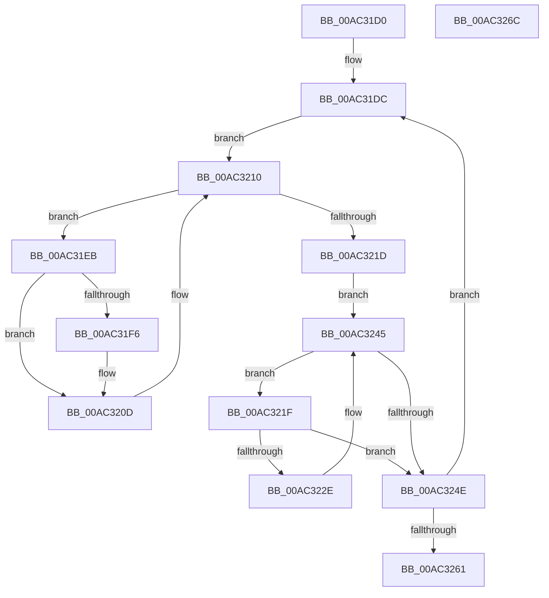

# PspProcessRundownWorker

- RVA: `0x00AC31D0`–`0x00AC326D` (길이 `157` bytes)
- VA: `0x0000000140AC31D0`
- 실행 섹션: `PAGE`
- PDB 이름 있음: `예`; PDB Function 태그: `아니요`
- unwind 정보 RVA: `0x0005CAAC`
- 디코드: `42`개 명령, `157/157` bytes 표시
- 미해석 바이트: `0` (있으면 어셈블리에 `.byte`로 보존)

> 이 문서는 커널 이미지의 기계어와 PDB 기호를 분석해 생성했습니다. 4번과 5번은 함수 원형과 자료형을 바이너리 사용 방식에서 추정한 C 해석이며 원본 소스 복구 결과는 아닙니다.

## 1. Dependencies

- 직접 호출 지점: **5**; 고유 호출 대상: **3**
- 직접 호출자로 확인된 함수: **0**
- RIP 상대 이미지 참조: **4**

### Outgoing calls
- `0x00AC31FB` → [PspRundownSingleProcess](../90/PspRundownSingleProcess_function_00906D50.md) (function, `0x00906D50`)
- `0x00AC3208` → [ObfDereferenceObjectWithTag](../../text/2F/ObfDereferenceObjectWithTag_function_002F78E0.md) (function, `0x002F78E0`)
- `0x00AC3210` → [PsGetNextProcess](../91/PsGetNextProcess_function_0091C900.md) (function, `0x0091C900`)
- `0x00AC3233` → [PspRundownSingleProcess](../90/PspRundownSingleProcess_function_00906D50.md) (function, `0x00906D50`)
- `0x00AC3240` → [ObfDereferenceObjectWithTag](../../text/2F/ObfDereferenceObjectWithTag_function_002F78E0.md) (function, `0x002F78E0`)

### Direct callers
- 이 함수 시작 RVA로 연결되는 직접 call은 확인되지 않았습니다. 간접 호출은 완전히 역산할 수 없습니다.

### Static image references
- `0x00AC31E3` → RVA `0x00FD9C6C` (`PAGEDATA`; read/write)
- `0x00AC3222` → RVA `0x00FD9D98` (`PAGEDATA`; read/write)
- `0x00AC3245` → RVA `0x00FD9D98` (`PAGEDATA`; read)
- `0x00AC3253` → RVA `0x00FD9C6C` (`PAGEDATA`; read)

## 2. Other-region calls and transfers

- 다른 실행 섹션으로 향하는 call: **2**
  - `0x00AC3208` → [ObfDereferenceObjectWithTag](../../text/2F/ObfDereferenceObjectWithTag_function_002F78E0.md) (`PAGE` → `.text`)
  - `0x00AC3240` → [ObfDereferenceObjectWithTag](../../text/2F/ObfDereferenceObjectWithTag_function_002F78E0.md) (`PAGE` → `.text`)
- 별도 외부 분기/꼬리 이동을 확인하지 못했습니다.

## 3. Assembly (complete function range)

```asm
00AC31D0  48 89 5C 24 08                  mov qword ptr [rsp + 8], rbx
00AC31D5  57                              push rdi
00AC31D6  48 83 EC 20                     sub rsp, 0x20
00AC31DA  33 FF                           xor edi, edi
00AC31DC  B8 01 00 00 00                  mov eax, 1
00AC31E1  33 C9                           xor ecx, ecx
00AC31E3  87 05 83 6A 51 00               xchg dword ptr [rip + 0x516a83], eax
00AC31E9  EB 25                           jmp 0x140ac3210
00AC31EB  F0 0F BA B3 F0 01 00 00 08      lock btr dword ptr [rbx + 0x1f0], 8
00AC31F4  73 17                           jae 0x140ac320d
00AC31F6  33 D2                           xor edx, edx
00AC31F8  48 8B CB                        mov rcx, rbx
00AC31FB  E8 50 3B E4 FF                  call 0x140906d50
00AC3200  BA 50 73 53 77                  mov edx, 0x77537350
00AC3205  48 8B CB                        mov rcx, rbx
00AC3208  E8 D3 46 83 FF                  call 0x1402f78e0
00AC320D  48 8B CB                        mov rcx, rbx
00AC3210  E8 EB 96 E5 FF                  call 0x14091c900
00AC3215  48 8B D8                        mov rbx, rax
00AC3218  48 85 C0                        test rax, rax
00AC321B  75 CE                           jne 0x140ac31eb
00AC321D  EB 26                           jmp 0x140ac3245
00AC321F  48 8B DF                        mov rbx, rdi
00AC3222  48 87 1D 6F 6B 51 00            xchg qword ptr [rip + 0x516b6f], rbx
00AC3229  48 85 DB                        test rbx, rbx
00AC322C  74 20                           je 0x140ac324e
00AC322E  33 D2                           xor edx, edx
00AC3230  48 8B CB                        mov rcx, rbx
00AC3233  E8 18 3B E4 FF                  call 0x140906d50
00AC3238  BA 50 73 53 77                  mov edx, 0x77537350
00AC323D  48 8B CB                        mov rcx, rbx
00AC3240  E8 9B 46 83 FF                  call 0x1402f78e0
00AC3245  48 39 3D 4C 6B 51 00            cmp qword ptr [rip + 0x516b4c], rdi
00AC324C  75 D1                           jne 0x140ac321f
00AC324E  B8 01 00 00 00                  mov eax, 1
00AC3253  F0 0F B1 3D 11 6A 51 00         lock cmpxchg dword ptr [rip + 0x516a11], edi
00AC325B  0F 85 7B FF FF FF               jne 0x140ac31dc
00AC3261  48 8B 5C 24 30                  mov rbx, qword ptr [rsp + 0x30]
00AC3266  48 83 C4 20                     add rsp, 0x20
00AC326A  5F                              pop rdi
00AC326B  C3                              ret
00AC326C  CC                              int3
```

## 4. C-style interpretation (structured pseudocode)

```c
__int64 __fastcall PspProcessRundownWorker(int a1, int a2)
{
    __int64 result;
    __int64 v_rdi;
    __int64 v_rsp;
    unsigned __int64 v_stack_p8;

    v_stack_p8 = v_rbx;
    v_rsp = (v_rsp) - (32);
    v_rdi = 0;
loc_00AC31DC:
    a1 = 0;
    goto loc_00AC3210;
loc_00AC31EB:
    result = 1;
    if (!(condition_is_above_or_equal)) {
        a2 = 0;
        a1 = v_rbx;
        result = PspRundownSingleProcess(a1, a2, a3, a4);
        a2 = 0x77537350ULL;
        a1 = v_rbx;
        result = ObfDereferenceObjectWithTag(a1, a2, a3, a4);
    }
loc_00AC3210:
    result = PsGetNextProcess(v_rbx, a2, a3, a4);
    if (result != 0) goto loc_00AC31EB;
    goto loc_00AC3245;
loc_00AC321F:
    if (0 == 0) goto loc_00AC324E;
    a2 = 0;
    result = PspRundownSingleProcess(0, a2, a3, a4);
    result = ObfDereferenceObjectWithTag(0, (unsigned int)(0x77537350ULL), a3, a4);
loc_00AC3245:
    if ((*(unsigned __int64 *)(v_rip + 5335884)) != 0) goto loc_00AC321F;
loc_00AC324E:
    if ((*(unsigned __int64 *)(v_rip + 5335884)) != 0) goto loc_00AC31DC;
    v_rsp = (v_rsp) + (32);
    return 1;
}
```

## 5. (Beta) C Style

```c
int64_t PspProcessRundownWorker(int32_t Arg1, int32_t Arg2)
{
    int64_t result;
    int64_t local_rdi;
    int64_t local_rsp;
    uint64_t v_stack_p8;

    v_stack_p8 = local_rbx;
    local_rsp = (local_rsp) - (32);
    local_rdi = 0;
loc_00AC31DC:
    Arg1 = 0;
    goto loc_00AC3210;
loc_00AC31EB:
    result = 1;
    if (!(condition_is_above_or_equal)) {
        Arg2 = 0;
        Arg1 = local_rbx;
        result = PspRundownSingleProcess(Arg1, Arg2, a3, a4);
        Arg2 = 0x77537350ULL;
        Arg1 = local_rbx;
        result = ObfDereferenceObjectWithTag(Arg1, Arg2, a3, a4);
    }
loc_00AC3210:
    result = PsGetNextProcess(local_rbx, Arg2, a3, a4);
    if (result != 0) goto loc_00AC31EB;
    goto loc_00AC3245;
loc_00AC321F:
    if (0 == 0) goto loc_00AC324E;
    Arg2 = 0;
    result = PspRundownSingleProcess(0, Arg2, a3, a4);
    result = ObfDereferenceObjectWithTag(0, (uint32_t)(0x77537350ULL), a3, a4);
loc_00AC3245:
    if ((*(uint64_t *)(v_rip + 0x516B4C)) != 0) goto loc_00AC321F;
loc_00AC324E:
    if ((*(uint64_t *)(v_rip + 0x516B4C)) != 0) goto loc_00AC31DC;
    local_rsp = (local_rsp) + (32);
    return 1;
}
```

## 6. Execution-region graph

[열기: 2D/3D 그래프와 함수 탐색 컨트롤 패널](../../../control-panel.html?section=page&rva=0x00AC31D0&view=graph)

- 2D 그래프는 위에서 아래로 흐르고, 3D 그래프는 빈 공간을 드래그해 회전합니다. Shift+드래그는 이동, 휠은 확대·축소, 함수 노드 선택은 대상 보고서 이동입니다.

### Static fallback


