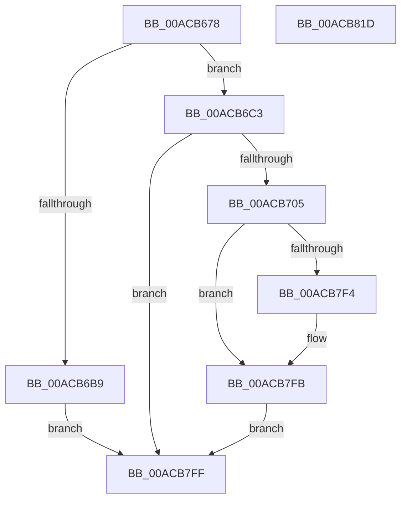

# PspQueryPooledQuotaLimits

- RVA: `0x00ACB678`–`0x00ACB81E` (길이 `422` bytes)
- VA: `0x0000000140ACB678`
- 실행 섹션: `PAGE`
- PDB 이름 있음: `예`; PDB Function 태그: `아니요`
- unwind 정보 RVA: `0x000BE4B4`
- 디코드: `92`개 명령, `422/422` bytes 표시
- 미해석 바이트: `0` (있으면 어셈블리에 `.byte`로 보존)

> 이 문서는 커널 이미지의 기계어와 PDB 기호를 분석해 생성했습니다. 4번과 5번은 함수 원형과 자료형을 바이너리 사용 방식에서 추정한 C 해석이며 원본 소스 복구 결과는 아닙니다.

## 1. Dependencies

- 직접 호출 지점: **3**; 고유 호출 대상: **3**
- 직접 호출자로 확인된 함수: **1**
- RIP 상대 이미지 참조: **1**

### Outgoing calls
- `0x00ACB6AF` → [memset](../../text/6C/memset_function_006C6C40.md) (function, `0x006C6C40`)
- `0x00ACB6F8` → [ObpReferenceObjectByHandleWithTag](../86/ObpReferenceObjectByHandleWithTag_function_00869650.md) (function, `0x00869650`)
- `0x00ACB7B0` → [ObfDereferenceObjectWithTag](../../text/2F/ObfDereferenceObjectWithTag_function_002F78E0.md) (function, `0x002F78E0`)

### Direct callers
- [NtQueryInformationProcess](../9A/NtQueryInformationProcess_function_009AA250.md) at `0x009ACF97`

### Static image references
- `0x00ACB6C3` → RVA `0x00FC6A98` (`ALMOSTRO`; read)

## 2. Other-region calls and transfers

- 다른 실행 섹션으로 향하는 call: **2**
  - `0x00ACB6AF` → [memset](../../text/6C/memset_function_006C6C40.md) (`PAGE` → `.text`)
  - `0x00ACB7B0` → [ObfDereferenceObjectWithTag](../../text/2F/ObfDereferenceObjectWithTag_function_002F78E0.md) (`PAGE` → `.text`)
- 별도 외부 분기/꼬리 이동을 확인하지 못했습니다.

## 3. Assembly (complete function range)

```asm
00ACB678  48 8B C4                        mov rax, rsp
00ACB67B  48 89 58 08                     mov qword ptr [rax + 8], rbx
00ACB67F  48 89 70 10                     mov qword ptr [rax + 0x10], rsi
00ACB683  48 89 78 18                     mov qword ptr [rax + 0x18], rdi
00ACB687  4C 89 70 20                     mov qword ptr [rax + 0x20], r14
00ACB68B  41 57                           push r15
00ACB68D  48 81 EC A0 00 00 00            sub rsp, 0xa0
00ACB694  4D 8B F9                        mov r15, r9
00ACB697  41 8B D8                        mov ebx, r8d
00ACB69A  4C 8B F2                        mov r14, rdx
00ACB69D  48 8B F9                        mov rdi, rcx
00ACB6A0  48 83 60 98 00                  and qword ptr [rax - 0x68], 0
00ACB6A5  33 D2                           xor edx, edx
00ACB6A7  44 8D 42 48                     lea r8d, [rdx + 0x48]
00ACB6AB  48 8D 48 A8                     lea rcx, [rax - 0x58]
00ACB6AF  E8 8C B5 BF FF                  call 0x1406c6c40
00ACB6B4  83 FB 48                        cmp ebx, 0x48
00ACB6B7  74 0A                           je 0x140acb6c3
00ACB6B9  B8 04 00 00 C0                  mov eax, 0xc0000004
00ACB6BE  E9 3C 01 00 00                  jmp 0x140acb7ff
00ACB6C3  4C 8B 05 CE B3 4F 00            mov r8, qword ptr [rip + 0x4fb3ce]
00ACB6CA  48 83 64 24 38 00               and qword ptr [rsp + 0x38], 0
00ACB6D0  48 83 64 24 30 00               and qword ptr [rsp + 0x30], 0
00ACB6D6  48 8D 44 24 40                  lea rax, [rsp + 0x40]
00ACB6DB  48 89 44 24 28                  mov qword ptr [rsp + 0x28], rax
00ACB6E0  C7 44 24 20 50 73 51 79         mov dword ptr [rsp + 0x20], 0x79517350
00ACB6E8  44 8A 8C 24 D0 00 00 00         mov r9b, byte ptr [rsp + 0xd0]
00ACB6F0  BA 00 10 00 00                  mov edx, 0x1000
00ACB6F5  48 8B CF                        mov rcx, rdi
00ACB6F8  E8 53 DF D9 FF                  call 0x140869650
00ACB6FD  85 C0                           test eax, eax
00ACB6FF  0F 88 FA 00 00 00               js 0x140acb7ff
00ACB705  48 8B 44 24 40                  mov rax, qword ptr [rsp + 0x40]
00ACB70A  48 8B 88 F8 02 00 00            mov rcx, qword ptr [rax + 0x2f8]
00ACB711  4C 8B 81 C0 00 00 00            mov r8, qword ptr [rcx + 0xc0]
00ACB718  48 8B B1 80 00 00 00            mov rsi, qword ptr [rcx + 0x80]
00ACB71F  48 89 74 24 58                  mov qword ptr [rsp + 0x58], rsi
00ACB724  48 8B 99 88 00 00 00            mov rbx, qword ptr [rcx + 0x88]
00ACB72B  48 8B 51 40                     mov rdx, qword ptr [rcx + 0x40]
00ACB72F  48 8B 39                        mov rdi, qword ptr [rcx]
00ACB732  48 89 7C 24 70                  mov qword ptr [rsp + 0x70], rdi
00ACB737  4C 8B 51 08                     mov r10, qword ptr [rcx + 8]
00ACB73B  48 8B 81 40 01 00 00            mov rax, qword ptr [rcx + 0x140]
00ACB742  4C 8B 99 00 01 00 00            mov r11, qword ptr [rcx + 0x100]
00ACB749  4C 89 9C 24 88 00 00 00         mov qword ptr [rsp + 0x88], r11
00ACB751  4C 8B 89 08 01 00 00            mov r9, qword ptr [rcx + 0x108]
00ACB758  4C 3B C6                        cmp r8, rsi
00ACB75B  4C 0F 46 C6                     cmovbe r8, rsi
00ACB75F  4C 89 44 24 60                  mov qword ptr [rsp + 0x60], r8
00ACB764  48 3B D7                        cmp rdx, rdi
00ACB767  48 0F 46 D7                     cmovbe rdx, rdi
00ACB76B  48 89 54 24 78                  mov qword ptr [rsp + 0x78], rdx
00ACB770  49 3B C3                        cmp rax, r11
00ACB773  49 0F 46 C3                     cmovbe rax, r11
00ACB777  48 89 84 24 90 00 00 00         mov qword ptr [rsp + 0x90], rax
00ACB77F  48 3B DE                        cmp rbx, rsi
00ACB782  48 0F 46 DE                     cmovbe rbx, rsi
00ACB786  48 89 5C 24 50                  mov qword ptr [rsp + 0x50], rbx
00ACB78B  4C 3B D7                        cmp r10, rdi
00ACB78E  4C 0F 46 D7                     cmovbe r10, rdi
00ACB792  4C 89 54 24 68                  mov qword ptr [rsp + 0x68], r10
00ACB797  4D 3B CB                        cmp r9, r11
00ACB79A  4D 0F 46 CB                     cmovbe r9, r11
00ACB79E  4C 89 8C 24 80 00 00 00         mov qword ptr [rsp + 0x80], r9
00ACB7A6  BA 50 73 51 79                  mov edx, 0x79517350
00ACB7AB  48 8B 4C 24 40                  mov rcx, qword ptr [rsp + 0x40]
00ACB7B0  E8 2B C1 82 FF                  call 0x1402f78e0
00ACB7B5  90                              nop
00ACB7B6  0F 28 44 24 50                  movaps xmm0, xmmword ptr [rsp + 0x50]
00ACB7BB  41 0F 11 06                     movups xmmword ptr [r14], xmm0
00ACB7BF  0F 28 4C 24 60                  movaps xmm1, xmmword ptr [rsp + 0x60]
00ACB7C4  41 0F 11 4E 10                  movups xmmword ptr [r14 + 0x10], xmm1
00ACB7C9  0F 28 44 24 70                  movaps xmm0, xmmword ptr [rsp + 0x70]
00ACB7CE  41 0F 11 46 20                  movups xmmword ptr [r14 + 0x20], xmm0
00ACB7D3  0F 28 8C 24 80 00 00 00         movaps xmm1, xmmword ptr [rsp + 0x80]
00ACB7DB  41 0F 11 4E 30                  movups xmmword ptr [r14 + 0x30], xmm1
00ACB7E0  F2 0F 10 84 24 90 00 00 00      movsd xmm0, qword ptr [rsp + 0x90]
00ACB7E9  F2 41 0F 11 46 40               movsd qword ptr [r14 + 0x40], xmm0
00ACB7EF  4D 85 FF                        test r15, r15
00ACB7F2  74 07                           je 0x140acb7fb
00ACB7F4  41 C7 07 48 00 00 00            mov dword ptr [r15], 0x48
00ACB7FB  33 C0                           xor eax, eax
00ACB7FD  EB 00                           jmp 0x140acb7ff
00ACB7FF  4C 8D 9C 24 A0 00 00 00         lea r11, [rsp + 0xa0]
00ACB807  49 8B 5B 10                     mov rbx, qword ptr [r11 + 0x10]
00ACB80B  49 8B 73 18                     mov rsi, qword ptr [r11 + 0x18]
00ACB80F  49 8B 7B 20                     mov rdi, qword ptr [r11 + 0x20]
00ACB813  4D 8B 73 28                     mov r14, qword ptr [r11 + 0x28]
00ACB817  49 8B E3                        mov rsp, r11
00ACB81A  41 5F                           pop r15
00ACB81C  C3                              ret
00ACB81D  CC                              int3
```

## 4. C-style interpretation (structured pseudocode)

```c
__int64 __fastcall PspQueryPooledQuotaLimits(__int64 a1, __int64 a2, int a3, __int64 a4, unsigned __int8 a5)
{
    __int64 result;
    __int64 v_r10;
    __int64 v_rbx;
    __int64 v_rsp;
    unsigned __int64 v_stack_m18;
    unsigned __int64 v_stack_m20;
    unsigned __int64 v_stack_m28;
    unsigned __int64 v_stack_m30;
    unsigned __int64 v_stack_m38;
    unsigned __int64 v_stack_m40;
    unsigned __int64 v_stack_m48;
    unsigned __int64 v_stack_m50;
    unsigned __int64 v_stack_m58;
    unsigned __int64 v_stack_m68;
    unsigned __int64 v_stack_m70;
    unsigned __int64 v_stack_m78;
    unsigned __int64 v_stack_m8;
    unsigned __int64 v_stack_m80;
    unsigned int v_stack_m88;

    *(unsigned __int64 *)(v_rsp + 8) = v_rbx;
    *(unsigned __int64 *)(v_rsp + 16) = v_rsi;
    *(unsigned __int64 *)(v_rsp + 24) = v_rdi;
    *(unsigned __int64 *)(v_rsp + 32) = v_r14;
    v_rsp = (v_rsp) - (160);
    a2 = 0;
    result = memset(v_rsp - 88, a2, a2 + 72, a4);
    if (((unsigned int)((unsigned int)(a3))) == 72) goto loc_00ACB6C3;
    goto loc_00ACB7FF;
loc_00ACB6C3:
    v_stack_m80 = v_stack_m68;
    v_stack_m88 = 0x79517350ULL;
    result = ObpReferenceObjectByHandleWithTag(a1, (unsigned int)(0x1000ULL), *(unsigned __int64 *)(v_rip + 5223374), a5);
    if (sign_flag) goto loc_00ACB7FF;
    v_stack_m50 = *(unsigned __int64 *)(*(unsigned __int64 *)(v_stack_m68 + 760) + 128);
    v_stack_m38 = *(unsigned __int64 *)(*(unsigned __int64 *)(v_stack_m68 + 760));
    v_stack_m20 = *(unsigned __int64 *)(*(unsigned __int64 *)(v_stack_m68 + 760) + 256);
    a3 = *(unsigned __int64 *)(*(unsigned __int64 *)(v_stack_m68 + 760) + 192);
    if ((*(unsigned __int64 *)(*(unsigned __int64 *)(v_stack_m68 + 760) + 192)) <= (*(unsigned __int64 *)(*(unsigned __int64 *)(v_stack_m68 + 760) + 128))) { a3 = *(unsigned __int64 *)(*(unsigned __int64 *)(v_stack_m68 + 760) + 128); }
    v_stack_m48 = a3;
    a2 = *(unsigned __int64 *)(*(unsigned __int64 *)(v_stack_m68 + 760) + 64);
    if ((*(unsigned __int64 *)(*(unsigned __int64 *)(v_stack_m68 + 760) + 64)) <= (*(unsigned __int64 *)(*(unsigned __int64 *)(v_stack_m68 + 760)))) { a2 = *(unsigned __int64 *)(*(unsigned __int64 *)(v_stack_m68 + 760)); }
    v_stack_m30 = a2;
    result = *(unsigned __int64 *)(*(unsigned __int64 *)(v_stack_m68 + 760) + 320);
    if ((*(unsigned __int64 *)(*(unsigned __int64 *)(v_stack_m68 + 760) + 320)) <= (*(unsigned __int64 *)(*(unsigned __int64 *)(v_stack_m68 + 760) + 256))) { result = *(unsigned __int64 *)(*(unsigned __int64 *)(v_stack_m68 + 760) + 256); }
    v_stack_m18 = result;
    v_rbx = *(unsigned __int64 *)(*(unsigned __int64 *)(v_stack_m68 + 760) + 136);
    if ((*(unsigned __int64 *)(*(unsigned __int64 *)(v_stack_m68 + 760) + 136)) <= (*(unsigned __int64 *)(*(unsigned __int64 *)(v_stack_m68 + 760) + 128))) { v_rbx = *(unsigned __int64 *)(*(unsigned __int64 *)(v_stack_m68 + 760) + 128); }
    v_stack_m58 = v_rbx;
    v_r10 = *(unsigned __int64 *)(*(unsigned __int64 *)(v_stack_m68 + 760) + 8);
    if ((*(unsigned __int64 *)(*(unsigned __int64 *)(v_stack_m68 + 760) + 8)) <= (*(unsigned __int64 *)(*(unsigned __int64 *)(v_stack_m68 + 760)))) { v_r10 = *(unsigned __int64 *)(*(unsigned __int64 *)(v_stack_m68 + 760)); }
    v_stack_m40 = v_r10;
    a4 = *(unsigned __int64 *)(*(unsigned __int64 *)(v_stack_m68 + 760) + 264);
    if ((*(unsigned __int64 *)(*(unsigned __int64 *)(v_stack_m68 + 760) + 264)) <= (*(unsigned __int64 *)(*(unsigned __int64 *)(v_stack_m68 + 760) + 256))) { a4 = *(unsigned __int64 *)(*(unsigned __int64 *)(v_stack_m68 + 760) + 256); }
    v_stack_m28 = a4;
    result = ObfDereferenceObjectWithTag(v_stack_m68, (unsigned int)(0x79517350ULL), a3, a4);
    *(unsigned __int64 *)(a2) = v_xmm0;
    *(unsigned __int64 *)(a2 + 16) = v_xmm1;
    *(unsigned __int64 *)(a2 + 32) = v_xmm0;
    *(unsigned __int64 *)(a2 + 48) = v_xmm1;
    *(unsigned __int64 *)(a2 + 64) = v_xmm0;
    if (a4 != 0) {
        *(unsigned int *)(a4) = 72;
    }
    result = 0;
    goto loc_00ACB7FF;
loc_00ACB7FF:
    return result;
}
```

## 5. (Beta) C Style

```c
int64_t PspQueryPooledQuotaLimits(int64_t Arg1, void *Arg2, int32_t Arg3, int64_t Arg4, uint8_t Arg5)
{
    uint8_t *arg2 = (uint8_t *)Arg2;

    int64_t result;
    int64_t local_r10;
    int64_t local_rbx;
    int64_t local_rsp;
    uint64_t v_stack_m18;
    uint64_t v_stack_m20;
    uint64_t v_stack_m28;
    uint64_t v_stack_m30;
    uint64_t v_stack_m38;
    uint64_t v_stack_m40;
    uint64_t v_stack_m48;
    uint64_t v_stack_m50;
    uint64_t v_stack_m58;
    uint64_t v_stack_m68;
    uint64_t v_stack_m70;
    uint64_t v_stack_m78;
    uint64_t v_stack_m8;
    uint64_t v_stack_m80;
    uint32_t v_stack_m88;

    *(uint64_t *)(local_rsp + 0x8) = local_rbx;
    *(uint64_t *)(local_rsp + 0x10) = local_rsi;
    *(uint64_t *)(local_rsp + 0x18) = local_rdi;
    *(uint64_t *)(local_rsp + 0x20) = local_r14;
    local_rsp = (local_rsp) - (160);
    Arg2 = 0;
    result = memset(local_rsp - 88, Arg2, Arg2 + 72, Arg4);
    if (((uint32_t)((uint32_t)(Arg3))) == 72) goto loc_00ACB6C3;
    goto loc_00ACB7FF;
loc_00ACB6C3:
    v_stack_m80 = v_stack_m68;
    v_stack_m88 = 0x79517350ULL;
    result = ObpReferenceObjectByHandleWithTag(Arg1, (uint32_t)(0x1000ULL), *(uint64_t *)(v_rip + 0x4FB3CE), Arg5);
    if (sign_flag) goto loc_00ACB7FF;
    v_stack_m50 = *(uint64_t *)(*(uint64_t *)(v_stack_m68 + 0x2F8) + 0x80);
    v_stack_m38 = *(uint64_t *)(*(uint64_t *)(v_stack_m68 + 0x2F8));
    v_stack_m20 = *(uint64_t *)(*(uint64_t *)(v_stack_m68 + 0x2F8) + 0x100);
    Arg3 = *(uint64_t *)(*(uint64_t *)(v_stack_m68 + 0x2F8) + 0xC0);
    if ((*(uint64_t *)(*(uint64_t *)(v_stack_m68 + 0x2F8) + 0xC0)) <= (*(uint64_t *)(*(uint64_t *)(v_stack_m68 + 0x2F8) + 0x80))) { Arg3 = *(uint64_t *)(*(uint64_t *)(v_stack_m68 + 0x2F8) + 0x80); }
    v_stack_m48 = Arg3;
    Arg2 = *(uint64_t *)(*(uint64_t *)(v_stack_m68 + 0x2F8) + 0x40);
    if ((*(uint64_t *)(*(uint64_t *)(v_stack_m68 + 0x2F8) + 0x40)) <= (*(uint64_t *)(*(uint64_t *)(v_stack_m68 + 0x2F8)))) { Arg2 = *(uint64_t *)(*(uint64_t *)(v_stack_m68 + 0x2F8)); }
    v_stack_m30 = Arg2;
    result = *(uint64_t *)(*(uint64_t *)(v_stack_m68 + 0x2F8) + 0x140);
    if ((*(uint64_t *)(*(uint64_t *)(v_stack_m68 + 0x2F8) + 0x140)) <= (*(uint64_t *)(*(uint64_t *)(v_stack_m68 + 0x2F8) + 0x100))) { result = *(uint64_t *)(*(uint64_t *)(v_stack_m68 + 0x2F8) + 0x100); }
    v_stack_m18 = result;
    local_rbx = *(uint64_t *)(*(uint64_t *)(v_stack_m68 + 0x2F8) + 0x88);
    if ((*(uint64_t *)(*(uint64_t *)(v_stack_m68 + 0x2F8) + 0x88)) <= (*(uint64_t *)(*(uint64_t *)(v_stack_m68 + 0x2F8) + 0x80))) { local_rbx = *(uint64_t *)(*(uint64_t *)(v_stack_m68 + 0x2F8) + 0x80); }
    v_stack_m58 = local_rbx;
    local_r10 = *(uint64_t *)(*(uint64_t *)(v_stack_m68 + 0x2F8) + 0x8);
    if ((*(uint64_t *)(*(uint64_t *)(v_stack_m68 + 0x2F8) + 0x8)) <= (*(uint64_t *)(*(uint64_t *)(v_stack_m68 + 0x2F8)))) { local_r10 = *(uint64_t *)(*(uint64_t *)(v_stack_m68 + 0x2F8)); }
    v_stack_m40 = local_r10;
    Arg4 = *(uint64_t *)(*(uint64_t *)(v_stack_m68 + 0x2F8) + 0x108);
    if ((*(uint64_t *)(*(uint64_t *)(v_stack_m68 + 0x2F8) + 0x108)) <= (*(uint64_t *)(*(uint64_t *)(v_stack_m68 + 0x2F8) + 0x100))) { Arg4 = *(uint64_t *)(*(uint64_t *)(v_stack_m68 + 0x2F8) + 0x100); }
    v_stack_m28 = Arg4;
    result = ObfDereferenceObjectWithTag(v_stack_m68, (uint32_t)(0x79517350ULL), Arg3, Arg4);
    *(uint64_t *)(arg2) = v_xmm0;
    *(uint64_t *)(arg2 + 0x10) = v_xmm1;
    *(uint64_t *)(arg2 + 0x20) = v_xmm0;
    *(uint64_t *)(arg2 + 0x30) = v_xmm1;
    *(uint64_t *)(arg2 + 0x40) = v_xmm0;
    if (Arg4 != 0) {
        *(uint32_t *)(Arg4) = 72;
    }
    result = 0;
    goto loc_00ACB7FF;
loc_00ACB7FF:
    return result;
}
```

### 관측된 메모리 오프셋

구조체 형식이 확인되지 않은 접근은 인자 기준의 오프셋으로만 기록했습니다.

| 기준 인자 | 오프셋 표현 | 폭 (bit) | 접근 |
|---|---:|---:|---|
| `Arg2` | `+ 0x0` | `128` | `R` |
| `Arg2` | `+ 0x10` | `128` | `R` |
| `Arg2` | `+ 0x20` | `128` | `R` |
| `Arg2` | `+ 0x30` | `128` | `R` |
| `Arg2` | `+ 0x40` | `64` | `W` |

## 6. Execution-region graph

[열기: 2D/3D 그래프와 함수 탐색 컨트롤 패널](../../../control-panel.html?section=page&rva=0x00ACB678&view=graph)

- 2D 그래프는 위에서 아래로 흐르고, 3D 그래프는 빈 공간을 드래그해 회전합니다. Shift+드래그는 이동, 휠은 확대·축소, 함수 노드 선택은 대상 보고서 이동입니다.

### Static fallback


