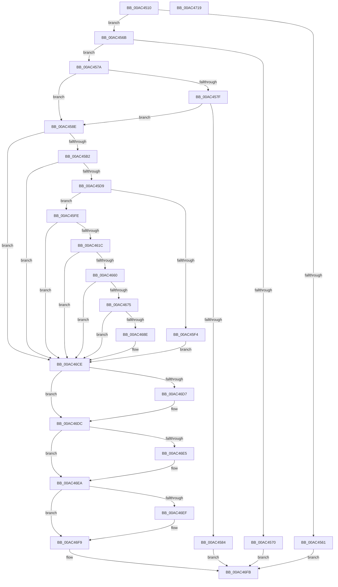

# RtlGenerateClass5Guid

- RVA: `0x00AC4510`–`0x00AC471A` (길이 `522` bytes)
- VA: `0x0000000140AC4510`
- 실행 섹션: `PAGE`
- PDB 이름 있음: `예`; PDB Function 태그: `아니요`
- unwind 정보 RVA: `0x000BDE34`
- 디코드: `149`개 명령, `522/522` bytes 표시
- 미해석 바이트: `0` (있으면 어셈블리에 `.byte`로 보존)

> 이 문서는 커널 이미지의 기계어와 PDB 기호를 분석해 생성했습니다. 4번과 5번은 함수 원형과 자료형을 바이너리 사용 방식에서 추정한 C 해석이며 원본 소스 복구 결과는 아닙니다.

## 1. Dependencies

- 직접 호출 지점: **11**; 고유 호출 대상: **10**
- 직접 호출자로 확인된 함수: **1**
- RIP 상대 이미지 참조: **4**

### Outgoing calls
- `0x00AC45A3` → [BCryptOpenAlgorithmProvider](../AB/BCryptOpenAlgorithmProvider_function_00ABF200.md) (function, `0x00ABF200`)
- `0x00AC45CA` → [BCryptGetProperty](../A5/BCryptGetProperty_function_00A56158.md) (function, `0x00A56158`)
- `0x00AC45E7` → [ExAllocatePool2](../../poolcode/B8/ExAllocatePool2_function_00B820F0.md) (function, `0x00B820F0`)
- `0x00AC460D` → [BCryptCreateHash](../8D/BCryptCreateHash_function_008D1D80.md) (function, `0x008D1D80`)
- `0x00AC4655` → [BCryptHashData](../8D/BCryptHashData_function_008D1CB4.md) (function, `0x008D1CB4`)
- `0x00AC466A` → [BCryptHashData](../8D/BCryptHashData_function_008D1CB4.md) (function, `0x008D1CB4`)
- `0x00AC4683` → [BCryptFinishHash](../8D/BCryptFinishHash_function_008D1BB8.md) (function, `0x008D1BB8`)
- `0x00AC46D7` → [BCryptDestroyHash](../8D/BCryptDestroyHash_function_008D1D2C.md) (function, `0x008D1D2C`)
- `0x00AC46E5` → [BCryptCloseAlgorithmProvider](../../text/60/BCryptCloseAlgorithmProvider_function_006064D8.md) (function, `0x006064D8`)
- `0x00AC46F4` → [ExFreePoolWithTag](../../poolcode/B8/ExFreePoolWithTag_function_00B82870.md) (function, `0x00B82870`)
- `0x00AC4702` → [_security_check_cookie](../../text/6A/_security_check_cookie_function_006AC640.md) (function, `0x006AC640`)

### Direct callers
- [PipCreateComputerId](../../init/C3/PipCreateComputerId_function_00C305F4.md) at `0x00C30705`

### Static image references
- `0x00AC4527` → RVA `0x00E0A740` (`.data`; read)
- `0x00AC4591` → RVA `0x00B05AA0` (` ?? ::NNGAKEGL::`string'`; read)
- `0x00AC4598` → RVA `0x00B05AE0` (` ?? ::NNGAKEGL::`string'`; read)
- `0x00AC45C3` → RVA `0x00B05AF0` (` ?? ::NNGAKEGL::`string'`; read)

## 2. Other-region calls and transfers

- 다른 실행 섹션으로 향하는 call: **4**
  - `0x00AC45E7` → [ExAllocatePool2](../../poolcode/B8/ExAllocatePool2_function_00B820F0.md) (`PAGE` → `POOLCODE`)
  - `0x00AC46E5` → [BCryptCloseAlgorithmProvider](../../text/60/BCryptCloseAlgorithmProvider_function_006064D8.md) (`PAGE` → `.text`)
  - `0x00AC46F4` → [ExFreePoolWithTag](../../poolcode/B8/ExFreePoolWithTag_function_00B82870.md) (`PAGE` → `POOLCODE`)
  - `0x00AC4702` → [_security_check_cookie](../../text/6A/_security_check_cookie_function_006AC640.md) (`PAGE` → `.text`)
- 별도 외부 분기/꼬리 이동을 확인하지 못했습니다.

## 3. Assembly (complete function range)

```asm
00AC4510  40 55                           push rbp
00AC4512  53                              push rbx
00AC4513  56                              push rsi
00AC4514  57                              push rdi
00AC4515  41 54                           push r12
00AC4517  41 56                           push r14
00AC4519  41 57                           push r15
00AC451B  48 8D 6C 24 D9                  lea rbp, [rsp - 0x27]
00AC4520  48 81 EC 90 00 00 00            sub rsp, 0x90
00AC4527  48 8B 05 12 62 34 00            mov rax, qword ptr [rip + 0x346212]
00AC452E  48 33 C4                        xor rax, rsp
00AC4531  48 89 45 1F                     mov qword ptr [rbp + 0x1f], rax
00AC4535  83 65 EF 00                     and dword ptr [rbp - 0x11], 0
00AC4539  33 FF                           xor edi, edi
00AC453B  83 65 D7 00                     and dword ptr [rbp - 0x29], 0
00AC453F  0F 57 C0                        xorps xmm0, xmm0
00AC4542  48 83 65 E7 00                  and qword ptr [rbp - 0x19], 0
00AC4547  49 8B F1                        mov rsi, r9
00AC454A  48 83 65 DF 00                  and qword ptr [rbp - 0x21], 0
00AC454F  45 8B E0                        mov r12d, r8d
00AC4552  4C 8B FA                        mov r15, rdx
00AC4555  4C 8B F1                        mov r14, rcx
00AC4558  0F 11 45 F7                     movups xmmword ptr [rbp - 9], xmm0
00AC455C  48 85 C9                        test rcx, rcx
00AC455F  75 0A                           jne 0x140ac456b
00AC4561  B8 EF 00 00 C0                  mov eax, 0xc00000ef
00AC4566  E9 90 01 00 00                  jmp 0x140ac46fb
00AC456B  48 85 F6                        test rsi, rsi
00AC456E  75 0A                           jne 0x140ac457a
00AC4570  B8 F2 00 00 C0                  mov eax, 0xc00000f2
00AC4575  E9 81 01 00 00                  jmp 0x140ac46fb
00AC457A  4D 85 FF                        test r15, r15
00AC457D  75 0F                           jne 0x140ac458e
00AC457F  45 85 E4                        test r12d, r12d
00AC4582  74 0A                           je 0x140ac458e
00AC4584  B8 F1 00 00 C0                  mov eax, 0xc00000f1
00AC4589  E9 6D 01 00 00                  jmp 0x140ac46fb
00AC458E  45 33 C9                        xor r9d, r9d
00AC4591  4C 8D 05 08 15 04 00            lea r8, [rip + 0x41508]
00AC4598  48 8D 15 41 15 04 00            lea rdx, [rip + 0x41541]
00AC459F  48 8D 4D E7                     lea rcx, [rbp - 0x19]
00AC45A3  E8 58 AC FF FF                  call 0x140abf200
00AC45A8  8B D8                           mov ebx, eax
00AC45AA  85 C0                           test eax, eax
00AC45AC  0F 88 1C 01 00 00               js 0x140ac46ce
00AC45B2  48 8B 4D E7                     mov rcx, qword ptr [rbp - 0x19]
00AC45B6  48 8D 45 EF                     lea rax, [rbp - 0x11]
00AC45BA  4C 8D 45 D7                     lea r8, [rbp - 0x29]
00AC45BE  48 89 44 24 20                  mov qword ptr [rsp + 0x20], rax
00AC45C3  48 8D 15 26 15 04 00            lea rdx, [rip + 0x41526]
00AC45CA  E8 89 1B F9 FF                  call 0x140a56158
00AC45CF  8B D8                           mov ebx, eax
00AC45D1  85 C0                           test eax, eax
00AC45D3  0F 88 F5 00 00 00               js 0x140ac46ce
00AC45D9  8B 55 D7                        mov edx, dword ptr [rbp - 0x29]
00AC45DC  B9 00 01 00 00                  mov ecx, 0x100
00AC45E1  41 B8 47 75 69 64               mov r8d, 0x64697547
00AC45E7  E8 04 DB 0B 00                  call 0x140b820f0
00AC45EC  48 8B F8                        mov rdi, rax
00AC45EF  48 85 C0                        test rax, rax
00AC45F2  75 0A                           jne 0x140ac45fe
00AC45F4  BB 9A 00 00 C0                  mov ebx, 0xc000009a
00AC45F9  E9 D0 00 00 00                  jmp 0x140ac46ce
00AC45FE  44 8B 4D D7                     mov r9d, dword ptr [rbp - 0x29]
00AC4602  48 8D 55 DF                     lea rdx, [rbp - 0x21]
00AC4606  48 8B 4D E7                     mov rcx, qword ptr [rbp - 0x19]
00AC460A  4C 8B C0                        mov r8, rax
00AC460D  E8 6E D7 E0 FF                  call 0x1408d1d80
00AC4612  8B D8                           mov ebx, eax
00AC4614  85 C0                           test eax, eax
00AC4616  0F 88 B2 00 00 00               js 0x140ac46ce
00AC461C  41 0F 10 06                     movups xmm0, xmmword ptr [r14]
00AC4620  41 8B 06                        mov eax, dword ptr [r14]
00AC4623  48 8D 55 F7                     lea rdx, [rbp - 9]
00AC4627  48 8B 4D DF                     mov rcx, qword ptr [rbp - 0x21]
00AC462B  41 B8 10 00 00 00               mov r8d, 0x10
00AC4631  0F C8                           bswap eax
00AC4633  F3 0F 7F 45 F7                  movdqu xmmword ptr [rbp - 9], xmm0
00AC4638  89 45 F7                        mov dword ptr [rbp - 9], eax
00AC463B  41 0F B7 46 04                  movzx eax, word ptr [r14 + 4]
00AC4640  66 C1 C8 08                     ror ax, 8
00AC4644  66 89 45 FB                     mov word ptr [rbp - 5], ax
00AC4648  41 0F B7 46 06                  movzx eax, word ptr [r14 + 6]
00AC464D  66 C1 C8 08                     ror ax, 8
00AC4651  66 89 45 FD                     mov word ptr [rbp - 3], ax
00AC4655  E8 5A D6 E0 FF                  call 0x1408d1cb4
00AC465A  8B D8                           mov ebx, eax
00AC465C  85 C0                           test eax, eax
00AC465E  78 6E                           js 0x140ac46ce
00AC4660  48 8B 4D DF                     mov rcx, qword ptr [rbp - 0x21]
00AC4664  45 8B C4                        mov r8d, r12d
00AC4667  49 8B D7                        mov rdx, r15
00AC466A  E8 45 D6 E0 FF                  call 0x1408d1cb4
00AC466F  8B D8                           mov ebx, eax
00AC4671  85 C0                           test eax, eax
00AC4673  78 59                           js 0x140ac46ce
00AC4675  48 8B 4D DF                     mov rcx, qword ptr [rbp - 0x21]
00AC4679  48 8D 55 07                     lea rdx, [rbp + 7]
00AC467D  41 B8 14 00 00 00               mov r8d, 0x14
00AC4683  E8 30 D5 E0 FF                  call 0x1408d1bb8
00AC4688  8B D8                           mov ebx, eax
00AC468A  85 C0                           test eax, eax
00AC468C  78 40                           js 0x140ac46ce
00AC468E  0F 10 45 07                     movups xmm0, xmmword ptr [rbp + 7]
00AC4692  B9 FF 0F 00 00                  mov ecx, 0xfff
00AC4697  F3 0F 7F 06                     movdqu xmmword ptr [rsi], xmm0
00AC469B  8B 06                           mov eax, dword ptr [rsi]
00AC469D  0F C8                           bswap eax
00AC469F  89 06                           mov dword ptr [rsi], eax
00AC46A1  0F B7 46 04                     movzx eax, word ptr [rsi + 4]
00AC46A5  66 C1 C8 08                     ror ax, 8
00AC46A9  66 89 46 04                     mov word ptr [rsi + 4], ax
00AC46AD  0F B7 46 06                     movzx eax, word ptr [rsi + 6]
00AC46B1  66 C1 C8 08                     ror ax, 8
00AC46B5  66 23 C1                        and ax, cx
00AC46B8  B9 00 50 00 00                  mov ecx, 0x5000
00AC46BD  66 0B C1                        or ax, cx
00AC46C0  66 89 46 06                     mov word ptr [rsi + 6], ax
00AC46C4  8A 46 08                        mov al, byte ptr [rsi + 8]
00AC46C7  24 3F                           and al, 0x3f
00AC46C9  0C 80                           or al, 0x80
00AC46CB  88 46 08                        mov byte ptr [rsi + 8], al
00AC46CE  48 8B 4D DF                     mov rcx, qword ptr [rbp - 0x21]
00AC46D2  48 85 C9                        test rcx, rcx
00AC46D5  74 05                           je 0x140ac46dc
00AC46D7  E8 50 D6 E0 FF                  call 0x1408d1d2c
00AC46DC  48 8B 4D E7                     mov rcx, qword ptr [rbp - 0x19]
00AC46E0  48 85 C9                        test rcx, rcx
00AC46E3  74 05                           je 0x140ac46ea
00AC46E5  E8 EE 1D B4 FF                  call 0x1406064d8
00AC46EA  48 85 FF                        test rdi, rdi
00AC46ED  74 0A                           je 0x140ac46f9
00AC46EF  33 D2                           xor edx, edx
00AC46F1  48 8B CF                        mov rcx, rdi
00AC46F4  E8 77 E1 0B 00                  call 0x140b82870
00AC46F9  8B C3                           mov eax, ebx
00AC46FB  48 8B 4D 1F                     mov rcx, qword ptr [rbp + 0x1f]
00AC46FF  48 33 CC                        xor rcx, rsp
00AC4702  E8 39 7F BE FF                  call 0x1406ac640
00AC4707  48 81 C4 90 00 00 00            add rsp, 0x90
00AC470E  41 5F                           pop r15
00AC4710  41 5E                           pop r14
00AC4712  41 5C                           pop r12
00AC4714  5F                              pop rdi
00AC4715  5E                              pop rsi
00AC4716  5B                              pop rbx
00AC4717  5D                              pop rbp
00AC4718  C3                              ret
00AC4719  CC                              int3
```

## 4. C-style interpretation (structured pseudocode)

```c
__int64 __fastcall RtlGenerateClass5Guid(__int64 a1, __int64 a2, int a3, __int64 a4)
{
    __int64 result;
    __int64 v_rdi;
    __int64 v_rsp;
    unsigned __int64 v_stack_m40;
    unsigned __int64 v_stack_m58;
    unsigned __int64 v_stack_m5F;
    unsigned __int16 v_stack_m62;
    unsigned __int16 v_stack_m64;
    unsigned __int64 v_stack_m68;
    unsigned int v_stack_m70;
    unsigned __int64 v_stack_m78;
    unsigned __int64 v_stack_m80;
    unsigned int v_stack_m88;
    unsigned __int64 v_stack_mA8;

    v_rsp = (v_rsp) - (144);
    result = (*(unsigned __int64 *)(v_rip + 3432978)) ^ (v_rsp);
    v_stack_m40 = result;
    v_rdi = 0;
    v_stack_m68 = v_xmm0;
    if (a1 != 0) goto loc_00AC456B;
    goto loc_00AC46FB;
loc_00AC456B:
    if (a4 != 0) goto loc_00AC457A;
    goto loc_00AC46FB;
loc_00AC457A:
    if (a2 != 0) goto loc_00AC458E;
    if ((unsigned int)((unsigned int)(a3)) == 0) goto loc_00AC458E;
    goto loc_00AC46FB;
loc_00AC458E:
    a4 = 0;
    result = BCryptOpenAlgorithmProvider(v_stack_m78, v_rip + 267585, v_rip + 267528, a4);
    if (sign_flag) goto loc_00AC46CE;
    v_stack_mA8 = v_stack_m70;
    result = BCryptGetProperty(v_stack_m78, v_rip + 267558, v_stack_m88, a4);
    if (sign_flag) goto loc_00AC46CE;
    result = ExAllocatePool2(256, (unsigned int)(v_stack_m88), (unsigned int)(0x64697547ULL), a4);
    if (result != 0) goto loc_00AC45FE;
    goto loc_00AC46CE;
loc_00AC45FE:
    result = BCryptCreateHash(v_stack_m78, v_stack_m80, result, (unsigned int)(v_stack_m88));
    if (sign_flag) goto loc_00AC46CE;
    v_stack_m68 = v_xmm0;
    v_stack_m68 = (unsigned int)((unsigned int)(*(unsigned int *)(a1)));
    v_stack_m64 = (unsigned __int16)(*(unsigned __int16 *)(a1 + 4));
    v_stack_m62 = (unsigned __int16)(*(unsigned __int16 *)(a1 + 6));
    result = BCryptHashData(v_stack_m80, v_stack_m68, 16, (unsigned int)(v_stack_m88));
    if (sign_flag) goto loc_00AC46CE;
    result = BCryptHashData(v_stack_m80, a2, (unsigned int)((unsigned int)((unsigned int)(a3))), (unsigned int)(v_stack_m88));
    if (sign_flag) goto loc_00AC46CE;
    result = BCryptFinishHash(v_stack_m80, v_stack_m58, 20, (unsigned int)(v_stack_m88));
    if (!(sign_flag)) {
        a1 = 0xFFFULL;
        *(unsigned __int64 *)(a4) = v_xmm0;
        result = *(unsigned int *)(a4);
        *(unsigned int *)(a4) = (unsigned int)(result);
        result = *(unsigned __int16 *)(a4 + 4);
        *(unsigned __int16 *)(a4 + 4) = (unsigned __int16)(result);
        result = *(unsigned __int16 *)(a4 + 6);
        result = (unsigned __int16)((result) & ((unsigned __int16)(a1)));
        a1 = 0x5000ULL;
        result = (unsigned __int16)((result) | ((unsigned __int16)(a1)));
        *(unsigned __int16 *)(a4 + 6) = (unsigned __int16)(result);
        result = *(unsigned __int8 *)(a4 + 8);
        result = (unsigned __int8)((result) & (63));
        result = (unsigned __int8)((result) | (128));
        *(unsigned __int8 *)(a4 + 8) = (unsigned __int8)(result);
    }
    if (v_stack_m80 != 0) {
        result = BCryptDestroyHash(v_stack_m80, v_stack_m58, 20, (unsigned int)(v_stack_m88));
    }
    if (v_stack_m78 != 0) {
        result = BCryptCloseAlgorithmProvider(v_stack_m78, v_stack_m58, 20, (unsigned int)(v_stack_m88));
    }
    if (result != 0) {
        a2 = 0;
        a1 = result;
        result = ExFreePoolWithTag(a1, a2, 20, (unsigned int)(v_stack_m88));
    }
loc_00AC46FB:
    a1 = (v_stack_m40) ^ (v_rsp);
    result = _security_check_cookie(a1, a2, 20, (unsigned int)(v_stack_m88));
    v_rsp = (v_rsp) + (144);
    return result;
}
```

## 5. (Beta) C Style

```c
int64_t RtlGenerateClass5Guid(void *Arg1, int64_t Arg2, int32_t Arg3, int64_t Arg4)
{
    uint8_t *arg1 = (uint8_t *)Arg1;

    int64_t result;
    int64_t local_rdi;
    int64_t local_rsp;
    uint64_t v_stack_m40;
    uint64_t v_stack_m58;
    uint64_t v_stack_m5F;
    uint16_t v_stack_m62;
    uint16_t v_stack_m64;
    uint64_t v_stack_m68;
    uint32_t v_stack_m70;
    uint64_t v_stack_m78;
    uint64_t v_stack_m80;
    uint32_t v_stack_m88;
    uint64_t v_stack_mA8;

    local_rsp = (local_rsp) - (144);
    result = (*(uint64_t *)(v_rip + 0x346212)) ^ (local_rsp);
    v_stack_m40 = result;
    local_rdi = 0;
    v_stack_m68 = v_xmm0;
    if (Arg1 != NULL) goto loc_00AC456B;
    goto loc_00AC46FB;
loc_00AC456B:
    if (Arg4 != 0) goto loc_00AC457A;
    goto loc_00AC46FB;
loc_00AC457A:
    if (Arg2 != 0) goto loc_00AC458E;
    if ((uint32_t)((uint32_t)(Arg3)) == 0) goto loc_00AC458E;
    goto loc_00AC46FB;
loc_00AC458E:
    Arg4 = 0;
    result = BCryptOpenAlgorithmProvider(v_stack_m78, v_rip + 267585, v_rip + 267528, Arg4);
    if (sign_flag) goto loc_00AC46CE;
    v_stack_mA8 = v_stack_m70;
    result = BCryptGetProperty(v_stack_m78, v_rip + 267558, v_stack_m88, Arg4);
    if (sign_flag) goto loc_00AC46CE;
    result = ExAllocatePool2(256, (uint32_t)(v_stack_m88), (uint32_t)(0x64697547ULL), Arg4);
    if (result != 0) goto loc_00AC45FE;
    goto loc_00AC46CE;
loc_00AC45FE:
    result = BCryptCreateHash(v_stack_m78, v_stack_m80, result, (uint32_t)(v_stack_m88));
    if (sign_flag) goto loc_00AC46CE;
    v_stack_m68 = v_xmm0;
    v_stack_m68 = (uint32_t)((uint32_t)(*(uint32_t *)(arg1)));
    v_stack_m64 = (uint16_t)(*(uint16_t *)(arg1 + 0x4));
    v_stack_m62 = (uint16_t)(*(uint16_t *)(arg1 + 0x6));
    result = BCryptHashData(v_stack_m80, v_stack_m68, 16, (uint32_t)(v_stack_m88));
    if (sign_flag) goto loc_00AC46CE;
    result = BCryptHashData(v_stack_m80, Arg2, (uint32_t)((uint32_t)((uint32_t)(Arg3))), (uint32_t)(v_stack_m88));
    if (sign_flag) goto loc_00AC46CE;
    result = BCryptFinishHash(v_stack_m80, v_stack_m58, 20, (uint32_t)(v_stack_m88));
    if (!(sign_flag)) {
        Arg1 = 0xFFFULL;
        *(uint64_t *)(Arg4) = v_xmm0;
        result = *(uint32_t *)(Arg4);
        *(uint32_t *)(Arg4) = (uint32_t)(result);
        result = *(uint16_t *)(Arg4 + 0x4);
        *(uint16_t *)(Arg4 + 0x4) = (uint16_t)(result);
        result = *(uint16_t *)(Arg4 + 0x6);
        result = (uint16_t)((result) & ((uint16_t)(Arg1)));
        Arg1 = 0x5000ULL;
        result = (uint16_t)((result) | ((uint16_t)(Arg1)));
        *(uint16_t *)(Arg4 + 0x6) = (uint16_t)(result);
        result = *(uint8_t *)(Arg4 + 0x8);
        result = (uint8_t)((result) & (63));
        result = (uint8_t)((result) | (128));
        *(uint8_t *)(Arg4 + 0x8) = (uint8_t)(result);
    }
    if (v_stack_m80 != 0) {
        result = BCryptDestroyHash(v_stack_m80, v_stack_m58, 20, (uint32_t)(v_stack_m88));
    }
    if (v_stack_m78 != 0) {
        result = BCryptCloseAlgorithmProvider(v_stack_m78, v_stack_m58, 20, (uint32_t)(v_stack_m88));
    }
    if (result != 0) {
        Arg2 = 0;
        Arg1 = result;
        result = ExFreePoolWithTag(Arg1, Arg2, 20, (uint32_t)(v_stack_m88));
    }
loc_00AC46FB:
    Arg1 = (v_stack_m40) ^ (local_rsp);
    result = _security_check_cookie(Arg1, Arg2, 20, (uint32_t)(v_stack_m88));
    local_rsp = (local_rsp) + (144);
    return result;
}
```

### 관측된 메모리 오프셋

구조체 형식이 확인되지 않은 접근은 인자 기준의 오프셋으로만 기록했습니다.

| 기준 인자 | 오프셋 표현 | 폭 (bit) | 접근 |
|---|---:|---:|---|
| `Arg1` | `+ 0x0` | `32` | `R` |
| `Arg1` | `+ 0x0` | `128` | `R` |
| `Arg1` | `+ 0x4` | `16` | `R` |
| `Arg1` | `+ 0x6` | `16` | `R` |

## 6. Execution-region graph

[열기: 2D/3D 그래프와 함수 탐색 컨트롤 패널](../../../control-panel.html?section=page&rva=0x00AC4510&view=graph)

- 2D 그래프는 위에서 아래로 흐르고, 3D 그래프는 빈 공간을 드래그해 회전합니다. Shift+드래그는 이동, 휠은 확대·축소, 함수 노드 선택은 대상 보고서 이동입니다.

### Static fallback


