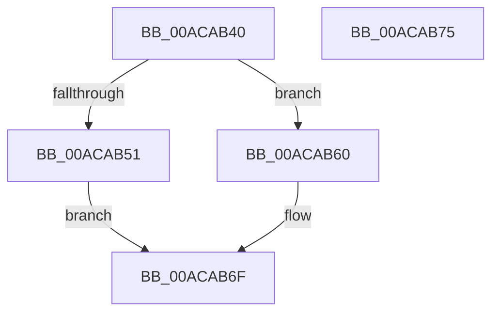

# RtlSetActiveConsoleId

- RVA: `0x00ACAB40`–`0x00ACAB76` (길이 `54` bytes)
- VA: `0x0000000140ACAB40`
- 실행 섹션: `PAGE`
- PDB 이름 있음: `예`; PDB Function 태그: `아니요`
- unwind 정보 RVA: `0x0005CF00`
- 디코드: `16`개 명령, `54/54` bytes 표시
- 미해석 바이트: `0` (있으면 어셈블리에 `.byte`로 보존)

> 이 문서는 커널 이미지의 기계어와 PDB 기호를 분석해 생성했습니다. 4번과 5번은 함수 원형과 자료형을 바이너리 사용 방식에서 추정한 C 해석이며 원본 소스 복구 결과는 아닙니다.

## 1. Dependencies

- 직접 호출 지점: **2**; 고유 호출 대상: **2**
- 직접 호출자로 확인된 함수: **0**
- RIP 상대 이미지 참조: **1**

### Outgoing calls
- `0x00ACAB48` → [PsIsCurrentThreadInServerSilo](../../text/43/PsIsCurrentThreadInServerSilo_function_004362E0.md) (function, `0x004362E0`)
- `0x00ACAB60` → [PsGetCurrentServerSiloGlobals](../../text/2F/PsGetCurrentServerSiloGlobals_function_002FE1F0.md) (function, `0x002FE1F0`)

### Direct callers
- 이 함수 시작 RVA로 연결되는 직접 call은 확인되지 않았습니다. 간접 호출은 완전히 역산할 수 없습니다.

### Static image references
- `0x00ACAB51` → RVA `0x00FC5008` (`ALMOSTRO`; read)

## 2. Other-region calls and transfers

- 다른 실행 섹션으로 향하는 call: **2**
  - `0x00ACAB48` → [PsIsCurrentThreadInServerSilo](../../text/43/PsIsCurrentThreadInServerSilo_function_004362E0.md) (`PAGE` → `.text`)
  - `0x00ACAB60` → [PsGetCurrentServerSiloGlobals](../../text/2F/PsGetCurrentServerSiloGlobals_function_002FE1F0.md) (`PAGE` → `.text`)
- 별도 외부 분기/꼬리 이동을 확인하지 못했습니다.

## 3. Assembly (complete function range)

```asm
00ACAB40  40 53                           push rbx
00ACAB42  48 83 EC 20                     sub rsp, 0x20
00ACAB46  8B D9                           mov ebx, ecx
00ACAB48  E8 93 B7 96 FF                  call 0x1404362e0
00ACAB4D  84 C0                           test al, al
00ACAB4F  75 0F                           jne 0x140acab60
00ACAB51  48 8B 05 B0 A4 4F 00            mov rax, qword ptr [rip + 0x4fa4b0]
00ACAB58  89 98 D8 02 00 00               mov dword ptr [rax + 0x2d8], ebx
00ACAB5E  EB 0F                           jmp 0x140acab6f
00ACAB60  E8 8B 36 83 FF                  call 0x1402fe1f0
00ACAB65  48 8B 88 08 05 00 00            mov rcx, qword ptr [rax + 0x508]
00ACAB6C  89 59 04                        mov dword ptr [rcx + 4], ebx
00ACAB6F  48 83 C4 20                     add rsp, 0x20
00ACAB73  5B                              pop rbx
00ACAB74  C3                              ret
00ACAB75  CC                              int3
```

## 4. C-style interpretation (structured pseudocode)

```c
__int64 __fastcall RtlSetActiveConsoleId(int a1)
{
    __int64 result;
    __int64 v_rsp;

    v_rsp = (v_rsp) - (32);
    result = PsIsCurrentThreadInServerSilo(a1, a2, a3, a4);
    if ((unsigned __int8)(result) != 0) goto loc_00ACAB60;
    *(unsigned int *)(*(unsigned __int64 *)(v_rip + 5219504) + 728) = (unsigned int)((unsigned int)(a1));
    goto loc_00ACAB6F;
loc_00ACAB60:
    result = PsGetCurrentServerSiloGlobals(a1, a2, a3, a4);
    *(unsigned int *)(*(unsigned __int64 *)(result + 1288) + 4) = (unsigned int)((unsigned int)(a1));
loc_00ACAB6F:
    v_rsp = (v_rsp) + (32);
    return result;
}
```

## 5. (Beta) C Style

```c
int64_t RtlSetActiveConsoleId(int32_t Arg1)
{
    int64_t result;
    int64_t local_rsp;

    local_rsp = (local_rsp) - (32);
    result = PsIsCurrentThreadInServerSilo(Arg1, a2, a3, a4);
    if ((uint8_t)(result) != 0) goto loc_00ACAB60;
    *(uint32_t *)(*(uint64_t *)(v_rip + 0x4FA4B0) + 0x2D8) = (uint32_t)((uint32_t)(Arg1));
    goto loc_00ACAB6F;
loc_00ACAB60:
    result = PsGetCurrentServerSiloGlobals(Arg1, a2, a3, a4);
    *(uint32_t *)(*(uint64_t *)(result + 0x508) + 0x4) = (uint32_t)((uint32_t)(Arg1));
loc_00ACAB6F:
    local_rsp = (local_rsp) + (32);
    return result;
}
```

## 6. Execution-region graph

[열기: 2D/3D 그래프와 함수 탐색 컨트롤 패널](../../../control-panel.html?section=page&rva=0x00ACAB40&view=graph)

- 2D 그래프는 위에서 아래로 흐르고, 3D 그래프는 빈 공간을 드래그해 회전합니다. Shift+드래그는 이동, 휠은 확대·축소, 함수 노드 선택은 대상 보고서 이동입니다.

### Static fallback


