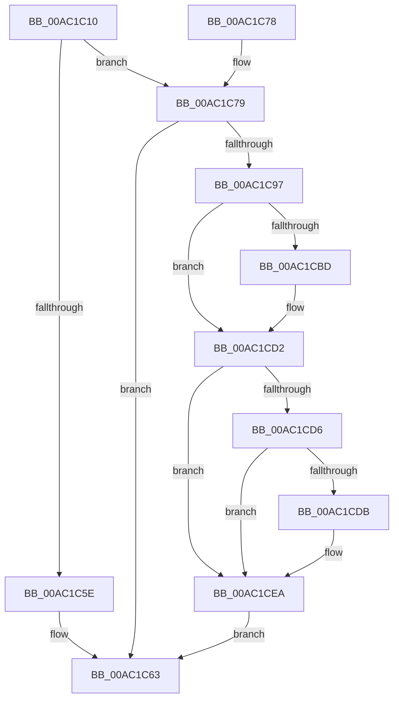

# RtlUnicodeStringToOemString

- RVA: `0x00AC1C10`–`0x00AC1CF1` (길이 `225` bytes)
- VA: `0x0000000140AC1C10`
- 실행 섹션: `PAGE`
- PDB 이름 있음: `예`; PDB Function 태그: `아니요`
- unwind 정보 RVA: `0x000BDB24`
- 디코드: `70`개 명령, `225/225` bytes 표시
- 미해석 바이트: `0` (있으면 어셈블리에 `.byte`로 보존)

> 이 문서는 커널 이미지의 기계어와 PDB 기호를 분석해 생성했습니다. 4번과 5번은 함수 원형과 자료형을 바이너리 사용 방식에서 추정한 C 해석이며 원본 소스 복구 결과는 아닙니다.

## 1. Dependencies

- 직접 호출 지점: **4**; 고유 호출 대상: **4**
- 직접 호출자로 확인된 함수: **2**
- RIP 상대 이미지 참조: **0**

### Outgoing calls
- `0x00AC1C47` → [RtlUnicodeToMultiByteSize](../90/RtlUnicodeToMultiByteSize_function_0090D110.md) (function, `0x0090D110`)
- `0x00AC1C8A` → [AllocateOrValidateCharStringBuffer](../../text/44/AllocateOrValidateCharStringBuffer_function_00447F60.md) (function, `0x00447F60`)
- `0x00AC1CAE` → [RtlUnicodeToOemN](../90/RtlUnicodeToOemN_function_0090F2B0.md) (function, `0x0090F2B0`)
- `0x00AC1CDE` → [ExFreePool](../../poolcode/B8/ExFreePool_function_00B82850.md) (function, `0x00B82850`)

### Direct callers
- [DifRtlUnicodeStringToOemStringWrapper](../../text/63/DifRtlUnicodeStringToOemStringWrapper_function_0063C8D0.md) at `0x0063C9B5`
- [ExpSystemErrorHandler2](../../pagelk/B7/ExpSystemErrorHandler2_function_00B72C30.md) at `0x00B73114`
- [ExpSystemErrorHandler2](../../pagelk/B7/ExpSystemErrorHandler2_function_00B72C30.md) at `0x00B73254`

### Static image references
- 디코드된 RIP-relative 메모리 참조가 없습니다.

## 2. Other-region calls and transfers

- 다른 실행 섹션으로 향하는 call: **2**
  - `0x00AC1C8A` → [AllocateOrValidateCharStringBuffer](../../text/44/AllocateOrValidateCharStringBuffer_function_00447F60.md) (`PAGE` → `.text`)
  - `0x00AC1CDE` → [ExFreePool](../../poolcode/B8/ExFreePool_function_00B82850.md) (`PAGE` → `POOLCODE`)
- 별도 외부 분기/꼬리 이동을 확인하지 못했습니다.

## 3. Assembly (complete function range)

```asm
00AC1C10  48 8B C4                        mov rax, rsp
00AC1C13  48 89 58 20                     mov qword ptr [rax + 0x20], rbx
00AC1C17  44 88 40 18                     mov byte ptr [rax + 0x18], r8b
00AC1C1B  48 89 48 08                     mov qword ptr [rax + 8], rcx
00AC1C1F  56                              push rsi
00AC1C20  57                              push rdi
00AC1C21  41 54                           push r12
00AC1C23  41 56                           push r14
00AC1C25  41 57                           push r15
00AC1C27  48 83 EC 40                     sub rsp, 0x40
00AC1C2B  45 8A F0                        mov r14b, r8b
00AC1C2E  48 8B DA                        mov rbx, rdx
00AC1C31  48 8B F1                        mov rsi, rcx
00AC1C34  45 33 E4                        xor r12d, r12d
00AC1C37  44 89 60 10                     mov dword ptr [rax + 0x10], r12d
00AC1C3B  44 0F B7 02                     movzx r8d, word ptr [rdx]
00AC1C3F  48 8B 52 08                     mov rdx, qword ptr [rdx + 8]
00AC1C43  48 8D 48 10                     lea rcx, [rax + 0x10]
00AC1C47  E8 C4 B4 E4 FF                  call 0x14090d110
00AC1C4C  8B 54 24 78                     mov edx, dword ptr [rsp + 0x78]
00AC1C50  FF C2                           inc edx
00AC1C52  89 54 24 78                     mov dword ptr [rsp + 0x78], edx
00AC1C56  81 FA FF FF 00 00               cmp edx, 0xffff
00AC1C5C  76 1B                           jbe 0x140ac1c79
00AC1C5E  B8 F0 00 00 C0                  mov eax, 0xc00000f0
00AC1C63  48 8B 9C 24 88 00 00 00         mov rbx, qword ptr [rsp + 0x88]
00AC1C6B  48 83 C4 40                     add rsp, 0x40
00AC1C6F  41 5F                           pop r15
00AC1C71  41 5E                           pop r14
00AC1C73  41 5C                           pop r12
00AC1C75  5F                              pop rdi
00AC1C76  5E                              pop rsi
00AC1C77  C3                              ret
00AC1C78  CC                              int3
00AC1C79  4C 8D 7E 02                     lea r15, [rsi + 2]
00AC1C7D  48 8D 7E 08                     lea rdi, [rsi + 8]
00AC1C81  4D 8B CF                        mov r9, r15
00AC1C84  4C 8B C7                        mov r8, rdi
00AC1C87  41 8A CE                        mov cl, r14b
00AC1C8A  E8 D1 62 98 FF                  call 0x140447f60
00AC1C8F  89 44 24 30                     mov dword ptr [rsp + 0x30], eax
00AC1C93  85 C0                           test eax, eax
00AC1C95  78 CC                           js 0x140ac1c63
00AC1C97  0F B7 03                        movzx eax, word ptr [rbx]
00AC1C9A  41 0F B7 17                     movzx edx, word ptr [r15]
00AC1C9E  89 44 24 20                     mov dword ptr [rsp + 0x20], eax
00AC1CA2  4C 8B 4B 08                     mov r9, qword ptr [rbx + 8]
00AC1CA6  4C 8D 44 24 78                  lea r8, [rsp + 0x78]
00AC1CAB  48 8B 0F                        mov rcx, qword ptr [rdi]
00AC1CAE  E8 FD D5 E4 FF                  call 0x14090f2b0
00AC1CB3  8B D8                           mov ebx, eax
00AC1CB5  89 44 24 30                     mov dword ptr [rsp + 0x30], eax
00AC1CB9  85 C0                           test eax, eax
00AC1CBB  78 15                           js 0x140ac1cd2
00AC1CBD  8B 54 24 78                     mov edx, dword ptr [rsp + 0x78]
00AC1CC1  48 8B 07                        mov rax, qword ptr [rdi]
00AC1CC4  44 88 24 02                     mov byte ptr [rdx + rax], r12b
00AC1CC8  66 89 16                        mov word ptr [rsi], dx
00AC1CCB  41 8B DC                        mov ebx, r12d
00AC1CCE  89 5C 24 30                     mov dword ptr [rsp + 0x30], ebx
00AC1CD2  85 DB                           test ebx, ebx
00AC1CD4  79 14                           jns 0x140ac1cea
00AC1CD6  45 84 F6                        test r14b, r14b
00AC1CD9  74 0F                           je 0x140ac1cea
00AC1CDB  48 8B 0F                        mov rcx, qword ptr [rdi]
00AC1CDE  E8 6D 0B 0C 00                  call 0x140b82850
00AC1CE3  4C 89 27                        mov qword ptr [rdi], r12
00AC1CE6  66 45 89 27                     mov word ptr [r15], r12w
00AC1CEA  8B C3                           mov eax, ebx
00AC1CEC  E9 72 FF FF FF                  jmp 0x140ac1c63
```

## 4. C-style interpretation (structured pseudocode)

```c
__int64 __fastcall RtlUnicodeStringToOemString(__int64 a1, __int64 a2, unsigned __int8 a3)
{
    __int64 result;
    __int64 v_r12;
    __int64 v_rbx;
    __int64 v_rsp;
    unsigned int v_stack_p10;
    unsigned __int64 v_stack_p20;
    unsigned int v_stack_p30;
    unsigned __int64 v_stack_p78;

    *(unsigned __int64 *)(v_rsp + 32) = v_rbx;
    *(unsigned __int8 *)(v_rsp + 24) = a3;
    *(unsigned __int64 *)(v_rsp + 8) = a1;
    v_rsp = (v_rsp) - (64);
    v_r12 = 0;
    *(unsigned int *)(v_rsp + 16) = 0;
    result = RtlUnicodeToMultiByteSize(v_rsp + 16, *(unsigned __int64 *)(a2 + 8), *(unsigned __int16 *)(a2), a4);
    a2 = (unsigned int)(((unsigned int)(v_stack_p10)) + 1);
    v_stack_p10 = (unsigned int)(a2);
    if (((unsigned int)(a2)) <= 0xFFFFULL) goto loc_00AC1C79;
loc_00AC1C63:
    v_rsp = (v_rsp) + (64);
    return (unsigned int)(0xC00000F0ULL);
loc_00AC1C79:
    result = AllocateOrValidateCharStringBuffer(a3, a2, a1 + 8, a1 + 2);
    v_stack_p30 = (unsigned int)(result);
    if (sign_flag) goto loc_00AC1C63;
    v_stack_p20 = (unsigned int)(*(unsigned __int16 *)(v_stack_p20));
    result = RtlUnicodeToOemN(*(unsigned __int64 *)(a1 + 8), *(unsigned __int16 *)(a1 + 2), v_stack_p78, *(unsigned __int64 *)(v_stack_p20 + 8));
    v_stack_p30 = (unsigned int)(result);
    v_rbx = (unsigned int)((unsigned int)(result));
    if (!(sign_flag)) {
        a2 = v_stack_p78;
        result = *(unsigned __int64 *)(a1 + 8);
        *(unsigned __int8 *)(a2 + result * 1) = 0;
        *(unsigned __int16 *)(a1) = (unsigned __int16)(a2);
        v_rbx = 0;
        v_stack_p30 = (unsigned int)(v_rbx);
    }
    if (!sign_flag) goto loc_00AC1CEA;
    if (a3 != 0) {
        a1 = *(unsigned __int64 *)(a1 + 8);
        result = ExFreePool(a1, a2, v_stack_p78, *(unsigned __int64 *)(v_stack_p20 + 8));
        *(unsigned __int64 *)(a1 + 8) = 0;
        *(unsigned __int16 *)(a1 + 2) = 0;
    }
    goto loc_00AC1C63;
}
```

## 5. (Beta) C Style

```c
int64_t RtlUnicodeStringToOemString(void *Arg1, void *Arg2, uint8_t Arg3)
{
    uint8_t *arg1 = (uint8_t *)Arg1;
    uint8_t *arg2 = (uint8_t *)Arg2;

    int64_t result;
    int64_t local_r12;
    int64_t local_rbx;
    int64_t local_rsp;
    uint32_t v_stack_p10;
    uint64_t v_stack_p20;
    uint32_t v_stack_p30;
    uint64_t v_stack_p78;

    *(uint64_t *)(local_rsp + 0x20) = local_rbx;
    *(uint8_t *)(local_rsp + 0x18) = Arg3;
    *(void **)(local_rsp + 0x8) = Arg1;
    local_rsp = (local_rsp) - (64);
    local_r12 = 0;
    *(uint32_t *)(local_rsp + 0x10) = 0;
    result = RtlUnicodeToMultiByteSize(local_rsp + 16, *(uint64_t *)(arg2 + 0x8), *(uint16_t *)(arg2), a4);
    Arg2 = (uint32_t)(((uint32_t)(v_stack_p10)) + 1);
    v_stack_p10 = (uint32_t)(Arg2);
    if (((uint32_t)(Arg2)) <= 0xFFFFULL) goto loc_00AC1C79;
loc_00AC1C63:
    local_rsp = (local_rsp) + (64);
    return (uint32_t)(0xC00000F0ULL);
loc_00AC1C79:
    result = AllocateOrValidateCharStringBuffer(Arg3, Arg2, Arg1 + 8, Arg1 + 2);
    v_stack_p30 = (uint32_t)(result);
    if (sign_flag) goto loc_00AC1C63;
    v_stack_p20 = (uint32_t)(*(uint16_t *)(v_stack_p20));
    result = RtlUnicodeToOemN(*(uint64_t *)(arg1 + 0x8), *(uint16_t *)(arg1 + 0x2), v_stack_p78, *(uint64_t *)(v_stack_p20 + 0x8));
    v_stack_p30 = (uint32_t)(result);
    local_rbx = (uint32_t)((uint32_t)(result));
    if (!(sign_flag)) {
        Arg2 = v_stack_p78;
        result = *(uint64_t *)(arg1 + 0x8);
        *(uint8_t *)(arg2 + result * 1) = 0;
        *(uint16_t *)(arg1) = (uint16_t)(Arg2);
        local_rbx = 0;
        v_stack_p30 = (uint32_t)(local_rbx);
    }
    if (!sign_flag) goto loc_00AC1CEA;
    if (Arg3 != 0) {
        Arg1 = *(uint64_t *)(arg1 + 0x8);
        result = ExFreePool(Arg1, Arg2, v_stack_p78, *(uint64_t *)(v_stack_p20 + 0x8));
        *(uint64_t *)(arg1 + 0x8) = 0;
        *(uint16_t *)(arg1 + 0x2) = 0;
    }
    goto loc_00AC1C63;
}
```

### 관측된 메모리 오프셋

구조체 형식이 확인되지 않은 접근은 인자 기준의 오프셋으로만 기록했습니다.

| 기준 인자 | 오프셋 표현 | 폭 (bit) | 접근 |
|---|---:|---:|---|
| `Arg1` | `+ 0x0` | `16` | `R` |
| `Arg1` | `+ 0x0` | `16` | `W` |
| `Arg1` | `+ 0x0` | `64` | `R` |
| `Arg1` | `+ 0x0` | `64` | `W` |
| `Arg1` | `+ 0x2` | `64` | `R` |
| `Arg1` | `+ 0x8` | `64` | `R` |
| `Arg2` | `+ 0x0` | `16` | `R` |
| `Arg2` | `+ 0x8` | `64` | `R` |

## 6. Execution-region graph

[열기: 2D/3D 그래프와 함수 탐색 컨트롤 패널](../../../control-panel.html?section=page&rva=0x00AC1C10&view=graph)

- 2D 그래프는 위에서 아래로 흐르고, 3D 그래프는 빈 공간을 드래그해 회전합니다. Shift+드래그는 이동, 휠은 확대·축소, 함수 노드 선택은 대상 보고서 이동입니다.

### Static fallback


