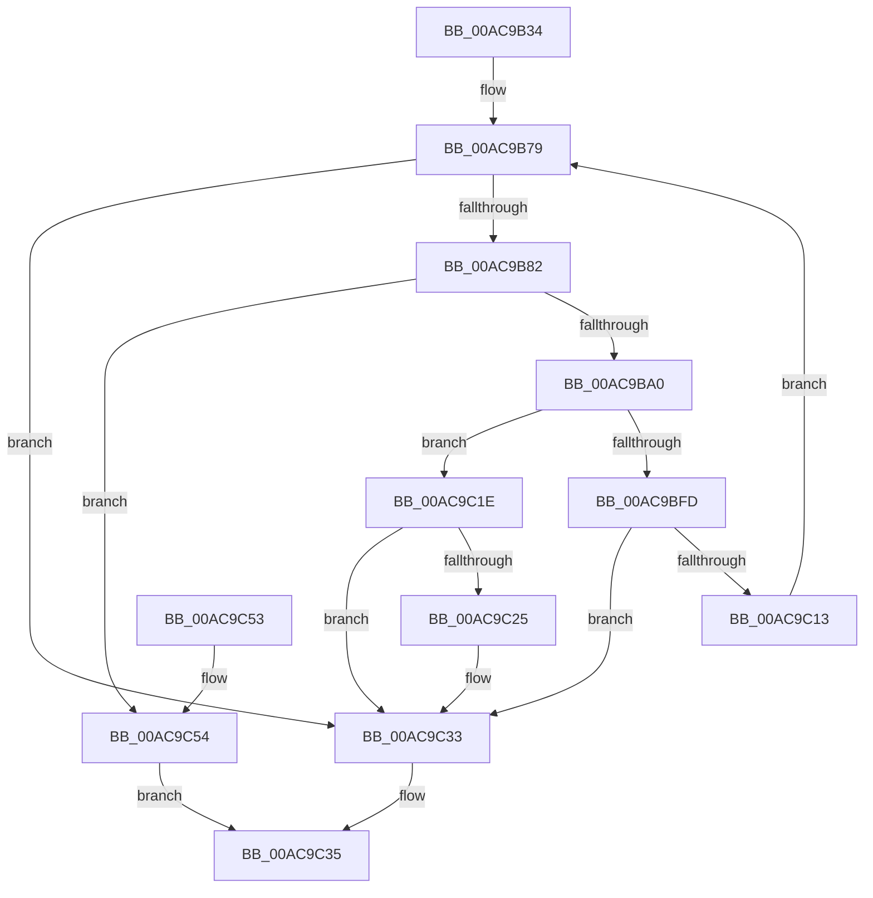

# RtlpComputeMergedAcl

- RVA: `0x00AC9B34`–`0x00AC9C5B` (길이 `295` bytes)
- VA: `0x0000000140AC9B34`
- 실행 섹션: `PAGE`
- PDB 이름 있음: `예`; PDB Function 태그: `아니요`
- unwind 정보 RVA: `0x000BE2E0`
- 디코드: `78`개 명령, `295/295` bytes 표시
- 미해석 바이트: `0` (있으면 어셈블리에 `.byte`로 보존)

> 이 문서는 커널 이미지의 기계어와 PDB 기호를 분석해 생성했습니다. 4번과 5번은 함수 원형과 자료형을 바이너리 사용 방식에서 추정한 C 해석이며 원본 소스 복구 결과는 아닙니다.

## 1. Dependencies

- 직접 호출 지점: **4**; 고유 호출 대상: **3**
- 직접 호출자로 확인된 함수: **3**
- RIP 상대 이미지 참조: **0**

### Outgoing calls
- `0x00AC9B8F` → [ExAllocatePool2](../../poolcode/B8/ExAllocatePool2_function_00B820F0.md) (function, `0x00B820F0`)
- `0x00AC9BF2` → [RtlpComputeMergedAcl2](../78/RtlpComputeMergedAcl2_function_0078EA34.md) (function, `0x0078EA34`)
- `0x00AC9C02` → [ExFreePoolWithTag](../../poolcode/B8/ExFreePoolWithTag_function_00B82870.md) (function, `0x00B82870`)
- `0x00AC9C2A` → [ExFreePoolWithTag](../../poolcode/B8/ExFreePoolWithTag_function_00B82870.md) (function, `0x00B82870`)

### Direct callers
- [sub_008BC3C4](../8B/Unknown_function_008BC3C4.md) at `0x008BC4E4`
- [sub_008BC3C4](../8B/Unknown_function_008BC3C4.md) at `0x008BC5AE`
- [sub_008BC3C4](../8B/Unknown_function_008BC3C4.md) at `0x008BC660`
- [RtlpNewSecurityObject](../92/RtlpNewSecurityObject_function_0092AB50.md) at `0x0092C937`
- [sub_00B1A906](../B1/Unknown_function_00B1A906.md) at `0x00B1AA15`
- [sub_00B1A906](../B1/Unknown_function_00B1A906.md) at `0x00B1AAD2`
- [sub_00B1A906](../B1/Unknown_function_00B1A906.md) at `0x00B1ABBB`

### Static image references
- 디코드된 RIP-relative 메모리 참조가 없습니다.

## 2. Other-region calls and transfers

- 다른 실행 섹션으로 향하는 call: **3**
  - `0x00AC9B8F` → [ExAllocatePool2](../../poolcode/B8/ExAllocatePool2_function_00B820F0.md) (`PAGE` → `POOLCODE`)
  - `0x00AC9C02` → [ExFreePoolWithTag](../../poolcode/B8/ExFreePoolWithTag_function_00B82870.md) (`PAGE` → `POOLCODE`)
  - `0x00AC9C2A` → [ExFreePoolWithTag](../../poolcode/B8/ExFreePoolWithTag_function_00B82870.md) (`PAGE` → `POOLCODE`)
- 별도 외부 분기/꼬리 이동을 확인하지 못했습니다.

## 3. Assembly (complete function range)

```asm
00AC9B34  48 89 5C 24 08                  mov qword ptr [rsp + 8], rbx
00AC9B39  48 89 6C 24 10                  mov qword ptr [rsp + 0x10], rbp
00AC9B3E  48 89 74 24 18                  mov qword ptr [rsp + 0x18], rsi
00AC9B43  57                              push rdi
00AC9B44  41 54                           push r12
00AC9B46  41 55                           push r13
00AC9B48  41 56                           push r14
00AC9B4A  41 57                           push r15
00AC9B4C  48 83 EC 70                     sub rsp, 0x70
00AC9B50  4C 8B AC 24 E8 00 00 00         mov r13, qword ptr [rsp + 0xe8]
00AC9B58  33 FF                           xor edi, edi
00AC9B5A  48 8B 9C 24 E0 00 00 00         mov rbx, qword ptr [rsp + 0xe0]
00AC9B62  B8 00 04 00 00                  mov eax, 0x400
00AC9B67  89 44 24 60                     mov dword ptr [rsp + 0x60], eax
00AC9B6B  33 F6                           xor esi, esi
00AC9B6D  41 8B E9                        mov ebp, r9d
00AC9B70  4D 8B F0                        mov r14, r8
00AC9B73  44 8B FA                        mov r15d, edx
00AC9B76  4C 8B E1                        mov r12, rcx
00AC9B79  83 FE 02                        cmp esi, 2
00AC9B7C  0F 83 B1 00 00 00               jae 0x140ac9c33
00AC9B82  8B D0                           mov edx, eax
00AC9B84  B9 00 01 00 00                  mov ecx, 0x100
00AC9B89  41 B8 53 65 41 63               mov r8d, 0x63416553
00AC9B8F  E8 5C 85 0B 00                  call 0x140b820f0
00AC9B94  48 89 03                        mov qword ptr [rbx], rax
00AC9B97  48 85 C0                        test rax, rax
00AC9B9A  0F 84 B4 00 00 00               je 0x140ac9c54
00AC9BA0  4C 89 6C 24 50                  mov qword ptr [rsp + 0x50], r13
00AC9BA5  44 8B CD                        mov r9d, ebp
00AC9BA8  48 89 44 24 48                  mov qword ptr [rsp + 0x48], rax
00AC9BAD  4D 8B C6                        mov r8, r14
00AC9BB0  48 8D 44 24 60                  lea rax, [rsp + 0x60]
00AC9BB5  41 8B D7                        mov edx, r15d
00AC9BB8  48 89 44 24 40                  mov qword ptr [rsp + 0x40], rax
00AC9BBD  49 8B CC                        mov rcx, r12
00AC9BC0  8B 84 24 D8 00 00 00            mov eax, dword ptr [rsp + 0xd8]
00AC9BC7  89 44 24 38                     mov dword ptr [rsp + 0x38], eax
00AC9BCB  48 8B 84 24 D0 00 00 00         mov rax, qword ptr [rsp + 0xd0]
00AC9BD3  48 89 44 24 30                  mov qword ptr [rsp + 0x30], rax
00AC9BD8  48 8B 84 24 C8 00 00 00         mov rax, qword ptr [rsp + 0xc8]
00AC9BE0  48 89 44 24 28                  mov qword ptr [rsp + 0x28], rax
00AC9BE5  48 8B 84 24 C0 00 00 00         mov rax, qword ptr [rsp + 0xc0]
00AC9BED  48 89 44 24 20                  mov qword ptr [rsp + 0x20], rax
00AC9BF2  E8 3D 4E CC FF                  call 0x14078ea34
00AC9BF7  8B F8                           mov edi, eax
00AC9BF9  85 C0                           test eax, eax
00AC9BFB  79 21                           jns 0x140ac9c1e
00AC9BFD  48 8B 0B                        mov rcx, qword ptr [rbx]
00AC9C00  33 D2                           xor edx, edx
00AC9C02  E8 69 8C 0B 00                  call 0x140b82870
00AC9C07  48 83 23 00                     and qword ptr [rbx], 0
00AC9C0B  81 FF 23 00 00 C0               cmp edi, 0xc0000023
00AC9C11  75 20                           jne 0x140ac9c33
00AC9C13  8B 44 24 60                     mov eax, dword ptr [rsp + 0x60]
00AC9C17  FF C6                           inc esi
00AC9C19  E9 5B FF FF FF                  jmp 0x140ac9b79
00AC9C1E  83 7C 24 60 00                  cmp dword ptr [rsp + 0x60], 0
00AC9C23  75 0E                           jne 0x140ac9c33
00AC9C25  48 8B 0B                        mov rcx, qword ptr [rbx]
00AC9C28  33 D2                           xor edx, edx
00AC9C2A  E8 41 8C 0B 00                  call 0x140b82870
00AC9C2F  48 83 23 00                     and qword ptr [rbx], 0
00AC9C33  8B C7                           mov eax, edi
00AC9C35  4C 8D 5C 24 70                  lea r11, [rsp + 0x70]
00AC9C3A  49 8B 5B 30                     mov rbx, qword ptr [r11 + 0x30]
00AC9C3E  49 8B 6B 38                     mov rbp, qword ptr [r11 + 0x38]
00AC9C42  49 8B 73 40                     mov rsi, qword ptr [r11 + 0x40]
00AC9C46  49 8B E3                        mov rsp, r11
00AC9C49  41 5F                           pop r15
00AC9C4B  41 5E                           pop r14
00AC9C4D  41 5D                           pop r13
00AC9C4F  41 5C                           pop r12
00AC9C51  5F                              pop rdi
00AC9C52  C3                              ret
00AC9C53  CC                              int3
00AC9C54  B8 17 00 00 C0                  mov eax, 0xc0000017
00AC9C59  EB DA                           jmp 0x140ac9c35
```

## 4. C-style interpretation (structured pseudocode)

```c
__int64 __fastcall RtlpComputeMergedAcl(__int64 a1, int a2, __int64 a3, int a4, __int64 a5, __int64 a6, __int64 a7, unsigned int a8, __int64 a9, __int64 a10)
{
    __int64 result;
    __int64 v_rdi;
    __int64 v_rsi;
    __int64 v_rsp;
    unsigned __int64 v_stack_m28;
    unsigned int v_stack_m38;
    unsigned __int64 v_stack_m48;
    unsigned __int64 v_stack_m50;
    unsigned __int64 v_stack_m58;
    unsigned int v_stack_m60;
    unsigned __int64 v_stack_m68;
    unsigned __int64 v_stack_m70;
    unsigned __int64 v_stack_m78;
    unsigned __int64 v_stack_p10;
    unsigned __int64 v_stack_p18;
    unsigned __int64 v_stack_p8;

    v_stack_p8 = v_rbx;
    v_stack_p10 = v_rbp;
    v_stack_p18 = v_rsi;
    v_rsp = (v_rsp) - (112);
    v_rdi = 0;
    v_stack_m38 = (unsigned int)((unsigned int)(0x400ULL));
    v_rsi = 0;
loc_00AC9B79:
    if (0 >= 2) goto loc_00AC9C33;
    result = ExAllocatePool2(256, (unsigned int)((unsigned int)((unsigned int)(0x400ULL))), (unsigned int)(0x63416553ULL), a4);
    *(unsigned __int64 *)(a9) = result;
    if (result == 0) goto loc_00AC9C54;
    v_stack_m48 = a10;
    v_stack_m50 = result;
    v_stack_m58 = v_stack_m38;
    v_stack_m60 = (unsigned int)((unsigned int)(a8));
    v_stack_m68 = a7;
    v_stack_m70 = a6;
    v_stack_m78 = a5;
    result = RtlpComputeMergedAcl2(a1, (unsigned int)((unsigned int)((unsigned int)(a2))), a3, (unsigned int)((unsigned int)((unsigned int)(a4))));
    if (!sign_flag) goto loc_00AC9C1E;
    a2 = 0;
    result = ExFreePoolWithTag(*(unsigned __int64 *)(a9), a2, a3, (unsigned int)((unsigned int)((unsigned int)(a4))));
    if (((unsigned int)((unsigned int)((unsigned int)(result)))) != 0xC0000023ULL) goto loc_00AC9C33;
    v_rsi = (unsigned int)((v_rsi) + 1);
    goto loc_00AC9B79;
loc_00AC9C1E:
    result = (unsigned int)(v_stack_m38);
    if (v_stack_m38 == 0) {
        a1 = *(unsigned __int64 *)(a9);
        a2 = 0;
        result = ExFreePoolWithTag(a1, a2, a3, (unsigned int)((unsigned int)((unsigned int)(a4))));
    }
loc_00AC9C35:
    return (unsigned int)((unsigned int)((unsigned int)((unsigned int)(result))));
loc_00AC9C54:
    goto loc_00AC9C35;
}
```

## 5. (Beta) C Style

```c
int64_t RtlpComputeMergedAcl(int64_t Arg1, int32_t Arg2, int64_t Arg3, int32_t Arg4, int64_t Arg5, int64_t Arg6, int64_t Arg7, uint32_t Arg8, void *Arg9, int64_t Arg10)
{
    uint8_t *arg9 = (uint8_t *)Arg9;

    int64_t result;
    int64_t local_rdi;
    int64_t local_rsi;
    int64_t local_rsp;
    uint64_t v_stack_m28;
    uint32_t v_stack_m38;
    uint64_t v_stack_m48;
    uint64_t v_stack_m50;
    uint64_t v_stack_m58;
    uint32_t v_stack_m60;
    uint64_t v_stack_m68;
    uint64_t v_stack_m70;
    uint64_t v_stack_m78;
    uint64_t v_stack_p10;
    uint64_t v_stack_p18;
    uint64_t v_stack_p8;

    v_stack_p8 = local_rbx;
    v_stack_p10 = local_rbp;
    v_stack_p18 = local_rsi;
    local_rsp = (local_rsp) - (112);
    local_rdi = 0;
    v_stack_m38 = (uint32_t)((uint32_t)(0x400ULL));
    local_rsi = 0;
loc_00AC9B79:
    if (0 >= 2) goto loc_00AC9C33;
    result = ExAllocatePool2(256, (uint32_t)((uint32_t)((uint32_t)(0x400ULL))), (uint32_t)(0x63416553ULL), Arg4);
    *(uint64_t *)(arg9) = result;
    if (result == 0) goto loc_00AC9C54;
    v_stack_m48 = Arg10;
    v_stack_m50 = result;
    v_stack_m58 = v_stack_m38;
    v_stack_m60 = (uint32_t)((uint32_t)(Arg8));
    v_stack_m68 = Arg7;
    v_stack_m70 = Arg6;
    v_stack_m78 = Arg5;
    result = RtlpComputeMergedAcl2(Arg1, (uint32_t)((uint32_t)((uint32_t)(Arg2))), Arg3, (uint32_t)((uint32_t)((uint32_t)(Arg4))));
    if (!sign_flag) goto loc_00AC9C1E;
    Arg2 = 0;
    result = ExFreePoolWithTag(*(uint64_t *)(arg9), Arg2, Arg3, (uint32_t)((uint32_t)((uint32_t)(Arg4))));
    if (((uint32_t)((uint32_t)((uint32_t)(result)))) != 0xC0000023ULL) goto loc_00AC9C33;
    local_rsi = (uint32_t)((local_rsi) + 1);
    goto loc_00AC9B79;
loc_00AC9C1E:
    result = (uint32_t)(v_stack_m38);
    if (v_stack_m38 == 0) {
        Arg1 = *(uint64_t *)(arg9);
        Arg2 = 0;
        result = ExFreePoolWithTag(Arg1, Arg2, Arg3, (uint32_t)((uint32_t)((uint32_t)(Arg4))));
    }
loc_00AC9C35:
    return (uint32_t)((uint32_t)((uint32_t)((uint32_t)(result))));
loc_00AC9C54:
    goto loc_00AC9C35;
}
```

### 관측된 메모리 오프셋

구조체 형식이 확인되지 않은 접근은 인자 기준의 오프셋으로만 기록했습니다.

| 기준 인자 | 오프셋 표현 | 폭 (bit) | 접근 |
|---|---:|---:|---|
| `Arg9` | `+ 0x0` | `64` | `R` |
| `Arg9` | `+ 0x0` | `64` | `R/W` |
| `Arg9` | `+ 0x0` | `64` | `W` |

## 6. Execution-region graph

[열기: 2D/3D 그래프와 함수 탐색 컨트롤 패널](../../../control-panel.html?section=page&rva=0x00AC9B34&view=graph)

- 2D 그래프는 위에서 아래로 흐르고, 3D 그래프는 빈 공간을 드래그해 회전합니다. Shift+드래그는 이동, 휠은 확대·축소, 함수 노드 선택은 대상 보고서 이동입니다.

### Static fallback


