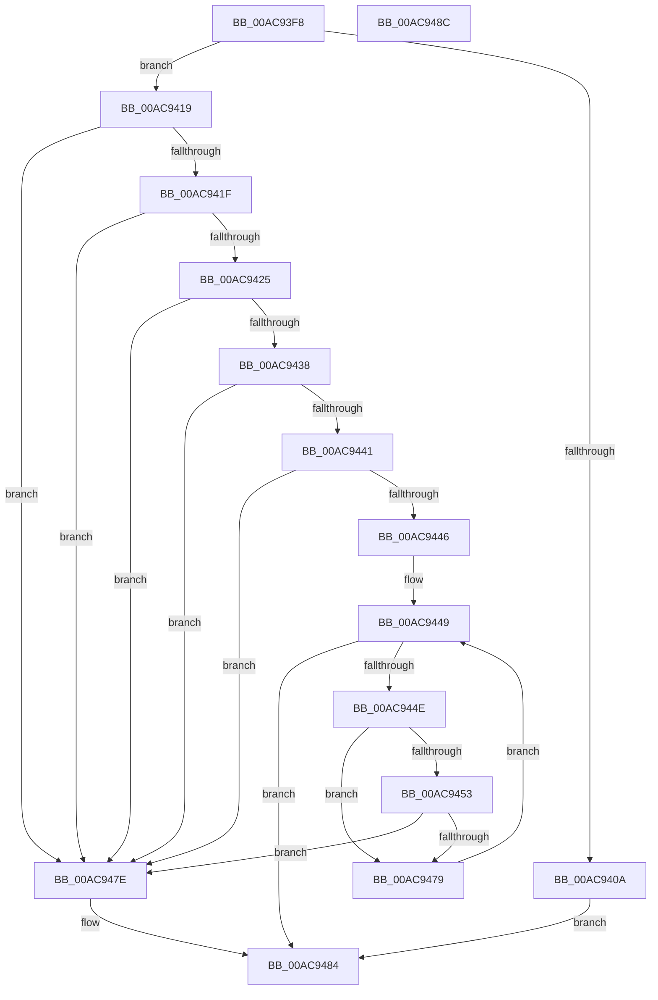

# RtlpFcValidateFeatureUsageSubscriptionBuffer

- RVA: `0x00AC93F8`–`0x00AC948D` (길이 `149` bytes)
- VA: `0x0000000140AC93F8`
- 실행 섹션: `PAGE`
- PDB 이름 있음: `예`; PDB Function 태그: `아니요`
- unwind 정보 RVA: `0x0005C788`
- 디코드: `48`개 명령, `149/149` bytes 표시
- 미해석 바이트: `0` (있으면 어셈블리에 `.byte`로 보존)

> 이 문서는 커널 이미지의 기계어와 PDB 기호를 분석해 생성했습니다. 4번과 5번은 함수 원형과 자료형을 바이너리 사용 방식에서 추정한 C 해석이며 원본 소스 복구 결과는 아닙니다.

## 1. Dependencies

- 직접 호출 지점: **1**; 고유 호출 대상: **1**
- 직접 호출자로 확인된 함수: **1**
- RIP 상대 이미지 참조: **0**

### Outgoing calls
- `0x00AC9470` → [RtlpFcCompareUsageSubscriptionToUsageSubscription](../../text/4A/RtlpFcCompareUsageSubscriptionToUsageSubscription_function_004AEEF8.md) (function, `0x004AEEF8`)

### Direct callers
- [sub_00B3AEBA](../B3/Unknown_function_00B3AEBA.md) at `0x00B3AF33`

### Static image references
- 디코드된 RIP-relative 메모리 참조가 없습니다.

## 2. Other-region calls and transfers

- 다른 실행 섹션으로 향하는 call: **1**
  - `0x00AC9470` → [RtlpFcCompareUsageSubscriptionToUsageSubscription](../../text/4A/RtlpFcCompareUsageSubscriptionToUsageSubscription_function_004AEEF8.md) (`PAGE` → `.text`)
- 별도 외부 분기/꼬리 이동을 확인하지 못했습니다.

## 3. Assembly (complete function range)

```asm
00AC93F8  48 83 EC 28                     sub rsp, 0x28
00AC93FC  45 33 C0                        xor r8d, r8d
00AC93FF  4C 8B CA                        mov r9, rdx
00AC9402  4C 8B D1                        mov r10, rcx
00AC9405  48 85 C9                        test rcx, rcx
00AC9408  75 0F                           jne 0x140ac9419
00AC940A  49 F7 D9                        neg r9
00AC940D  45 1B C0                        sbb r8d, r8d
00AC9410  41 81 E0 0D 00 00 C0            and r8d, 0xc000000d
00AC9417  EB 6B                           jmp 0x140ac9484
00AC9419  49 83 F9 04                     cmp r9, 4
00AC941D  72 5F                           jb 0x140ac947e
00AC941F  41 F6 C2 03                     test r10b, 3
00AC9423  75 59                           jne 0x140ac947e
00AC9425  44 8B 19                        mov r11d, dword ptr [rcx]
00AC9428  B8 10 00 00 00                  mov eax, 0x10
00AC942D  49 F7 E3                        mul r11
00AC9430  48 8B C8                        mov rcx, rax
00AC9433  48 85 D2                        test rdx, rdx
00AC9436  75 46                           jne 0x140ac947e
00AC9438  48 83 C0 04                     add rax, 4
00AC943C  48 3B C1                        cmp rax, rcx
00AC943F  72 3D                           jb 0x140ac947e
00AC9441  49 3B C1                        cmp rax, r9
00AC9444  77 38                           ja 0x140ac947e
00AC9446  45 8B C8                        mov r9d, r8d
00AC9449  45 3B CB                        cmp r9d, r11d
00AC944C  73 36                           jae 0x140ac9484
00AC944E  45 85 C9                        test r9d, r9d
00AC9451  74 26                           je 0x140ac9479
00AC9453  41 8B D1                        mov edx, r9d
00AC9456  41 8D 49 FF                     lea ecx, [r9 - 1]
00AC945A  48 C1 E2 04                     shl rdx, 4
00AC945E  48 C1 E1 04                     shl rcx, 4
00AC9462  48 83 C2 04                     add rdx, 4
00AC9466  48 83 C1 04                     add rcx, 4
00AC946A  49 03 D2                        add rdx, r10
00AC946D  49 03 CA                        add rcx, r10
00AC9470  E8 83 5A 9E FF                  call 0x1404aeef8
00AC9475  85 C0                           test eax, eax
00AC9477  79 05                           jns 0x140ac947e
00AC9479  41 FF C1                        inc r9d
00AC947C  EB CB                           jmp 0x140ac9449
00AC947E  41 B8 0D 00 00 C0               mov r8d, 0xc000000d
00AC9484  41 8B C0                        mov eax, r8d
00AC9487  48 83 C4 28                     add rsp, 0x28
00AC948B  C3                              ret
00AC948C  CC                              int3
```

## 4. C-style interpretation (structured pseudocode)

```c
__int64 __fastcall RtlpFcValidateFeatureUsageSubscriptionBuffer(__int64 a1, __int64 a2, int a3)
{
    __int64 result;
    __int64 v_rsp;

    v_rsp = (v_rsp) - (40);
    a3 = 0;
    if (a1 != 0) goto loc_00AC9419;
    a4 = -(a2);
    a3 = (unsigned int)((a3) & (0xC000000DULL));
    goto loc_00AC9484;
loc_00AC9419:
    if (a4 < 4) goto loc_00AC947E;
    if ((((unsigned __int8)(a1)) & (3)) != 0) goto loc_00AC947E;
    if (a2 != 0) goto loc_00AC947E;
    result = (16) + (4);
    if (result < 16) goto loc_00AC947E;
    if (result > a4) goto loc_00AC947E;
loc_00AC9449:
    if (((unsigned int)((unsigned int)(a3))) >= ((unsigned int)((unsigned int)(*(unsigned int *)(a1))))) goto loc_00AC9484;
    if ((unsigned int)((unsigned int)(a3)) == 0) goto loc_00AC9479;
    a2 = ((unsigned int)((unsigned int)((unsigned int)(a3)))) << (4);
    a1 = ((unsigned int)(a3) - 1) << (4);
    a2 = (a2) + (4);
    a1 = (a1) + (4);
    a2 = (a2) + (a1);
    a1 = (a1) + (a1);
    result = RtlpFcCompareUsageSubscriptionToUsageSubscription(a1, a2, a3, (unsigned int)(a3));
    if (!sign_flag) goto loc_00AC947E;
loc_00AC9479:
    a4 = (unsigned int)(((unsigned int)(a3)) + 1);
    goto loc_00AC9449;
loc_00AC947E:
loc_00AC9484:
    v_rsp = (v_rsp) + (40);
    return (unsigned int)((unsigned int)((unsigned int)(0xC000000DULL)));
}
```

## 5. (Beta) C Style

```c
int64_t RtlpFcValidateFeatureUsageSubscriptionBuffer(int64_t Arg1, int64_t Arg2, int32_t Arg3)
{
    int64_t result;
    int64_t local_rsp;

    local_rsp = (local_rsp) - (40);
    Arg3 = 0;
    if (Arg1 != 0) goto loc_00AC9419;
    a4 = -(Arg2);
    Arg3 = (uint32_t)((Arg3) & (0xC000000DULL));
    goto loc_00AC9484;
loc_00AC9419:
    if (a4 < 4) goto loc_00AC947E;
    if ((((uint8_t)(Arg1)) & (3)) != 0) goto loc_00AC947E;
    if (Arg2 != 0) goto loc_00AC947E;
    result = (16) + (4);
    if (result < 16) goto loc_00AC947E;
    if (result > a4) goto loc_00AC947E;
loc_00AC9449:
    if (((uint32_t)((uint32_t)(Arg3))) >= ((uint32_t)((uint32_t)(*(uint32_t *)(Arg1))))) goto loc_00AC9484;
    if ((uint32_t)((uint32_t)(Arg3)) == 0) goto loc_00AC9479;
    Arg2 = ((uint32_t)((uint32_t)((uint32_t)(Arg3)))) << (4);
    Arg1 = ((uint32_t)(Arg3) - 1) << (4);
    Arg2 = (Arg2) + (4);
    Arg1 = (Arg1) + (4);
    Arg2 = (Arg2) + (Arg1);
    Arg1 = (Arg1) + (Arg1);
    result = RtlpFcCompareUsageSubscriptionToUsageSubscription(Arg1, Arg2, Arg3, (uint32_t)(Arg3));
    if (!sign_flag) goto loc_00AC947E;
loc_00AC9479:
    a4 = (uint32_t)(((uint32_t)(Arg3)) + 1);
    goto loc_00AC9449;
loc_00AC947E:
loc_00AC9484:
    local_rsp = (local_rsp) + (40);
    return (uint32_t)((uint32_t)((uint32_t)(0xC000000DULL)));
}
```

## 6. Execution-region graph

[열기: 2D/3D 그래프와 함수 탐색 컨트롤 패널](../../../control-panel.html?section=page&rva=0x00AC93F8&view=graph)

- 2D 그래프는 위에서 아래로 흐르고, 3D 그래프는 빈 공간을 드래그해 회전합니다. Shift+드래그는 이동, 휠은 확대·축소, 함수 노드 선택은 대상 보고서 이동입니다.

### Static fallback


