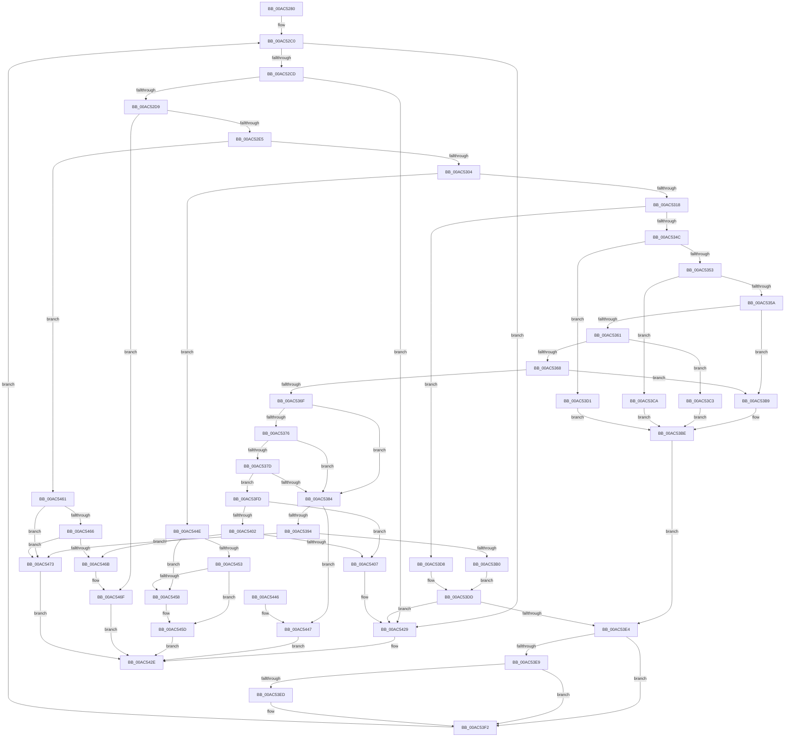

# SdbpValidateRootTagSizes

- RVA: `0x00AC5280`–`0x00AC547A` (길이 `506` bytes)
- VA: `0x0000000140AC5280`
- 실행 섹션: `PAGE`
- PDB 이름 있음: `예`; PDB Function 태그: `아니요`
- unwind 정보 RVA: `0x000BDEC0`
- 디코드: `149`개 명령, `506/506` bytes 표시
- 미해석 바이트: `0` (있으면 어셈블리에 `.byte`로 보존)

> 이 문서는 커널 이미지의 기계어와 PDB 기호를 분석해 생성했습니다. 4번과 5번은 함수 원형과 자료형을 바이너리 사용 방식에서 추정한 C 해석이며 원본 소스 복구 결과는 아닙니다.

## 1. Dependencies

- 직접 호출 지점: **3**; 고유 호출 대상: **2**
- 직접 호출자로 확인된 함수: **2**
- RIP 상대 이미지 참조: **2**

### Outgoing calls
- `0x00AC52F7` → [SdbpReadMappedData](../95/SdbpReadMappedData_function_0095E460.md) (function, `0x0095E460`)
- `0x00AC53A3` → [SdbpReadMappedData](../95/SdbpReadMappedData_function_0095E460.md) (function, `0x0095E460`)
- `0x00AC5424` → [AslLogCallPrintf](../95/AslLogCallPrintf_function_0095E4EC.md) (function, `0x0095E4EC`)

### Direct callers
- [SdbpOpenDatabaseInMemory](../95/SdbpOpenDatabaseInMemory_function_0095A574.md) at `0x0095A6B2`
- [SdbpValidateAndApplyCompatFlags](../AF/SdbpValidateAndApplyCompatFlags_function_00AF93D8.md) at `0x00AF9488`

### Static image references
- `0x00AC5407` → RVA `0x0003BD80` (`.rdata`; read)
- `0x00AC5418` → RVA `0x0003BD60` (`.rdata`; read)

## 2. Other-region calls and transfers

- 다른 실행 섹션으로 향하는 call: **0**
- 별도 외부 분기/꼬리 이동을 확인하지 못했습니다.

## 3. Assembly (complete function range)

```asm
00AC5280  48 89 5C 24 20                  mov qword ptr [rsp + 0x20], rbx
00AC5285  55                              push rbp
00AC5286  56                              push rsi
00AC5287  57                              push rdi
00AC5288  41 54                           push r12
00AC528A  41 55                           push r13
00AC528C  41 56                           push r14
00AC528E  41 57                           push r15
00AC5290  48 8B EC                        mov rbp, rsp
00AC5293  48 83 EC 30                     sub rsp, 0x30
00AC5297  8B 81 30 0A 00 00               mov eax, dword ptr [rcx + 0xa30]
00AC529D  33 DB                           xor ebx, ebx
00AC529F  83 E0 01                        and eax, 1
00AC52A2  89 5D 48                        mov dword ptr [rbp + 0x48], ebx
00AC52A5  89 45 50                        mov dword ptr [rbp + 0x50], eax
00AC52A8  48 8B F1                        mov rsi, rcx
00AC52AB  BF 0C 00 00 00                  mov edi, 0xc
00AC52B0  66 89 5D 40                     mov word ptr [rbp + 0x40], bx
00AC52B4  44 8B F3                        mov r14d, ebx
00AC52B7  44 8B EB                        mov r13d, ebx
00AC52BA  44 8B FB                        mov r15d, ebx
00AC52BD  44 8B E3                        mov r12d, ebx
00AC52C0  41 81 FD 00 01 00 00            cmp r13d, 0x100
00AC52C7  0F 8F 5C 01 00 00               jg 0x140ac5429
00AC52CD  41 8B C6                        mov eax, r14d
00AC52D0  48 3B F8                        cmp rdi, rax
00AC52D3  0F 8E 50 01 00 00               jle 0x140ac5429
00AC52D9  8B 46 14                        mov eax, dword ptr [rsi + 0x14]
00AC52DC  48 3B F8                        cmp rdi, rax
00AC52DF  0F 84 8A 01 00 00               je 0x140ac546f
00AC52E5  41 B9 02 00 00 00               mov r9d, 2
00AC52EB  4C 8D 45 40                     lea r8, [rbp + 0x40]
00AC52EF  8B D7                           mov edx, edi
00AC52F1  48 8B CE                        mov rcx, rsi
00AC52F4  44 8B F7                        mov r14d, edi
00AC52F7  E8 64 91 E9 FF                  call 0x14095e460
00AC52FC  85 C0                           test eax, eax
00AC52FE  0F 84 5D 01 00 00               je 0x140ac5461
00AC5304  0F B7 4D 40                     movzx ecx, word ptr [rbp + 0x40]
00AC5308  41 B8 00 10 00 00               mov r8d, 0x1000
00AC530E  66 41 3B C8                     cmp cx, r8w
00AC5312  0F 86 36 01 00 00               jbe 0x140ac544e
00AC5318  8B C3                           mov eax, ebx
00AC531A  BA 01 70 00 00                  mov edx, 0x7001
00AC531F  66 3B D1                        cmp dx, cx
00AC5322  BA 01 78 00 00                  mov edx, 0x7801
00AC5327  0F 94 C0                        sete al
00AC532A  44 0B E0                        or r12d, eax
00AC532D  8B C3                           mov eax, ebx
00AC532F  66 3B D1                        cmp dx, cx
00AC5332  0F 94 C0                        sete al
00AC5335  48 83 C7 02                     add rdi, 2
00AC5339  44 0B F8                        or r15d, eax
00AC533C  8B C1                           mov eax, ecx
00AC533E  25 00 F0 00 00                  and eax, 0xf000
00AC5343  41 3B C0                        cmp eax, r8d
00AC5346  0F 84 8C 00 00 00               je 0x140ac53d8
00AC534C  3D 00 20 00 00                  cmp eax, 0x2000
00AC5351  74 7E                           je 0x140ac53d1
00AC5353  3D 00 30 00 00                  cmp eax, 0x3000
00AC5358  74 70                           je 0x140ac53ca
00AC535A  3D 00 40 00 00                  cmp eax, 0x4000
00AC535F  74 58                           je 0x140ac53b9
00AC5361  3D 00 50 00 00                  cmp eax, 0x5000
00AC5366  74 5B                           je 0x140ac53c3
00AC5368  3D 00 60 00 00                  cmp eax, 0x6000
00AC536D  74 4A                           je 0x140ac53b9
00AC536F  3D 00 70 00 00                  cmp eax, 0x7000
00AC5374  74 0E                           je 0x140ac5384
00AC5376  3D 00 80 00 00                  cmp eax, 0x8000
00AC537B  74 07                           je 0x140ac5384
00AC537D  3D 00 90 00 00                  cmp eax, 0x9000
00AC5382  75 79                           jne 0x140ac53fd
00AC5384  8B 46 14                        mov eax, dword ptr [rsi + 0x14]
00AC5387  48 8D 4F 03                     lea rcx, [rdi + 3]
00AC538B  48 3B C8                        cmp rcx, rax
00AC538E  0F 87 B3 00 00 00               ja 0x140ac5447
00AC5394  41 B9 04 00 00 00               mov r9d, 4
00AC539A  4C 8D 45 48                     lea r8, [rbp + 0x48]
00AC539E  8B D7                           mov edx, edi
00AC53A0  48 8B CE                        mov rcx, rsi
00AC53A3  E8 B8 90 E9 FF                  call 0x14095e460
00AC53A8  85 C0                           test eax, eax
00AC53AA  0F 84 C3 00 00 00               je 0x140ac5473
00AC53B0  8B 45 48                        mov eax, dword ptr [rbp + 0x48]
00AC53B3  48 83 C7 04                     add rdi, 4
00AC53B7  EB 24                           jmp 0x140ac53dd
00AC53B9  B8 04 00 00 00                  mov eax, 4
00AC53BE  89 45 48                        mov dword ptr [rbp + 0x48], eax
00AC53C1  EB 21                           jmp 0x140ac53e4
00AC53C3  B8 08 00 00 00                  mov eax, 8
00AC53C8  EB F4                           jmp 0x140ac53be
00AC53CA  B8 02 00 00 00                  mov eax, 2
00AC53CF  EB ED                           jmp 0x140ac53be
00AC53D1  B8 01 00 00 00                  mov eax, 1
00AC53D6  EB E6                           jmp 0x140ac53be
00AC53D8  8B C3                           mov eax, ebx
00AC53DA  89 45 48                        mov dword ptr [rbp + 0x48], eax
00AC53DD  3D FF FF FF 0F                  cmp eax, 0xfffffff
00AC53E2  73 45                           jae 0x140ac5429
00AC53E4  39 5D 50                        cmp dword ptr [rbp + 0x50], ebx
00AC53E7  75 09                           jne 0x140ac53f2
00AC53E9  A8 01                           test al, 1
00AC53EB  74 05                           je 0x140ac53f2
00AC53ED  FF C0                           inc eax
00AC53EF  89 45 48                        mov dword ptr [rbp + 0x48], eax
00AC53F2  48 03 F8                        add rdi, rax
00AC53F5  41 FF C5                        inc r13d
00AC53F8  E9 C3 FE FF FF                  jmp 0x140ac52c0
00AC53FD  45 85 E4                        test r12d, r12d
00AC5400  74 05                           je 0x140ac5407
00AC5402  45 85 FF                        test r15d, r15d
00AC5405  75 64                           jne 0x140ac546b
00AC5407  4C 8D 0D 72 69 57 FF            lea r9, [rip - 0xa8968e]
00AC540E  89 44 24 20                     mov dword ptr [rsp + 0x20], eax
00AC5412  41 B8 1A 09 00 00               mov r8d, 0x91a
00AC5418  48 8D 15 41 69 57 FF            lea rdx, [rip - 0xa896bf]
00AC541F  B9 01 00 00 00                  mov ecx, 1
00AC5424  E8 C3 90 E9 FF                  call 0x14095e4ec
00AC5429  B8 E4 00 00 C0                  mov eax, 0xc00000e4
00AC542E  48 8B 9C 24 88 00 00 00         mov rbx, qword ptr [rsp + 0x88]
00AC5436  48 83 C4 30                     add rsp, 0x30
00AC543A  41 5F                           pop r15
00AC543C  41 5E                           pop r14
00AC543E  41 5D                           pop r13
00AC5440  41 5C                           pop r12
00AC5442  5F                              pop rdi
00AC5443  5E                              pop rsi
00AC5444  5D                              pop rbp
00AC5445  C3                              ret
00AC5446  CC                              int3
00AC5447  B8 1F 00 00 C0                  mov eax, 0xc000001f
00AC544C  EB E0                           jmp 0x140ac542e
00AC544E  45 85 E4                        test r12d, r12d
00AC5451  74 05                           je 0x140ac5458
00AC5453  45 85 FF                        test r15d, r15d
00AC5456  75 05                           jne 0x140ac545d
00AC5458  BB E4 00 00 C0                  mov ebx, 0xc00000e4
00AC545D  8B C3                           mov eax, ebx
00AC545F  EB CD                           jmp 0x140ac542e
00AC5461  45 85 E4                        test r12d, r12d
00AC5464  74 0D                           je 0x140ac5473
00AC5466  45 85 FF                        test r15d, r15d
00AC5469  74 08                           je 0x140ac5473
00AC546B  44 89 76 14                     mov dword ptr [rsi + 0x14], r14d
00AC546F  33 C0                           xor eax, eax
00AC5471  EB BB                           jmp 0x140ac542e
00AC5473  B8 58 01 00 C0                  mov eax, 0xc0000158
00AC5478  EB B4                           jmp 0x140ac542e
```

## 4. C-style interpretation (structured pseudocode)

```c
__int64 __fastcall SdbpValidateRootTagSizes(__int64 a1)
{
    __int64 result;
    __int64 v_r12;
    __int64 v_r13;
    __int64 v_r15;
    __int64 v_rbx;
    __int64 v_rdi;
    __int64 v_rsp;
    unsigned int v_stack_m48;
    unsigned int v_stack_p10;
    unsigned int v_stack_p18;
    unsigned __int64 v_stack_p20;
    unsigned __int16 v_stack_p8;

    v_stack_p20 = v_rbx;
    v_rsp = (v_rsp) - (48);
    v_rbx = 0;
    result = (unsigned int)(((unsigned int)(*(unsigned int *)(a1 + 2608))) & (1));
    v_stack_p10 = 0;
    v_stack_p18 = (unsigned int)(result);
    v_stack_p8 = 0;
loc_00AC52C0:
    if (0 > 256) goto loc_00AC5429;
    if (12 <= 0) goto loc_00AC5429;
    if (12 == ((unsigned int)(*(unsigned int *)(a1 + 20)))) goto loc_00AC546F;
    result = SdbpReadMappedData(a1, 12, v_stack_p8, 2);
    if ((unsigned int)(result) == 0) goto loc_00AC5461;
    if (((unsigned __int16)(v_stack_p8)) <= ((unsigned __int16)((unsigned int)(0x1000ULL)))) goto loc_00AC544E;
    result = (((unsigned __int16)((unsigned int)(0x7001ULL))) == ((unsigned __int16)(v_stack_p8))) ? 1 : 0;
    v_r12 = (unsigned int)((0) | ((unsigned int)(result)));
    result = (((unsigned __int16)((unsigned int)(0x7801ULL))) == ((unsigned __int16)(v_stack_p8))) ? 1 : 0;
    v_rdi = (12) + (2);
    v_r15 = (unsigned int)((0) | ((unsigned int)(result)));
    result = (unsigned int)(((unsigned int)((unsigned int)(v_stack_p8))) & (0xF000ULL));
    if (((unsigned int)(result)) == ((unsigned int)((unsigned int)(0x1000ULL)))) goto loc_00AC53D8;
    if (((unsigned int)(result)) == 0x2000ULL) goto loc_00AC53D1;
    if (((unsigned int)(result)) == 0x3000ULL) goto loc_00AC53CA;
    if (((unsigned int)(result)) == 0x4000ULL) goto loc_00AC53B9;
    if (((unsigned int)(result)) == 0x5000ULL) goto loc_00AC53C3;
    if (((unsigned int)(result)) == 0x6000ULL) goto loc_00AC53B9;
    if (((unsigned int)(result)) == 0x7000ULL) goto loc_00AC5384;
    if (((unsigned int)(result)) == 0x8000ULL) goto loc_00AC5384;
    if (((unsigned int)(result)) != 0x9000ULL) goto loc_00AC53FD;
loc_00AC5384:
    if ((v_rdi + 3) > ((unsigned int)(*(unsigned int *)(a1 + 20)))) goto loc_00AC5447;
    result = SdbpReadMappedData(a1, (unsigned int)((unsigned int)(v_rdi)), v_stack_p10, 4);
    if ((unsigned int)(result) == 0) goto loc_00AC5473;
    v_rdi = (v_rdi) + (4);
    goto loc_00AC53DD;
loc_00AC53B9:
loc_00AC53BE:
    v_stack_p10 = 4;
    goto loc_00AC53E4;
loc_00AC53C3:
    goto loc_00AC53BE;
loc_00AC53CA:
    goto loc_00AC53BE;
loc_00AC53D1:
    goto loc_00AC53BE;
loc_00AC53D8:
    v_stack_p10 = 0;
loc_00AC53DD:
    if (0 >= 0xFFFFFFFULL) goto loc_00AC5429;
loc_00AC53E4:
    if (v_stack_p18 != 0) goto loc_00AC53F2;
    result = 0;
    if (((0) & (1)) != 0) {
        result = (unsigned int)((0) + 1);
        v_stack_p10 = (unsigned int)(result);
    }
    v_rdi = (v_rdi) + (result);
    v_r13 = (unsigned int)((0) + 1);
    goto loc_00AC52C0;
loc_00AC53FD:
    if ((unsigned int)(v_r12) == 0) goto loc_00AC5407;
    if ((unsigned int)(v_r15) != 0) goto loc_00AC546B;
loc_00AC5407:
    v_stack_m48 = (unsigned int)(result);
    result = AslLogCallPrintf(1, v_rip - 11048639, (unsigned int)(0x91AULL), v_rip - 11048590);
loc_00AC5429:
loc_00AC542E:
    v_rsp = (v_rsp) + (48);
    return (unsigned int)(0xC00000E4ULL);
loc_00AC5447:
    goto loc_00AC542E;
loc_00AC544E:
    if ((unsigned int)(v_r12) == 0) goto loc_00AC5458;
    v_rbx = v_stack_p20;
    if ((unsigned int)(v_r15) == 0) {
        v_rbx = 0xC00000E4ULL;
    }
    goto loc_00AC542E;
loc_00AC5461:
    if ((unsigned int)(v_r12) == 0) goto loc_00AC5473;
    if ((unsigned int)(v_r15) == 0) goto loc_00AC5473;
loc_00AC546B:
    *(unsigned int *)(a1 + 20) = 12;
loc_00AC546F:
    result = 0;
    goto loc_00AC542E;
loc_00AC5473:
    goto loc_00AC542E;
}
```

## 5. (Beta) C Style

```c
int64_t SdbpValidateRootTagSizes(void *Arg1)
{
    uint8_t *arg1 = (uint8_t *)Arg1;

    int64_t result;
    int64_t local_r12;
    int64_t local_r13;
    int64_t local_r15;
    int64_t local_rbx;
    int64_t local_rdi;
    int64_t local_rsp;
    uint32_t v_stack_m48;
    uint32_t v_stack_p10;
    uint32_t v_stack_p18;
    uint64_t v_stack_p20;
    uint16_t v_stack_p8;

    v_stack_p20 = local_rbx;
    local_rsp = (local_rsp) - (48);
    local_rbx = 0;
    result = (uint32_t)(((uint32_t)(*(uint32_t *)(arg1 + 0xA30))) & (1));
    v_stack_p10 = 0;
    v_stack_p18 = (uint32_t)(result);
    v_stack_p8 = 0;
loc_00AC52C0:
    if (0 > 256) goto loc_00AC5429;
    if (12 <= 0) goto loc_00AC5429;
    if (12 == ((uint32_t)(*(uint32_t *)(arg1 + 0x14)))) goto loc_00AC546F;
    result = SdbpReadMappedData(Arg1, 12, v_stack_p8, 2);
    if ((uint32_t)(result) == 0) goto loc_00AC5461;
    if (((uint16_t)(v_stack_p8)) <= ((uint16_t)((uint32_t)(0x1000ULL)))) goto loc_00AC544E;
    result = (((uint16_t)((uint32_t)(0x7001ULL))) == ((uint16_t)(v_stack_p8))) ? 1 : 0;
    local_r12 = (uint32_t)((0) | ((uint32_t)(result)));
    result = (((uint16_t)((uint32_t)(0x7801ULL))) == ((uint16_t)(v_stack_p8))) ? 1 : 0;
    local_rdi = (12) + (2);
    local_r15 = (uint32_t)((0) | ((uint32_t)(result)));
    result = (uint32_t)(((uint32_t)((uint32_t)(v_stack_p8))) & (0xF000ULL));
    if (((uint32_t)(result)) == ((uint32_t)((uint32_t)(0x1000ULL)))) goto loc_00AC53D8;
    if (((uint32_t)(result)) == 0x2000ULL) goto loc_00AC53D1;
    if (((uint32_t)(result)) == 0x3000ULL) goto loc_00AC53CA;
    if (((uint32_t)(result)) == 0x4000ULL) goto loc_00AC53B9;
    if (((uint32_t)(result)) == 0x5000ULL) goto loc_00AC53C3;
    if (((uint32_t)(result)) == 0x6000ULL) goto loc_00AC53B9;
    if (((uint32_t)(result)) == 0x7000ULL) goto loc_00AC5384;
    if (((uint32_t)(result)) == 0x8000ULL) goto loc_00AC5384;
    if (((uint32_t)(result)) != 0x9000ULL) goto loc_00AC53FD;
loc_00AC5384:
    if ((local_rdi + 3) > ((uint32_t)(*(uint32_t *)(arg1 + 0x14)))) goto loc_00AC5447;
    result = SdbpReadMappedData(Arg1, (uint32_t)((uint32_t)(local_rdi)), v_stack_p10, 4);
    if ((uint32_t)(result) == 0) goto loc_00AC5473;
    local_rdi = (local_rdi) + (4);
    goto loc_00AC53DD;
loc_00AC53B9:
loc_00AC53BE:
    v_stack_p10 = 4;
    goto loc_00AC53E4;
loc_00AC53C3:
    goto loc_00AC53BE;
loc_00AC53CA:
    goto loc_00AC53BE;
loc_00AC53D1:
    goto loc_00AC53BE;
loc_00AC53D8:
    v_stack_p10 = 0;
loc_00AC53DD:
    if (0 >= 0xFFFFFFFULL) goto loc_00AC5429;
loc_00AC53E4:
    if (v_stack_p18 != 0) goto loc_00AC53F2;
    result = 0;
    if (((0) & (1)) != 0) {
        result = (uint32_t)((0) + 1);
        v_stack_p10 = (uint32_t)(result);
    }
    local_rdi = (local_rdi) + (result);
    local_r13 = (uint32_t)((0) + 1);
    goto loc_00AC52C0;
loc_00AC53FD:
    if ((uint32_t)(local_r12) == 0) goto loc_00AC5407;
    if ((uint32_t)(local_r15) != 0) goto loc_00AC546B;
loc_00AC5407:
    v_stack_m48 = (uint32_t)(result);
    result = AslLogCallPrintf(1, v_rip - 11048639, (uint32_t)(0x91AULL), v_rip - 11048590);
loc_00AC5429:
loc_00AC542E:
    local_rsp = (local_rsp) + (48);
    return (uint32_t)(0xC00000E4ULL);
loc_00AC5447:
    goto loc_00AC542E;
loc_00AC544E:
    if ((uint32_t)(local_r12) == 0) goto loc_00AC5458;
    local_rbx = v_stack_p20;
    if ((uint32_t)(local_r15) == 0) {
        local_rbx = 0xC00000E4ULL;
    }
    goto loc_00AC542E;
loc_00AC5461:
    if ((uint32_t)(local_r12) == 0) goto loc_00AC5473;
    if ((uint32_t)(local_r15) == 0) goto loc_00AC5473;
loc_00AC546B:
    *(uint32_t *)(arg1 + 0x14) = 12;
loc_00AC546F:
    result = 0;
    goto loc_00AC542E;
loc_00AC5473:
    goto loc_00AC542E;
}
```

### 관측된 메모리 오프셋

구조체 형식이 확인되지 않은 접근은 인자 기준의 오프셋으로만 기록했습니다.

| 기준 인자 | 오프셋 표현 | 폭 (bit) | 접근 |
|---|---:|---:|---|
| `Arg1` | `+ 0x14` | `32` | `R` |
| `Arg1` | `+ 0x14` | `32` | `W` |
| `Arg1` | `+ 0xA30` | `32` | `R` |

## 6. Execution-region graph

[열기: 2D/3D 그래프와 함수 탐색 컨트롤 패널](../../../control-panel.html?section=page&rva=0x00AC5280&view=graph)

- 2D 그래프는 위에서 아래로 흐르고, 3D 그래프는 빈 공간을 드래그해 회전합니다. Shift+드래그는 이동, 휠은 확대·축소, 함수 노드 선택은 대상 보고서 이동입니다.

### Static fallback


