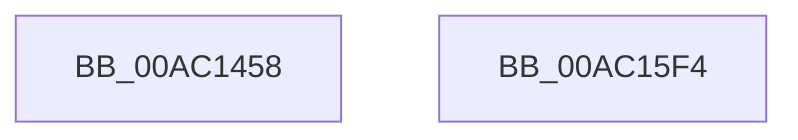

# SeAuditHandleDuplication

- RVA: `0x00AC1458`–`0x00AC15F5` (길이 `413` bytes)
- VA: `0x0000000140AC1458`
- 실행 섹션: `PAGE`
- PDB 이름 있음: `예`; PDB Function 태그: `아니요`
- unwind 정보 RVA: `0x000BD9F0`
- 디코드: `89`개 명령, `413/413` bytes 표시
- 미해석 바이트: `0` (있으면 어셈블리에 `.byte`로 보존)

> 이 문서는 커널 이미지의 기계어와 PDB 기호를 분석해 생성했습니다. 4번과 5번은 함수 원형과 자료형을 바이너리 사용 방식에서 추정한 C 해석이며 원본 소스 복구 결과는 아닙니다.

## 1. Dependencies

- 직접 호출 지점: **7**; 고유 호출 대상: **6**
- 직접 호출자로 확인된 함수: **3**
- RIP 상대 이미지 참조: **2**

### Outgoing calls
- `0x00AC14AD` → [SeCaptureSubjectContext](../86/SeCaptureSubjectContext_function_0086B820.md) (function, `0x0086B820`)
- `0x00AC14DD` → [memset](../../text/6C/memset_function_006C6C40.md) (function, `0x006C6C40`)
- `0x00AC1565` → [ObNormalizeHandleValue](../91/ObNormalizeHandleValue_function_0091E6A8.md) (function, `0x0091E6A8`)
- `0x00AC158C` → [ObNormalizeHandleValue](../91/ObNormalizeHandleValue_function_0091E6A8.md) (function, `0x0091E6A8`)
- `0x00AC15B5` → [SepAdtLogAuditRecord](../../text/22/SepAdtLogAuditRecord_function_00224B6C.md) (function, `0x00224B6C`)
- `0x00AC15BF` → [SeReleaseSubjectContext](../86/SeReleaseSubjectContext_function_0086B710.md) (function, `0x0086B710`)
- `0x00AC15CE` → [_security_check_cookie](../../text/6A/_security_check_cookie_function_006AC640.md) (function, `0x006AC640`)

### Direct callers
- [ObAuditInheritedHandleProcedure](../74/ObAuditInheritedHandleProcedure_function_0074D6E0.md) at `0x0074D713`
- [ObCompleteObjectDuplication](../89/ObCompleteObjectDuplication_function_0089387C.md) at `0x00893B53`
- [ObDuplicateObject](../8C/ObDuplicateObject_function_008C4FA0.md) at `0x008C5F15`

### Static image references
- `0x00AC147E` → RVA `0x00E0A740` (`.data`; read)
- `0x00AC1546` → RVA `0x000013A8` (`.rdata`; read)

## 2. Other-region calls and transfers

- 다른 실행 섹션으로 향하는 call: **3**
  - `0x00AC14DD` → [memset](../../text/6C/memset_function_006C6C40.md) (`PAGE` → `.text`)
  - `0x00AC15B5` → [SepAdtLogAuditRecord](../../text/22/SepAdtLogAuditRecord_function_00224B6C.md) (`PAGE` → `.text`)
  - `0x00AC15CE` → [_security_check_cookie](../../text/6A/_security_check_cookie_function_006AC640.md) (`PAGE` → `.text`)
- 별도 외부 분기/꼬리 이동을 확인하지 못했습니다.

## 3. Assembly (complete function range)

```asm
00AC1458  48 8B C4                        mov rax, rsp
00AC145B  48 89 58 08                     mov qword ptr [rax + 8], rbx
00AC145F  48 89 70 10                     mov qword ptr [rax + 0x10], rsi
00AC1463  4C 89 60 18                     mov qword ptr [rax + 0x18], r12
00AC1467  4C 89 68 20                     mov qword ptr [rax + 0x20], r13
00AC146B  55                              push rbp
00AC146C  41 56                           push r14
00AC146E  41 57                           push r15
00AC1470  48 8D A8 78 FC FF FF            lea rbp, [rax - 0x388]
00AC1477  48 81 EC 70 04 00 00            sub rsp, 0x470
00AC147E  48 8B 05 BB 92 34 00            mov rax, qword ptr [rip + 0x3492bb]
00AC1485  48 33 C4                        xor rax, rsp
00AC1488  48 89 85 60 03 00 00            mov qword ptr [rbp + 0x360], rax
00AC148F  0F 57 C0                        xorps xmm0, xmm0
00AC1492  4C 8B F1                        mov r14, rcx
00AC1495  48 8D 4C 24 20                  lea rcx, [rsp + 0x20]
00AC149A  4D 8B E9                        mov r13, r9
00AC149D  0F 11 44 24 20                  movups xmmword ptr [rsp + 0x20], xmm0
00AC14A2  4D 8B F8                        mov r15, r8
00AC14A5  4C 8B E2                        mov r12, rdx
00AC14A8  0F 11 44 24 30                  movups xmmword ptr [rsp + 0x30], xmm0
00AC14AD  E8 6E A3 DA FF                  call 0x14086b820
00AC14B2  48 8B 74 24 30                  mov rsi, qword ptr [rsp + 0x30]
00AC14B7  48 8D 4C 24 40                  lea rcx, [rsp + 0x40]
00AC14BC  48 83 7C 24 20 00               cmp qword ptr [rsp + 0x20], 0
00AC14C2  48 8B C6                        mov rax, rsi
00AC14C5  41 B8 18 04 00 00               mov r8d, 0x418
00AC14CB  48 0F 45 44 24 20               cmovne rax, qword ptr [rsp + 0x20]
00AC14D1  33 D2                           xor edx, edx
00AC14D3  48 8B 80 98 00 00 00            mov rax, qword ptr [rax + 0x98]
00AC14DA  48 8B 18                        mov rbx, qword ptr [rax]
00AC14DD  E8 5E 57 C0 FF                  call 0x1406c6c40
00AC14E2  48 83 7C 24 20 00               cmp qword ptr [rsp + 0x20], 0
00AC14E8  41 BA 08 00 00 00               mov r10d, 8
00AC14EE  C7 44 24 40 03 00 00 00         mov dword ptr [rsp + 0x40], 3
00AC14F6  49 8B CE                        mov rcx, r14
00AC14F9  48 0F 45 74 24 20               cmovne rsi, qword ptr [rsp + 0x20]
00AC14FF  C7 44 24 50 7C 00 08 00         mov dword ptr [rsp + 0x50], 0x8007c
00AC1507  C7 44 24 44 52 12 00 00         mov dword ptr [rsp + 0x44], 0x1252
00AC150F  45 8D 4A 03                     lea r9d, [r10 + 3]
00AC1513  C7 44 24 58 04 00 00 00         mov dword ptr [rsp + 0x58], 4
00AC151B  0F B6 43 01                     movzx eax, byte ptr [rbx + 1]
00AC151F  48 89 5C 24 70                  mov qword ptr [rsp + 0x70], rbx
00AC1524  C7 44 24 78 01 00 00 00         mov dword ptr [rsp + 0x78], 1
00AC152C  C7 44 24 7C 20 00 00 00         mov dword ptr [rsp + 0x7c], 0x20
00AC1534  8D 04 85 08 00 00 00            lea eax, [rax*4 + 8]
00AC153B  C7 45 98 05 00 00 00            mov dword ptr [rbp - 0x68], 5
00AC1542  89 44 24 5C                     mov dword ptr [rsp + 0x5c], eax
00AC1546  48 8D 05 5B FE 53 FF            lea rax, [rip - 0xac01a5]
00AC154D  48 89 45 90                     mov qword ptr [rbp - 0x70], rax
00AC1551  44 89 55 9C                     mov dword ptr [rbp - 0x64], r10d
00AC1555  48 8B 46 18                     mov rax, qword ptr [rsi + 0x18]
00AC1559  48 89 45 A0                     mov qword ptr [rbp - 0x60], rax
00AC155D  44 89 4D B8                     mov dword ptr [rbp - 0x48], r9d
00AC1561  44 89 55 BC                     mov dword ptr [rbp - 0x44], r10d
00AC1565  E8 3E D1 E5 FF                  call 0x14091e6a8
00AC156A  48 89 45 C0                     mov qword ptr [rbp - 0x40], rax
00AC156E  49 8B CC                        mov rcx, r12
00AC1571  49 8B 87 D0 01 00 00            mov rax, qword ptr [r15 + 0x1d0]
00AC1578  48 89 45 E0                     mov qword ptr [rbp - 0x20], rax
00AC157C  44 89 4D D8                     mov dword ptr [rbp - 0x28], r9d
00AC1580  44 89 55 DC                     mov dword ptr [rbp - 0x24], r10d
00AC1584  44 89 4D F8                     mov dword ptr [rbp - 8], r9d
00AC1588  44 89 55 FC                     mov dword ptr [rbp - 4], r10d
00AC158C  E8 17 D1 E5 FF                  call 0x14091e6a8
00AC1591  48 89 45 00                     mov qword ptr [rbp], rax
00AC1595  48 8D 4C 24 40                  lea rcx, [rsp + 0x40]
00AC159A  49 8B 85 D0 01 00 00            mov rax, qword ptr [r13 + 0x1d0]
00AC15A1  48 89 45 20                     mov qword ptr [rbp + 0x20], rax
00AC15A5  44 89 4D 18                     mov dword ptr [rbp + 0x18], r9d
00AC15A9  44 89 55 1C                     mov dword ptr [rbp + 0x1c], r10d
00AC15AD  C7 44 24 48 07 00 00 00         mov dword ptr [rsp + 0x48], 7
00AC15B5  E8 B2 35 76 FF                  call 0x140224b6c
00AC15BA  48 8D 4C 24 20                  lea rcx, [rsp + 0x20]
00AC15BF  E8 4C A1 DA FF                  call 0x14086b710
00AC15C4  48 8B 8D 60 03 00 00            mov rcx, qword ptr [rbp + 0x360]
00AC15CB  48 33 CC                        xor rcx, rsp
00AC15CE  E8 6D B0 BE FF                  call 0x1406ac640
00AC15D3  4C 8D 9C 24 70 04 00 00         lea r11, [rsp + 0x470]
00AC15DB  49 8B 5B 20                     mov rbx, qword ptr [r11 + 0x20]
00AC15DF  49 8B 73 28                     mov rsi, qword ptr [r11 + 0x28]
00AC15E3  4D 8B 63 30                     mov r12, qword ptr [r11 + 0x30]
00AC15E7  4D 8B 6B 38                     mov r13, qword ptr [r11 + 0x38]
00AC15EB  49 8B E3                        mov rsp, r11
00AC15EE  41 5F                           pop r15
00AC15F0  41 5E                           pop r14
00AC15F2  5D                              pop rbp
00AC15F3  C3                              ret
00AC15F4  CC                              int3
```

## 4. C-style interpretation (structured pseudocode)

```c
__int64 __fastcall SeAuditHandleDuplication(__int64 a1, __int64 a2, __int64 a3, __int64 a4)
{
    __int64 result;
    __int64 v_rsi;
    __int64 v_rsp;
    unsigned __int64 v_stack_m18;
    unsigned int v_stack_m40C;
    unsigned int v_stack_m410;
    unsigned __int64 v_stack_m418;
    unsigned int v_stack_m42C;
    unsigned int v_stack_m430;
    unsigned int v_stack_m438;
    unsigned int v_stack_m440;
    unsigned int v_stack_m444;
    unsigned __int64 v_stack_m448;
    unsigned __int64 v_stack_m458;
    unsigned __int64 v_stack_m468;

    *(unsigned __int64 *)(v_rsp + 8) = v_rbx;
    *(unsigned __int64 *)(v_rsp + 16) = v_rsi;
    *(unsigned __int64 *)(v_rsp + 24) = v_r12;
    *(unsigned __int64 *)(v_rsp + 32) = v_r13;
    v_rsp = (v_rsp) - (0x470ULL);
    result = (*(unsigned __int64 *)(v_rip + 3445435)) ^ (v_rsp);
    *(unsigned __int64 *)(v_rsp - 904 + 864) = result;
    v_stack_m468 = v_xmm0;
    v_stack_m458 = v_xmm0;
    result = SeCaptureSubjectContext(v_stack_m468, a2, a3, a4);
    result = v_stack_m458;
    if (v_stack_m468 != 0) { result = v_stack_m468; }
    a2 = 0;
    result = memset(v_stack_m448, a2, (unsigned int)(0x418ULL), a4);
    v_stack_m448 = 3;
    v_rsi = v_stack_m458;
    if (v_stack_m468 != 0) { v_rsi = v_stack_m468; }
    v_stack_m438 = 0x8007CULL;
    v_stack_m444 = 0x1252ULL;
    v_stack_m430 = 4;
    v_stack_m418 = *(unsigned __int64 *)(*(unsigned __int64 *)(result + 152));
    v_stack_m410 = 1;
    v_stack_m40C = 32;
    *(unsigned int *)(v_rsp - 904 - 104) = 5;
    v_stack_m42C = (unsigned int)(*(unsigned __int8 *)(*(unsigned __int64 *)(*(unsigned __int64 *)(result + 152)) + 1) * 4 + 8);
    *(unsigned __int64 *)(v_rsp - 904 - 112) = v_rip - 11272613;
    *(unsigned int *)(v_rsp - 904 - 100) = 8;
    *(unsigned __int64 *)(v_rsp - 904 - 96) = *(unsigned __int64 *)(v_rsi + 24);
    *(unsigned int *)(v_rsp - 904 - 72) = (unsigned int)(8 + 3);
    *(unsigned int *)(v_rsp - 904 - 68) = 8;
    result = ObNormalizeHandleValue(a1, a2, (unsigned int)(0x418ULL), 8 + 3);
    *(unsigned __int64 *)(v_rsp - 904 - 64) = result;
    *(unsigned __int64 *)(v_rsp - 904 - 32) = *(unsigned __int64 *)(a3 + 464);
    *(unsigned int *)(v_rsp - 904 - 40) = (unsigned int)(8 + 3);
    *(unsigned int *)(v_rsp - 904 - 36) = 8;
    *(unsigned int *)(v_rsp - 904 - 8) = (unsigned int)(8 + 3);
    *(unsigned int *)(v_rsp - 904 - 4) = 8;
    result = ObNormalizeHandleValue(0, a2, (unsigned int)(0x418ULL), 8 + 3);
    *(unsigned __int64 *)(v_rsp - 904) = result;
    *(unsigned __int64 *)(v_rsp - 904 + 32) = *(unsigned __int64 *)(a4 + 464);
    *(unsigned int *)(v_rsp - 904 + 24) = (unsigned int)(8 + 3);
    *(unsigned int *)(v_rsp - 904 + 28) = 8;
    v_stack_m440 = 7;
    result = SepAdtLogAuditRecord(v_stack_m448, a2, (unsigned int)(0x418ULL), 8 + 3);
    result = SeReleaseSubjectContext(v_stack_m468, a2, (unsigned int)(0x418ULL), 8 + 3);
    a1 = (*(unsigned __int64 *)(v_rsp - 904 + 864)) ^ (v_rsp);
    result = _security_check_cookie(a1, a2, (unsigned int)(0x418ULL), 8 + 3);
    return result;
}
```

## 5. (Beta) C Style

```c
int64_t SeAuditHandleDuplication(int64_t Arg1, int64_t Arg2, void *Arg3, void *Arg4)
{
    uint8_t *arg3 = (uint8_t *)Arg3;
    uint8_t *arg4 = (uint8_t *)Arg4;

    int64_t result;
    int64_t local_rsi;
    int64_t local_rsp;
    uint64_t v_stack_m18;
    uint32_t v_stack_m40C;
    uint32_t v_stack_m410;
    uint64_t v_stack_m418;
    uint32_t v_stack_m42C;
    uint32_t v_stack_m430;
    uint32_t v_stack_m438;
    uint32_t v_stack_m440;
    uint32_t v_stack_m444;
    uint64_t v_stack_m448;
    uint64_t v_stack_m458;
    uint64_t v_stack_m468;

    *(uint64_t *)(local_rsp + 0x8) = local_rbx;
    *(uint64_t *)(local_rsp + 0x10) = local_rsi;
    *(uint64_t *)(local_rsp + 0x18) = local_r12;
    *(uint64_t *)(local_rsp + 0x20) = local_r13;
    local_rsp = (local_rsp) - (0x470ULL);
    result = (*(uint64_t *)(v_rip + 0x3492BB)) ^ (local_rsp);
    *(uint64_t *)(local_rsp - 0x388 + 0x360) = result;
    v_stack_m468 = v_xmm0;
    v_stack_m458 = v_xmm0;
    result = SeCaptureSubjectContext(v_stack_m468, Arg2, Arg3, Arg4);
    result = v_stack_m458;
    if (v_stack_m468 != 0) { result = v_stack_m468; }
    Arg2 = 0;
    result = memset(v_stack_m448, Arg2, (uint32_t)(0x418ULL), Arg4);
    v_stack_m448 = 3;
    local_rsi = v_stack_m458;
    if (v_stack_m468 != 0) { local_rsi = v_stack_m468; }
    v_stack_m438 = 0x8007CULL;
    v_stack_m444 = 0x1252ULL;
    v_stack_m430 = 4;
    v_stack_m418 = *(uint64_t *)(*(uint64_t *)(result + 0x98));
    v_stack_m410 = 1;
    v_stack_m40C = 32;
    *(uint32_t *)(local_rsp - 0x388 - 0x68) = 5;
    v_stack_m42C = (uint32_t)(*(uint8_t *)(*(uint64_t *)(*(uint64_t *)(result + 0x98)) + 0x1) * 4 + 8);
    *(uint64_t *)(local_rsp - 0x388 - 0x70) = v_rip - 11272613;
    *(uint32_t *)(local_rsp - 0x388 - 0x64) = 8;
    *(uint64_t *)(local_rsp - 0x388 - 0x60) = *(uint64_t *)(local_rsi + 0x18);
    *(uint32_t *)(local_rsp - 0x388 - 0x48) = (uint32_t)(8 + 3);
    *(uint32_t *)(local_rsp - 0x388 - 0x44) = 8;
    result = ObNormalizeHandleValue(Arg1, Arg2, (uint32_t)(0x418ULL), 8 + 3);
    *(uint64_t *)(local_rsp - 0x388 - 0x40) = result;
    *(uint64_t *)(local_rsp - 0x388 - 0x20) = *(uint64_t *)(arg3 + 0x1D0);
    *(uint32_t *)(local_rsp - 0x388 - 0x28) = (uint32_t)(8 + 3);
    *(uint32_t *)(local_rsp - 0x388 - 0x24) = 8;
    *(uint32_t *)(local_rsp - 0x388 - 0x8) = (uint32_t)(8 + 3);
    *(uint32_t *)(local_rsp - 0x388 - 0x4) = 8;
    result = ObNormalizeHandleValue(0, Arg2, (uint32_t)(0x418ULL), 8 + 3);
    *(uint64_t *)(local_rsp - 0x388) = result;
    *(uint64_t *)(local_rsp - 0x388 + 0x20) = *(uint64_t *)(arg4 + 0x1D0);
    *(uint32_t *)(local_rsp - 0x388 + 0x18) = (uint32_t)(8 + 3);
    *(uint32_t *)(local_rsp - 0x388 + 0x1C) = 8;
    v_stack_m440 = 7;
    result = SepAdtLogAuditRecord(v_stack_m448, Arg2, (uint32_t)(0x418ULL), 8 + 3);
    result = SeReleaseSubjectContext(v_stack_m468, Arg2, (uint32_t)(0x418ULL), 8 + 3);
    Arg1 = (*(uint64_t *)(local_rsp - 0x388 + 0x360)) ^ (local_rsp);
    result = _security_check_cookie(Arg1, Arg2, (uint32_t)(0x418ULL), 8 + 3);
    return result;
}
```

### 관측된 메모리 오프셋

구조체 형식이 확인되지 않은 접근은 인자 기준의 오프셋으로만 기록했습니다.

| 기준 인자 | 오프셋 표현 | 폭 (bit) | 접근 |
|---|---:|---:|---|
| `Arg3` | `+ 0x1D0` | `64` | `R` |
| `Arg4` | `+ 0x1D0` | `64` | `R` |

## 6. Execution-region graph

[열기: 2D/3D 그래프와 함수 탐색 컨트롤 패널](../../../control-panel.html?section=page&rva=0x00AC1458&view=graph)

- 2D 그래프는 위에서 아래로 흐르고, 3D 그래프는 빈 공간을 드래그해 회전합니다. Shift+드래그는 이동, 휠은 확대·축소, 함수 노드 선택은 대상 보고서 이동입니다.

### Static fallback


