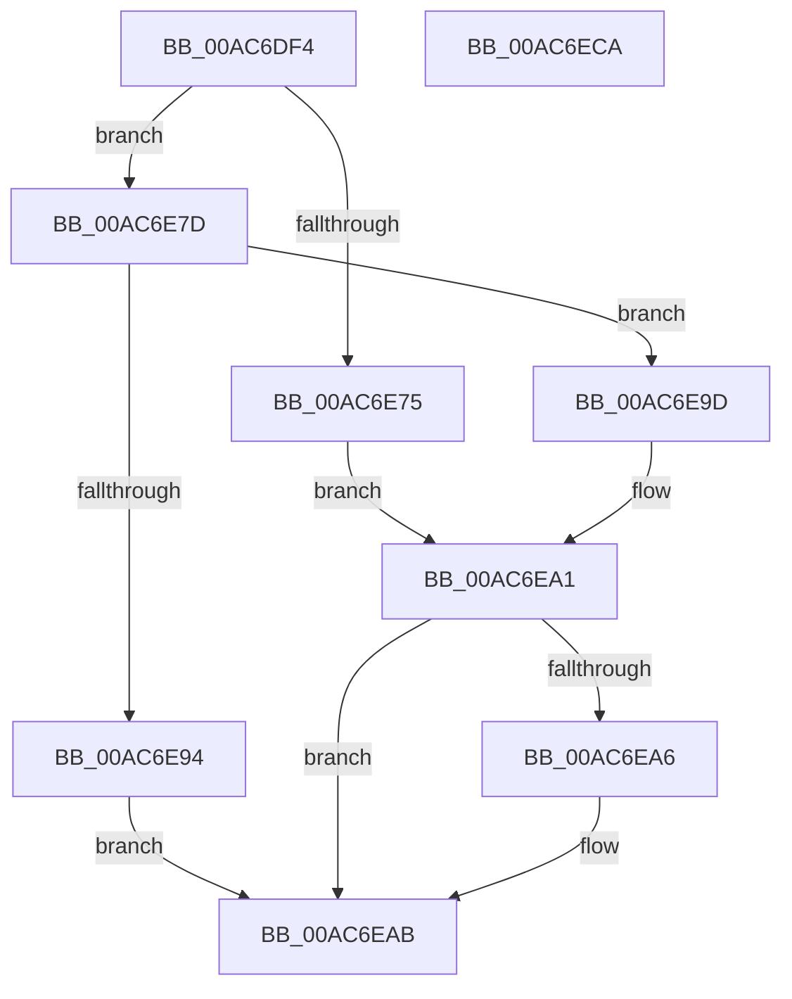

# SeDuplicateTokenAndAddOriginClaim

- RVA: `0x00AC6DF4`–`0x00AC6ECB` (길이 `215` bytes)
- VA: `0x0000000140AC6DF4`
- 실행 섹션: `PAGE`
- PDB 이름 있음: `예`; PDB Function 태그: `아니요`
- unwind 정보 RVA: `0x000BDF9C`
- 디코드: `60`개 명령, `215/215` bytes 표시
- 미해석 바이트: `0` (있으면 어셈블리에 `.byte`로 보존)

> 이 문서는 커널 이미지의 기계어와 PDB 기호를 분석해 생성했습니다. 4번과 5번은 함수 원형과 자료형을 바이너리 사용 방식에서 추정한 C 해석이며 원본 소스 복구 결과는 아닙니다.

## 1. Dependencies

- 직접 호출 지점: **3**; 고유 호출 대상: **3**
- 직접 호출자로 확인된 함수: **1**
- RIP 상대 이미지 참조: **0**

### Outgoing calls
- `0x00AC6E6A` → [SepDuplicateToken](../8B/SepDuplicateToken_function_008B87EC.md) (function, `0x008B87EC`)
- `0x00AC6E89` → [SepAddTokenOriginClaim](../AF/SepAddTokenOriginClaim_function_00AF2130.md) (function, `0x00AF2130`)
- `0x00AC6EA6` → [ObfDereferenceObject](../../text/2F/ObfDereferenceObject_function_002F9350.md) (function, `0x002F9350`)

### Direct callers
- [NtCreateUserProcess](../AE/NtCreateUserProcess_function_00AEA680.md) at `0x00AEAEB8`

### Static image references
- 디코드된 RIP-relative 메모리 참조가 없습니다.

## 2. Other-region calls and transfers

- 다른 실행 섹션으로 향하는 call: **1**
  - `0x00AC6EA6` → [ObfDereferenceObject](../../text/2F/ObfDereferenceObject_function_002F9350.md) (`PAGE` → `.text`)
- 별도 외부 분기/꼬리 이동을 확인하지 못했습니다.

## 3. Assembly (complete function range)

```asm
00AC6DF4  4C 8B DC                        mov r11, rsp
00AC6DF7  49 89 5B 08                     mov qword ptr [r11 + 8], rbx
00AC6DFB  49 89 73 10                     mov qword ptr [r11 + 0x10], rsi
00AC6DFF  49 89 7B 18                     mov qword ptr [r11 + 0x18], rdi
00AC6E03  4D 89 73 20                     mov qword ptr [r11 + 0x20], r14
00AC6E07  55                              push rbp
00AC6E08  48 8B EC                        mov rbp, rsp
00AC6E0B  48 81 EC 80 00 00 00            sub rsp, 0x80
00AC6E12  48 83 65 C0 00                  and qword ptr [rbp - 0x40], 0
00AC6E17  48 8D 45 C0                     lea rax, [rbp - 0x40]
00AC6E1B  83 65 E4 00                     and dword ptr [rbp - 0x1c], 0
00AC6E1F  49 8B F9                        mov rdi, r9
00AC6E22  48 83 65 D0 00                  and qword ptr [rbp - 0x30], 0
00AC6E27  41 8B F0                        mov esi, r8d
00AC6E2A  83 65 E0 00                     and dword ptr [rbp - 0x20], 0
00AC6E2E  4C 8B F2                        mov r14, rdx
00AC6E31  48 83 65 D8 00                  and qword ptr [rbp - 0x28], 0
00AC6E36  48 8D 55 C8                     lea rdx, [rbp - 0x38]
00AC6E3A  49 89 43 B0                     mov qword ptr [r11 - 0x50], rax
00AC6E3E  0F 57 C0                        xorps xmm0, xmm0
00AC6E41  C6 44 24 30 00                  mov byte ptr [rsp + 0x30], 0
00AC6E46  41 B9 01 00 00 00               mov r9d, 1
00AC6E4C  48 C7 45 C8 30 00 00 00         mov qword ptr [rbp - 0x38], 0x30
00AC6E54  45 33 C0                        xor r8d, r8d
00AC6E57  83 65 CC 00                     and dword ptr [rbp - 0x34], 0
00AC6E5B  C6 44 24 28 00                  mov byte ptr [rsp + 0x28], 0
00AC6E60  83 64 24 20 00                  and dword ptr [rsp + 0x20], 0
00AC6E65  F3 0F 7F 45 E8                  movdqu xmmword ptr [rbp - 0x18], xmm0
00AC6E6A  E8 7D 19 DF FF                  call 0x1408b87ec
00AC6E6F  8B D8                           mov ebx, eax
00AC6E71  85 C0                           test eax, eax
00AC6E73  79 08                           jns 0x140ac6e7d
00AC6E75  33 C9                           xor ecx, ecx
00AC6E77  48 89 4D C0                     mov qword ptr [rbp - 0x40], rcx
00AC6E7B  EB 24                           jmp 0x140ac6ea1
00AC6E7D  4C 8B 45 C0                     mov r8, qword ptr [rbp - 0x40]
00AC6E81  41 B1 01                        mov r9b, 1
00AC6E84  8B D6                           mov edx, esi
00AC6E86  49 8B CE                        mov rcx, r14
00AC6E89  E8 A2 B2 02 00                  call 0x140af2130
00AC6E8E  8B D8                           mov ebx, eax
00AC6E90  85 C0                           test eax, eax
00AC6E92  78 09                           js 0x140ac6e9d
00AC6E94  48 8B 45 C0                     mov rax, qword ptr [rbp - 0x40]
00AC6E98  48 89 07                        mov qword ptr [rdi], rax
00AC6E9B  EB 0E                           jmp 0x140ac6eab
00AC6E9D  48 8B 4D C0                     mov rcx, qword ptr [rbp - 0x40]
00AC6EA1  48 85 C9                        test rcx, rcx
00AC6EA4  74 05                           je 0x140ac6eab
00AC6EA6  E8 A5 24 83 FF                  call 0x1402f9350
00AC6EAB  4C 8D 9C 24 80 00 00 00         lea r11, [rsp + 0x80]
00AC6EB3  8B C3                           mov eax, ebx
00AC6EB5  49 8B 5B 10                     mov rbx, qword ptr [r11 + 0x10]
00AC6EB9  49 8B 73 18                     mov rsi, qword ptr [r11 + 0x18]
00AC6EBD  49 8B 7B 20                     mov rdi, qword ptr [r11 + 0x20]
00AC6EC1  4D 8B 73 28                     mov r14, qword ptr [r11 + 0x28]
00AC6EC5  49 8B E3                        mov rsp, r11
00AC6EC8  5D                              pop rbp
00AC6EC9  C3                              ret
00AC6ECA  CC                              int3
```

## 4. C-style interpretation (structured pseudocode)

```c
__int64 __fastcall SeDuplicateTokenAndAddOriginClaim(int a1, __int64 a2, int a3, __int64 a4)
{
    __int64 result;
    __int64 v_rsp;
    unsigned __int64 v_stack_m20;
    unsigned int v_stack_m24;
    unsigned int v_stack_m28;
    unsigned __int64 v_stack_m30;
    unsigned __int64 v_stack_m38;
    unsigned int v_stack_m3C;
    unsigned __int64 v_stack_m40;
    unsigned __int64 v_stack_m48;
    unsigned __int8 v_stack_m58;
    unsigned __int8 v_stack_m60;
    unsigned int v_stack_m68;
    unsigned __int64 v_stack_m8;

    *(unsigned __int64 *)(v_rsp + 8) = v_rbx;
    *(unsigned __int64 *)(v_rsp + 16) = v_rsi;
    *(unsigned __int64 *)(v_rsp + 24) = v_rdi;
    *(unsigned __int64 *)(v_rsp + 32) = v_r14;
    v_rsp = (v_rsp) - (128);
    *(unsigned __int64 *)(v_rsp - 80) = v_stack_m48;
    v_stack_m58 = 0;
    v_stack_m40 = 48;
    a3 = 0;
    v_stack_m60 = 0;
    v_stack_m20 = v_xmm0;
    result = SepDuplicateToken(a1, v_stack_m40, a3, 1);
    if (!sign_flag) goto loc_00AC6E7D;
    a1 = 0;
    v_stack_m48 = 0;
    goto loc_00AC6EA1;
loc_00AC6E7D:
    result = SepAddTokenOriginClaim(a2, (unsigned int)((unsigned int)((unsigned int)(a3))), v_stack_m48, 1);
    if (sign_flag) goto loc_00AC6E9D;
    *(unsigned __int64 *)(a4) = v_stack_m48;
    goto loc_00AC6EAB;
loc_00AC6E9D:
loc_00AC6EA1:
    result = v_stack_m48;
    if (v_stack_m48 != 0) {
        result = ObfDereferenceObject(v_stack_m48, (unsigned int)((unsigned int)((unsigned int)(a3))), v_stack_m48, 1);
    }
    return (unsigned int)((unsigned int)((unsigned int)((unsigned int)(result))));
}
```

## 5. (Beta) C Style

```c
int64_t SeDuplicateTokenAndAddOriginClaim(int32_t Arg1, int64_t Arg2, int32_t Arg3, void *Arg4)
{
    uint8_t *arg4 = (uint8_t *)Arg4;

    int64_t result;
    int64_t local_rsp;
    uint64_t v_stack_m20;
    uint32_t v_stack_m24;
    uint32_t v_stack_m28;
    uint64_t v_stack_m30;
    uint64_t v_stack_m38;
    uint32_t v_stack_m3C;
    uint64_t v_stack_m40;
    uint64_t v_stack_m48;
    uint8_t v_stack_m58;
    uint8_t v_stack_m60;
    uint32_t v_stack_m68;
    uint64_t v_stack_m8;

    *(uint64_t *)(local_rsp + 0x8) = local_rbx;
    *(uint64_t *)(local_rsp + 0x10) = local_rsi;
    *(uint64_t *)(local_rsp + 0x18) = local_rdi;
    *(uint64_t *)(local_rsp + 0x20) = local_r14;
    local_rsp = (local_rsp) - (128);
    *(uint64_t *)(local_rsp - 0x50) = v_stack_m48;
    v_stack_m58 = 0;
    v_stack_m40 = 48;
    Arg3 = 0;
    v_stack_m60 = 0;
    v_stack_m20 = v_xmm0;
    result = SepDuplicateToken(Arg1, v_stack_m40, Arg3, 1);
    if (!sign_flag) goto loc_00AC6E7D;
    Arg1 = 0;
    v_stack_m48 = 0;
    goto loc_00AC6EA1;
loc_00AC6E7D:
    result = SepAddTokenOriginClaim(Arg2, (uint32_t)((uint32_t)((uint32_t)(Arg3))), v_stack_m48, 1);
    if (sign_flag) goto loc_00AC6E9D;
    *(uint64_t *)(arg4) = v_stack_m48;
    goto loc_00AC6EAB;
loc_00AC6E9D:
loc_00AC6EA1:
    result = v_stack_m48;
    if (v_stack_m48 != 0) {
        result = ObfDereferenceObject(v_stack_m48, (uint32_t)((uint32_t)((uint32_t)(Arg3))), v_stack_m48, 1);
    }
    return (uint32_t)((uint32_t)((uint32_t)((uint32_t)(result))));
}
```

### 관측된 메모리 오프셋

구조체 형식이 확인되지 않은 접근은 인자 기준의 오프셋으로만 기록했습니다.

| 기준 인자 | 오프셋 표현 | 폭 (bit) | 접근 |
|---|---:|---:|---|
| `Arg4` | `+ 0x0` | `64` | `W` |

## 6. Execution-region graph

[열기: 2D/3D 그래프와 함수 탐색 컨트롤 패널](../../../control-panel.html?section=page&rva=0x00AC6DF4&view=graph)

- 2D 그래프는 위에서 아래로 흐르고, 3D 그래프는 빈 공간을 드래그해 회전합니다. Shift+드래그는 이동, 휠은 확대·축소, 함수 노드 선택은 대상 보고서 이동입니다.

### Static fallback


