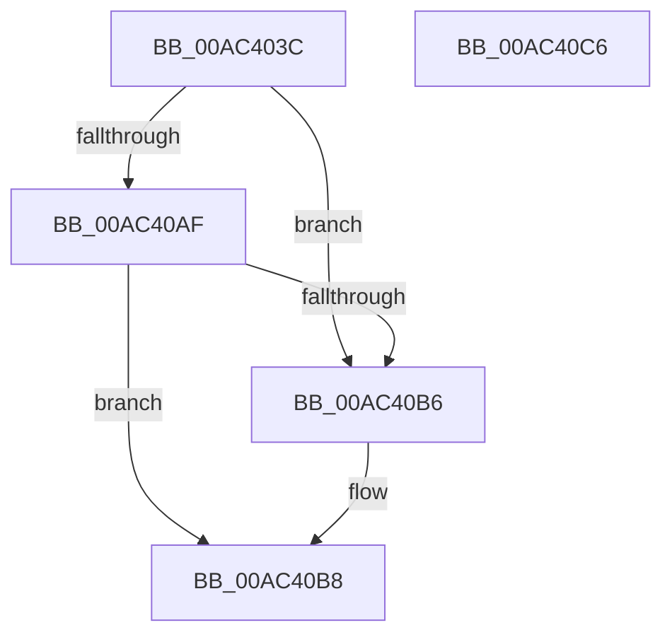

# SepAdtOpenEtwReadyEvent

- RVA: `0x00AC403C`–`0x00AC40C7` (길이 `139` bytes)
- VA: `0x0000000140AC403C`
- 실행 섹션: `PAGE`
- PDB 이름 있음: `예`; PDB Function 태그: `아니요`
- unwind 정보 RVA: `0x000AF604`
- 디코드: `35`개 명령, `139/139` bytes 표시
- 미해석 바이트: `0` (있으면 어셈블리에 `.byte`로 보존)

> 이 문서는 커널 이미지의 기계어와 PDB 기호를 분석해 생성했습니다. 4번과 5번은 함수 원형과 자료형을 바이너리 사용 방식에서 추정한 C 해석이며 원본 소스 복구 결과는 아닙니다.

## 1. Dependencies

- 직접 호출 지점: **2**; 고유 호출 대상: **2**
- 직접 호출자로 확인된 함수: **2**
- RIP 상대 이미지 참조: **1**

### Outgoing calls
- `0x00AC406E` → [RtlInitUnicodeString](../../text/42/RtlInitUnicodeString_function_0042A780.md) (function, `0x0042A780`)
- `0x00AC40A3` → [NtCreateEvent](../8B/NtCreateEvent_function_008B9140.md) (function, `0x008B9140`)

### Direct callers
- [SepRmCallLsa](../../text/22/SepRmCallLsa_function_00223630.md) at `0x002238B2`
- [SepAdtInitializeAuditingOptions](../../init/C4/SepAdtInitializeAuditingOptions_function_00C4BC1C.md) at `0x00C4BC36`

### Static image references
- `0x00AC404D` → RVA `0x00B06360` (` ?? ::NNGAKEGL::`string'`; read)

## 2. Other-region calls and transfers

- 다른 실행 섹션으로 향하는 call: **1**
  - `0x00AC406E` → [RtlInitUnicodeString](../../text/42/RtlInitUnicodeString_function_0042A780.md) (`PAGE` → `.text`)
- 별도 외부 분기/꼬리 이동을 확인하지 못했습니다.

## 3. Assembly (complete function range)

```asm
00AC403C  48 89 5C 24 08                  mov qword ptr [rsp + 8], rbx
00AC4041  55                              push rbp
00AC4042  48 8B EC                        mov rbp, rsp
00AC4045  48 83 EC 70                     sub rsp, 0x70
00AC4049  83 65 EC 00                     and dword ptr [rbp - 0x14], 0
00AC404D  48 8D 15 0C 23 04 00            lea rdx, [rip + 0x4230c]
00AC4054  48 8B D9                        mov rbx, rcx
00AC4057  48 C7 45 D0 30 00 00 00         mov qword ptr [rbp - 0x30], 0x30
00AC405F  83 65 D4 00                     and dword ptr [rbp - 0x2c], 0
00AC4063  48 8D 4D C0                     lea rcx, [rbp - 0x40]
00AC4067  0F 57 C0                        xorps xmm0, xmm0
00AC406A  0F 11 45 C0                     movups xmmword ptr [rbp - 0x40], xmm0
00AC406E  E8 0D 67 96 FF                  call 0x14042a780
00AC4073  48 83 65 D8 00                  and qword ptr [rbp - 0x28], 0
00AC4078  48 8D 45 C0                     lea rax, [rbp - 0x40]
00AC407C  0F 57 C0                        xorps xmm0, xmm0
00AC407F  48 89 45 E0                     mov qword ptr [rbp - 0x20], rax
00AC4083  45 33 C9                        xor r9d, r9d
00AC4086  C7 45 E8 80 02 00 00            mov dword ptr [rbp - 0x18], 0x280
00AC408D  4C 8D 45 D0                     lea r8, [rbp - 0x30]
00AC4091  C6 44 24 20 00                  mov byte ptr [rsp + 0x20], 0
00AC4096  BA 03 00 10 00                  mov edx, 0x100003
00AC409B  48 8B CB                        mov rcx, rbx
00AC409E  F3 0F 7F 45 F0                  movdqu xmmword ptr [rbp - 0x10], xmm0
00AC40A3  E8 98 50 DF FF                  call 0x1408b9140
00AC40A8  3D 00 00 00 40                  cmp eax, 0x40000000
00AC40AD  74 07                           je 0x140ac40b6
00AC40AF  3D 35 00 00 C0                  cmp eax, 0xc0000035
00AC40B4  75 02                           jne 0x140ac40b8
00AC40B6  33 C0                           xor eax, eax
00AC40B8  48 8B 9C 24 80 00 00 00         mov rbx, qword ptr [rsp + 0x80]
00AC40C0  48 83 C4 70                     add rsp, 0x70
00AC40C4  5D                              pop rbp
00AC40C5  C3                              ret
00AC40C6  CC                              int3
```

## 4. C-style interpretation (structured pseudocode)

```c
__int64 __fastcall SepAdtOpenEtwReadyEvent(__int64 a1, __int64 a2, __int64 a3, int a4)
{
    __int64 result;
    __int64 v_rsp;
    unsigned __int64 v_stack_m18;
    unsigned int v_stack_m1C;
    unsigned int v_stack_m20;
    unsigned __int64 v_stack_m28;
    unsigned __int64 v_stack_m30;
    unsigned int v_stack_m34;
    unsigned __int64 v_stack_m38;
    unsigned __int64 v_stack_m48;
    unsigned __int8 v_stack_m58;
    unsigned __int64 v_stack_p8;

    v_stack_p8 = v_rbx;
    v_rsp = (v_rsp) - (112);
    v_stack_m38 = 48;
    v_stack_m48 = v_xmm0;
    result = RtlInitUnicodeString(v_stack_m48, v_rip + 271116, a3, a4);
    v_stack_m28 = v_stack_m48;
    a4 = 0;
    v_stack_m20 = 640;
    v_stack_m58 = 0;
    v_stack_m18 = v_xmm0;
    result = NtCreateEvent(a1, (unsigned int)(0x100003ULL), v_stack_m38, a4);
    if (((unsigned int)(result)) == 0x40000000ULL) goto loc_00AC40B6;
    if (((unsigned int)(result)) == 0xC0000035ULL) {
        result = 0;
    }
    v_rsp = (v_rsp) + (112);
    return result;
}
```

## 5. (Beta) C Style

```c
int64_t SepAdtOpenEtwReadyEvent(int64_t Arg1, int64_t Arg2, int64_t Arg3, int32_t Arg4)
{
    int64_t result;
    int64_t local_rsp;
    uint64_t v_stack_m18;
    uint32_t v_stack_m1C;
    uint32_t v_stack_m20;
    uint64_t v_stack_m28;
    uint64_t v_stack_m30;
    uint32_t v_stack_m34;
    uint64_t v_stack_m38;
    uint64_t v_stack_m48;
    uint8_t v_stack_m58;
    uint64_t v_stack_p8;

    v_stack_p8 = local_rbx;
    local_rsp = (local_rsp) - (112);
    v_stack_m38 = 48;
    v_stack_m48 = v_xmm0;
    result = RtlInitUnicodeString(v_stack_m48, v_rip + 271116, Arg3, Arg4);
    v_stack_m28 = v_stack_m48;
    Arg4 = 0;
    v_stack_m20 = 640;
    v_stack_m58 = 0;
    v_stack_m18 = v_xmm0;
    result = NtCreateEvent(Arg1, (uint32_t)(0x100003ULL), v_stack_m38, Arg4);
    if (((uint32_t)(result)) == 0x40000000ULL) goto loc_00AC40B6;
    if (((uint32_t)(result)) == 0xC0000035ULL) {
        result = 0;
    }
    local_rsp = (local_rsp) + (112);
    return result;
}
```

## 6. Execution-region graph

[열기: 2D/3D 그래프와 함수 탐색 컨트롤 패널](../../../control-panel.html?section=page&rva=0x00AC403C&view=graph)

- 2D 그래프는 위에서 아래로 흐르고, 3D 그래프는 빈 공간을 드래그해 회전합니다. Shift+드래그는 이동, 휠은 확대·축소, 함수 노드 선택은 대상 보고서 이동입니다.

### Static fallback


